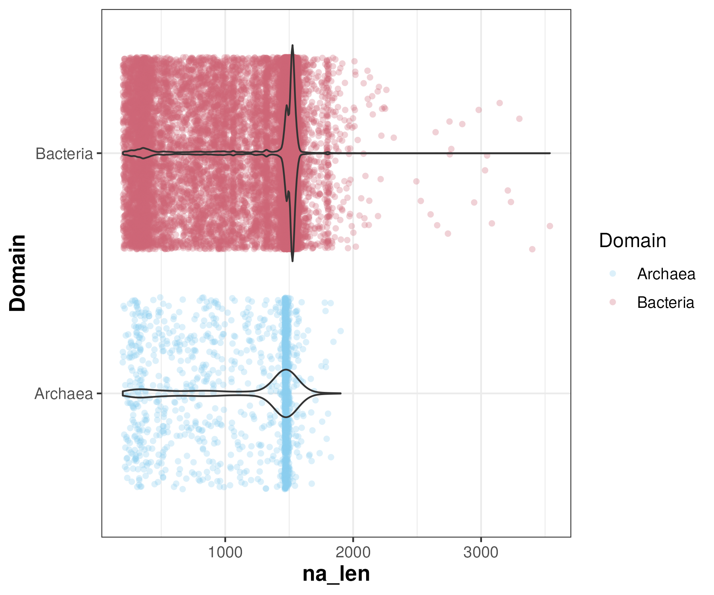
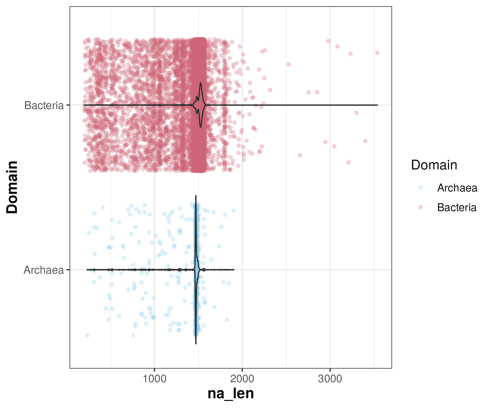

# Set environments

## Self-defined functions

```{sh}
source scripts/bash/functions.sh
```

## R containers

### Build

- `cpnet`: The primary R image used for most of the analysis.
- `r_html`: For rendering AntiCo-Net.qmd (html).
- `cytoscape_r`: To make cytoscape-desktop image.

```{sh}
docker image build -t $User/cpnet -f Dockerfiles/Dockerfile.cpnet .
docker image build -t $User/r_html -f Dockerfiles/Dockerfile.r_html .
docker image build -t $User/cytoscape_r -f Dockerfiles/Dockerfile.cytoscape_r .
```

### Run RStudio Server

- Run following command and access to http://localhost:8787

```{sh}
docker container run -p 8787:8787 -v ${PWD}:/home/rstudio -e PASSWORD=$Pass $User/cpnet
docker container run -p 8787:8787 -v ${PWD}:/home/rstudio -e PASSWORD=$Pass $User/r_html
```

### Launch Cytoscape with RStudio(+RCy3) in Docker

- For making Cytoscape/NDEx networks.
- https://hub.docker.com/r/cytoscape/cytoscape-desktop

```{sh}
docker run -p 6080:6080 -p 8787:8787 -v ${PWD}:/home/rstudio $User/cytoscape_r
```

- Open the URL below with your web browser:
  - [http://localhost:6080/vnc.html⁠](http://localhost:6080/vnc.html⁠)
    - Click the "Connect" button
  - [http://localhost:8787/⁠](http://localhost:8787/⁠)
    - username: rstudio, password: cytoscape

## Bioinfomatics softwares

### In the SuperComputer System (Institute for Chemical Research, Kyoto University)

```sh
module load seqkit/0.16.1 R/4.1.2 CheckM/1.1.3 mmseqs2/13-45111.mpi sqlite3/3.30.1 diamond/2.0.11 hmmer/3.3.2 blast+/2.12.0 sqlite3/3.30.1 pastml/1.9.34 mafft/7.487 trimal/1.4.1 hmmer/3.3.2
```

### AlphaFold2 (Miniconda + Mamba)

- To make plddt results from AlphaFold2 outputs.

```sh
mamba create -n AF
mamba activate AF
mamba install -c conda-forge numpy scipy
```

### Graph Splitting (GS)

- https://github.com/MotomuMatsui/gs

```sh
cd $HOME/tools
mamba env create -n py39_gs -f py39_gs.yml
mamba activate py39_gs
git clone https://github.com/MotomuMatsui/gs
cd gs
make
```

### trimAl

```sh
mamba create -n trimal
mamba activate trimal
mamba install -c bioconda trimal # v1.4.rev15 build[2013-12-17]
```

### vsearch

```sh
cd $HOME/tools
wget https://github.com/torognes/vsearch/releases/download/v2.23.0/vsearch-2.23.0-linux-x86_64.tar.gz
tar xzf vsearch-2.23.0-linux-x86_64.tar.gz
$HOME/tools/vsearch-2.23.0-linux-x86_64/bin/vsearch -v
```
```
vsearch v2.23.0_linux_x86_64, 2003.9GB RAM, 128 cores
```

### Containers (singularity)

```sh
singularity pull docker://interpro/interproscan:5.63-95.0
singularity pull docker://soedinglab/mmseqs2 # version ad5837b3444728411e6c90f8c6ba9370f665c443
singularity pull docker://staphb/iqtree2 # version 2.2.2.6
singularity pull docker://staphb/mafft # version v7.505 (2022/Apr/10)
singularity pull docker://staphb/fasttree # version 2.1.11
singularity pull docker://ncbi/blast:2.15.0
```

## Databases

- GTDB (Release 06-RS202)
  - https://gtdb.ecogenomic.org/
- COG2020
  - https://www.ncbi.nlm.nih.gov/research/cog/
- KEGG FTP (Release 20211006)
  - https://www.genome.jp/kegg/
- ProkAtlas
  - https://msk33.github.io/prokatlas.html

```sh
ln -s $DB_DIR/gtdb_release202/202.0/ db/gtdb_release202
ln -s $DB_DIR/cog2020/ db/cog2020
ln -s $DB_DIR/kegg_v20211006/ db/kegg
ln -s $DB_DIR/ProkAtlas db/prokatlas
```

# Retrieval of genomes and proteins from GTDB (Release 06-RS202)

## Download genomes, nucleotides, peptides sequences

According to `ar122_metadata_r202.tar.gz` and `bac120_metadata_r202.tar.gz`,

- GTDB total genomes
    - Archaea: 4,316
    - Bacteria: 254,090
- GTDB representative genomes
    - Archaea: 2,339
    - Bacteria: 45,555

```sh
mkdir -p raw/gtdb/
ln -s $DB_DIR/gtdb_release202/202.0/ db/gtdb_release202

tar -zxvf db/gtdb_release202/ar122_metadata_r202.tar.gz -C raw/gtdb/
tar -zxvf db/gtdb_release202/bac120_metadata_r202.tar.gz -C raw/gtdb/

# Extract genomes, proteins and gene sequences from GTDB (resources_used.vmem=357380kb;resources_used.walltime=00:38:52)
qsub -q $que_large -m abe -M $Email -l select=1:ncpus=40:mem=360gb -e qsub_out/gtdb_thaw_e -o qsub_out/gtdb_thaw_o scripts/qsub/gtdb_thaw.sh
{
tar -zxvf db/gtdb_release202/genomic_files_reps/gtdb_proteins_aa_reps_r202.tar.gz -C raw/gtdb/
tar -zxvf db/gtdb_release202/genomic_files_reps/gtdb_proteins_nt_reps_r202.tar.gz -C raw/gtdb/
tar -zxvf db/gtdb_release202/genomic_files_reps/gtdb_genomes_reps_r202.tar.gz -C raw/gtdb/
}

qsub -q $que_small -m abe -M $Email -l select=1:ncpus=1:mem=108gb -e qsub_out/gtdb_thaw_2_e -o qsub_out/gtdb_thaw_2_o scripts/qsub/gtdb_thaw_2.sh
{
cp db/gtdb_release202/genomic_files_reps/ar122_ssu_reps_r202.tar.gz raw/gtdb/
cp db/gtdb_release202/genomic_files_reps/bac120_ssu_reps_r202.tar.gz raw/gtdb/
tar -zxvf raw/gtdb/ar122_ssu_reps_r202.tar.gz -C raw/gtdb/
tar -zxvf raw/gtdb/bac120_ssu_reps_r202.tar.gz -C raw/gtdb/
}
```

```{r}
# Load self-defined functions
source("scripts/r/functions.R")
# GTDB metadata
gtdb_metadata <- load_gtdb_meta()
df_bac_tax <- gtdb_metadata[[1]]
df_ar_tax <- gtdb_metadata[[2]]
n_bac <- dim(df_bac_tax)[1]
n_ar <- dim(df_ar_tax)[1]
## GTDB representative
n_bac_rep <- df_bac_tax %>% filter(gtdb_representative == "t") %>% nrow()
n_ar_rep <- df_ar_tax %>% filter(gtdb_representative == "t") %>% nrow()
tibble(Domain = c("Archaea","Bacteria"), n_genomes_total = c(n_ar,n_bac), n_genomes_rep = c(n_ar_rep,n_bac_rep)) %>% knitr::kable()
```

|Domain   | n_genomes_total| n_genomes_rep|
|:--------|---------------:|-------------:|
|Archaea  |            4316|          2339|
|Bacteria |          254090|         45555|

## Parse GTDB tree

Slightly change original GTDB tree file to normal newick format. This python script needs only `pandas`.

Following trees were generated. For the format code, refer to [The ETE tutorial](http://etetoolkit.org/docs/latest/tutorial/tutorial_trees.html).

- raw/gtdb/bac120_r202_ete3fmt1.tree
- raw/gtdb/bac120_r202_ete3fmt5.tree
- raw/gtdb/ar122_r202_ete3fmt1.tree
- raw/gtdb/ar122_r202_ete3fmt5.tree

```sh
python scripts/python/gtdb_tree_parse.py
```

## Retrieve representative high-quality CPR genomes

According to `data/gtdb/cpr_metadata.tsv`,

- CPR genomes: 1,601

```sh
mkdir -p data/gtdb/cpr_genomes_reps

# Performed in RStudio server
Rscript --vanilla --slave scripts/r/retrieve_cpr_rep_genomes.R

# Copy CPR protein files into one directory (resources_used.vmem=0kb;resources_used.walltime=00:00:05)
qsub -q $que_small -m abe -M $Email -l select=1:ncpus=8:mem=10gb -e qsub_out/cpr_protein_copy_e -o qsub_out/cpr_protein_copy_o scripts/qsub/cpr_protein_copy.sh
{
cat data/gtdb/cpr_metadata.tsv | gtdbacc2path | xargs -I {} -P 8 -n 1 sh -c "cp raw/gtdb/gtdb_genomes_reps_r202/{}*_genomic.fna.gz data/gtdb/cpr_genomes_reps/"
}
```

```{r}
# Load self-defined functions
source("scripts/r/functions.R")
# GTDB metadata
gtdb_metadata <- load_gtdb_meta()
df_bac_tax <- gtdb_metadata[[1]]
# Retrieve CPR representative genomes
df_cpr <- cpr_rep_genomes(df_bac_tax)
dim(df_cpr)[1]
#[1] 1601
```

Download marker sets of CPR Pfam hmm files (https://github.com/Ecogenomics/CheckM/tree/master/custom_marker_sets/)

```sh
cp ../../tools/CheckM/custom_marker_sets/cpr_43_markers.hmm raw/gtdb/
cp ../../tools/CheckM/custom_marker_sets/cpr_43_markers.xlxs raw/gtdb/
```

Perform CheckM

```sh
mkdir -p data/gtdb/cpr_checkm

# Thaw gzip genomes (resources_used.vmem=0kb;resources_used.walltime=00:00:04)
qsub -q $que_small -m abe -M $Email -l select=1:ncpus=8:mem=10gb -e qsub_out/cpr_gzip_decompose_e -o qsub_out/cpr_gzip_decompose_o scripts/qsub/cpr_gzip_decompose.sh
{
find data/gtdb/cpr_genomes_reps/ -name "*.fna.gz" | xargs -I {} -P 8 -n 1 sh -c "gzip -d {}"
}

# Perform CheckM (resources_used.vmem=16491020kb;resources_used.walltime=00:14:50)
qsub -q $que_small -m abe -M $Email -l select=1:ncpus=12:mem=108gb -e qsub_out/cpr_checkm_e -o qsub_out/cpr_checkm_o scripts/qsub/cpr_checkm.sh
{
checkm analyze -x fna -t 12 raw/gtdb/cpr_43_markers.hmm data/gtdb/cpr_genomes_reps data/gtdb/cpr_checkm
}

## Generate tsv (resources_used.vmem=837812kb;resources_used.walltime=00:01:54)
qsub -q $que_small -m abe -M $Email -l select=1:ncpus=1:mem=50gb -e qsub_out/cpr_checkm_tsv_e -o qsub_out/cpr_checkm_tsv_o scripts/qsub/cpr_checkm_tsv.sh
{
checkm qa --tab_table raw/gtdb/cpr_43_markers.hmm data/gtdb/cpr_checkm > data/gtdb/checkm_result_cpr.tsv
}

# Gzip genomes agein
find data/gtdb/cpr_genomes_reps/ -name "*.fna" | xargs -I {} -P 8 -n 1 sh -c "gzip {}"
```

Retrieve representative high-quality CPR genomes

```sh
# Slight modification for processing in R
cat data/gtdb/checkm_result_cpr.tsv | sed '1,6d; $d' | sed '1s/# //g; 1s/Bin Id/accession/; 1s/Completeness/cpr_completeness/; 1s/Contamination/cpr_contamination/; 2,$s/_genomic//; 2,$s/^GCA/GB_GCA/; 2,$s/^GCF/RS_GCF/' > data/gtdb/cpr_completeness_contamination.tsv
```

## Finalize the genomic data set for analysis

```{r}
# Load self-defined functions
source("scripts/r/functions.R")
# GTDB metadata
gtdb_metadata <- load_gtdb_meta()
df_bac_tax <- gtdb_metadata[[1]]
df_ar_tax <- gtdb_metadata[[2]]
# Analyzed HQ genomes
hq_genomes <- rep_hq_genomes(df_bac_tax, df_ar_tax)
df_bac_hq <- hq_genomes[[1]]
df_ar_hq <- hq_genomes[[2]]
## Retrieve CPR representative genomes
df_cpr <- cpr_rep_genomes(df_bac_tax)
## Load CheckM result using CPR marker set
df_cpr_cm <- cpr_checkm()
## Retrieve CPR representative high-quality (based on CPR marker set) genomes
df_cpr_hq <- cpr_hq_rep_genomes(df_cpr_cm)
## Merge CPR representative high-quality (based on CPR marker set) genomes and others
hq_merged_genomes <- hq_genomes_merged(df_bac_hq, df_ar_hq, df_cpr_hq)
df_bac_hq_merged <- hq_merged_genomes[[1]]
df_ar_hq_merged <- hq_merged_genomes[[2]]

n_bac_hq <- df_bac_hq %>% filter(Phylum != "p__Patescibacteria") %>% dim()
n_cpr_hq <- dim(df_cpr_hq)[1]
n_ar_analyzed <- dim(df_ar_hq_merged)[1]
n_bac_analyzed <- dim(df_bac_hq_merged)[1]
tibble(n_bac_hq_genomes = n_bac_hq[1], n_cpr_hq_genomes = n_cpr_hq, n_ar_analyzed_genomes = n_ar_analyzed, n_bac_analyzed_genomes = n_bac_analyzed, n_total_analyzed_genomes = n_bac_analyzed + n_ar_analyzed) %>% knitr::kable()
```

| n_bac_hq_genomes| n_cpr_hq_genomes| n_ar_analyzed_genomes| n_bac_analyzed_genomes| n_total_analyzed_genomes|
|----------------:|----------------:|---------------------:|----------------------:|------------------------:|
|            25877|              964|                   901|                  26841|                    27742|

High-quality representative genomes (CPRs were estimated by custom marker set)

- Completeness >= 95%
- Contamination <= 5%

According to `data/genomes_analyzed_bac.tsv` and `data/genomes_analyzed_ar.tsv`,

- Analyzed HQ genomes (excluding CPR): 27,742
    - Bacteria: 26,841
        - Bacteria (excluding CPR): 25,877
        - CPR: 964
    - Archaea: 901

(increased from previous analysis: 27,187 genomes)

```sh
mkdir -p data/tsv

# Performed in RStudio server
Rscript --vanilla --slave scripts/r/genomes_analyzed.R
```

## Copy genomes of the analyzed data set

```sh
mkdir -p data/genomes

# Genomes (resources_used.vmem=1798424kb;resources_used.walltime=00:01:59)
qsub -q $que_small -m abe -M $Email -l select=1:ncpus=8:mem=10gb -e qsub_out/cp_analyzed_genomes_e -o qsub_out/cp_analyzed_genomes_o scripts/qsub/cp_analyzed_genomes.sh
{
cat data/tsv/genomes_analyzed_bac.tsv data/tsv/genomes_analyzed_ar.tsv | cut -f 1 | sed '/accession/d' | gtdbacc2path | xargs -I {} -P 8 -n 1 sh -c "cp raw/gtdb/gtdb_genomes_reps_r202/{}*_genomic.fna.gz data/genomes"
}
```

## Copy protein and make tsv

Make tsv with genomic accession, prodigal info and sequences (resources_used.vmem=2793844kb;resources_used.walltime=00:52:28)

```sh
qsub -q $que_small -m abe -M $Email -l select=1:ncpus=1:mem=108gb -e qsub_out/protein2tsv_e -o qsub_out/protein2tsv_o scripts/qsub/protein2tsv.sh
{
(cat data/tsv/genomes_analyzed_bac.tsv | cut -f 1 | tail -n +2 | proteins2tsv_bac; cat data/tsv/genomes_analyzed_ar.tsv | cut -f 1 | tail -n +2 | proteins2tsv_ar) | protein_names2tsv | sed '1s/^/accession\tprodigal_acc\tprodigal_start\tprodigal_end\tprodigal_strand\t\tprodigal_ID\tprodigal_partial\tprodigal_start_type\tprodigal_rbs_motif\tprodigal_rbs_spacer\tprodigal_gc_cont\tprotein_seq\n/' > data/tsv/proteins_raw.tsv
}
```

Generate FASTA file (resources_used.vmem=1278176kb;resources_used.walltime=00:05:16)

```sh
mkdir -p data/seqs

qsub -q $que_small -m abe -M $Email -l select=1:ncpus=1:mem=108gb -e qsub_out/proteins_raw_tsv2fasta_e -o qsub_out/proteins_raw_tsv2fasta_o scripts/qsub/proteins_raw_tsv2fasta.sh
{
cat data/tsv/proteins_raw.tsv | tail -n +2 | cut -f 2,13 | seqkit tab2fx > data/seqs/proteins_raw.faa
}
```

According to `data/tsv/proteins_raw.tsv` and `data/seqs/proteins_raw.faa`,

 - The number of raw protein (gene) sequences:  105,323,091

```sh
cat data/tsv/proteins_raw.tsv | tail -n +2 | wc -l
105323091
cat data/seqs/proteins_raw.faa | grep '^>' | wc -l
105323091
```

# Sequence similarity search against orthologous databases

## Split raw protein FASTA into 250 chunks

- ~421K sequences/chunk

```sh
mkdir -p data/seqs_split

# resources_used.vmem=735088kb;resources_used.walltime=00:09:35
qsub -q $que_small -m abe -M $Email -l select=1:ncpus=1:mem=1gb -e qsub_out/split_fasta_e -o qsub_out/split_fasta_o scripts/qsub/split_fasta.sh
{
perl scripts/perl/split_fasta.pl 421293 data/seqs/proteins_raw.faa data/seqs_split 3
}
```

Check sequence number (resources_used.vmem=1062192kb;resources_used.walltime=00:16:07)

```sh
qsub -q $que_small -m abe -M $Email -l select=1:ncpus=1:mem=50gb -e qsub_out/check_split_fasta_e -o qsub_out/check_split_fasta_o scripts/qsub/check_split_fasta.sh
{
seqkit stats data/seqs/proteins_raw.faa
cat data/seqs_split/* | seqkit stats
}

cat qsub_out/check_split_fasta_o
```
```
file                        format  type        num_seqs         sum_len  min_len  avg_len  max_len
data/seqs/proteins_raw.faa  FASTA   Protein  105,323,091  33,820,703,569       20    321.1   58,166

file  format  type        num_seqs         sum_len  min_len  avg_len  max_len
-     FASTA   Protein  105,323,091  33,820,703,569       20    321.1   58,166
```

## Databases

### COG2020

- According to [COG2020 paper](https://doi.org/10.1093/nar/gkaa1018)
  - Proteins
    - All:  4,401,819
    - Assigned to COGs:  3,236,575 (**73.5%**)
  - COGs:  4,877
- According to `db/cog2020/cog-20.fa`, and `db/cog2020/cog-20.cog.csv`, 
  - Proteins
    - Assigned to COGs:  3,213,025
  - COGs:  4,877

```sh
cat db/cog2020/cog-20.fa | grep '^>' | wc -l
3213025
```

First of all, 14 of total hits in `db/cog2020/cog-20.cog.csv` have wrong number of columns!

```sh
cat db/cog2020/cog-20.cog.csv | awk -F ',' '{print NF}' | sort | uniq -c
3455839 13
     14 14

cat db/cog2020/cog-20.cog.csv | awk -F ',' -v OFS="\t" '{print $1,NF}' | awk -F "\t" -v OFS="\t" '$2 == 14 {print}' | tee db/cog2020_fixed/cog-20.wrong_columns.geneid_ncol.tsv
TPPAVE_182      14
C9I84_004       14
UX70_C0001G0274 14
UR17_C0001G0563 14
XF24_00358      14
C9I84_130       14
CAE21543.1      14
HCDSEM_186      14
phytr_4830      14
ZICARI_225      14
RAAC1_SR1_1_167 14
UR17_C0001G0557 14
C9I84_040       14
WP_010880176.1  14
```

Some sequence names wrongly use '_' instead of '.', according to comparison between `db/cog2020/cog-20.cog.csv` and `db/cog2020/cog-20.fa`.

Fix this by add sequence name column to `db/cog2020/cog-20.cog.csv`, as well as the above probrem with using perl script.

```sh
mkdir -p db/cog2020_fixed/

# Make table for wrong names (resources_used.vmem=3034920kb;resources_used.walltime=00:02:12)
qsub -q $que_small -m abe -M $Email -l select=1:ncpus=1:mem=10gb -e qsub_out/cog_20_wrong_names_e -o qsub_out/cog_20_wrong_names_o scripts/qsub/cog_20_wrong_names.sh
{
bash scripts/bash/cog_20_wrong_names.sh
{
cat <(cat db/cog2020/cog-20.fa | grep '^>' | sed 's/^>//;s/ .*//' | sort | uniq) <(cat db/cog2020/cog-20.cog.csv | cut -d "," -f 3 | sort | uniq) | sort | uniq -d | cat - <(cat db/cog2020/cog-20.cog.csv | cut -d "," -f 3 | sort | uniq) | sort | uniq -u | awk -F "\t" -v OFS="\t" '{print $1,$1}' | sed 's/\./_/' > db/cog2020_fixed/cog-20.wrong_names.seq_csv.tsv
}
}

# Make db/cog2020/cog-20.cog.csv to tsv, adding sequence name column (resources_used.vmem=926040kb;resources_used.walltime=00:00:20)
qsub -q $que_small -m abe -M $Email -l select=1:ncpus=1:mem=10gb -e qsub_out/cog_20_csv2tsv_e -o qsub_out/cog_20_csv2tsv_o scripts/qsub/cog_20_csv2tsv.sh
{
perl scripts/perl/cog_20_csv2tsv.pl db/cog2020_fixed/cog-20.wrong_names.seq_csv.tsv db/cog2020/cog-20.cog.csv db/cog2020_fixed/cog-20.wrong_columns.geneid_ncol.tsv > db/cog2020_fixed/cog-20.cog.tsv
}
```

Finally, cleared.

```sh
table_columns db/cog2020_fixed/cog-20.cog.tsv
1 gene_id
2 ncbi_assembly_id
3 protein_id
4 protein_length
5 cog_footprint_on_protein
6 cog_footprint_length
7 cog_id
8 reserved
9 cog_membership
10 bitscore
11 e_val
12 cog_profile_length
13 protein_footprint_on_cog
14 seq_name

cat db/cog2020/cog-20.fa | grep '^>' | sed 's/^>//;s/ .*//' | sort | uniq | wc -l
3213025
cat db/cog2020/cog-20.cog.csv | cut -d "," -f 3 | sort | uniq | wc -l
3213025
cat db/cog2020_fixed/cog-20.cog.tsv | tail -n +2 | cut -f 3 | sort | uniq | wc -l
3213025
cat db/cog2020_fixed/cog-20.cog.tsv | tail -n +2 | cut -f 14 | sort | uniq | wc -l
3213025

cat <(cat db/cog2020/cog-20.fa | grep '^>' | sed 's/^>//;s/ .*//' | sort | uniq) <(cat db/cog2020_fixed/cog-20.cog.tsv | tail -n +2 | cut -f 14 | sort | uniq) | sort | uniq -u | wc -l
0
```

Make tsv of seq_name & cog_id

- `db/cog2020_fixed/cog-20.seqname_cogid.tsv`

```sh
# resources_used.vmem=5562008kb;resources_used.walltime=00:29:38
qsub -q $que_small -m abe -M $Email -l select=1:ncpus=1:mem=10gb -e qsub_out/cog2020_seqname_cogid_e -o qsub_out/cog2020_seqname_cogid_o scripts/qsub/cog2020_seqname_cogid.sh
{
Rscript --vanilla --slave scripts/r/cog2020_seqname_cogid.R
}
```

Also, `cog-20.def.tab` have characters with unknown code (maybe Shift_JIS), and disturbs some analysis.

```sh
grep -w COG1074 db/cog2020/cog-20.def.tab
COG1074 L       3�-5� helicase subunit RecB of the DNA repair enzyme RecBCD (exonuclease V)     RecB            29901759;30601118       3U44

less -S db/cog2020/cog-20.def.tab
COG1074 L       3<92>-5<92> helicase subunit RecB of the DNA repair enzyme RecBCD (exonuclease V)       RecB            29901759;30601118       3U44
```

To avoid this, convert the file character code into UTF-8 in a forced manner

```sh
nkf -w db/cog2020/cog-20.def.tab > db/cog2020_fixed/cog-20.def.utf8.tsv
```

However, this process has not solved the probrem (see COG2315).

```sh
diff db/cog2020/cog-20.def.tab db/cog2020_fixed/cog-20.def.utf8.tsv
502c502
< COG0507       L       ATPase/5�-3� helicase helicase subunit RecD of the DNA repair enzyme RecBCD (exonuclease V)     RecD            29901759;30601118       1W36
---
> COG0507       L       ATPase/53helicase helicase subunit RecD of the DNA repair enzyme RecBCD (exonuclease V) RecD            29901759;30601118       1W36
921c921
< COG1074       L       3�-5� helicase subunit RecB of the DNA repair enzyme RecBCD (exonuclease V)     RecB            29901759;30601118       3U44
---
> COG1074       L       35helicase subunit RecB of the DNA repair enzyme RecBCD (exonuclease V) RecB            29901759;30601118       3U44
2118c2118
< COG2315       K       Predicted DNA-binding protein with �double-wing� structural motif, MmcQ/YjbR family     MmcQ            17266124        2A1V
---
> COG2315       K       Predicted DNA-binding protein with 租ouble-wingstructural motif, MmcQ/YjbR family       MmcQ            17266124        2A1V
```

Finally, I solved the problem by the following command.

```sh
nkf -w db/cog2020/cog-20.def.tab | \
  sed 's/53helicase/5-3 helicase/; s/35helicase/3-5 helicase/; s/租ouble-wingstructural/double-wing structural/' > \
  db/cog2020_fixed/cog-20.def.utf8.tsv
```

For some already processed files, I solved the problem by the following command, instead.

```sh
nkf -w --overwrite file
```

### KEGG

#### Statistics of KEGG GENES

Release information

```sh
cat db/kegg/RELEASE
```
```
KEGG FTP Release 2021-10-04

 Category and database   Subdirectory  Number of entries
------------------------------------------------------------
 Systems information
   KEGG PATHWAY          pathway       545 (823,063)
   KEGG BRITE            brite         185 (290,221)
   KEGG MODULE           module        526
 Genomic information
   KEGG ORTHOLOGY (KO)   genes         24,666
   KEGG GENES            genes         37,714,545
   KEGG GENOME           genes         7,856
 Chemical information
   KEGG COMPOUND         ligand        18,844
   KEGG GLYCAN           ligand        11,039
   KEGG REACTION         ligand        11,605
   KEGG RCLASS           ligand        3,175
   KEGG ENZYME           ligand        7,890
 Health information
   KEGG NETWORK          medicus       1,541
   KEGG VARIANT          medicus       455
   KEGG DISEASE          medicus       2,507
   KEGG DRUG             medicus       11,736
   KEGG DGROUP           medicus       2,382
------------------------------------------------------------
 - Numbers in parentheses include computationally generated
   organism-specific entries.


(c) Kanehisa Laboratories
```

Stats from raw files in KEGG DB

- Stats
  - Genes
    - All: 37,714,545
    - Genes in all prokaryotes (redundant): 23,596,021
    - The nunber of genes (all) which were assigned to any KO: 19,070,415
    - The nunber of genes in `prokaryotes.pep` which were assigned to any KO: 12,644,223 (~53.6%)
  - KO
    - The number of KO: 24,687
      - (I don't know why this number is lager than 24,666)
    - The number of KO in `prokaryotes.pep`: 11,791
- Raw files:
  - `db/kegg/genes/fasta/prokaryotes.pep`
  - `db/kegg/genes/fasta/prokaryotes.dat.gz`
  - `db/kegg/genes/ko/ko_genes.list`
  - `db/kegg/genes/links/genes_ko.list.gz`

```sh
# resources_used.vmem=681664kb;resources_used.walltime=00:10:07
qsub -q $que_small -m abe -M $Email -l select=1:ncpus=1:mem=10gb -e qsub_out/check_koid_geneid_e -o qsub_out/check_koid_geneid_o scripts/qsub/check_koid_geneid.sh
{
grep '^>' db/kegg/genes/fasta/prokaryotes.pep | wc -l
zcat db/kegg/genes/fasta/prokaryotes.dat.gz | cut -f 1 | sort | uniq | wc -l
#zcat db/kegg/genes/fasta/prokaryotes.dat.gz | awk -F "\t" -v OFS="\t" '$2 != "" {print $1}' | sort | uniq | wc -l
bash scripts/bash/kegg_genes_prokaryotes_with_ko.sh | wc -l
#zcat db/kegg/genes/fasta/prokaryotes.dat.gz | awk -F "\t" -v OFS="\t" '$2 != "" {print $2}' | sort | uniq | wc -l
bash scripts/bash/kegg_prokaryotes_ko.sh | wc -l
cut -f 2 db/kegg/genes/ko/ko_genes.list | sort | uniq | wc -l
cut -f 1 db/kegg/genes/ko/ko_genes.list | sort | uniq | wc -l
zcat db/kegg/genes/links/genes_ko.list.gz | cut -f 1 | sort | uniq | wc -l
zcat db/kegg/genes/links/genes_ko.list.gz | cut -f 2 | sort | uniq | wc -l
}

cat qsub_out/check_koid_geneid_o
23596021
23596021
12644223
11791
19070415
24687
19070415
24687
```

#### Retrieve only proteins with KO assignment from prokaryotes

```sh
mkdir -p db/kegg_fixed

# resources_used.vmem=2701612kb;resources_used.walltime=00:06:04
qsub -q $que_small -m abe -M $Email -l select=1:ncpus=1:mem=10gb -e qsub_out/retrieve_prokaryotes_pep_with_ko_e -o qsub_out/retrieve_prokaryotes_pep_with_ko_o scripts/qsub/retrieve_prokaryotes_pep_with_ko.sh
{
bash scripts/bash/retrieve_prokaryotes_pep_with_ko.sh
{
seqkit fx2tab db/kegg/genes/fasta/prokaryotes.pep | \
  perl -ne 's/ .+?\t/\t/;print' | \
  sort -k 1,1 | \
  join -t "$(printf '\011')" -1 1 -2 1 -a 1 <(bash scripts/bash/kegg_genes_prokaryotes_with_ko.sh) - | \
  seqkit tab2fx \
  > db/kegg_fixed/prokaryotes.pep.with_ko.faa
}
}
```

Check the retrieved fasta file

```sh
# resources_used.vmem=948820kb;resources_used.walltime=00:00:22
qsub -q $que_small -m abe -M $Email -l select=1:ncpus=1:mem=108gb -e qsub_out/check_prokaryotes_pep_with_ko_e -o qsub_out/check_prokaryotes_pep_with_ko_o scripts/qsub/check_prokaryotes_pep_with_ko.sh
{
seqkit stats db/kegg/genes/fasta/prokaryotes.pep
seqkit stats db/kegg_fixed/prokaryotes.pep.with_ko.faa
}

cat qsub_out/check_prokaryotes_pep_with_ko_o
file                                 format  type       num_seqs        sum_len  min_len  avg_len  max_len
db/kegg/genes/fasta/prokaryotes.pep  FASTA   Protein  23,596,021  7,503,786,772        2      318   39,677
file                                       format  type       num_seqs        sum_len  min_len  avg_len  max_len
db/kegg_fixed/prokaryotes.pep.with_ko.faa  FASTA   Protein  12,644,223  4,507,778,687       14    356.5   17,019
```

#### Make tsv of gene_id & ko_id

- `db/kegg_fixed/kegg_geneid_koid.tsv`

```sh
mkdir -p db/kegg_fixed

# resources_used.vmem=13870000kb;resources_used.walltime=00:53:49
qsub -q $que_small -m abe -M $Email -l select=1:ncpus=1:mem=108gb -e qsub_out/kegg_geneid_koid_e -o qsub_out/kegg_geneid_koid_o scripts/qsub/kegg_geneid_koid.sh
{
Rscript --vanilla --slave scripts/r/kegg_geneid_koid.R
}
```

#### Generate KO definition tsv

- By using (partially parsing) following files, KO definition tsv was generated
  - `db/kegg/genes/ko/ko`: `ko_id`, `ko_symbol`, and `ko_name`
  - `db/kegg/genes/ko/ko_brite.list`: `ko_br`
  - `db/kegg/genes/ko/ko_cog.list`: `ko_cog`
  - `db/kegg/genes/ko/ko_enzyme.list`: `ko_ec`
  - `db/kegg/genes/ko/ko_pathway.list`: `ko_path`
  - `db/kegg/genes/ko/ko_reaction.list`: `ko_rn`

```sh
# Make tsv of ko_id, symbol, name
## resources_used.vmem=4444168kb;resources_used.walltime=00:00:12
qsub -q $que_small -m abe -M $Email -l select=1:ncpus=1:mem=108gb -e qsub_out/generate_koid_kosymbol_koname_tsv_e -o qsub_out/generate_koid_kosymbol_koname_tsv_o scripts/qsub/generate_koid_kosymbol_koname_tsv.sh
{
bash scripts/bash/generate_koid_kosymbol_koname_tsv.sh
{
cat db/kegg/genes/ko/ko | \
  perl scripts/perl/parse_ko.pl | \
  sort -k 1,1 \
  > db/kegg_fixed/kegg_koid_kosymbol_koname.tsv
}
}

# Generate KO definition tsv
## resources_used.vmem=1426044kb;resources_used.walltime=00:00:15
qsub -q $que_small -m abe -M $Email -l select=1:ncpus=1:mem=108gb -e qsub_out/generate_ko_def_tsv_e -o qsub_out/generate_ko_def_tsv_o scripts/qsub/generate_ko_def_tsv.sh
{
Rscript --vanilla --slave scripts/r/generate_ko_def_tsv.R db/kegg_fixed/kegg_ko_def.tsv
}
```

#### Generate other KEGG function tables

```sh
perl scripts/perl/transform_kegg_pathway_list.pl db/kegg/pathway/pathway.list > db/kegg_fixed/pathway_mod.list
```


## MakeDB for DIAMOND

### COG2020

```sh
mkdir -p db/diamond_cog2020
ln -s ../cog2020/cog-20.fa db/diamond_cog2020/

# resources_used.vmem=2414760kb;resources_used.walltime=00:00:12
qsub -q $que_small -m abe -M $Email -l select=1:ncpus=12:mem=50gb -e qsub_out/diamond_makedb_cog2020_e -o qsub_out/diamond_makedb_cog2020_o scripts/qsub/diamond_makedb_cog2020.sh
{
diamond makedb --in db/diamond_cog2020/cog-20.fa -d db/diamond_cog2020/cog-20 -p 12
}
```

### KEGG

```sh
mkdir -p db/diamond_kegg
ln -s ../kegg_fixed/prokaryotes.pep.with_ko.faa db/diamond_kegg/

# resources_used.vmem=2931724kb;resources_used.walltime=00:00:48
qsub -q $que_small -m abe -M $Email -l select=1:ncpus=12:mem=50gb -e qsub_out/diamond_makedb_kegg_e -o qsub_out/diamond_makedb_kegg_o scripts/qsub/diamond_makedb_kegg.sh
{
diamond makedb --in db/diamond_kegg/prokaryotes.pep.with_ko.faa -d db/diamond_kegg/prokaryotes.pep.with_ko -p 12
}
```

## Search by DIAMOND

### COG2020

- Use 36 cores (360 GB)
- Options
    - sensitivity: `default`
    - use 1 thread: `-p 1`
- Took ~10.5 hours; 342 GB memory

```sh
mkdir -p {data,qsub_out}/diamond_blast_cog2020

# resources_used.vmem=341943128kb;resources_used.walltime=10:20:39
qsub -q $que_large -m abe -M $Email -l select=1:ncpus=36:mem=360gb -e qsub_out/diamond_blast_cog2020_e -o qsub_out/diamond_blast_cog2020_o scripts/qsub/diamond_blast_cog2020.sh
{
seq -w 0 249 | xargs -I {} -P 36 -n 1 sh -c "diamond blastp -q data/seqs_split/proteins_raw.faa.{} -d db/diamond_cog2020/cog-20.dmnd -o data/diamond_blast_cog2020/proteins_raw.tsv.{} -p 1 -f 6 qseqid sseqid pident length mismatch gapopen qstart qend sstart send evalue bitscore qlen qcovhsp slen scovhsp 2>qsub_out/diamond_blast_cog2020/{}.err"
}
```

### KEGG

- Use 35 cores (360 GB)
- Options
    - sensitivity: `default`
    - use 1 thread: `-p 1`
- Took ~48 hours; 340 GB memory

```sh
mkdir -p {data,qsub_out}/diamond_blast_kegg

# resources_used.vmem=339783512kb;resources_used.walltime=47:42:40
qsub -q $que_large -m abe -M $Email -l select=1:ncpus=35:mem=360gb -e qsub_out/diamond_blast_kegg_e -o qsub_out/diamond_blast_kegg_o scripts/qsub/diamond_blast_kegg.sh
{
seq -w 0 249 | xargs -I {} -P 35 -n 1 sh -c "diamond blastp -q data/seqs_split/proteins_raw.faa.{} -d db/diamond_kegg/prokaryotes.pep.with_ko.dmnd -o data/diamond_blast_kegg/proteins_raw.tsv.{} -p 1 -f 6 qseqid sseqid pident length mismatch gapopen qstart qend sstart send evalue bitscore qlen qcovhsp slen scovhsp 2>qsub_out/diamond_blast_kegg/{}.err"
}
```

## Parse KEGG Brite

```sh
cat db/kegg/brite/ko/ko00001.keg | sed '/^#/d;/^\!/d;/^\+D/d;/^B *$/d' | sed 's/^A/A\t/;s/^B */B\t/;s/^C */C\t/;s/^D */D\t/' > db/kegg_fixed/kegg_brite_ko.tsv
perl scripts/perl/make_tsv_brite.pl db/kegg_fixed/kegg_brite_ko.tsv > db/kegg_fixed/ko_brite_text.tsv
```

# Filtering, joining metadata, and assignment of OGs

- Filtering method (see `filter_mmseqs` in `script/r/functions.R`, and `scripts/r/search_result_filter.R`)
  - Full-length alignment of OG profile
    - `tcov >= 0.8`
  - High enough bitscore
    - `bits >= 50`
  - Allow horizontal multiple hits (multiple domain)
  - Allow vertical multiple hits (significant multiple hits)
    - `filter(bits >= 0.9 * max_bit)`
      - Where `max_bit` indicates bitscore of top hit in each domain.
- Assignment of OGs
  - Accept all OGs assigned to database proteins which were alligned to the query proteins.

## COG2020

### Filter

- Memory usage and speed per 1/250 chunk
  - resources_used.vmem=7887880kb;resources_used.walltime=01:57:34
- Will take ~14 hours for all chunks by using 36 cores (360 GB)
- Took 17 hours; 252 GB memory

```sh
mkdir -p {data,qsub_out}/diamond_blast_cog2020_filter

# resources_used.vmem=251018148kb;resources_used.walltime=17:05:26
qsub -q $que_large -m abe -M $Email -l select=1:ncpus=36:mem=360gb -e qsub_out/diamond_blast_cog2020_filter_e -o qsub_out/diamond_blast_cog2020_filter_o scripts/qsub/diamond_blast_cog2020_filter.sh
{
seq -w 0 249 | xargs -I {} -P 36 -n 1 sh -c "Rscript --vanilla --slave scripts/r/search_result_filter.R data/diamond_blast_cog2020/proteins_raw.tsv.{} diamond data/diamond_blast_cog2020_filter/ 2>qsub_out/diamond_blast_cog2020_filter/{}.err"
}
```

### Join COG2020

- Memory usage and speed per 1/250 chunk
  - resources_used.vmem=1238688kb;resources_used.walltime=00:00:56
- Will take ~6.5 mins for all chunks by using 40 cores (50 GB)
- Took ~12 mins; 14 GB memory (12 cores)

```sh
mkdir -p {data,qsub_out}/diamond_blast_cog2020_filter_joined

# resources_used.vmem=14036928kb;resources_used.walltime=00:12:03
qsub -q $que_small -m abe -M $Email -l select=1:ncpus=12:mem=108gb -e qsub_out/diamond_blast_cog2020_filter_joined_e -o qsub_out/diamond_blast_cog2020_filter_joined_o scripts/qsub/diamond_blast_cog2020_filter_joined.sh
{
seq -w 0 249 | xargs -I {} -P 12 -n 1 sh -c "bash scripts/bash/join_filtered_cog2020.sh db/cog2020_fixed/cog-20.seqname_cogid.tsv data/diamond_blast_cog2020_filter/proteins_raw.filtered.tsv.{} cog > data/diamond_blast_cog2020_filter_joined/proteins_raw.filtered.cog2020.tsv.{} 2>qsub_out/diamond_blast_cog2020_filter_joined/{}.err"
}
```

### Assign COGs

- Memory usage and speed per 1/250 chunk
  - resources_used.vmem=4020908kb;resources_used.walltime=00:11:13
- Will take ~1.5 hours for all chunks by using 40 cores (200 GB)
- Took 3.5 hours; 38 GB memory (12 cores)

```sh
mkdir -p {data,qsub_out}/diamond_blast_cog2020_filter_joined_assigned

# resources_used.vmem=37439076kb;resources_used.walltime=03:27:32
qsub -q $que_small -m abe -M $Email -l select=1:ncpus=12:mem=108gb -e qsub_out/diamond_blast_cog2020_filter_joined_assigned_e -o qsub_out/diamond_blast_cog2020_filter_joined_assigned_o scripts/qsub/diamond_blast_cog2020_filter_joined_assigned.sh
{
seq -w 0 249 | xargs -I {} -P 12 -n 1 sh -c "Rscript --vanilla --slave scripts/r/assign_og.R data/diamond_blast_cog2020_filter_joined/proteins_raw.filtered.cog2020.tsv.{} cog data/diamond_blast_cog2020_filter_joined_assigned/ 2>qsub_out/diamond_blast_cog2020_filter_joined_assigned/{}.err"
}
```

## KEGG

### Filter

- Took 15 hours; 230 GB memory (36 cores)

```sh
mkdir -p {data,qsub_out}/diamond_blast_kegg_filter

# resources_used.vmem=229456740kb;resources_used.walltime=15:00:38
qsub -q $que_large -m abe -M $Email -l select=1:ncpus=36:mem=360gb -e qsub_out/diamond_blast_kegg_filter_e -o qsub_out/diamond_blast_kegg_filter_o scripts/qsub/diamond_blast_kegg_filter.sh
{
seq -w 0 249 | xargs -I {} -P 36 -n 1 sh -c "Rscript --vanilla --slave scripts/r/search_result_filter.R data/diamond_blast_kegg/proteins_raw.tsv.{} diamond data/diamond_blast_kegg_filter/ 2>qsub_out/diamond_blast_kegg_filter/{}.err"
}
```

### Join KO

- Will take ~12 mins for all chunks by using 12 cores (14 GB)
- Took 40 mins; 14 GB memory (12 cores)

```sh
mkdir -p {data,qsub_out}/diamond_blast_kegg_filter_joined

# resources_used.vmem=14036908kb;resources_used.walltime=00:39:24
qsub -q $que_small -m abe -M $Email -l select=1:ncpus=12:mem=108gb -e qsub_out/diamond_blast_kegg_filter_joined_e -o qsub_out/diamond_blast_kegg_filter_joined_o scripts/qsub/diamond_blast_kegg_filter_joined.sh
{
seq -w 0 249 | xargs -I {} -P 12 -n 1 sh -c "
    bash scripts/bash/join_filtered_cog2020.sh \
      db/kegg_fixed/kegg_geneid_koid.tsv \
      data/diamond_blast_kegg_filter/proteins_raw.filtered.tsv.{} \
      kegg \
      > data/diamond_blast_kegg_filter_joined/proteins_raw.filtered.cog2020.tsv.{} \
      2>qsub_out/diamond_blast_kegg_filter_joined/{}.err
  "
}
```

### Assign KO

- Will take ~3.5 hours for all chunks by using 12 cores (40 GB)
- Took ~3 hours; 40 GB memory (12 cores)

```sh
mkdir -p {data,qsub_out}/diamond_blast_kegg_filter_joined_assigned

#resources_used.vmem=39127536kb;resources_used.walltime=03:09:01
qsub -q $que_small -m abe -M $Email -l select=1:ncpus=12:mem=108gb -e qsub_out/diamond_blast_kegg_filter_joined_assigned_e -o qsub_out/diamond_blast_kegg_filter_joined_assigned_o scripts/qsub/diamond_blast_kegg_filter_joined_assigned.sh
{
seq -w 0 249 | xargs -I {} -P 12 -n 1 sh -c "
  Rscript --vanilla --slave scripts/r/assign_og.R \
    data/diamond_blast_kegg_filter_joined/proteins_raw.filtered.cog2020.tsv.{} \
    kegg \
    data/diamond_blast_kegg_filter_joined_assigned/ \
    2>qsub_out/diamond_blast_kegg_filter_joined_assigned/{}.err
  "
}
```

# Merge genomes, proteins, OG classification and GTDB taxonomy

## Merge proteins and genomes

- Took 42 mins; 11GB memory (1 core)

```sh
# resources_used.vmem=10748396kb;resources_used.walltime=00:41:53
qsub -q $que_small -m abe -M $Email -l select=1:ncpus=1:mem=15gb -e qsub_out/join_proteins_raw_genomes_analyzed_e -o qsub_out/join_proteins_raw_genomes_analyzed_o scripts/qsub/join_proteins_raw_genomes_analyzed.sh
{
bash scripts/bash/join_proteins_raw_genomes_analyzed.sh
{
cat data/tsv/genomes_analyzed_ar.tsv <(tail -n +2 data/tsv/genomes_analyzed_bac.tsv) | \
    cut -f 1,111-117 | \
    sort -k 1,1 | \
    join -t "$(printf '\011')" -1 1 -2 1 -a 1 <(
        sort -k 1,1 data/tsv/proteins_raw.tsv | perl -ne 's/\t$//; print'
    ) - \
    > data/tsv/proteins_raw_gtdbtax.tsv
}
}
```

## Merge with OG assignments

### COG2020

- Join following tables
- Sort all by genomic ID and locus_tag (prodigal_ID)
  - Took 3 hours; 2.5 GB memory
- Resulted tsv (`data/tsv/proteins_raw_gtdbtax_cog2020.tsv`)
  - Size: 56 GB
  - Genes assigned to COG2020:  75,291,587 (**71.5%**)
  - Number of COGs:  4,877 (100%)

1. `data/diamond_blast_cog2020_filter_joined_assigned/proteins_raw.filtered.cog2020.assigned.tsv.{}`
2. `data/tsv/proteins_raw_gtdbtax.tsv`
  - Remove the 6th empty colomun

```sh
# resources_used.vmem=2388424kb;resources_used.walltime=02:58:29
qsub -q $que_small -m abe -M $Email -l select=1:ncpus=1:mem=10gb -e qsub_out/join_proteins_raw_gtdbtax_cog2020_e -o qsub_out/join_proteins_raw_gtdbtax_cog2020_o scripts/qsub/join_proteins_raw_gtdbtax_cog2020.sh
{
bash scripts/bash/join_proteins_raw_gtdbtax_cog2020.sh
{
seq -w 0 249 | \
  xargs -I {} sh -c "
    cat data/diamond_blast_cog2020_filter_joined_assigned/proteins_raw.filtered.cog2020.assigned.tsv.{} | sed -e '1d'
  " | \
  cat <(
    head -n1 data/diamond_blast_cog2020_filter_joined_assigned/proteins_raw.filtered.cog2020.assigned.tsv.000
  ) - | \
  sed '1s/^query/00_prodigal_acc/' | \
  sort -k 1,1 | \
  join -t "$(printf '\011')" -1 2 -2 1 <(cut --complement -f 6 data/tsv/proteins_raw_gtdbtax.tsv | sed '1s/prodigal_acc/00_prodigal_acc/' | sort -k 2,2) - | \
  sed '1s/00_prodigal_acc/gene_id/' | \
  awk -F "\t" -v OFS="\t" '{print $6,$0}' | \
  sed 's/_/\t/' | \
  sed '1s/prodigal/00000/;1s/ID/00000/' | \
  sort -k 4,4 -k 1,1n -k 2,2n | \
  cut --complement -f 1,2 \
  > data/tsv/proteins_raw_gtdbtax_cog2020.tsv
}
}

# Check resulted tsv
## resources_used.vmem=779336kb;resources_used.walltime=00:32:37
qsub -q $que_small -m abe -M $Email -l select=1:ncpus=1:mem=5gb -e qsub_out/check_proteins_raw_gtdbtax_cog2020_e -o qsub_out/check_proteins_raw_gtdbtax_cog2020_o scripts/qsub/check_proteins_raw_gtdbtax_cog2020.sh
{
# File size
du -hs data/tsv/proteins_raw_gtdbtax_cog2020.tsv
# All lines
tail -n +2 data/tsv/proteins_raw_gtdbtax_cog2020.tsv | wc -l
# Number of gene_id
tail -n +2 data/tsv/proteins_raw_gtdbtax_cog2020.tsv | cut -f 1 | sort | uniq | wc -l
# Number of genomes
tail -n +2 data/tsv/proteins_raw_gtdbtax_cog2020.tsv | cut -f 2 | sort | uniq | wc -l
# Number of cog_id
tail -n +2 data/tsv/proteins_raw_gtdbtax_cog2020.tsv | cut -f 27 | sort | uniq | wc -l
# Number of cog_ids
tail -n +2 data/tsv/proteins_raw_gtdbtax_cog2020.tsv | cut -f 28 | sort | uniq | wc -l
}

cat qsub_out/check_proteins_raw_gtdbtax_cog2020_o
56G     data/tsv/proteins_raw_gtdbtax_cog2020.tsv
81489724
75291587
27742
4877
40154
```

### KEGG

- Join following tables
- Sort all by genomic ID and locus_tag (prodigal_ID)
  - Took 2 hours; 2.4 GB memory
- Resulted tsv (`data/tsv/proteins_raw_gtdbtax_ko.tsv`)
  - Size: 51 GB
  - Genes assigned to KO:  65,093,653 (**61.8%**)
  - Number of KOs:  11,418 (96.8%)

1. `data/diamond_blast_kegg_filter_joined_assigned/proteins_raw.filtered.cog2020.assigned.tsv.{}`
2. `data/tsv/proteins_raw_gtdbtax.tsv`
  - Remove the 6th empty colomun

```sh
# resources_used.vmem=2388684kb;resources_used.walltime=01:58:29
qsub -q $que_small -m abe -M $Email -l select=1:ncpus=1:mem=108gb -e qsub_out/join_proteins_raw_gtdbtax_kegg_e -o qsub_out/join_proteins_raw_gtdbtax_kegg_o scripts/qsub/join_proteins_raw_gtdbtax_kegg.sh
{
bash scripts/bash/join_proteins_raw_gtdbtax_kegg.sh
{
seq -w 0 249 | \
  xargs -I {} sh -c "
    cat data/diamond_blast_kegg_filter_joined_assigned/proteins_raw.filtered.cog2020.assigned.tsv.{} | sed -e '1d'
  " | \
  cat <(
    head -n1 data/diamond_blast_kegg_filter_joined_assigned/proteins_raw.filtered.cog2020.assigned.tsv.000
  ) - | \
  sed '1s/^query/00_prodigal_acc/' | \
  sort -k 1,1 | \
  join -t "$(printf '\011')" -1 2 -2 1 <(cut --complement -f 6 data/tsv/proteins_raw_gtdbtax.tsv | sed '1s/prodigal_acc/00_prodigal_acc/' | sort -k 2,2) - | \
  sed '1s/00_prodigal_acc/gene_id/' | \
  awk -F "\t" -v OFS="\t" '{print $6,$0}' | \
  sed 's/_/\t/' | \
  sed '1s/prodigal/00000/;1s/ID/00000/' | \
  sort -k 4,4 -k 1,1n -k 2,2n | \
  cut --complement -f 1,2 \
  > data/tsv/proteins_raw_gtdbtax_ko.tsv
}
}

# Check resulted tsv
## resources_used.vmem=779336kb;resources_used.walltime=00:32:37
qsub -q $que_small -m abe -M $Email -l select=1:ncpus=1:mem=5gb -e qsub_out/check_proteins_raw_gtdbtax_kegg_e -o qsub_out/check_proteins_raw_gtdbtax_kegg_o scripts/qsub/check_proteins_raw_gtdbtax_kegg.sh
{
# File size
du -hs data/tsv/proteins_raw_gtdbtax_ko.tsv
# All lines
tail -n +2 data/tsv/proteins_raw_gtdbtax_ko.tsv | wc -l
# Number of gene_id
tail -n +2 data/tsv/proteins_raw_gtdbtax_ko.tsv | cut -f 1 | sort | uniq | wc -l
# Number of genomes
tail -n +2 data/tsv/proteins_raw_gtdbtax_ko.tsv | cut -f 2 | sort | uniq | wc -l
# Number of ko_id
tail -n +2 data/tsv/proteins_raw_gtdbtax_ko.tsv | cut -f 27 | sort | uniq | wc -l
# Number of ko_ids
tail -n +2 data/tsv/proteins_raw_gtdbtax_ko.tsv | cut -f 28 | sort | uniq | wc -l
# Number of genes assigned to ko_cog
tail -n +2 data/tsv/proteins_raw_gtdbtax_ko.tsv | cut -f 31 | grep -v -w "NA" | wc -l
# Number of assigned ko_cog
tail -n +2 data/tsv/proteins_raw_gtdbtax_ko.tsv | cut -f 31 | grep -v -w "NA" | sort | uniq | wc -l
# Number of genes assigned to ko_ec
tail -n +2 data/tsv/proteins_raw_gtdbtax_ko.tsv | cut -f 32 | grep -v -w "NA" | wc -l
# Number of assigned ko_ec
tail -n +2 data/tsv/proteins_raw_gtdbtax_ko.tsv | cut -f 32 | grep -v -w "NA" | sort | uniq | wc -l
# Number of genes assigned to ko_path
tail -n +2 data/tsv/proteins_raw_gtdbtax_ko.tsv | cut -f 33 | grep -v -w "NA" | wc -l
# Number of assigned ko_path
tail -n +2 data/tsv/proteins_raw_gtdbtax_ko.tsv | cut -f 33 | grep -v -w "NA" | sort | uniq | wc -l
# Number of genes assigned to ko_rn
tail -n +2 data/tsv/proteins_raw_gtdbtax_ko.tsv | cut -f 34 | grep -v -w "NA" | wc -l
# Number of assigned ko_rn
tail -n +2 data/tsv/proteins_raw_gtdbtax_ko.tsv | cut -f 34 | grep -v -w "NA" | sort | uniq | wc -l
}

cat qsub_out/check_proteins_raw_gtdbtax_kegg_o
51G     data/tsv/proteins_raw_gtdbtax_ko.tsv
69422857
65093653
27742
11418
106459
63473853
3455
33218306
3776
38234511
1392
25000023
3178
```

# Extract OG pairs

## Generate tidy tsv of genomes, OGs, and GTDB tax

- Took ~4.5 hours; 1 GB memory

```sh
# COG2020
## resources_used.vmem=910692kb;resources_used.walltime=04:24:03
qsub -q $que_small -m abe -M $Email -l select=1:ncpus=1:mem=108gb -e qsub_out/generate_genomes_ogs_tidy_tsv_cog2020_e -o qsub_out/generate_genomes_ogs_tidy_tsv_cog2020_o scripts/qsub/generate_genomes_ogs_tidy_tsv_cog2020.sh
{
bash scripts/bash/generate_genomes_ogs_tidy_tsv.sh data/tsv/proteins_raw_gtdbtax_cog2020.tsv data/tsv/proteins_raw_gtdbtax_cog2020_tidy.tsv
{
cut -f 2,13-19,27 $1 | \
  sed '1s/^/00_/; 1s/\t/\t00_/g' | \
  sort -k 1,1 -k 9,9 | \
  uniq -c | \
  sed 's/^ *//;1s/1 /count\t/; 1s/00_//g; s/ /\t/' \
  > $2
}
}
# KEGG
## resources_used.vmem=910692kb;resources_used.walltime=03:41:20
qsub -q $que_small -m abe -M $Email -l select=1:ncpus=1:mem=108gb -e qsub_out/generate_genomes_ogs_tidy_tsv_ko_e -o qsub_out/generate_genomes_ogs_tidy_tsv_ko_o scripts/qsub/generate_genomes_ogs_tidy_tsv_ko.sh
{
bash scripts/bash/generate_genomes_ogs_tidy_tsv.sh data/tsv/proteins_raw_gtdbtax_ko.tsv data/tsv/proteins_raw_gtdbtax_ko_tidy.tsv
}
```

## Determine taxa for contrapositive analysis

scripts/r/analyzed_taxa_sunburst.R

- `data/tsv/taxa_summarized.tsv`: Taxa of all 27,742 genomes
- `data/tsv/taxa_summarized_50.tsv`: Taxa with >=50 genomes which are used for contrapositive analysis

```sh
# resources_used.vmem=1454204kb;resources_used.walltime=00:00:19
qsub -q $que_small -m abe -M $Email -l select=1:ncpus=1:mem=108gb -e qsub_out/summarize_taxa_e -o qsub_out/summarize_taxa_o scripts/qsub/summarize_taxa.sh
{
Rscript --vanilla --slave scripts/r/summarize_taxa.R data/tsv/taxa_summarized.tsv 50
}
```

## Split tidy tsv into each analyzed taxa

```sh
mkdir -p data/{proteins_raw_gtdbtax_cog2020_tidy,proteins_raw_gtdbtax_ko_tidy}

# resources_used.vmem=5693872kb;resources_used.walltime=00:08:15
qsub -q $que_small -m abe -M $Email -l select=1:ncpus=12:mem=108gb -e qsub_out/split_genomes_ogs_tidy_tsv_cog2020_e -o qsub_out/split_genomes_ogs_tidy_tsv_cog2020_o scripts/qsub/split_genomes_ogs_tidy_tsv_cog2020.sh
{
cat data/tsv/taxa_summarized_50.tsv | \
  tail -n +2 | \
  cut -f 1,2 | \
  sed 's/\t/ /' | \
  xargs -I {} -P 12 -n 1 sh -c "bash scripts/bash/split_genomes_ogs_tidy_tsv.sh cog {}"
}

# resources_used.vmem=5693872kb;resources_used.walltime=00:08:56
qsub -q $que_small -m abe -M $Email -l select=1:ncpus=12:mem=108gb -e qsub_out/split_genomes_ogs_tidy_tsv_ko_e -o qsub_out/split_genomes_ogs_tidy_tsv_ko_o scripts/qsub/split_genomes_ogs_tidy_tsv_ko.sh
{
cat data/tsv/taxa_summarized_50.tsv | \
  tail -n +2 | \
  cut -f 1,2 | \
  sed 's/\t/ /' | \
  xargs -I {} -P 12 -n 1 sh -c "bash scripts/bash/split_genomes_ogs_tidy_tsv.sh kegg {}"
}
```

## Generate contingency tsv

- Took 4.5 mins; 10 GB (1 core) for p__Proteobacteria (9,603 genomes)
- Processing time for all
  - COG2020:  36 mins; 55 GB memory
  - KEGG:  1.5 hours; 157 GB memory

```sh
mkdir {data,qsub_out}/contingency_tsv_cog2020
mkdir {data,qsub_out}/contingency_tsv_ko

# resources_used.vmem=55226232kb;resources_used.walltime=00:36:44
qsub -q $que_small -m abe -M $Email -l select=1:ncpus=12:mem=108gb -e qsub_out/generate_contingency_tsv_cog2020_e -o qsub_out/generate_contingency_tsv_cog2020_o scripts/qsub/generate_contingency_tsv_cog2020.sh
{
cut -f 1 data/tsv/taxa_summarized_50.tsv | \
  tail -n +2 | \
  xargs -I {} -P 12 -n 1 sh -c "
    Rscript --vanilla --slave scripts/r/generate_contingency_tsv.R \
      cog \
      {} \
      data/contingency_tsv_cog2020/contingency_cog2020_{}.tsv \
      2>qsub_out/contingency_tsv_cog2020/{}.err
  "
}

# resources_used.vmem=156812868kb;resources_used.walltime=01:24:43
qsub -q $que_large -m abe -M $Email -l select=1:ncpus=12:mem=360gb -e qsub_out/generate_contingency_tsv_ko_e -o qsub_out/generate_contingency_tsv_ko_o scripts/qsub/generate_contingency_tsv_ko.sh
{
cut -f 1 data/tsv/taxa_summarized_50.tsv | \
  tail -n +2 | \
  xargs -I {} -P 12 -n 1 sh -c "
    Rscript --vanilla --slave scripts/r/generate_contingency_tsv.R \
      kegg \
      {} \
      data/contingency_tsv_ko/contingency_ko_{}.tsv \
      2>qsub_out/contingency_tsv_ko/{}.err
  "
}
```

## Retrieve anti-correlog pairs

- Filter contingency tsv by following criteria (refer to `scripts/r/retrieve_contrapositive_pairs.R` & `scripts/r/retrieve_cooccurring_pairs.R`)
  - Common OG filter
    - OG prevalence >= 0.1
    - OG prevalence <= 0.9
  - Anti-correlog pairs
    - Contrapositive (anti-correlated) ratio >= 0.8
    - TF / (TF + FT) >= 0.1
    - TF / (TF + FT) <= 0.9

### Anti-correlogs

- Processing time and memory usage
  - COG2020:  17 mins; 24 GB (12 cores)
  - KEGG:  34 mins; 50 GB (12 cores)

```sh
mkdir -p {data,qsub_out}/contrapositive_pairs_cog2020
mkdir -p {data,qsub_out}/contrapositive_pairs_ko

# resources_used.vmem=23610784kb;resources_used.walltime=00:17:08
qsub -q $que_large -m abe -M $Email -l select=1:ncpus=12:mem=108gb -e qsub_out/retrieve_contrapositive_pairs_cog2020_e -o qsub_out/retrieve_contrapositive_pairs_cog2020_o scripts/qsub/retrieve_contrapositive_pairs_cog2020.sh
{
cut -f 1 data/tsv/taxa_summarized_50.tsv | \
  tail -n +2 | \
  xargs -I {} -P 12 -n 1 sh -c "
    Rscript --vanilla --slave scripts/r/retrieve_contrapositive_cooccurring_pairs.R \
      cog \
      data/contingency_tsv_cog2020/contingency_cog2020_{}.tsv \
      data/contrapositive_pairs_cog2020/contrapositive_pairs_cog2020_{}.tsv \
      contrapositive \
      2>qsub_out/contrapositive_pairs_cog2020/{}.err
    "
}

# resources_used.vmem=49390708kb;resources_used.walltime=00:33:35
qsub -q $que_large -m abe -M $Email -l select=1:ncpus=12:mem=108gb -e qsub_out/retrieve_contrapositive_pairs_ko_e -o qsub_out/retrieve_contrapositive_pairs_ko_o scripts/qsub/retrieve_contrapositive_pairs_ko.sh
{
cut -f 1 data/tsv/taxa_summarized_50.tsv | \
  tail -n +2 | \
  xargs -I {} -P 12 -n 1 sh -c "
    Rscript --vanilla --slave scripts/r/retrieve_contrapositive_cooccurring_pairs.R \
      kegg \
      data/contingency_tsv_ko/contingency_ko_{}.tsv \
      data/contrapositive_pairs_ko/contrapositive_pairs_ko_{}.tsv \
      contrapositive \
      2>qsub_out/contrapositive_pairs_ko/{}.err
    "
}
```

# Make anti-correlogome networks (AntiCO-Net)

## Generate edge list

```sh
# Combine files
## resources_used.vmem=780680kb;resources_used.walltime=00:01:31
qsub -q $que_small -m abe -M $Email -l select=1:ncpus=1:mem=5gb -e qsub_out/combine_contrapositive_pairs_e -o qsub_out/combine_contrapositive_pairs_o scripts/qsub/combine_contrapositive_pairs.sh
{
bash scripts/bash/combine_contrapositive_pairs.sh
{
ls data/contrapositive_pairs_cog2020/* |\
  xargs -I {} sh -c "tail -n +2 {}" |\
  cut -f 1-14 |\
  cat <(head -n1 data/contrapositive_pairs_cog2020/contrapositive_pairs_cog2020_c__ABY1.tsv | cut -f 1-14) - \
  > data/tsv/contrapositive_pairs_cog2020.tsv
ls data/contrapositive_pairs_ko/* |\
  xargs -I {} sh -c "tail -n +2 {}" |\
  cut -f 1-14 |\
  cat <(head -n1 data/contrapositive_pairs_ko/contrapositive_pairs_ko_c__ABY1.tsv | cut -f 1-14) - \
  > data/tsv/contrapositive_pairs_ko.tsv
}
}

cat data/tsv/contrapositive_pairs_cog2020.tsv | gzip > data/tsv/contrapositive_pairs_cog2020.tsv.gz
cat data/tsv/contrapositive_pairs_ko.tsv | gzip > data/tsv/contrapositive_pairs_ko.tsv.gz
```

## COG2020 AntiCO-Net

```{r anti-correlogome network cog}
# Load self-defined functions
source("scripts/r/functions.R")
# Load libraries
library(data.table)
library(igraph)
# Load raw network edge data (by each taxon)
df_contra_pairs <- fread("data/tsv/contrapositive_pairs_cog2020.tsv.gz", stringsAsFactors=FALSE,header = TRUE, sep = "\t", quote = "") %>%
		select(og_id_A, og_id_B, tax) %>%
		mutate(edge_type = "contrapositive")
# Unify taxon networks
df_contra_graph <- df_contra_pairs %>%
	as_tibble() %>%
	graph_from_data_frame(directed = FALSE) %>%
	simplify(edge.attr.comb = "concat") %>%
	as_data_frame() %>%
	as_tibble() %>%
	mutate(n_tax = map(tax, ~ length(.))) %>%
	unnest(c(n_tax)) %>%
	select(-tax) %>%
	mutate(edge_type = "Anticorrelating")
# Load OG definition
df_ogs_def <- read_cog2020_def_fixed_funcat_text2() %>% dplyr::rename(og_id = "cog_id")
# Make columns for Nods
colnames(df_ogs_def) <- gsub("$", "_A", colnames(df_ogs_def))
df_contra_graph_def <- df_contra_graph %>%
	dplyr::rename(og_id_A = "from", og_id_B = "to") %>%
	left_join(df_ogs_def, by = "og_id_A")
colnames(df_ogs_def) <- gsub("_A$", "_B", colnames(df_ogs_def))
df_contra_graph_def <- df_contra_graph_def %>%
	left_join(df_ogs_def, by = "og_id_B")
# Add columns for function sharing
df_contra_graph_def_tfcol <- df_contra_graph_def %>% mutate(
		cog_fun_cats_A = strsplit(cog_fun_cat_A, ""),
		n_cog_fun_cats_A = map(cog_fun_cats_A, ~ length(.)),
		cog_fun_cats_B = strsplit(cog_fun_cat_B, ""),
		n_cog_fun_cats_B = map(cog_fun_cats_B, ~ length(.)),
		share_cog_fun_cat = map2(cog_fun_cats_A, cog_fun_cats_B, ~ length(intersect(.x, .y)) >= 1),
		share_cog_fun_path = map2(cog_fun_path_A, cog_fun_path_B, ~ if (is.na(.x[[1]]) | is.na(.y[[1]])) {FALSE} else {length(intersect(.x, .y)) >= 1})
	) %>%
	select(-cog_fun_cats_A, -cog_fun_cats_B) %>%
	unnest(c(n_cog_fun_cats_A, n_cog_fun_cats_B, share_cog_fun_cat, share_cog_fun_path))
# Write tsv
write.table(
	df_contra_graph_def_tfcol %>% arrange(desc(n_tax)),
	paste0("data/tsv/anticorrelogome_network_cog.tsv"),
	append=FALSE, quote=FALSE, sep = "\t", row.names=FALSE, na = ""
)
```
```sh
gzip data/tsv/anticorrelogome_network_cog.tsv
zcat data/tsv/anticorrelogome_network_cog.tsv.gz | awk -F "\t" -v OFS="\t" '$4 >= 8 {print}' | \
  gzip > data/tsv/anticorrelogome_network_cog_ntax8.tsv.gz
# Number of anti-correlog pairs
zcat data/tsv/anticorrelogome_network_cog.tsv.gz | tail -n +2 | wc -l
961712
```

## KEGG AntiCO-Net

```{r anti-correlogome network kegg}
# Load self-defined functions
source("scripts/r/functions.R")
# Load libraries
library(data.table)
library(igraph)
# Load raw network edge data (by each taxon)
df_contra_pairs <- fread("data/tsv/contrapositive_pairs_ko.tsv.gz", stringsAsFactors=FALSE,header = TRUE, sep = "\t", quote = "") %>%
		select(og_id_A, og_id_B, tax) %>%
		mutate(edge_type = "contrapositive")
# Unify taxon networks
df_contra_graph <- df_contra_pairs %>%
	as_tibble() %>%
	graph_from_data_frame(directed = FALSE) %>%
	simplify(edge.attr.comb = "concat") %>%
	as_data_frame() %>%
	as_tibble() %>%
	mutate(n_tax = map(tax, ~ length(.))) %>%
	unnest(c(n_tax)) %>%
	select(-tax) %>%
	mutate(edge_type = "Anticorrelating")
# Load OG definition
df_ogs_def <- read_ko_def_na2() %>% dplyr::rename(og_id = "ko_id")
# Make columns for Nods
colnames(df_ogs_def) <- gsub("$", "_A", colnames(df_ogs_def))
df_contra_graph_def <- df_contra_graph %>%
	dplyr::rename(og_id_A = "from", og_id_B = "to") %>%
	left_join(df_ogs_def, by = "og_id_A")
colnames(df_ogs_def) <- gsub("_A$", "_B", colnames(df_ogs_def))
df_contra_graph_def <- df_contra_graph_def %>%
	left_join(df_ogs_def, by = "og_id_B")
# Add columns for function sharing (Requires ~9 GB memory)
df_contra_graph_def_tfcol <- df_contra_graph_def %>% mutate(
		ko_cogs_A = strsplit(ko_cog_A, ";"),
		ko_cogs_B = strsplit(ko_cog_B, ";"),
		n_ko_cogs_A = map(ko_cogs_A, ~ length(.)),
		n_ko_cogs_B = map(ko_cogs_B, ~ length(.)),
		share_ko_cog = map2(ko_cogs_A, ko_cogs_B, ~ if (is.na(.x[[1]]) | is.na(.y[[1]])) {FALSE} else {length(intersect(.x, .y)) >= 1}),
		ko_ecs_A = strsplit(ko_ec_A, ";"),
		ko_ecs_B = strsplit(ko_ec_B, ";"),
		n_ko_ecs_A = map(ko_ecs_A, ~ length(.)),
		n_ko_ecs_B = map(ko_ecs_B, ~ length(.)),
		share_ko_ec = map2(ko_ecs_A, ko_ecs_B, ~ if (is.na(.x[[1]]) | is.na(.y[[1]])) {FALSE} else {length(intersect(.x, .y)) >= 1}),
		ko_ec3s_A = map(ko_ecs_A, ~ sub("\\.[0-9]*$", "", .x)),
		ko_ec3s_B = map(ko_ecs_B, ~ sub("\\.[0-9]*$", "", .x)),
		share_ko_ec3 = map2(ko_ec3s_A, ko_ec3s_B, ~ if (is.na(.x[[1]]) | is.na(.y[[1]])) {FALSE} else {length(intersect(.x, .y)) >= 1}),
		ko_ec2s_A = map(ko_ec3s_A, ~ sub("\\.[0-9]*$", "", .x)),
		ko_ec2s_B = map(ko_ec3s_B, ~ sub("\\.[0-9]*$", "", .x)),
		share_ko_ec2 = map2(ko_ec2s_A, ko_ec2s_B, ~ if (is.na(.x[[1]]) | is.na(.y[[1]])) {FALSE} else {length(intersect(.x, .y)) >= 1}),
		ko_ec1s_A = map(ko_ec2s_A, ~ sub("\\.[0-9]*$", "", .x)),
		ko_ec1s_B = map(ko_ec2s_B, ~ sub("\\.[0-9]*$", "", .x)),
		share_ko_ec1 = map2(ko_ec1s_A, ko_ec1s_B, ~ if (is.na(.x[[1]]) | is.na(.y[[1]])) {FALSE} else {length(intersect(.x, .y)) >= 1}),
		ko_rns_A = strsplit(ko_rn_A, ";"),
		ko_rns_B = strsplit(ko_rn_B, ";"),
		n_ko_rns_A = map(ko_rns_A, ~ length(.)),
		n_ko_rns_B = map(ko_rns_B, ~ length(.)),
		share_ko_rn = map2(ko_rns_A, ko_rns_B, ~ if (is.na(.x[[1]]) | is.na(.y[[1]])) {FALSE} else {length(intersect(.x, .y)) >= 1}),
		ko_paths_num_specific_A = strsplit(ko_path_num_specific_A, ";"),
		ko_paths_num_specific_B = strsplit(ko_path_num_specific_B, ";"),
		n_ko_paths_num_specific_A = map(ko_paths_num_specific_A, ~ length(.)),
		n_ko_paths_num_specific_B = map(ko_paths_num_specific_B, ~ length(.)),
		share_ko_path_num_specific = map2(ko_paths_num_specific_A, ko_paths_num_specific_B, ~ if (is.na(.x[[1]]) | is.na(.y[[1]])) {FALSE} else {length(intersect(.x, .y)) >= 1}),
		ko_brs_specific_A = strsplit(ko_br_specific_A, ";"),
		ko_brs_specific_B = strsplit(ko_br_specific_B, ";"),
		n_ko_brs_specific_A = map(ko_brs_specific_A, ~ length(.)),
		n_ko_brs_specific_B = map(ko_brs_specific_B, ~ length(.)),
		share_ko_br_specific = map2(ko_brs_specific_A, ko_brs_specific_B, ~ if (is.na(.x[[1]]) | is.na(.y[[1]])) {FALSE} else {length(intersect(.x, .y)) >= 1}),
	) %>%
	select(-ko_cogs_A, -ko_cogs_B, -ko_ecs_A, -ko_ecs_B, -ko_ec3s_A, -ko_ec3s_B, -ko_ec2s_A, -ko_ec2s_B, -ko_ec1s_A, -ko_ec1s_B, -ko_rns_A, -ko_rns_B, -ko_paths_num_specific_A, -ko_paths_num_specific_B, -ko_brs_specific_A, -ko_brs_specific_B) %>%
	unnest(c(n_ko_cogs_A:share_ko_br_specific))
# Write tsv
write.table(
	df_contra_graph_def_tfcol %>% arrange(desc(n_tax)),
	paste0("data/tsv/anticorrelogome_network_kegg.tsv"),
	append=FALSE, quote=FALSE, sep = "\t", row.names=FALSE, na = ""
)
```
```sh
cat data/tsv/anticorrelogome_network_kegg.tsv | awk -F "\t" -v OFS="\t" '{sub("^ko:","",$1); sub("^ko:","",$2)}{print}' | \
  gzip > data/tsv/anticorrelogome_network_kegg.tsv.gz
zcat data/tsv/anticorrelogome_network_kegg.tsv.gz | awk -F "\t" -v OFS="\t" '$4 >= 8 {print}' | \
  gzip > data/tsv/anticorrelogome_network_kegg_ntax8.tsv.gz
# Number of anti-correlog pairs
zcat data/tsv/anticorrelogome_network_kegg.tsv.gz | tail -n +2 | wc -l
1686842
```

## KEGG AntiCO-Net mini

```{r anti-correlogome network kegg mini}
# Load libraries
library(tidyverse)
library(data.table)
library(igraph)
# Load raw network edge data (by each taxon)
df_contra_pairs <- fread("data/tsv/contrapositive_pairs_ko.tsv.gz", stringsAsFactors=FALSE,header = TRUE, sep = "\t", quote = "") %>%
		select(og_id_A, og_id_B, tax) %>%
		mutate(edge_type = "contrapositive")
# Unify taxon networks
df_contra_graph <- df_contra_pairs %>%
	as_tibble() %>%
	graph_from_data_frame(directed = FALSE) %>%
	simplify(edge.attr.comb = "concat") %>%
	as_data_frame() %>%
	as_tibble() %>%
	mutate(n_tax = map(tax, ~ length(.))) %>%
	unnest(c(n_tax)) %>%
	select(-tax) %>%
	mutate(edge_type = "Anticorrelating")
# Load OG definition
df_ogs_def <- 
  read.csv("db/kegg_fixed/kegg_ko_def.tsv", header = TRUE, sep = "\t", quote = "", na.strings=c("", "NULL")) %>%
  as_tibble() %>%
  mutate(
    gene_name_custom = map2(ko_id, ko_symbol, ~
			if (is.na(.y)) {
				.x
			} else {
				.y
			}
		)) %>% 
  unnest(c(gene_name_custom)) %>% dplyr::rename(og_id = "ko_id")
# Make columns for Nods
colnames(df_ogs_def) <- gsub("$", "_A", colnames(df_ogs_def))
df_contra_graph_def <- df_contra_graph %>%
	dplyr::rename(og_id_A = "from", og_id_B = "to") %>%
	left_join(df_ogs_def, by = "og_id_A")
colnames(df_ogs_def) <- gsub("_A$", "_B", colnames(df_ogs_def))
df_contra_graph_def <- df_contra_graph_def %>%
	left_join(df_ogs_def, by = "og_id_B")
# Replace ko_path_num
assign_functional_categories <- function(ko_pathway) {
  # Generate a canonical representation of pathway sets
  categories <- ko_pathway %>%
    filter(!is.na(pathway_id)) %>%
    distinct(ko_id, pathway_id) %>%
    group_by(ko_id) %>%
    summarise(
      pathway_set = paste(
        sort(unique(pathway_id)),
        collapse = ";"
      ),
      .groups = "drop"
    ) %>%
    arrange(pathway_set, ko_id) %>%
    mutate(
      category_id = sprintf(
        "FC%05d",
        match(pathway_set, unique(pathway_set))
      )
    )
  return(categories %>%
    select(ko_id, category_id))
}
df_category_id <- 
  assign_functional_categories(
  tibble(
      ko_id = c(df_contra_graph_def$og_id_A, df_contra_graph_def$og_id_B),
      pathway_id = c(df_contra_graph_def$ko_path_num_A, df_contra_graph_def$ko_path_num_B)
    )
  )
names(df_category_id$category_id) <- df_category_id$ko_id
df_contra_graph_def$ko_path_num_FC_A <- df_category_id$category_id[df_contra_graph_def$og_id_A]
df_contra_graph_def$ko_path_num_FC_B <- df_category_id$category_id[df_contra_graph_def$og_id_B]
# Add columns for function sharing (Requires ~9 GB memory)
df_contra_graph_def_tfcol <- df_contra_graph_def %>% mutate(
		ko_cogs_A = strsplit(ko_cog_A, ";"),
		ko_cogs_B = strsplit(ko_cog_B, ";"),
		n_ko_cogs_A = map(ko_cogs_A, ~ length(.)),
		n_ko_cogs_B = map(ko_cogs_B, ~ length(.)),
		share_ko_cog = map2(ko_cogs_A, ko_cogs_B, ~ if (is.na(.x[[1]]) | is.na(.y[[1]])) {FALSE} else {length(intersect(.x, .y)) >= 1}),
		ko_ecs_A = strsplit(ko_ec_A, ";"),
		ko_ecs_B = strsplit(ko_ec_B, ";"),
		n_ko_ecs_A = map(ko_ecs_A, ~ length(.)),
		n_ko_ecs_B = map(ko_ecs_B, ~ length(.)),
		share_ko_ec = map2(ko_ecs_A, ko_ecs_B, ~ if (is.na(.x[[1]]) | is.na(.y[[1]])) {FALSE} else {length(intersect(.x, .y)) >= 1}),
		ko_ec3s_A = map(ko_ecs_A, ~ sub("\\.[0-9]*$", "", .x)),
		ko_ec3s_B = map(ko_ecs_B, ~ sub("\\.[0-9]*$", "", .x)),
		share_ko_ec3 = map2(ko_ec3s_A, ko_ec3s_B, ~ if (is.na(.x[[1]]) | is.na(.y[[1]])) {FALSE} else {length(intersect(.x, .y)) >= 1}),
		ko_ec2s_A = map(ko_ec3s_A, ~ sub("\\.[0-9]*$", "", .x)),
		ko_ec2s_B = map(ko_ec3s_B, ~ sub("\\.[0-9]*$", "", .x)),
		share_ko_ec2 = map2(ko_ec2s_A, ko_ec2s_B, ~ if (is.na(.x[[1]]) | is.na(.y[[1]])) {FALSE} else {length(intersect(.x, .y)) >= 1}),
		ko_ec1s_A = map(ko_ec2s_A, ~ sub("\\.[0-9]*$", "", .x)),
		ko_ec1s_B = map(ko_ec2s_B, ~ sub("\\.[0-9]*$", "", .x)),
		share_ko_ec1 = map2(ko_ec1s_A, ko_ec1s_B, ~ if (is.na(.x[[1]]) | is.na(.y[[1]])) {FALSE} else {length(intersect(.x, .y)) >= 1}),
		ko_rns_A = strsplit(ko_rn_A, ";"),
		ko_rns_B = strsplit(ko_rn_B, ";"),
		n_ko_rns_A = map(ko_rns_A, ~ length(.)),
		n_ko_rns_B = map(ko_rns_B, ~ length(.)),
		share_ko_rn = map2(ko_rns_A, ko_rns_B, ~ if (is.na(.x[[1]]) | is.na(.y[[1]])) {FALSE} else {length(intersect(.x, .y)) >= 1}),
		ko_paths_num_specific_A = strsplit(ko_path_num_specific_A, ";"),
		ko_paths_num_specific_B = strsplit(ko_path_num_specific_B, ";"),
		n_ko_paths_num_specific_A = map(ko_paths_num_specific_A, ~ length(.)),
		n_ko_paths_num_specific_B = map(ko_paths_num_specific_B, ~ length(.)),
		share_ko_path_num_specific = map2(ko_paths_num_specific_A, ko_paths_num_specific_B, ~ if (is.na(.x[[1]]) | is.na(.y[[1]])) {FALSE} else {length(intersect(.x, .y)) >= 1}),
		ko_brs_specific_A = strsplit(ko_br_specific_A, ";"),
		ko_brs_specific_B = strsplit(ko_br_specific_B, ";"),
		n_ko_brs_specific_A = map(ko_brs_specific_A, ~ length(.)),
		n_ko_brs_specific_B = map(ko_brs_specific_B, ~ length(.)),
		share_ko_br_specific = map2(ko_brs_specific_A, ko_brs_specific_B, ~ if (is.na(.x[[1]]) | is.na(.y[[1]])) {FALSE} else {length(intersect(.x, .y)) >= 1}),
	) %>%
	select(-ko_cogs_A, -ko_cogs_B, -ko_ecs_A, -ko_ecs_B, -ko_ec3s_A, -ko_ec3s_B, -ko_ec2s_A, -ko_ec2s_B, -ko_ec1s_A, -ko_ec1s_B, -ko_rns_A, -ko_rns_B, -ko_paths_num_specific_A, -ko_paths_num_specific_B, -ko_brs_specific_A, -ko_brs_specific_B, -ko_cog_A, -ko_ec_A, -ko_path_A, -ko_rn_A, -ko_br_A, -ko_path_num_A, -ko_path_num_specific_A, -ko_br_specific_A, -ko_cog_B, -ko_ec_B, -ko_path_B, -ko_rn_B, -ko_br_B, -ko_path_num_B, -ko_path_num_specific_B, -ko_br_specific_B) %>%
	unnest(c(n_ko_cogs_A:share_ko_br_specific))
# Write tsv
write.table(
	df_contra_graph_def_tfcol %>% arrange(desc(n_tax)),
	paste0("data/tsv/anticorrelogome_network_kegg_mini.tsv"),
	append=FALSE, quote=FALSE, sep = "\t", row.names=FALSE, na = ""
)
```
```sh
cat data/tsv/anticorrelogome_network_kegg_mini.tsv | awk -F "\t" -v OFS="\t" '{sub("^ko:","",$1); sub("^ko:","",$2)}{print}' | \
  gzip > data/tsv/anticorrelogome_network_kegg_mini.tsv.gz
zcat data/tsv/anticorrelogome_network_kegg_mini.tsv.gz | awk -F "\t" -v OFS="\t" '$4 >= 8 {print}' | \
  gzip > data/tsv/anticorrelogome_network_kegg_mini_ntax8.tsv.gz
# Number of anti-correlog pairs
zcat data/tsv/anticorrelogome_network_kegg_mini.tsv.gz | tail -n +2 | wc -l
1686842
```

## Export Node tsv

```{r anti-correlogome network node tsv}
# Load self-defined functions
source("scripts/r/functions.R")
# Load libraries
library(igraph)

# cog
df_anticonet_cog <- read.csv("data/tsv/anticorrelogome_network_cog_ntax8.tsv.gz",stringsAsFactors=FALSE,header = TRUE, sep = "\t", quote = "") %>% as_tibble()
df_anticonet_cog_nodes <- graph_from_data_frame(df_anticonet_cog, directed = FALSE) %>% 
  as_data_frame(what = "vertices") %>% as_tibble()
# Load OG definition
df_ogs_def <- read_cog2020_def_fixed_funcat_text2() %>% dplyr::rename(og_id = "cog_id")
# merge
df_anticonet_cog_nodes_tsv <- 
  left_join(df_anticonet_cog_nodes %>% dplyr::rename(og_id = "name"), df_ogs_def, by = "og_id")
# export tsv
write.table(df_anticonet_cog_nodes_tsv,	"data/tsv/anticorrelogome_network_cog_ntax8_nodes.tsv", append=FALSE, quote=FALSE, sep = "\t", row.names=FALSE, na = "")

# kegg
df_anticonet_kegg <- read.csv("data/tsv/anticorrelogome_network_kegg_ntax8.tsv.gz",stringsAsFactors=FALSE,header = TRUE, sep = "\t", quote = "") %>% as_tibble()
df_anticonet_kegg_nodes <- graph_from_data_frame(df_anticonet_kegg, directed = FALSE) %>% 
  as_data_frame(what = "vertices") %>% as_tibble()
# Load OG definition
df_ogs_def <- read_ko_def_na2() %>% mutate(og_id = sub("^ko:", "", ko_id)) %>% select(-ko_id)
# merge
df_anticonet_kegg_nodes_tsv <- 
  left_join(df_anticonet_kegg_nodes %>% dplyr::rename(og_id = "name"), df_ogs_def, by = "og_id")
# export tsv
write.table(df_anticonet_kegg_nodes_tsv,	"data/tsv/anticorrelogome_network_kegg_ntax8_nodes.tsv", append=FALSE, quote=FALSE, sep = "\t", row.names=FALSE, na = "")
```

# Make transporter tsv

- Manually classify transporters 
  - `data/tsv/anticorrelogome_network_cog_ntax8_nodes_transporters.csv` or [suppl/anticorrelogome_network_cog_ntax8_nodes_transporters.csv](suppl/anticorrelogome_network_cog_ntax8_nodes_transporters.csv)
  - `transporter`, `H/Na/K_transporter`, `H_Na_antiporter`
    - Classified based on COG names ("transporter", "transport system", "permease", "pump", "channel")
    - Nuo/Nqr were manually classified as H_/Na_transporter
  - `putative_transporter`
    - Function unknown but predicted as transporter
  - `potential_transporter`
    - Unkown but has TM domain
  - `non_transporter`
    - Seems enzymes or other proteins (based on COG name)

# Ancestral reconstruction

## Prepare csv files

```sh
mkdir -p data/{pastml_csv_cog2020_ar,pastml_csv_cog2020_bac}
mkdir -p data/{pastml_csv_ko_ar,pastml_csv_ko_bac}

# resources_used.vmem=1405440kb;resources_used.walltime=00:00:24
qsub -q $que_small -m abe -M $Email -l select=1:ncpus=12:mem=108gb -e qsub_out/generate_pastml_csv_cog2020_ar_e -o qsub_out/generate_pastml_csv_cog2020_ar_o scripts/qsub/generate_pastml_csv_cog2020_ar.sh
{
Rscript --vanilla --slave scripts/r/generate_pastml_csv.R \
  data/proteins_raw_gtdbtax_cog2020_tidy/proteins_raw_gtdbtax_cog2020_tidy_d__Archaea.tsv \
  data/pastml_csv_cog2020_ar/ \
  12
}

# resources_used.vmem=76297188kb;resources_used.walltime=00:01:56
qsub -q $que_small -m abe -M $Email -l select=1:ncpus=12:mem=108gb -e qsub_out/generate_pastml_csv_cog2020_bac_e -o qsub_out/generate_pastml_csv_cog2020_bac_o scripts/qsub/generate_pastml_csv_cog2020_bac.sh
{
Rscript --vanilla --slave scripts/r/generate_pastml_csv.R \
  data/proteins_raw_gtdbtax_cog2020_tidy/proteins_raw_gtdbtax_cog2020_tidy_d__Bacteria.tsv \
  data/pastml_csv_cog2020_bac/ \
  12
}

# resources_used.vmem=76297188kb;resources_used.walltime=00:01:56
qsub -q $que_small -m abe -M $Email -l select=1:ncpus=12:mem=108gb -e qsub_out/generate_pastml_csv_ko_ar_e -o qsub_out/generate_pastml_csv_ko_ar_o scripts/qsub/generate_pastml_csv_ko_ar.sh
{
Rscript --vanilla --slave scripts/r/generate_pastml_csv.R \
  data/proteins_raw_gtdbtax_ko_tidy/proteins_raw_gtdbtax_ko_tidy_d__Archaea.tsv \
  data/pastml_csv_ko_ar/ \
  12
}

# resources_used.vmem=52245856kb;resources_used.walltime=00:16:38
qsub -q $que_small -m abe -M $Email -l select=1:ncpus=6:mem=108gb -e qsub_out/generate_pastml_csv_ko_bac_e -o qsub_out/generate_pastml_csv_ko_bac_o scripts/qsub/generate_pastml_csv_ko_bac.sh
{
Rscript --vanilla --slave scripts/r/generate_pastml_csv.R \
  data/proteins_raw_gtdbtax_ko_tidy/proteins_raw_gtdbtax_ko_tidy_d__Bacteria.tsv \
  data/pastml_csv_ko_bac/ \
  6
}
```

## Prepare trees whose nodes are renamed

- Nodes of analyzed taxa were renamed to taxon names
  - Note that some taxa share completely same genomes. In such case, smaller taxa were assigned as the node name.
- Outputs
  - `raw/gtdb/ar122_r202_ete3fmt5_node_labeled.tree`
  - `raw/gtdb/bac120_r202_ete3fmt5_node_labeled.tree`

```sh
# resources_used.vmem=1855152kb;resources_used.walltime=00:16:33
qsub -q $que_small -m abe -M $Email -l select=1:ncpus=1:mem=108gb -e qsub_out/rename_gtdb_tree_nodes_e -o qsub_out/rename_gtdb_tree_nodes_o scripts/qsub/rename_gtdb_tree_nodes.sh
{
Rscript --vanilla --slave scripts/r/rename_gtdb_tree_nodes.R
}
```

## Run PastML

```sh
mkdir -p {data,qsub_out}/pastml_cog2020_ar
mkdir -p {data,qsub_out}/pastml_cog2020_bac
mkdir -p {data,qsub_out}/pastml_ko_ar
mkdir -p {data,qsub_out}/pastml_ko_bac

# resources_used.vmem=4373244kb;resources_used.walltime=00:21:35
qsub -q $que_small -m abe -M $Email -l select=1:ncpus=12:mem=108gb -e qsub_out/pastml_cog2020_ar_e -o qsub_out/pastml_cog2020_ar_o scripts/qsub/pastml_cog2020_ar.sh
{
ls data/pastml_csv_cog2020_ar/ | sed 's/.csv$//' | xargs -I {} -P 12 -n 1 sh -c "bash scripts/bash/run_pastml.sh cog archaea {}"
}

# resources_used.vmem=36501980kb;resources_used.walltime=01:53:34
qsub -q $que_small -m abe -M $Email -l select=1:ncpus=12:mem=108gb -e qsub_out/pastml_ko_ar_e -o qsub_out/pastml_ko_ar_o scripts/qsub/pastml_ko_ar.sh
{
ls data/pastml_csv_ko_ar/ | sed 's/.csv$//' | xargs -I {} -P 12 -n 1 sh -c "bash scripts/bash/run_pastml.sh kegg archaea {}"
}

# resources_used.vmem=312950564kb;resources_used.walltime=10:39:59
qsub -q $que_large -m abe -M $Email -l select=1:ncpus=40:mem=200gb -e qsub_out/pastml_cog2020_bac_e -o qsub_out/pastml_cog2020_bac_o scripts/qsub/pastml_cog2020_bac.sh
{
ls data/pastml_csv_cog2020_bac/ | sed 's/.csv$//' | xargs -I {} -P 40 -n 1 sh -c "bash scripts/bash/run_pastml.sh cog bacteria {}"
}

# resources_used.vmem=313445708kb;resources_used.walltime=29:18:29
qsub -q $que_large -m abe -M $Email -l select=1:ncpus=40:mem=200gb -e qsub_out/pastml_ko_bac_e -o qsub_out/pastml_ko_bac_o scripts/qsub/pastml_ko_bac.sh
{
ls data/pastml_csv_ko_bac/ | sed 's/.csv$//' | xargs -I {} -P 40 -n 1 sh -c "bash scripts/bash/run_pastml.sh kegg bacteria {}"
}
```

### Check pastml results

```sh
mkdir -p data/txt

qsub -q $que_small -m abe -M $Email -l select=1:ncpus=1:mem=108gb -e qsub_out/check_pastml_results_e -o qsub_out/check_pastml_results_o scripts/qsub/check_pastml_results.sh
{
ls data/pastml_cog2020_ar/*.txt | perl -ne 's/^.*\///;s/.txt$//;print' | xargs -I {} sh -c "bash scripts/bash/check_pastml_results.sh pastml_cog2020_ar {}" > data/txt/check_pastml_cog2020_ar.txt
ls data/pastml_cog2020_bac/*.txt | perl -ne 's/^.*\///;s/.txt$//;print' | xargs -I {} sh -c "bash scripts/bash/check_pastml_results.sh pastml_cog2020_bac {}" > data/txt/check_pastml_cog2020_bac.txt
ls data/pastml_ko_ar/*.txt | perl -ne 's/^.*\///;s/.txt$//;print' | xargs -I {} sh -c "bash scripts/bash/check_pastml_results.sh pastml_ko_ar {}" > data/txt/check_pastml_ko_ar.txt
ls data/pastml_ko_bac/*.txt | perl -ne 's/^.*\///;s/.txt$//;print' | xargs -I {} sh -c "bash scripts/bash/check_pastml_results.sh pastml_ko_bac {}" > data/txt/check_pastml_ko_bac.txt
}
```

Note that COG0436 & COG0644 & K17830 are conserved in all Archaea

```sh
awk -F "\t" -v OFS="\t" '{print NF,$0}' data/txt/check_pastml_cog2020_ar.txt | sort -k 1,1n | head
2       COG0436 TRUE
2       COG0644 TRUE
3       COG0001 FALSE   TRUE
3       COG0002 FALSE   TRUE

awk -F "\t" -v OFS="\t" '{print NF,$0}' data/txt/check_pastml_cog2020_bac.txt | sort -k 1,1n | head
3       COG0001 FALSE   TRUE
3       COG0002 FALSE   TRUE
3       COG0003 FALSE   TRUE
3       COG0004 FALSE   TRUE

awk -F "\t" -v OFS="\t" '{print NF,$0}' data/txt/check_pastml_ko_ar.txt | sort -k 1,1n | head
2       K17830  TRUE
3       K00001  FALSE   TRUE
3       K00002  FALSE   TRUE
3       K00003  FALSE   TRUE

awk -F "\t" -v OFS="\t" '{print NF,$0}' data/txt/check_pastml_ko_bac.txt | sort -k 1,1n | head
3       K00001  FALSE   TRUE
3       K00002  FALSE   TRUE
3       K00003  FALSE   TRUE
3       K00004  FALSE   TRUE
```

## Count OG displacement

- Count displacement for all anticorelogs in the anticorrelogome networks.

```sh
cat scripts/bash/count_og_displacement_2.sh
{
#!/usr/bin/bash
cd /temp
Rscript --vanilla --slave /temp/scripts/r/count_og_displacement_2.R $1 $2 $3
}
```

### COG2020

```sh
# cog baceria
# resources_used.vmem = 317382648kb;resources_used.walltime = 16:26:44
qsub scripts/qsub/count_og_replacement_cog2020_bac_2.sh
{
#PBS -S /bin/bash
#PBS -l ncpus=40
#PBS -V
cd $HOME/crest/cpnet
singularity exec --bind $(pwd):/temp cpnet_latest.sif bash /temp/scripts/bash/count_og_displacement_2.sh cog bacteria 40
}
cat data/tsv/og_displacement_bacteria_cog.tsv | gzip > data/tsv/og_displacement_bacteria_cog.tsv.gz

# cog archaea
# resources_used.vmem = 306352372kb;resources_used.walltime = 08:54:06
qsub scripts/qsub/count_og_replacement_cog2020_ar_2.sh
{
#PBS -S /bin/bash
#PBS -l ncpus=40
#PBS -V
cd $HOME/crest/cpnet
singularity exec --bind $(pwd):/temp cpnet_latest.sif bash /temp/scripts/bash/count_og_displacement_2.sh cog archaea 40
}
cat data/tsv/og_displacement_archaea_cog.tsv | gzip > data/tsv/og_displacement_archaea_cog.tsv.gz
```
```{r merge OG displacement cog}
# Load self-defined functions
source("scripts/r/functions.R")
# Load libraries
library(data.table)
# merge bacterial and archaeal data
df_og_replacement_prok_cog <- 
  bind_rows(
    fread("data/tsv/og_displacement_bacteria_cog.tsv.gz", header = TRUE, sep = "\t", quote = "", na.strings=c("", "NULL")) %>% as_tibble(),
    fread("data/tsv/og_displacement_archaea_cog.tsv.gz", header = TRUE, sep = "\t", quote = "", na.strings=c("", "NULL")) %>% as_tibble()
  ) %>% 
  group_by(og_id_A, og_id_B) %>%
	summarize(
		n_replace_prok = sum(n_replace, na.rm = TRUE),
		n_A_B_prok = sum(n_A_B, na.rm = TRUE),
		n_B_A_prok = sum(n_B_A, na.rm = TRUE),
		n_replace_ar = first(n_replace, na.rm = TRUE),
		n_A_B_ar = first(n_A_B, na.rm = TRUE),
		n_B_A_ar = first(n_B_A, na.rm = TRUE),
		n_replace_bac = last(n_replace, na.rm = TRUE),
		n_A_B_bac = last(n_A_B, na.rm = TRUE),
		n_B_A_bac = last(n_B_A, na.rm = TRUE)
	) %>%
	ungroup() %>%
	arrange(desc(n_replace_prok))
# write tsv
write.table(df_og_replacement_prok_cog, "data/tsv/og_displacement_prok_cog.tsv", append=FALSE, quote=FALSE, sep = "\t", row.names=FALSE)
```
```sh
gzip data/tsv/og_displacement_prok_cog.tsv
```

### KEGG

```sh
# kegg baceria
# resources_used.vmem = 442661604kb;resources_used.walltime = 28:38:02
qsub scripts/qsub/count_og_replacement_ko_bac_2.sh
{
#PBS -S /bin/bash
#PBS -l ncpus=40
#PBS -V
cd $HOME/crest/cpnet
singularity exec --bind $(pwd):/temp cpnet_latest.sif bash /temp/scripts/bash/count_og_displacement_2.sh kegg bacteria 40
}
cat data/tsv/og_displacement_bacteria_kegg.tsv | gzip > data/tsv/og_displacement_bacteria_kegg.tsv.gz

# kegg archaea
# resources_used.vmem = 449455028kb;resources_used.walltime = 13:32:19
qsub scripts/qsub/count_og_replacement_ko_ar_2.sh
{
#PBS -S /bin/bash
#PBS -l ncpus=40
#PBS -V
cd $HOME/crest/cpnet
singularity exec --bind $(pwd):/temp cpnet_latest.sif bash /temp/scripts/bash/count_og_displacement_2.sh kegg archaea 40
}
cat data/tsv/og_displacement_archaea_kegg.tsv | gzip > data/tsv/og_displacement_archaea_kegg.tsv.gz
```
```{r merge OG displacement kegg}
# Load self-defined functions
source("scripts/r/functions.R")
# Load libraries
library(data.table)
# merge bacterial and archaeal data
df_og_replacement_prok_kegg <- 
  bind_rows(
    fread("data/tsv/og_displacement_bacteria_kegg.tsv.gz", header = TRUE, sep = "\t", quote = "", na.strings=c("", "NULL")) %>% as_tibble(),
    fread("data/tsv/og_displacement_archaea_kegg.tsv.gz", header = TRUE, sep = "\t", quote = "", na.strings=c("", "NULL")) %>% as_tibble()
  ) %>% 
  group_by(og_id_A, og_id_B) %>%
	summarize(
		n_replace_prok = sum(n_replace, na.rm = TRUE),
		n_A_B_prok = sum(n_A_B, na.rm = TRUE),
		n_B_A_prok = sum(n_B_A, na.rm = TRUE),
		n_replace_ar = first(n_replace, na.rm = TRUE),
		n_A_B_ar = first(n_A_B, na.rm = TRUE),
		n_B_A_ar = first(n_B_A, na.rm = TRUE),
		n_replace_bac = last(n_replace, na.rm = TRUE),
		n_A_B_bac = last(n_A_B, na.rm = TRUE),
		n_B_A_bac = last(n_B_A, na.rm = TRUE)
	) %>%
	ungroup() %>%
	arrange(desc(n_replace_prok))
# write tsv
write.table(df_og_replacement_prok_kegg, "data/tsv/og_displacement_prok_kegg.tsv", append=FALSE, quote=FALSE, sep = "\t", row.names=FALSE)
```
```sh
gzip data/tsv/og_displacement_prok_kegg.tsv
```

# Habitat analysis by ProkAtlas

## Stats of GTDB representative SSU seqs

```{r gtdb ssu}
# Load self-defined functions
source("scripts/r/functions.R")
# Load libraries
library(Biostrings)
# gtdb ssu
ssu_ar <- readDNAStringSet("raw/gtdb/ar122_ssu_reps_r202.fna", "fasta")
ssu_bac <- readDNAStringSet("raw/gtdb/bac120_ssu_reps_r202.fna", "fasta")
names(ssu_ar) <- sub(" .*", "", names(ssu_ar))
names(ssu_bac) <- sub(" .*", "", names(ssu_bac))
n_gtdb_ssu_reps <- length(ssu_ar) + length(ssu_bac)
set.seed(1234)
p_gtdb_ssu_len <- rbind(
    tibble(Domain = "Archaea", na_len = ssu_ar %>% width()),
    tibble(Domain = "Bacteria", na_len = ssu_bac %>% width())
  ) %>% ggplot(aes(y = Domain, x = na_len, color = Domain)) +
  geom_jitter(shape = 16, alpha = 0.3) +
  geom_violin(color = "grey20", fill = NA) +
  scale_color_manual(values = cbp12)
ggsave("png/gtdb_ssu_len.png", p_gtdb_ssu_len, height = 5, width = 6)
tibble(domain = c("total", "Archaea", "Bacteria"), n_SSU_seqs = c(n_gtdb_ssu_reps, length(ssu_ar), length(ssu_bac))) %>% knitr::kable()
```

|domain   | n_SSU_seqs|
|:--------|----------:|
|total    |      32884|
|Archaea  |       1565|
|Bacteria |      31319|

- GTDB r202
  - Total 32,884 SSU seqs
    - Archaea: 1,565
    - Bacteria: 31,319



## BLAST search against ProkAtlas and filtering

- Hits with identity >= 97% AND subject coverage >= 90% were selected.

```sh
mkdir -p data/prokatlas
mkdir -p data/gtdb_ssu_seqs

# resources_used.vmem=356604kb;resources_used.walltime=00:00:19
qsub -q $que_small -m abe -M $Email -l select=1:ncpus=1:mem=1gb -e qsub_out/split_fasta_gtdb_ssu_e -o qsub_out/split_fasta_gtdb_ssu_o scripts/qsub/split_fasta_gtdb_ssu.sh
{
perl scripts/perl/split_fasta.pl 100 raw/gtdb/ar122_ssu_reps_r202.fna data/gtdb_ssu_seqs 3
perl scripts/perl/split_fasta.pl 100 raw/gtdb/bac120_ssu_reps_r202.fna data/gtdb_ssu_seqs 3
}

# resources_used.vmem=54340344kb;resources_used.walltime=01:53:34
qsub -q $que_large -m abe -M $Email -l select=1:ncpus=40:mem=360gb -e qsub_out/blast_gtdb_ssu_e -o qsub_out/blast_gtdb_ssu_o scripts/qsub/blast_gtdb_ssu.sh
{
seq -w 0 15 | sed 's/^/0/' | xargs -P 40 -n 1 -I {} sh -c "blastn -db db/prokatlas/ProkAtlas.fa -query data/gtdb_ssu_seqs/ar122_ssu_reps_r202.fna.{} -out data/prokatlas/ar122_ssu_reps_r202.tsv.{} -outfmt '6 qseqid sseqid qlen qstart qend slen sstart send nident length' -evalue 1e-10 -max_target_seqs 361474 -num_threads 1"
seq -w 0 313 | xargs -P 40 -n 1 -I {} sh -c "blastn -db db/prokatlas/ProkAtlas.fa -query data/gtdb_ssu_seqs/bac120_ssu_reps_r202.fna.{} -out data/prokatlas/bac120_ssu_reps_r202.tsv.{} -outfmt '6 qseqid sseqid qlen qstart qend slen sstart send nident length' -evalue 1e-10 -max_target_seqs 361474 -num_threads 1"
}

# resources_used.vmem=22109172kb;resources_used.walltime=02:10:55
qsub -q $que_small -m abe -M $Email -l select=1:ncpus=12:mem=108gb -e qsub_out/blast_gtdb_ssu_filter_e -o qsub_out/blast_gtdb_ssu_filter_o scripts/qsub/blast_gtdb_ssu_filter.sh
{
cat data/prokatlas/bac120_ssu_reps_r202.tsv.* data/prokatlas/ar122_ssu_reps_r202.tsv.* | sed -E 's/seq_.*barcodelabel=//g' | awk '$10/$6 >= 0.9 && $9/$10 >= 0.97 {print}' | sed '1s/^/qseqid\tsseqid\tqlen\tqstart\tqend\tslen\tsstart\tsend\tnident\tlength\n/' > data/tsv/gtdb_ssu_prokatlas.tsv
}
```

## Calculation and statistics of habitat preference

- Outputs
  - `data/tsv/gtdb_ssu_prokatlas_habitat_pref.tsv`
  - `png/prokatlas_n_genomes.png`
  - `png/prokatlas_habitat_pref_dist.png`
  - `png/prokatlas_habitat_pref_n_genomes.png`
  - `png/prokatlas_habitat_pref.png`
  - `png/prokatlas_habitat_pref_binary.png`

```sh
cat data/tsv/gtdb_ssu_prokatlas.tsv | cut -f 1,2 | tail -n +2 | sort | uniq -c | sed 's/^ *//; s/ /\t/' | cat <(echo -ne "count\taccession\tbiome\n") - > data/tsv/gtdb_ssu_prokatlas_biome.tsv

Rscript --vanilla scripts/r/habitat_preference.R
```

```{r prokatlas blast}
# Load libraries and self-defined functions
source("scripts/r/functions.R")
# GTDB metadata
gtdb_metadata <- load_gtdb_meta()
df_bac_tax <- gtdb_metadata[[1]]
df_ar_tax <- gtdb_metadata[[2]]
# Analyzed HQ genomes
hq_genomes <- rep_hq_genomes(df_bac_tax, df_ar_tax)
df_bac_hq <- hq_genomes[[1]]
df_ar_hq <- hq_genomes[[2]]
df_cpr <- cpr_rep_genomes(df_bac_tax)
## Load CheckM result using CPR marker set
df_cpr_cm <- cpr_checkm()
## Retrieve CPR representative high-quality (based on CPR marker set) genomes
df_cpr_hq <- cpr_hq_rep_genomes(df_cpr_cm)
## Merge CPR representative high-quality (based on CPR marker set) genomes and others
hq_merged_genomes <- hq_genomes_merged(df_bac_hq, df_ar_hq, df_cpr_hq)
df_bac_hq_merged <- hq_merged_genomes[[1]]
df_ar_hq_merged <- hq_merged_genomes[[2]]
# gtdb ssu
ssu_ar <- readDNAStringSet("raw/gtdb/ar122_ssu_reps_r202.fna", "fasta")
ssu_bac <- readDNAStringSet("raw/gtdb/bac120_ssu_reps_r202.fna", "fasta")
names(ssu_ar) <- sub(" .*", "", names(ssu_ar))
names(ssu_bac) <- sub(" .*", "", names(ssu_bac))
# hp
df_habitat_pref <- read.csv("data/tsv/gtdb_ssu_prokatlas_habitat_pref.tsv", header = TRUE, sep = "\t", quote = "", na.strings=c("", "NULL")) %>%
  as_tibble()
genomes_hq_analyzed <- rbind(df_ar_hq_merged, df_bac_hq_merged) %>% select(accession) %>% pull()
genomes_habitat_pref <- df_habitat_pref %>% select(accession) %>% pull()
set.seed(1234)
p_hq_analyzed_ssu_len <- rbind(
    tibble(
      Domain = "Archaea",
      na_len = ssu_ar[which(names(ssu_ar) %in% intersect(genomes_hq_analyzed, genomes_habitat_pref))] %>% width()
    ),
    tibble(
      Domain = "Bacteria",
      na_len = ssu_bac[which(names(ssu_bac) %in% intersect(genomes_hq_analyzed, genomes_habitat_pref))] %>% width()
    )
  ) %>% ggplot(aes(y = Domain, x = na_len, color = Domain)) +
  geom_jitter(shape = 16, alpha = 0.3) +
  geom_violin(color = "grey20", fill = NA) +
  scale_color_manual(values = cbp12)
ggsave("png/analyzed_hq_genomes_ssu_len.png", p_hq_analyzed_ssu_len, height = 5, width = 6)
min_na_len <- c(ssu_ar, ssu_bac)[which(names(c(ssu_ar, ssu_bac)) %in% intersect(genomes_hq_analyzed, genomes_habitat_pref))] %>% width() %>% min()
max_na_len <- c(ssu_ar, ssu_bac)[which(names(c(ssu_ar, ssu_bac)) %in% intersect(genomes_hq_analyzed, genomes_habitat_pref))] %>% width() %>% max()
tibble(n_hits_prokatlas = length(genomes_habitat_pref), n_genomes_hq_analyzed = length(genomes_hq_analyzed), n_genomes_hq_analyzed_prokatlas = length(intersect(genomes_hq_analyzed, genomes_habitat_pref)), min_len_na = min_na_len, max_len_na = max_na_len) %>% knitr::kable()
```

| n_hits_prokatlas| n_genomes_hq_analyzed| n_genomes_hq_analyzed_prokatlas| min_len_na| max_len_na|
|----------------:|---------------------:|-------------------------------:|----------:|----------:|
|            28777|                 27742|                           22140|        200|       3538|

- Total 32,884 SSU seqs in GTDB
  - 28,777 genomes were hit to ProkAtlas
- Analyzed genomes: 27,742
  - Number of analyzed genomes which were hit to ProkAtlas: 22,140
    - Minimum length (na): 200
    - Maximum length (na): 3,538

Length distribution of SSU of analyzed HQ genomes (22,140)



## Make contingency tsv of habitat and OGs

```sh
#mkdir -p {data,qsub_out}/contingency_tsv_cog2020_habitat
#mkdir -p {data,qsub_out}/contingency_tsv_ko_habitat

# resources_used.vmem=14107524kb;resources_used.walltime=01:18:12
qsub -q $que_small -m abe -M $Email -l select=1:ncpus=1:mem=108gb -e qsub_out/generate_contingency_tsv_cog2020_habitat_e -o qsub_out/generate_contingency_tsv_cog2020_habitat_o scripts/qsub/generate_contingency_tsv_cog2020_habitat.sh
{
Rscript --vanilla --slave scripts/r/generate_contingency_tsv_habitat.R cog k__Prokaryotes data/tsv/contingency_tsv_cog2020_habitat_hp5.tsv 5
Rscript --vanilla --slave scripts/r/generate_contingency_tsv_habitat.R cog k__Prokaryotes data/tsv/contingency_tsv_cog2020_habitat_hp0.tsv 0
Rscript --vanilla --slave scripts/r/generate_contingency_tsv_habitat.R cog k__Prokaryotes data/tsv/contingency_tsv_cog2020_habitat_hp10.tsv 10
}

##### resources_used.vmem=29959484kb;resources_used.walltime=00:13:10
qsub -q $que_small -m abe -M $Email -l select=1:ncpus=1:mem=108gb -e qsub_out/generate_contingency_tsv_ko_habitat_e -o qsub_out/generate_contingency_tsv_ko_habitat_o scripts/qsub/generate_contingency_tsv_ko_habitat.sh
{
Rscript --vanilla --slave scripts/r/generate_contingency_tsv_habitat.R kegg k__Prokaryotes data/tsv/contingency_tsv_ko_habitat_hp5.tsv 5
Rscript --vanilla --slave scripts/r/generate_contingency_tsv_habitat.R kegg k__Prokaryotes data/tsv/contingency_tsv_ko_habitat_hp0.tsv 0
Rscript --vanilla --slave scripts/r/generate_contingency_tsv_habitat.R kegg k__Prokaryotes data/tsv/contingency_tsv_ko_habitat_hp10.tsv 10
}
```

# Habitat analysis by Global Microbial Gene Catalogue (GMGCv1)

## Gene abundance analysis by GMGC

- [GMGC databases](https://gmgc.embl.de/) were downloaded and stored in `$DB_DIR/gmgc`.
- `41586_2021_4233_MOESM2_ESM.csv` were downloaded from supplemental materials of [Coelho et al. 2021](https://doi.org/10.1038/s41586-021-04233-4).

```sh
# @ $DB_DIR/gmgc
mkdir -p ms
wc -l ms/41586_2021_4233_MOESM2_ESM.csv 
# 13175
awk -F "," '{print $5}' ms/41586_2021_4233_MOESM2_ESM.csv | tail -n +2 | sort | uniq -c | \
    sed 's/^ *//; s/ /\t/; 1s/^/n_sanples\tenvs\n/' > ms/n_samples_envs.tsv
join -t "$(printf '\011')" -1 1 -2 1 \
    <(zcat gmgc10/GMGC10.emapper2.annotations.mini.tsv.gz | sed '1s/unigene/0_unigene/') \
    <(zcat gmgc10/GMGC10.unigene-environment.tsv.gz | sed '1s/^/0_unigene/') | \
    sed '1s/0_unigene/unigene/' | \
    gzip > \
    gmgc10/GMGC10_cog_kegg_env.tsv.gz

# @ This repository
mkdir -p raw/gmgc10/
mkdir -p data/{gmgc10_cog,gmgc10_kegg}
cp $DB_DIR/gmgc/gmgc10/GMGC10_cog_kegg_env.tsv.gz raw/gmgc10/
cp $DB_DIR/gmgc/ms/n_samples_envs.tsv raw/gmgc10/
```

- Following commands generated `data/gmgc10_cog/gmgc10_COG*.tsv.gz` and `data/gmgc10_kegg/gmgc10_K*.tsv.gz` files.
- These files were unified into following files.

|Files|Size|Lines|
|:----|---:|----:|
|gmgc10_cog.tsv.gz|215 MB|23,787,496|
|gmgc10_kegg.tsv.gz|166 MB|29,127,295|

```sh
# resources_used.vmem=13995612kb;resources_used.walltime=01:29:27
qsub -q $que_small -m abe -M $Email -l select=1:ncpus=12:mem=108gb -e qsub_out/gmgc10_cog_e -o qsub_out/gmgc10_cog_o scripts/qsub/gmgc10_cog.sh
{
awk -F "\t" -v OFS="\t" '$5 == "contrapositive" && $3 >= 8 {print}' data/tsv/network_edge_stats_cog.tsv | \
	cut -f 1,2 | \
	perl -ne 's/\t/\n/;print' | \
	sort | uniq | \
	#head -n2 | \
	xargs -I {} -P 12 -n 1 sh -c "bash scripts/bash/gmgc10_cog_kegg.sh {}"
}
zcat data/gmgc10_cog/gmgc10_COG*.tsv.gz | grep -v '^unigene' | cat <(zcat data/gmgc10_cog/gmgc10_COG0010.tsv.gz | head -n1) - | \
  gzip > data/tsv/gmgc10_cog.tsv.gz
zcat data/tsv/gmgc10_cog.tsv.gz | wc -l
23787496

# resources_used.vmem=13995612kb;resources_used.walltime=01:52:39
qsub -q $que_small -m abe -M $Email -l select=1:ncpus=12:mem=108gb -e qsub_out/gmgc10_kegg_e -o qsub_out/gmgc10_kegg_o scripts/qsub/gmgc10_kegg.sh
{
awk -F "\t" -v OFS="\t" '$5 == "contrapositive" && $3 >= 8 {print}' data/tsv/network_edge_stats_kegg.tsv | \
	cut -f 1,2 | \
	perl -ne 's/\t/\n/;s/ko://g;print' | \
	sort | uniq | \
	#head -n2 | \
	xargs -I {} -P 12 -n 1 sh -c "bash scripts/bash/gmgc10_cog_kegg.sh {}"
}
zcat data/gmgc10_kegg/gmgc10_K*.tsv.gz | grep -v '^unigene' | cat <(zcat data/gmgc10_kegg/gmgc10_K00013.tsv.gz | head -n1) - | \
  gzip > data/tsv/gmgc10_kegg.tsv.gz
zcat data/tsv/gmgc10_kegg.tsv.gz | wc -l
29127295
```

## Gene abundance analysis by GMGC (performed in all OGs)

- 14,125 OGs (4,705 COGs + 9,420 KOs)
  - 2.7 min/OG
- Some OGs were lost due to database version difference or no detection in environments
  - 4,507 COGs left
  - 8,408 KOs left

```sh
mkdir -p data/gmgc10_cog_colsum
mkdir -p data/gmgc10_kegg_colsum

# Grep each OGs from GMGC eggnog tsv
# 10-20 h with 40 threads
#qsub_submit APC 40 60gb gmgc10_cog_kegg_all
qsub scripts/qsub/gmgc10_cog_kegg_all.sh
{
#PBS -S /bin/bash
#PBS -l ncpus=40
cat <(tail -n +2 data/tsv/network_edge_stats_cog.tsv) <(tail -n +2 data/tsv/network_edge_stats_kegg.tsv) | \
  awk -F "\t" -v OFS="\t" '$5 == "contrapositive" {print}' | \
	cut -f 1,2 | \
	perl -ne 's/\t/\n/;s/ko://g;print' | \
	sort | uniq | \
	xargs -I {} -P 40 -n 1 sh -c "bash scripts/bash/gmgc10_cog_kegg.sh {}"
}

# Sum each colum by awk
# Tens of seconds
qsub scripts/qsub/gmgc10_cog_kegg_colsum.sh
{
#PBS -S /bin/bash
#PBS -l ncpus=40
cat <(tail -n +2 data/tsv/network_edge_stats_cog.tsv) <(tail -n +2 data/tsv/network_edge_stats_kegg.tsv) | \
  awk -F "\t" -v OFS="\t" '$5 == "contrapositive" {print}' | \
	cut -f 1,2 | \
	perl -ne 's/\t/\n/;s/ko://g;print' | \
	sort | uniq | \
	xargs -I {} -P 40 -n 1 sh -c "bash scripts/bash/gmgc10_cog_kegg_colsum.sh {}"
}

cat <(zcat raw/gmgc10/GMGC10_cog_kegg_env.tsv.gz | head -n 1 | cut --complement -f 1,2,3 | sed '1s/^/OGs\t/') <(cat data/gmgc10_cog_colsum/*) | gzip > data/tsv/gmgc10_cog_colsum.tsv.gz

zcat data/tsv/gmgc10_cog_colsum.tsv.gz | tail -n +2 | wc -l
4507

cat <(zcat raw/gmgc10/GMGC10_cog_kegg_env.tsv.gz | head -n 1 | cut --complement -f 1,2,3 | sed '1s/^/OGs\t/') <(cat data/gmgc10_kegg_colsum/*) | gzip > data/tsv/gmgc10_kegg_colsum.tsv.gz

zcat data/tsv/gmgc10_kegg_colsum.tsv.gz | tail -n +2 | wc -l
8408
```

## Calculate Bray-Curtis dissimilarity

- Make normalized gmgc data

```{r make normalized gmgc tsv}
# Load libraries and self-defined functions
source("scripts/r/functions.R")

# cog
# Load GMGC COG raw data
df_gmgc_cog <- read.csv("data/tsv/gmgc10_cog_colsum.tsv.gz", header = TRUE, sep = "\t", quote = "", na.strings=c("", "NULL")) %>%
	select(-amplicon,-isolate) %>% as_tibble()
# Normalize GMGC data
df_gmgc_summary_norm_cog <- df_gmgc_cog %>%
  mutate(total_unigenes = rowSums(df_gmgc_cog %>% select(-OGs))) %>% 
  pivot_longer(cols = c(-OGs, -total_unigenes), names_to = "habitat", values_to = "n_unigenes") %>% 
  mutate(ratio_unigenes = n_unigenes / total_unigenes) %>% 
  select(-n_unigenes) %>% 
  pivot_wider(names_from = "habitat", values_from = "ratio_unigenes")
# Write tsv
write.table(df_gmgc_summary_norm_cog, "data/tsv/gmgc10_cog_norm.tsv", append=FALSE, quote=FALSE, sep = "\t", row.names=FALSE, na = "")

# kegg
# Load GMGC COG raw data
df_gmgc_kegg <- read.csv("data/tsv/gmgc10_kegg_colsum.tsv.gz", header = TRUE, sep = "\t", quote = "", na.strings=c("", "NULL")) %>%
	select(-amplicon,-isolate) %>% as_tibble()
# Normalize GMGC data
df_gmgc_summary_norm_kegg <- df_gmgc_kegg %>%
  mutate(total_unigenes = rowSums(df_gmgc_kegg %>% select(-OGs))) %>% 
  pivot_longer(cols = c(-OGs, -total_unigenes), names_to = "habitat", values_to = "n_unigenes") %>% 
  mutate(ratio_unigenes = n_unigenes / total_unigenes) %>% 
  select(-n_unigenes) %>% 
  pivot_wider(names_from = "habitat", values_from = "ratio_unigenes")
# Write tsv
write.table(df_gmgc_summary_norm_kegg, "data/tsv/gmgc10_kegg_norm.tsv", append=FALSE, quote=FALSE, sep = "\t", row.names=FALSE, na = "")
```
```sh
gzip data/tsv/gmgc10_cog_norm.tsv
gzip data/tsv/gmgc10_kegg_norm.tsv
```

# Genomic feature analysis

## Statistics of genomic features and taxa

```sh
mkdir -p data/{genomic_feature_cog,genomic_feature_kegg}
```

|Files|Size|Lines|
|:----|---:|----:|
|genomic_feature_cog.tsv.gz|500 MB|6,013,453|
|genomic_feature_kegg.tsv.gz|557 MB|6,707,681|

```sh
# resources_used.vmem=12645000kb;resources_used.walltime=00:03:03
qsub -q $que_small -m abe -M $Email -l select=1:ncpus=12:mem=108gb -e qsub_out/genomic_feature_cog_e -o qsub_out/genomic_feature_cog_o scripts/qsub/genomic_feature_cog.sh
{
awk -F "\t" -v OFS="\t" '$5 == "contrapositive" && $3 >= 8 {print}' data/tsv/network_edge_stats_cog.tsv | \
	cut -f 1,2 | \
	perl -ne 's/\t/\n/;print' | \
	sort | uniq | \
	#head -n2 | \
	xargs -I {} -P 12 -n 1 sh -c "bash scripts/bash/genomic_feature_cog_kegg.sh {}"
}
zcat data/genomic_feature_cog/genomic_feature_COG*.tsv.gz | grep -v '^accession' | cat <(zcat data/genomic_feature_cog/genomic_feature_COG0010.tsv.gz | head -n1) - | \
  gzip > data/tsv/genomic_feature_cog.tsv.gz
zcat data/tsv/genomic_feature_cog.tsv.gz | wc -l
6013453

# resources_used.vmem=12753636kb;resources_used.walltime=00:06:00
qsub -q $que_small -m abe -M $Email -l select=1:ncpus=12:mem=108gb -e qsub_out/genomic_feature_kegg_e -o qsub_out/genomic_feature_kegg_o scripts/qsub/genomic_feature_kegg.sh
{
awk -F "\t" -v OFS="\t" '$5 == "contrapositive" && $3 >= 8 {print}' data/tsv/network_edge_stats_kegg.tsv | \
	cut -f 1,2 | \
	perl -ne 's/\t/\n/;s/ko://g;print' | \
	sort | uniq | \
	#head -n2 | \
	xargs -I {} -P 12 -n 1 sh -c "bash scripts/bash/genomic_feature_cog_kegg.sh {}"
}
zcat data/genomic_feature_kegg/genomic_feature_K*.tsv.gz | grep -v '^accession' | cat <(zcat data/genomic_feature_kegg/genomic_feature_K00013.tsv.gz | head -n1) - | \
  gzip > data/tsv/genomic_feature_kegg.tsv.gz
zcat data/tsv/genomic_feature_kegg.tsv.gz | wc -l
6707681
```

# Make suppl.

## AntiCo-Net (≥4 taxa) tsv

```{r}
# Load self-defined functions
source('scripts/r/functions_ms_fisg_tables.R')

# COG AntiCo-Net
# Raw data
dt_net_edge_cog <- read_network_data2("cog")
# Displacement frequency
df_og_replacement_cog_prok <- read.table("data/tsv/og_displacement_prok_cog.tsv.gz", header = TRUE, sep = "\t", quote = "", na.strings=c("", "NULL")) %>% as_tibble()
# Normalized habitat distribution (GMGC)
df_gmgc10_cog_norm <- read.csv("data/tsv/gmgc10_cog_norm.tsv.gz", header = TRUE, sep = "\t", quote = "", na.strings=c("", "NULL"), row.names = NULL) %>% as_tibble()
# Displacement network
g_cog_4_contra_displace <- create_displacement_network_object("cog", 4, "Anticorrelating", dt_net_edge_cog, df_og_replacement_cog_prok, replace_thre)
# Make tsv
df_cog_nodes <- g_cog_4_contra_displace %>% as_data_frame("vertices") %>% as_tibble() %>% 
  mutate(Name = paste0(cog_fun_cat, "; ", cog_gene, ", ", cog_name))
df_net_edge_cog_top10 <- g_cog_4_contra_displace %>% as_data_frame("edge") %>% as_tibble() %>% 
  left_join(df_cog_nodes %>% select(name, Name) %>% dplyr::rename(from = "name", name_A = "Name"), by = "from") %>% 
  left_join(df_cog_nodes %>% select(name, Name) %>% dplyr::rename(to = "name", name_B = "Name"), by = "to") %>% 
  select(n_tax, n_replace_prok, from, name_A, to, name_B) 
colnames(df_net_edge_cog_top10) <- c("Taxa", "Displacement", "OG A", "Name A", "OG B", "Name B")
write.table(df_net_edge_cog_top10, "suppl/anticonet_cog_ntax4.tsv", append=FALSE, quote=FALSE, sep = "\t", row.names=FALSE)

# KEGG AntiCo-Net
# Raw data
dt_net_edge_kegg <- read_network_data2("kegg")
# Displacement frequency
df_og_replacement_kegg_prok <- read.table("data/tsv/og_displacement_prok_kegg.tsv.gz", header = TRUE, sep = "\t", quote = "", na.strings=c("", "NULL")) %>% as_tibble()
# Normalized habitat distribution (GMGC)
df_gmgc10_kegg_norm <- read.csv("data/tsv/gmgc10_kegg_norm.tsv.gz", header = TRUE, sep = "\t", quote = "", na.strings=c("", "NULL"), row.names = NULL) %>% as_tibble()
# Displacement network
g_kegg_4_contra_displace <- create_displacement_network_object("kegg", 4, "Anticorrelating", dt_net_edge_kegg, df_og_replacement_kegg_prok, replace_thre)
# Make tsv
df_kegg_nodes <- g_kegg_4_contra_displace %>% as_data_frame("vertices") %>% as_tibble() %>% 
  mutate(Name = paste0(ko_symbol, "; ", ko_name))
df_net_edge_kegg_top10 <- g_kegg_4_contra_displace %>% as_data_frame("edge") %>% as_tibble() %>% 
  left_join(df_kegg_nodes %>% select(name, Name) %>% dplyr::rename(from = "name", name_A = "Name"), by = "from") %>% 
  left_join(df_kegg_nodes %>% select(name, Name) %>% dplyr::rename(to = "name", name_B = "Name"), by = "to") %>% 
  select(n_tax, n_replace_prok, from, name_A, to, name_B) 
colnames(df_net_edge_kegg_top10) <- c("Taxa", "Displacement", "OG A", "Name A", "OG B", "Name B")
write.table(df_net_edge_kegg_top10, "suppl/anticonet_kegg_ntax4.tsv", append=FALSE, quote=FALSE, sep = "\t", row.names=FALSE)
```

## Bray-Curtis dissimilarity (GMGC) tsv

```{r}
# Load self-defined functions
source('scripts/r/functions_ms_fisg_tables.R')

# COG AntiCo-Net
# Raw data
dt_net_edge_cog <- read_network_data2("cog")
# Displacement frequency
df_og_replacement_cog_prok <- read.table("data/tsv/og_displacement_prok_cog.tsv.gz", header = TRUE, sep = "\t", quote = "", na.strings=c("", "NULL")) %>% as_tibble()
# Normalized habitat distribution (GMGC)
df_gmgc10_cog_norm <- read.csv("data/tsv/gmgc10_cog_norm.tsv.gz", header = TRUE, sep = "\t", quote = "", na.strings=c("", "NULL"), row.names = NULL) %>% as_tibble()
# Displacement network
g_cog_4_contra_displace <- create_displacement_network_object("cog", 4, "Anticorrelating", dt_net_edge_cog, df_og_replacement_cog_prok, replace_thre)
# Bray
g_cog_4_contra_displace_bray <- gmgc10_network_bray(g_cog_4_contra_displace, df_gmgc10_cog_norm)
# Make tsv
df_cog_nodes <- g_cog_4_contra_displace_bray %>% as_data_frame("vertices") %>% as_tibble() %>% 
  mutate(Name = paste0(cog_fun_cat, "; ", cog_gene, ", ", cog_name))
df_net_edge_cog_top10 <- g_cog_4_contra_displace_bray %>% as_data_frame("edge") %>% as_tibble() %>% 
  mutate(Bray = round(bray,3)) %>% 
  left_join(df_cog_nodes %>% select(name, Name) %>% dplyr::rename(from = "name", name_A = "Name"), by = "from") %>% 
  left_join(df_cog_nodes %>% select(name, Name) %>% dplyr::rename(to = "name", name_B = "Name"), by = "to") %>% 
  select(Bray, n_tax, from, name_A, to, name_B) 
colnames(df_net_edge_cog_top10) <- c("Bray", "Taxa", "OG A", "Name A", "OG B", "Name B")
write.table(df_net_edge_cog_top10, "suppl/anticonet_cog_ntax4_bray.tsv", append=FALSE, quote=FALSE, sep = "\t", row.names=FALSE)

# KEGG AntiCo-Net
# Raw data
dt_net_edge_kegg <- read_network_data2("kegg")
# Displacement frequency
df_og_replacement_kegg_prok <- read.table("data/tsv/og_displacement_prok_kegg.tsv.gz", header = TRUE, sep = "\t", quote = "", na.strings=c("", "NULL")) %>% as_tibble()
# Normalized habitat distribution (GMGC)
df_gmgc10_kegg_norm <- read.csv("data/tsv/gmgc10_kegg_norm.tsv.gz", header = TRUE, sep = "\t", quote = "", na.strings=c("", "NULL"), row.names = NULL) %>% as_tibble()
# Displacement network
g_kegg_4_contra_displace <- create_displacement_network_object("kegg", 4, "Anticorrelating", dt_net_edge_kegg, df_og_replacement_kegg_prok, replace_thre)
# Bray
g_kegg_4_contra_displace_bray <- gmgc10_network_bray(g_kegg_4_contra_displace, df_gmgc10_kegg_norm)
# Make tsv
df_kegg_nodes <- g_kegg_4_contra_displace_bray %>% as_data_frame("vertices") %>% as_tibble() %>% 
  mutate(Name = paste0(ko_symbol, "; ", ko_name))
df_net_edge_kegg_top10 <- g_kegg_4_contra_displace_bray %>% as_data_frame("edge") %>% as_tibble() %>% 
  mutate(Bray = round(bray,3)) %>% 
  left_join(df_kegg_nodes %>% select(name, Name) %>% dplyr::rename(from = "name", name_A = "Name"), by = "from") %>% 
  left_join(df_kegg_nodes %>% select(name, Name) %>% dplyr::rename(to = "name", name_B = "Name"), by = "to") %>% 
  select(Bray, n_tax, from, name_A, to, name_B) 
colnames(df_net_edge_kegg_top10) <- c("Bray", "Taxa", "OG A", "Name A", "OG B", "Name B")
write.table(df_net_edge_kegg_top10, "suppl/anticonet_kegg_ntax4_bray.tsv", append=FALSE, quote=FALSE, sep = "\t", row.names=FALSE)
```

## GMGC tsv

```{sh}
zcat data/tsv/gmgc10_cog_norm.tsv.gz > suppl/gmgc10_cog_norm.tsv
zcat data/tsv/gmgc10_kegg_norm.tsv.gz > suppl/gmgc10_kegg_norm.tsv
```

## KL divergence tsv

- [ms/gfeat_cog_kl.tsv](ms/gfeat_cog_kl.tsv)
- [ms/gfeat_kegg_kl.tsv](ms/gfeat_kegg_kl.tsv)

## Species tree

```{sh}
mkdir -p ogs_distribution
cat raw/gtdb/ar122_r202_ete3fmt5_node_labeled.tree | gzip > ogs_distribution/species_ar.tree.gz
cat raw/gtdb/bac120_r202_ete3fmt5_node_labeled.tree | gzip > ogs_distribution/species_bac.tree.gz
```

# Make Cytoscape networks

- Use `cytoscape_r` image (see [Cytoscape container](#cytoscape-container))
- `.cx` files were manually uploaded to NDEx.

```{sh}
mkdir -p data/cytoscape
```

## AntiCo-Net (≥8 taxa)

```{r}
# Load libraries and self-defined functions
source("scripts/r/functions_cytoscape_r.R")
# Check connection to Cytoscape
cytoscapePing()

# COG
# Load AntiCo-Net
dt_net_edge_cog <- read_network_data2("cog")
# Displacement frequency
df_og_replacement_cog_prok <- read.table("data/tsv/og_displacement_prok_cog.tsv.gz", header = TRUE, sep = "\t", quote = "", na.strings=c("", "NULL")) %>% as_tibble()
# Displacement network
g_cog_8_contra_displace <- create_displacement_network_object("cog", 8, "Anticorrelating", dt_net_edge_cog, df_og_replacement_cog_prok, replace_thre)
# Make Cytoscape network
cytoscape_save(g_cog_8_contra_displace, "cog_fun_cat", "anticonet_r202_cog_ntax8")
# Save networks
exportNetwork('data/cytoscape/anticonet_r202_cog_ntax8', type = 'cx')
# Reset Cytoscape
deleteAllNetworks()

# KEGG
# Load AntiCo-Net
dt_net_edge_kegg <- read_network_data2("kegg")
# Displacement frequency
df_og_replacement_kegg_prok <- read.table("data/tsv/og_displacement_prok_kegg.tsv.gz", header = TRUE, sep = "\t", quote = "", na.strings=c("", "NULL")) %>% as_tibble()
# Displacement network
g_kegg_8_contra_displace <- create_displacement_network_object("kegg", 8, "Anticorrelating", dt_net_edge_kegg, df_og_replacement_kegg_prok, replace_thre)
# Make Cytoscape network
cytoscape_save(g_kegg_8_contra_displace, "ko_path_num", "anticonet_r202_kegg_ntax8")
# Save networks
exportNetwork('data/cytoscape/anticonet_r202_kegg_ntax8', type = 'cx')
# Reset Cytoscape
deleteAllNetworks()

# KEGG mini
# Load AntiCo-Net
dt_net_edge_kegg <- read.csv("data/tsv/anticorrelogome_network_kegg_mini.tsv.gz", header = TRUE, sep = "\t", quote = "", na.strings=c("", "NULL")) %>% as_tibble() %>% 
	mutate(og_id_A_old = sub("^","ko:",og_id_A), og_id_B_old = sub("^","ko:",og_id_B))
dt_net_edge_kegg$edge_type <- factor(dt_net_edge_kegg$edge_type, levels = c("Anticorrelating", "Correlating"))
# Displacement frequency
df_og_replacement_kegg_prok <- read.table("data/tsv/og_displacement_prok_kegg.tsv.gz", header = TRUE, sep = "\t", quote = "", na.strings=c("", "NULL")) %>% as_tibble()
# Displacement network
g_kegg_8_contra_displace <- create_displacement_network_object_kegg_mini("kegg", 8, "Anticorrelating", dt_net_edge_kegg, df_og_replacement_kegg_prok, replace_thre)
# Replace ko_path_num
assign_functional_categories <- function(ko_pathway) {
  # Generate a canonical representation of pathway sets
  categories <- ko_pathway %>%
    filter(!is.na(pathway_id)) %>%
    distinct(ko_id, pathway_id) %>%
    group_by(ko_id) %>%
    summarise(
      pathway_set = paste(
        sort(unique(pathway_id)),
        collapse = ";"
      ),
      .groups = "drop"
    ) %>%
    arrange(pathway_set, ko_id) %>%
    mutate(
      category_id = sprintf(
        "FC%05d",
        match(pathway_set, unique(pathway_set))
      )
    )
  return(categories %>%
    select(ko_id, category_id))
}
df_path_num_FC <- 
  assign_functional_categories(
  tibble(
      ko_id = V(g_kegg_8_contra_displace)$ko_id_old, 
      pathway_id = V(g_kegg_8_contra_displace)$ko_path_num
    )
  )
names(df_path_num_FC$category_id) <- df_path_num_FC$ko_id
V(g_kegg_8_contra_displace)$ko_path_num <-
  df_path_num_FC$category_id[V(g_kegg_8_contra_displace)$ko_id_old]
for (attr in c("ko_id_old", "ko_id.y", "name_custom_2")) {
  g_kegg_8_contra_displace <- delete_vertex_attr(g_kegg_8_contra_displace, attr)
}
for (attr in c("og_id_A_old", "og_id_B_old")) {
  g_kegg_8_contra_displace <- delete_edge_attr(g_kegg_8_contra_displace, attr)
}
# Make Cytoscape network
cytoscape_save(g_kegg_8_contra_displace, "ko_path_num", "anticonet_r202_kegg_ntax8_mini")
# Save networks
exportNetwork('data/cytoscape/anticonet_r202_kegg_ntax8_mini', type = 'cx')
# Reset Cytoscape
deleteAllNetworks()
```
```
# A tibble: 1 × 5
  `Network type`  OG    `Network title (links)`  `# edges` `# nodes`
  <chr>           <chr> <chr>                        <int>     <int>
1 Anticorrelating cog   anticonet_r202_cog_ntax8       543       471

# A tibble: 1 × 5
  `Network type`  OG    `Network title (links)`   `# edges` `# nodes`
  <chr>           <chr> <chr>                         <int>     <int>
1 Anticorrelating kegg  anticonet_r202_kegg_ntax8       725       601

# A tibble: 1 × 5
  `Network type`  OG    `Network title (links)`        `# edges` `# nodes`
  <chr>           <chr> <chr>                              <int>     <int>
1 Anticorrelating kegg  anticonet_r202_kegg_ntax8_mini       725       601
```

## AntiCo-Net (GMGC)

```{r}
# Load libraries and self-defined functions
source("scripts/r/functions_cytoscape_r.R")
# Check connection to Cytoscape
cytoscapePing()

# COG
# Normalized habitat distribution (GMGC)
df_gmgc10_cog_norm <- read.csv("data/tsv/gmgc10_cog_norm.tsv.gz", header = TRUE, sep = "\t", quote = "", na.strings=c("", "NULL"), row.names = NULL) %>% as_tibble()
# Load AntiCo-Net
dt_net_edge_cog <- read_network_data2("cog")
# Displacement frequency
df_og_replacement_cog_prok <- read.table("data/tsv/og_displacement_prok_cog.tsv.gz", header = TRUE, sep = "\t", quote = "", na.strings=c("", "NULL")) %>% as_tibble()
# Displacement network
g_cog_8_contra_displace <- create_displacement_network_object("cog", 8, "Anticorrelating", dt_net_edge_cog, df_og_replacement_cog_prok, replace_thre)
# Merge GMGC data
g_cog_8_contra_bray <- gmgc10_network_bray(g_cog_8_contra_displace, df_gmgc10_cog_norm)
# Make Cytoscape network
cytoscape_save_gmgc_bray(g_cog_8_contra_bray, df_gmgc10_cog_norm, "anticonet_r202_cog_ntax8_gmgc")
# Save networks
exportNetwork('data/cytoscape/anticonet_r202_cog_ntax8_gmgc', type = 'cx')
# Reset Cytoscape
deleteAllNetworks()

# KEGG
# Normalized habitat distribution (GMGC)
df_gmgc10_kegg_norm <- read.csv("data/tsv/gmgc10_kegg_norm.tsv.gz", header = TRUE, sep = "\t", quote = "", na.strings=c("", "NULL"), row.names = NULL) %>% as_tibble()
# Load AntiCo-Net
dt_net_edge_kegg <- read_network_data2("kegg")
# Displacement frequency
df_og_replacement_kegg_prok <- read.table("data/tsv/og_displacement_prok_kegg.tsv.gz", header = TRUE, sep = "\t", quote = "", na.strings=c("", "NULL")) %>% as_tibble()
# Displacement network
g_kegg_8_contra_displace <- create_displacement_network_object("kegg", 8, "Anticorrelating", dt_net_edge_kegg, df_og_replacement_kegg_prok, replace_thre)
# Merge GMGC data
g_kegg_8_contra_bray <- gmgc10_network_bray(g_kegg_8_contra_displace, df_gmgc10_kegg_norm)
# Make Cytoscape network
cytoscape_save_gmgc_bray(g_kegg_8_contra_bray, df_gmgc10_kegg_norm, "anticonet_r202_kegg_ntax8_gmgc")
# Save networks
exportNetwork('data/cytoscape/anticonet_r202_kegg_ntax8_gmgc', type = 'cx')
# Reset Cytoscape
deleteAllNetworks()

# KEGG mini
# Normalized habitat distribution (GMGC)
df_gmgc10_kegg_norm <- read.csv("suppl/gmgc10_kegg_norm.tsv", header = TRUE, sep = "\t", quote = "", na.strings=c("", "NULL"), row.names = NULL) %>% as_tibble()
# Load AntiCo-Net
dt_net_edge_kegg <- read.csv("data/tsv/anticorrelogome_network_kegg_mini.tsv.gz", header = TRUE, sep = "\t", quote = "", na.strings=c("", "NULL")) %>% as_tibble() %>% 
	mutate(og_id_A_old = sub("^","ko:",og_id_A), og_id_B_old = sub("^","ko:",og_id_B))
dt_net_edge_kegg$edge_type <- factor(dt_net_edge_kegg$edge_type, levels = c("Anticorrelating", "Correlating"))
# Displacement frequency
df_og_replacement_kegg_prok <- read.table("data/tsv/og_displacement_prok_kegg.tsv.gz", header = TRUE, sep = "\t", quote = "", na.strings=c("", "NULL")) %>% as_tibble()
# Displacement network
g_kegg_8_contra_displace <- create_displacement_network_object_kegg_mini("kegg", 8, "Anticorrelating", dt_net_edge_kegg, df_og_replacement_kegg_prok, replace_thre)
# Replace ko_path_num
assign_functional_categories <- function(ko_pathway) {
  # Generate a canonical representation of pathway sets
  categories <- ko_pathway %>%
    filter(!is.na(pathway_id)) %>%
    distinct(ko_id, pathway_id) %>%
    group_by(ko_id) %>%
    summarise(
      pathway_set = paste(
        sort(unique(pathway_id)),
        collapse = ";"
      ),
      .groups = "drop"
    ) %>%
    arrange(pathway_set, ko_id) %>%
    mutate(
      category_id = sprintf(
        "FC%05d",
        match(pathway_set, unique(pathway_set))
      )
    )
  return(categories %>%
    select(ko_id, category_id))
}
df_path_num_FC <- 
  assign_functional_categories(
  tibble(
      ko_id = V(g_kegg_8_contra_displace)$ko_id_old, 
      pathway_id = V(g_kegg_8_contra_displace)$ko_path_num
    )
  )
names(df_path_num_FC$category_id) <- df_path_num_FC$ko_id
V(g_kegg_8_contra_displace)$ko_path_num <-
  df_path_num_FC$category_id[V(g_kegg_8_contra_displace)$ko_id_old]
for (attr in c("ko_id_old", "ko_id.y", "name_custom_2")) {
  g_kegg_8_contra_displace <- delete_vertex_attr(g_kegg_8_contra_displace, attr)
}
for (attr in c("og_id_A_old", "og_id_B_old")) {
  g_kegg_8_contra_displace <- delete_edge_attr(g_kegg_8_contra_displace, attr)
}
# Merge GMGC data
g_kegg_8_contra_bray <- gmgc10_network_bray(g_kegg_8_contra_displace, df_gmgc10_kegg_norm)
# Make Cytoscape network
cytoscape_save_gmgc_bray(g_kegg_8_contra_bray, df_gmgc10_kegg_norm, "anticonet_r202_kegg_ntax8_gmgc_mini")
# Save networks
exportNetwork('data/cytoscape/anticonet_r202_kegg_ntax8_gmgc_mini', type = 'cx')
# Reset Cytoscape
deleteAllNetworks()
```

## AntiCo-Net (each taxa)

### COG

```{r}
# Load libraries and self-defined functions
source("scripts/r/functions_cytoscape_r.R")
# Check connection to Cytoscape
cytoscapePing()

# COG
# Load AntiCo-Net
dt_net_edge_cog <- read_network_data2("cog")
# Displacement frequency
df_og_replacement_cog_prok <- read.table("data/tsv/og_displacement_prok_cog.tsv.gz", header = TRUE, sep = "\t", quote = "", na.strings=c("", "NULL")) %>% as_tibble()
# Displacement network
g_cog_0_contra_displace <- create_displacement_network_object("cog", 0, "Anticorrelating", dt_net_edge_cog, df_og_replacement_cog_prok, replace_thre)

# Analyzed taxa (≥50 genomes)
df_taxa <- read.csv("data/tsv/taxa_summarized_50.tsv", header = TRUE, sep = "\t", quote = "", na.strings=c("", "NULL")) %>%
  as_tibble()
taxa <- df_taxa %>%
  as_tibble() %>% select(tax) %>% pull()
n_genomes <- df_taxa$n_genomes
names(n_genomes) <- df_taxa$tax
tax_path <- df_taxa$tax_path
names(tax_path) <- df_taxa$tax

# Set args
OG <- "cog"
edgetype <- "Anticorrelating"

# chunk_1
df_og_tax <- tibble()
for (tax_x in taxa[1:50]) {
  g_og_contra_tax_x <- read_network_data_each_taxon(tax_x, edgetype, OG, g_cog_0_contra_displace)
  n_tax_thre <- 1
	while (length(igraph::E(g_og_contra_tax_x)[n_tax >= n_tax_thre]) > 1000) {
		n_tax_thre <- n_tax_thre + 1
	}
	net_title <- paste0("anticonet_r202_", OG, "_ntax", n_tax_thre, "_", tax_x)
	gsub_og_contra_tax_x <- subgraph_by_n_tax(g_og_contra_tax_x, n_tax_thre)
	V(gsub_og_contra_tax_x)$degree <- igraph::degree(gsub_og_contra_tax_x)
  # Make Cytoscape network
  df_og_tax <- rbind(
    df_og_tax,
	  cytoscape_save2(gsub_og_contra_tax_x, "cog_fun_cat", net_title, edgetype, OG) %>% 
      mutate(n_genomes = n_genomes[tax_x], taxon = tax_x, tax_path = tax_path[tax_x], 
             `n_tax border` = n_tax_thre)
  )
  # Save networks
  exportNetwork(paste0('data/cytoscape/', net_title), type = 'cx')
  # Reset Cytoscape
  deleteAllNetworks()
}
write.table(df_og_tax %>% select(taxon, n_genomes, OG, `n_tax border`, `# edges`, `# nodes`, tax_path),
  "data/tsv/anticonet_r202_cog_taxon_chunk_1.tsv", append=FALSE, quote=FALSE, sep = "\t", row.names=FALSE)

# chunk_2
df_og_tax <- tibble()
for (tax_x in taxa[51:100]) {
  g_og_contra_tax_x <- read_network_data_each_taxon(tax_x, edgetype, OG, g_cog_0_contra_displace)
  n_tax_thre <- 1
	while (length(igraph::E(g_og_contra_tax_x)[n_tax >= n_tax_thre]) > 1000) {
		n_tax_thre <- n_tax_thre + 1
	}
	net_title <- paste0("anticonet_r202_", OG, "_ntax", n_tax_thre, "_", tax_x)
	gsub_og_contra_tax_x <- subgraph_by_n_tax(g_og_contra_tax_x, n_tax_thre)
	V(gsub_og_contra_tax_x)$degree <- igraph::degree(gsub_og_contra_tax_x)
  # Make Cytoscape network
  df_og_tax <- rbind(
    df_og_tax,
	  cytoscape_save2(gsub_og_contra_tax_x, "cog_fun_cat", net_title, edgetype, OG) %>% 
      mutate(n_genomes = n_genomes[tax_x], taxon = tax_x, tax_path = tax_path[tax_x], 
             `n_tax border` = n_tax_thre)
  )
  # Save networks
  exportNetwork(paste0('data/cytoscape/', net_title), type = 'cx')
  # Reset Cytoscape
  deleteAllNetworks()
}
write.table(df_og_tax %>% select(taxon, n_genomes, OG, `n_tax border`, `# edges`, `# nodes`, tax_path),
  "data/tsv/anticonet_r202_cog_taxon_chunk_2.tsv", append=FALSE, quote=FALSE, sep = "\t", row.names=FALSE)

# chunk_3
df_og_tax <- tibble()
for (tax_x in taxa[101:150]) {
  g_og_contra_tax_x <- read_network_data_each_taxon(tax_x, edgetype, OG, g_cog_0_contra_displace)
  n_tax_thre <- 1
	while (length(igraph::E(g_og_contra_tax_x)[n_tax >= n_tax_thre]) > 1000) {
		n_tax_thre <- n_tax_thre + 1
	}
	net_title <- paste0("anticonet_r202_", OG, "_ntax", n_tax_thre, "_", tax_x)
	gsub_og_contra_tax_x <- subgraph_by_n_tax(g_og_contra_tax_x, n_tax_thre)
	V(gsub_og_contra_tax_x)$degree <- igraph::degree(gsub_og_contra_tax_x)
  # Make Cytoscape network
  df_og_tax <- rbind(
    df_og_tax,
	  cytoscape_save2(gsub_og_contra_tax_x, "cog_fun_cat", net_title, edgetype, OG) %>% 
      mutate(n_genomes = n_genomes[tax_x], taxon = tax_x, tax_path = tax_path[tax_x], 
             `n_tax border` = n_tax_thre)
  )
  # Save networks
  exportNetwork(paste0('data/cytoscape/', net_title), type = 'cx')
  # Reset Cytoscape
  deleteAllNetworks()
}
write.table(df_og_tax %>% select(taxon, n_genomes, OG, `n_tax border`, `# edges`, `# nodes`, tax_path),
  "data/tsv/anticonet_r202_cog_taxon_chunk_3.tsv", append=FALSE, quote=FALSE, sep = "\t", row.names=FALSE)

# chunk_4
df_og_tax <- tibble()
for (tax_x in taxa[151:200]) {
  g_og_contra_tax_x <- read_network_data_each_taxon(tax_x, edgetype, OG, g_cog_0_contra_displace)
  n_tax_thre <- 1
	while (length(igraph::E(g_og_contra_tax_x)[n_tax >= n_tax_thre]) > 1000) {
		n_tax_thre <- n_tax_thre + 1
	}
	net_title <- paste0("anticonet_r202_", OG, "_ntax", n_tax_thre, "_", tax_x)
	gsub_og_contra_tax_x <- subgraph_by_n_tax(g_og_contra_tax_x, n_tax_thre)
	V(gsub_og_contra_tax_x)$degree <- igraph::degree(gsub_og_contra_tax_x)
  # Make Cytoscape network
  df_og_tax <- rbind(
    df_og_tax,
	  cytoscape_save2(gsub_og_contra_tax_x, "cog_fun_cat", net_title, edgetype, OG) %>% 
      mutate(n_genomes = n_genomes[tax_x], taxon = tax_x, tax_path = tax_path[tax_x], 
             `n_tax border` = n_tax_thre)
  )
  # Save networks
  exportNetwork(paste0('data/cytoscape/', net_title), type = 'cx')
  # Reset Cytoscape
  deleteAllNetworks()
}
write.table(df_og_tax %>% select(taxon, n_genomes, OG, `n_tax border`, `# edges`, `# nodes`, tax_path),
  "data/tsv/anticonet_r202_cog_taxon_chunk_4.tsv", append=FALSE, quote=FALSE, sep = "\t", row.names=FALSE)

# chunk_5
df_og_tax <- tibble()
for (tax_x in taxa[201:250]) {
  g_og_contra_tax_x <- read_network_data_each_taxon(tax_x, edgetype, OG, g_cog_0_contra_displace)
  n_tax_thre <- 1
	while (length(igraph::E(g_og_contra_tax_x)[n_tax >= n_tax_thre]) > 1000) {
		n_tax_thre <- n_tax_thre + 1
	}
	net_title <- paste0("anticonet_r202_", OG, "_ntax", n_tax_thre, "_", tax_x)
	gsub_og_contra_tax_x <- subgraph_by_n_tax(g_og_contra_tax_x, n_tax_thre)
	V(gsub_og_contra_tax_x)$degree <- igraph::degree(gsub_og_contra_tax_x)
  # Make Cytoscape network
  df_og_tax <- rbind(
    df_og_tax,
	  cytoscape_save2(gsub_og_contra_tax_x, "cog_fun_cat", net_title, edgetype, OG) %>% 
      mutate(n_genomes = n_genomes[tax_x], taxon = tax_x, tax_path = tax_path[tax_x], 
             `n_tax border` = n_tax_thre)
  )
  # Save networks
  exportNetwork(paste0('data/cytoscape/', net_title), type = 'cx')
  # Reset Cytoscape
  deleteAllNetworks()
}
write.table(df_og_tax %>% select(taxon, n_genomes, OG, `n_tax border`, `# edges`, `# nodes`, tax_path),
  "data/tsv/anticonet_r202_cog_taxon_chunk_5.tsv", append=FALSE, quote=FALSE, sep = "\t", row.names=FALSE)

# chunk_6
df_og_tax <- tibble()
for (tax_x in taxa[251:296]) {
  g_og_contra_tax_x <- read_network_data_each_taxon(tax_x, edgetype, OG, g_cog_0_contra_displace)
  n_tax_thre <- 1
	while (length(igraph::E(g_og_contra_tax_x)[n_tax >= n_tax_thre]) > 1000) {
		n_tax_thre <- n_tax_thre + 1
	}
	net_title <- paste0("anticonet_r202_", OG, "_ntax", n_tax_thre, "_", tax_x)
	gsub_og_contra_tax_x <- subgraph_by_n_tax(g_og_contra_tax_x, n_tax_thre)
	V(gsub_og_contra_tax_x)$degree <- igraph::degree(gsub_og_contra_tax_x)
  # Make Cytoscape network
  df_og_tax <- rbind(
    df_og_tax,
	  cytoscape_save2(gsub_og_contra_tax_x, "cog_fun_cat", net_title, edgetype, OG) %>% 
      mutate(n_genomes = n_genomes[tax_x], taxon = tax_x, tax_path = tax_path[tax_x], 
             `n_tax border` = n_tax_thre)
  )
  # Save networks
  exportNetwork(paste0('data/cytoscape/', net_title), type = 'cx')
  # Reset Cytoscape
  deleteAllNetworks()
}
write.table(df_og_tax %>% select(taxon, n_genomes, OG, `n_tax border`, `# edges`, `# nodes`, tax_path),
  "data/tsv/anticonet_r202_cog_taxon_chunk_6.tsv", append=FALSE, quote=FALSE, sep = "\t", row.names=FALSE)
```

### KEGG

```{r}
# Load libraries and self-defined functions
source("scripts/r/functions_cytoscape_r.R")
# Check connection to Cytoscape
cytoscapePing()

# KEGG
# Load AntiCo-Net
dt_net_edge_kegg <- read_network_data2("kegg")
# Displacement frequency
df_og_replacement_kegg_prok <- read.table("data/tsv/og_displacement_prok_kegg.tsv.gz", header = TRUE, sep = "\t", quote = "", na.strings=c("", "NULL")) %>% as_tibble()
# Displacement network
g_kegg_0_contra_displace <- create_displacement_network_object("kegg", 0, "Anticorrelating", dt_net_edge_kegg, df_og_replacement_kegg_prok, replace_thre)

# Analyzed taxa (≥50 genomes)
df_taxa <- read.csv("data/tsv/taxa_summarized_50.tsv", header = TRUE, sep = "\t", quote = "", na.strings=c("", "NULL")) %>%
  as_tibble()
taxa <- df_taxa %>%
  as_tibble() %>% select(tax) %>% pull()
n_genomes <- df_taxa$n_genomes
names(n_genomes) <- df_taxa$tax
tax_path <- df_taxa$tax_path
names(tax_path) <- df_taxa$tax

# Set args
OG <- "kegg"
edgetype <- "Anticorrelating"

# chunk_1
df_og_tax <- tibble()
for (tax_x in taxa[1:50]) {
  g_og_contra_tax_x <- read_network_data_each_taxon(tax_x, edgetype, OG, g_kegg_0_contra_displace)
  n_tax_thre <- 1
	while (length(igraph::E(g_og_contra_tax_x)[n_tax >= n_tax_thre]) > 1000) {
		n_tax_thre <- n_tax_thre + 1
	}
	net_title <- paste0("anticonet_r202_", OG, "_ntax", n_tax_thre, "_", tax_x)
	gsub_og_contra_tax_x <- subgraph_by_n_tax(g_og_contra_tax_x, n_tax_thre)
	V(gsub_og_contra_tax_x)$degree <- igraph::degree(gsub_og_contra_tax_x)
  # Make Cytoscape network
  df_og_tax <- rbind(
    df_og_tax,
	  cytoscape_save2(gsub_og_contra_tax_x, "ko_path_num", net_title, edgetype, OG) %>% 
      mutate(n_genomes = n_genomes[tax_x], taxon = tax_x, tax_path = tax_path[tax_x], 
             `n_tax border` = n_tax_thre)
  )
  # Save networks
  exportNetwork(paste0('data/cytoscape/', net_title), type = 'cx')
  # Reset Cytoscape
  deleteAllNetworks()
}
write.table(df_og_tax %>% select(taxon, n_genomes, OG, `n_tax border`, `# edges`, `# nodes`, tax_path),
  "data/tsv/anticonet_r202_kegg_taxon_chunk_1.tsv", append=FALSE, quote=FALSE, sep = "\t", row.names=FALSE)

# chunk_2
df_og_tax <- tibble()
for (tax_x in taxa[51:100]) {
  g_og_contra_tax_x <- read_network_data_each_taxon(tax_x, edgetype, OG, g_kegg_0_contra_displace)
  n_tax_thre <- 1
	while (length(igraph::E(g_og_contra_tax_x)[n_tax >= n_tax_thre]) > 1000) {
		n_tax_thre <- n_tax_thre + 1
	}
	net_title <- paste0("anticonet_r202_", OG, "_ntax", n_tax_thre, "_", tax_x)
	gsub_og_contra_tax_x <- subgraph_by_n_tax(g_og_contra_tax_x, n_tax_thre)
	V(gsub_og_contra_tax_x)$degree <- igraph::degree(gsub_og_contra_tax_x)
  # Make Cytoscape network
  df_og_tax <- rbind(
    df_og_tax,
	  cytoscape_save2(gsub_og_contra_tax_x, "ko_path_num", net_title, edgetype, OG) %>% 
      mutate(n_genomes = n_genomes[tax_x], taxon = tax_x, tax_path = tax_path[tax_x], 
             `n_tax border` = n_tax_thre)
  )
  # Save networks
  exportNetwork(paste0('data/cytoscape/', net_title), type = 'cx')
  # Reset Cytoscape
  deleteAllNetworks()
}
write.table(df_og_tax %>% select(taxon, n_genomes, OG, `n_tax border`, `# edges`, `# nodes`, tax_path),
  "data/tsv/anticonet_r202_kegg_taxon_chunk_2.tsv", append=FALSE, quote=FALSE, sep = "\t", row.names=FALSE)

# chunk_3
df_og_tax <- tibble()
for (tax_x in taxa[101:150]) {
  g_og_contra_tax_x <- read_network_data_each_taxon(tax_x, edgetype, OG, g_kegg_0_contra_displace)
  n_tax_thre <- 1
	while (length(igraph::E(g_og_contra_tax_x)[n_tax >= n_tax_thre]) > 1000) {
		n_tax_thre <- n_tax_thre + 1
	}
	net_title <- paste0("anticonet_r202_", OG, "_ntax", n_tax_thre, "_", tax_x)
	gsub_og_contra_tax_x <- subgraph_by_n_tax(g_og_contra_tax_x, n_tax_thre)
	V(gsub_og_contra_tax_x)$degree <- igraph::degree(gsub_og_contra_tax_x)
  # Make Cytoscape network
  df_og_tax <- rbind(
    df_og_tax,
	  cytoscape_save2(gsub_og_contra_tax_x, "ko_path_num", net_title, edgetype, OG) %>% 
      mutate(n_genomes = n_genomes[tax_x], taxon = tax_x, tax_path = tax_path[tax_x], 
             `n_tax border` = n_tax_thre)
  )
  # Save networks
  exportNetwork(paste0('data/cytoscape/', net_title), type = 'cx')
  # Reset Cytoscape
  deleteAllNetworks()
}
write.table(df_og_tax %>% select(taxon, n_genomes, OG, `n_tax border`, `# edges`, `# nodes`, tax_path),
  "data/tsv/anticonet_r202_kegg_taxon_chunk_3.tsv", append=FALSE, quote=FALSE, sep = "\t", row.names=FALSE)

# chunk_4
df_og_tax <- tibble()
for (tax_x in taxa[151:200]) {
  g_og_contra_tax_x <- read_network_data_each_taxon(tax_x, edgetype, OG, g_kegg_0_contra_displace)
  n_tax_thre <- 1
	while (length(igraph::E(g_og_contra_tax_x)[n_tax >= n_tax_thre]) > 1000) {
		n_tax_thre <- n_tax_thre + 1
	}
	net_title <- paste0("anticonet_r202_", OG, "_ntax", n_tax_thre, "_", tax_x)
	gsub_og_contra_tax_x <- subgraph_by_n_tax(g_og_contra_tax_x, n_tax_thre)
	V(gsub_og_contra_tax_x)$degree <- igraph::degree(gsub_og_contra_tax_x)
  # Make Cytoscape network
  df_og_tax <- rbind(
    df_og_tax,
	  cytoscape_save2(gsub_og_contra_tax_x, "ko_path_num", net_title, edgetype, OG) %>% 
      mutate(n_genomes = n_genomes[tax_x], taxon = tax_x, tax_path = tax_path[tax_x], 
             `n_tax border` = n_tax_thre)
  )
  # Save networks
  exportNetwork(paste0('data/cytoscape/', net_title), type = 'cx')
  # Reset Cytoscape
  deleteAllNetworks()
}
write.table(df_og_tax %>% select(taxon, n_genomes, OG, `n_tax border`, `# edges`, `# nodes`, tax_path),
  "data/tsv/anticonet_r202_kegg_taxon_chunk_4.tsv", append=FALSE, quote=FALSE, sep = "\t", row.names=FALSE)

# chunk_5
df_og_tax <- tibble()
for (tax_x in taxa[201:250]) {
  g_og_contra_tax_x <- read_network_data_each_taxon(tax_x, edgetype, OG, g_kegg_0_contra_displace)
  n_tax_thre <- 1
	while (length(igraph::E(g_og_contra_tax_x)[n_tax >= n_tax_thre]) > 1000) {
		n_tax_thre <- n_tax_thre + 1
	}
	net_title <- paste0("anticonet_r202_", OG, "_ntax", n_tax_thre, "_", tax_x)
	gsub_og_contra_tax_x <- subgraph_by_n_tax(g_og_contra_tax_x, n_tax_thre)
	V(gsub_og_contra_tax_x)$degree <- igraph::degree(gsub_og_contra_tax_x)
  # Make Cytoscape network
  df_og_tax <- rbind(
    df_og_tax,
	  cytoscape_save2(gsub_og_contra_tax_x, "ko_path_num", net_title, edgetype, OG) %>% 
      mutate(n_genomes = n_genomes[tax_x], taxon = tax_x, tax_path = tax_path[tax_x], 
             `n_tax border` = n_tax_thre)
  )
  # Save networks
  exportNetwork(paste0('data/cytoscape/', net_title), type = 'cx')
  # Reset Cytoscape
  deleteAllNetworks()
}
write.table(df_og_tax %>% select(taxon, n_genomes, OG, `n_tax border`, `# edges`, `# nodes`, tax_path),
  "data/tsv/anticonet_r202_kegg_taxon_chunk_5.tsv", append=FALSE, quote=FALSE, sep = "\t", row.names=FALSE)

# chunk_6
df_og_tax <- tibble()
for (tax_x in taxa[251:296]) {
  g_og_contra_tax_x <- read_network_data_each_taxon(tax_x, edgetype, OG, g_kegg_0_contra_displace)
  n_tax_thre <- 1
	while (length(igraph::E(g_og_contra_tax_x)[n_tax >= n_tax_thre]) > 1000) {
		n_tax_thre <- n_tax_thre + 1
	}
	net_title <- paste0("anticonet_r202_", OG, "_ntax", n_tax_thre, "_", tax_x)
	gsub_og_contra_tax_x <- subgraph_by_n_tax(g_og_contra_tax_x, n_tax_thre)
	V(gsub_og_contra_tax_x)$degree <- igraph::degree(gsub_og_contra_tax_x)
  # Make Cytoscape network
  df_og_tax <- rbind(
    df_og_tax,
	  cytoscape_save2(gsub_og_contra_tax_x, "ko_path_num", net_title, edgetype, OG) %>% 
      mutate(n_genomes = n_genomes[tax_x], taxon = tax_x, tax_path = tax_path[tax_x], 
             `n_tax border` = n_tax_thre)
  )
  # Save networks
  exportNetwork(paste0('data/cytoscape/', net_title), type = 'cx')
  # Reset Cytoscape
  deleteAllNetworks()
}
write.table(df_og_tax %>% select(taxon, n_genomes, OG, `n_tax border`, `# edges`, `# nodes`, tax_path),
  "data/tsv/anticonet_r202_kegg_taxon_chunk_6.tsv", append=FALSE, quote=FALSE, sep = "\t", row.names=FALSE)
```

### KEGG mini

```{r}
# Load libraries and self-defined functions
source("scripts/r/functions_cytoscape_r.R")
# Check connection to Cytoscape
cytoscapePing()

# KEGG mini
# Load AntiCo-Net
dt_net_edge_kegg <- read.csv("data/tsv/anticorrelogome_network_kegg_mini.tsv.gz", header = TRUE, sep = "\t", quote = "", na.strings=c("", "NULL")) %>% as_tibble() %>% 
	mutate(og_id_A_old = sub("^","ko:",og_id_A), og_id_B_old = sub("^","ko:",og_id_B))
dt_net_edge_kegg$edge_type <- factor(dt_net_edge_kegg$edge_type, levels = c("Anticorrelating", "Correlating"))
# Displacement frequency
df_og_replacement_kegg_prok <- read.table("data/tsv/og_displacement_prok_kegg.tsv.gz", header = TRUE, sep = "\t", quote = "", na.strings=c("", "NULL")) %>% as_tibble()
# Displacement network
g_kegg_0_contra_displace <- create_displacement_network_object_kegg_mini("kegg", 0, "Anticorrelating", dt_net_edge_kegg, df_og_replacement_kegg_prok, replace_thre)
# Replace ko_path_num
assign_functional_categories <- function(ko_pathway) {
  # Generate a canonical representation of pathway sets
  categories <- ko_pathway %>%
    filter(!is.na(pathway_id)) %>%
    distinct(ko_id, pathway_id) %>%
    group_by(ko_id) %>%
    summarise(
      pathway_set = paste(
        sort(unique(pathway_id)),
        collapse = ";"
      ),
      .groups = "drop"
    ) %>%
    arrange(pathway_set, ko_id) %>%
    mutate(
      category_id = sprintf(
        "FC%05d",
        match(pathway_set, unique(pathway_set))
      )
    )
  return(categories %>%
    select(ko_id, category_id))
}
df_path_num_FC <- 
  assign_functional_categories(
  tibble(
      ko_id = V(g_kegg_0_contra_displace)$ko_id_old, 
      pathway_id = V(g_kegg_0_contra_displace)$ko_path_num
    )
  )
names(df_path_num_FC$category_id) <- df_path_num_FC$ko_id
V(g_kegg_0_contra_displace)$ko_path_num <-
  df_path_num_FC$category_id[V(g_kegg_0_contra_displace)$ko_id_old]
for (attr in c("ko_id_old", "ko_id.y", "name_custom_2")) {
  g_kegg_0_contra_displace <- delete_vertex_attr(g_kegg_0_contra_displace, attr)
}
for (attr in c("og_id_A_old", "og_id_B_old")) {
  g_kegg_0_contra_displace <- delete_edge_attr(g_kegg_0_contra_displace, attr)
}

# Analyzed taxa (≥50 genomes)
df_taxa <- read.csv("data/tsv/taxa_summarized_50.tsv", header = TRUE, sep = "\t", quote = "", na.strings=c("", "NULL")) %>%
  as_tibble()
taxa <- df_taxa %>%
  as_tibble() %>% select(tax) %>% pull()
n_genomes <- df_taxa$n_genomes
names(n_genomes) <- df_taxa$tax
tax_path <- df_taxa$tax_path
names(tax_path) <- df_taxa$tax

# Set args
OG <- "kegg"
edgetype <- "Anticorrelating"

# chunk_1
df_og_tax <- tibble()
for (tax_x in taxa[1:50]) {
  g_og_contra_tax_x <- read_network_data_each_taxon_mini(tax_x, edgetype, OG, g_kegg_0_contra_displace)
  n_tax_thre <- 1
	while (length(igraph::E(g_og_contra_tax_x)[n_tax >= n_tax_thre]) > 1000) {
		n_tax_thre <- n_tax_thre + 1
	}
	net_title <- paste0("anticonet_r202_", OG, "_ntax", n_tax_thre, "_", tax_x)
	gsub_og_contra_tax_x <- subgraph_by_n_tax(g_og_contra_tax_x, n_tax_thre)
	V(gsub_og_contra_tax_x)$degree <- igraph::degree(gsub_og_contra_tax_x)
  # Make Cytoscape network
  df_og_tax <- rbind(
    df_og_tax,
	  cytoscape_save2(gsub_og_contra_tax_x, "ko_path_num", net_title, edgetype, OG) %>% 
      mutate(n_genomes = n_genomes[tax_x], taxon = tax_x, tax_path = tax_path[tax_x], 
             `n_tax border` = n_tax_thre)
  )
  # Save networks
  exportNetwork(paste0('data/cytoscape_mini/', net_title), type = 'cx')
  # Reset Cytoscape
  deleteAllNetworks()
}
write.table(df_og_tax %>% select(taxon, n_genomes, OG, `n_tax border`, `# edges`, `# nodes`, tax_path),
  "data/tsv/anticonet_r202_kegg_taxon_chunk_1_mini.tsv", append=FALSE, quote=FALSE, sep = "\t", row.names=FALSE)

# chunk_2
df_og_tax <- tibble()
for (tax_x in taxa[51:100]) {
  g_og_contra_tax_x <- read_network_data_each_taxon_mini(tax_x, edgetype, OG, g_kegg_0_contra_displace)
  n_tax_thre <- 1
	while (length(igraph::E(g_og_contra_tax_x)[n_tax >= n_tax_thre]) > 1000) {
		n_tax_thre <- n_tax_thre + 1
	}
	net_title <- paste0("anticonet_r202_", OG, "_ntax", n_tax_thre, "_", tax_x)
	gsub_og_contra_tax_x <- subgraph_by_n_tax(g_og_contra_tax_x, n_tax_thre)
	V(gsub_og_contra_tax_x)$degree <- igraph::degree(gsub_og_contra_tax_x)
  # Make Cytoscape network
  df_og_tax <- rbind(
    df_og_tax,
	  cytoscape_save2(gsub_og_contra_tax_x, "ko_path_num", net_title, edgetype, OG) %>% 
      mutate(n_genomes = n_genomes[tax_x], taxon = tax_x, tax_path = tax_path[tax_x], 
             `n_tax border` = n_tax_thre)
  )
  # Save networks
  exportNetwork(paste0('data/cytoscape_mini/', net_title), type = 'cx')
  # Reset Cytoscape
  deleteAllNetworks()
}
write.table(df_og_tax %>% select(taxon, n_genomes, OG, `n_tax border`, `# edges`, `# nodes`, tax_path),
  "data/tsv/anticonet_r202_kegg_taxon_chunk_2_mini.tsv", append=FALSE, quote=FALSE, sep = "\t", row.names=FALSE)

# chunk_3
df_og_tax <- tibble()
for (tax_x in taxa[101:150]) {
  g_og_contra_tax_x <- read_network_data_each_taxon_mini(tax_x, edgetype, OG, g_kegg_0_contra_displace)
  n_tax_thre <- 1
	while (length(igraph::E(g_og_contra_tax_x)[n_tax >= n_tax_thre]) > 1000) {
		n_tax_thre <- n_tax_thre + 1
	}
	net_title <- paste0("anticonet_r202_", OG, "_ntax", n_tax_thre, "_", tax_x)
	gsub_og_contra_tax_x <- subgraph_by_n_tax(g_og_contra_tax_x, n_tax_thre)
	V(gsub_og_contra_tax_x)$degree <- igraph::degree(gsub_og_contra_tax_x)
  # Make Cytoscape network
  df_og_tax <- rbind(
    df_og_tax,
	  cytoscape_save2(gsub_og_contra_tax_x, "ko_path_num", net_title, edgetype, OG) %>% 
      mutate(n_genomes = n_genomes[tax_x], taxon = tax_x, tax_path = tax_path[tax_x], 
             `n_tax border` = n_tax_thre)
  )
  # Save networks
  exportNetwork(paste0('data/cytoscape_mini/', net_title), type = 'cx')
  # Reset Cytoscape
  deleteAllNetworks()
}
write.table(df_og_tax %>% select(taxon, n_genomes, OG, `n_tax border`, `# edges`, `# nodes`, tax_path),
  "data/tsv/anticonet_r202_kegg_taxon_chunk_3_mini.tsv", append=FALSE, quote=FALSE, sep = "\t", row.names=FALSE)

# chunk_4
df_og_tax <- tibble()
for (tax_x in taxa[151:200]) {
  g_og_contra_tax_x <- read_network_data_each_taxon_mini(tax_x, edgetype, OG, g_kegg_0_contra_displace)
  n_tax_thre <- 1
	while (length(igraph::E(g_og_contra_tax_x)[n_tax >= n_tax_thre]) > 1000) {
		n_tax_thre <- n_tax_thre + 1
	}
	net_title <- paste0("anticonet_r202_", OG, "_ntax", n_tax_thre, "_", tax_x)
	gsub_og_contra_tax_x <- subgraph_by_n_tax(g_og_contra_tax_x, n_tax_thre)
	V(gsub_og_contra_tax_x)$degree <- igraph::degree(gsub_og_contra_tax_x)
  # Make Cytoscape network
  df_og_tax <- rbind(
    df_og_tax,
	  cytoscape_save2(gsub_og_contra_tax_x, "ko_path_num", net_title, edgetype, OG) %>% 
      mutate(n_genomes = n_genomes[tax_x], taxon = tax_x, tax_path = tax_path[tax_x], 
             `n_tax border` = n_tax_thre)
  )
  # Save networks
  exportNetwork(paste0('data/cytoscape_mini/', net_title), type = 'cx')
  # Reset Cytoscape
  deleteAllNetworks()
}
write.table(df_og_tax %>% select(taxon, n_genomes, OG, `n_tax border`, `# edges`, `# nodes`, tax_path),
  "data/tsv/anticonet_r202_kegg_taxon_chunk_4_mini.tsv", append=FALSE, quote=FALSE, sep = "\t", row.names=FALSE)

# chunk_5
df_og_tax <- tibble()
for (tax_x in taxa[201:250]) {
  g_og_contra_tax_x <- read_network_data_each_taxon_mini(tax_x, edgetype, OG, g_kegg_0_contra_displace)
  n_tax_thre <- 1
	while (length(igraph::E(g_og_contra_tax_x)[n_tax >= n_tax_thre]) > 1000) {
		n_tax_thre <- n_tax_thre + 1
	}
	net_title <- paste0("anticonet_r202_", OG, "_ntax", n_tax_thre, "_", tax_x)
	gsub_og_contra_tax_x <- subgraph_by_n_tax(g_og_contra_tax_x, n_tax_thre)
	V(gsub_og_contra_tax_x)$degree <- igraph::degree(gsub_og_contra_tax_x)
  # Make Cytoscape network
  df_og_tax <- rbind(
    df_og_tax,
	  cytoscape_save2(gsub_og_contra_tax_x, "ko_path_num", net_title, edgetype, OG) %>% 
      mutate(n_genomes = n_genomes[tax_x], taxon = tax_x, tax_path = tax_path[tax_x], 
             `n_tax border` = n_tax_thre)
  )
  # Save networks
  exportNetwork(paste0('data/cytoscape_mini/', net_title), type = 'cx')
  # Reset Cytoscape
  deleteAllNetworks()
}
write.table(df_og_tax %>% select(taxon, n_genomes, OG, `n_tax border`, `# edges`, `# nodes`, tax_path),
  "data/tsv/anticonet_r202_kegg_taxon_chunk_5_mini.tsv", append=FALSE, quote=FALSE, sep = "\t", row.names=FALSE)

# chunk_6
df_og_tax <- tibble()
for (tax_x in taxa[251:296]) {
  g_og_contra_tax_x <- read_network_data_each_taxon_mini(tax_x, edgetype, OG, g_kegg_0_contra_displace)
  n_tax_thre <- 1
	while (length(igraph::E(g_og_contra_tax_x)[n_tax >= n_tax_thre]) > 1000) {
		n_tax_thre <- n_tax_thre + 1
	}
	net_title <- paste0("anticonet_r202_", OG, "_ntax", n_tax_thre, "_", tax_x)
	gsub_og_contra_tax_x <- subgraph_by_n_tax(g_og_contra_tax_x, n_tax_thre)
	V(gsub_og_contra_tax_x)$degree <- igraph::degree(gsub_og_contra_tax_x)
  # Make Cytoscape network
  df_og_tax <- rbind(
    df_og_tax,
	  cytoscape_save2(gsub_og_contra_tax_x, "ko_path_num", net_title, edgetype, OG) %>% 
      mutate(n_genomes = n_genomes[tax_x], taxon = tax_x, tax_path = tax_path[tax_x], 
             `n_tax border` = n_tax_thre)
  )
  # Save networks
  exportNetwork(paste0('data/cytoscape_mini/', net_title), type = 'cx')
  # Reset Cytoscape
  deleteAllNetworks()
}
write.table(df_og_tax %>% select(taxon, n_genomes, OG, `n_tax border`, `# edges`, `# nodes`, tax_path),
  "data/tsv/anticonet_r202_kegg_taxon_chunk_6_mini.tsv", append=FALSE, quote=FALSE, sep = "\t", row.names=FALSE)
```

### Compress and Make tsv

```{sh}
# Compress
tar -czvf data/cytoscape.tar.gz -C data cytoscape/

# Make tsv
seq 1 6 | xargs -I {} bash -c "tail -n +2 data/tsv/anticonet_r202_cog_taxon_chunk_{}.tsv" | \
  cat <(head -n 1 data/tsv/anticonet_r202_cog_taxon_chunk_1.tsv) - | \
  gzip > data/tsv/anticonet_r202_cog_taxon.tsv.gz
seq 1 6 | xargs -I {} bash -c "tail -n +2 data/tsv/anticonet_r202_kegg_taxon_chunk_{}.tsv" | \
  cat <(head -n 1 data/tsv/anticonet_r202_kegg_taxon_chunk_1.tsv) - | \
  gzip > data/tsv/anticonet_r202_kegg_taxon.tsv.gz
cat <(zcat data/tsv/anticonet_r202_cog_taxon.tsv.gz) <(zcat data/tsv/anticonet_r202_kegg_taxon.tsv.gz | tail -n +2) > suppl/anticonet_r202_taxon.tsv
```

# Make AntiCo-Net browser

- Render AntiCo-Net.qmd at with `r_html` docker image

```{sh}
# Render AntiCo-Net.qmd at with `r_html` image
du -hs AntiCo-Net.html AntiCo-Net_files
<< OUTPUT
19M     AntiCo-Net.html
1.7M    AntiCo-Net_files
OUTPUT

# Zip output files
zip -r anticonet_data.zip AntiCo-Net.html AntiCo-Net_files && rm -rf AntiCo-Net.html AntiCo-Net_files
```

# Figshare files

```{sh}
mkdir -p data/figshare/cytoscape
cp data/tsv/anticorrelogome_network_cog.tsv.gz data/figshare/
cp data/tsv/anticorrelogome_network_kegg_mini.tsv.gz data/figshare/
cp data/cytoscape/anticonet_r202_cog_ntax*__* data/figshare/cytoscape/
cp data/cytoscape_mini/anticonet_r202_kegg_ntax*__* data/figshare/cytoscape/
cd data/figshare && tar -zcvf cytoscape.tar.gz cytoscape && cd ../../
#rm -rf data/figshare/cytoscape
cp data/tsv/genomes_analyzed_ar.tsv data/figshare/
cp data/tsv/genomes_analyzed_bac.tsv data/figshare/
cp data/pastml_csv_cog2020_ar.tar.gz data/figshare/
cp data/pastml_csv_cog2020_bac.tar.gz data/figshare/
cp data/pastml_csv_ko_ar.tar.gz data/figshare/
cp data/pastml_csv_ko_bac.tar.gz data/figshare/
cp data/tsv/og_displacement_archaea_cog.tsv.gz data/figshare/
cp data/tsv/og_displacement_bacteria_cog.tsv.gz data/figshare/
cp data/tsv/og_displacement_archaea_kegg.tsv.gz data/figshare/
cp data/tsv/og_displacement_bacteria_kegg.tsv.gz data/figshare/
cp data/tsv/taxa_summarized_50.tsv data/figshare/
du -hs data/figshare
# 1.8G    data/figshare
cd data/figshare && du -hs * && cd ../../
<< OUTPUT
35M     anticorrelogome_network_cog.tsv.gz
52M     anticorrelogome_network_kegg_mini.tsv.gz
53M     cytoscape.tar.gz
1.4M    genomes_analyzed_ar.tsv
40M     genomes_analyzed_bac.tsv
18M     og_displacement_archaea_cog.tsv.gz
26M     og_displacement_archaea_kegg.tsv.gz
109M    og_displacement_bacteria_cog.tsv.gz
171M    og_displacement_bacteria_kegg.tsv.gz
5.5M    pastml_csv_cog2020_ar.tar.gz
401M    pastml_csv_cog2020_bac.tar.gz
6.8M    pastml_csv_ko_ar.tar.gz
933M    pastml_csv_ko_bac.tar.gz
52K     taxa_summarized_50.tsv
OUTPUT
```
