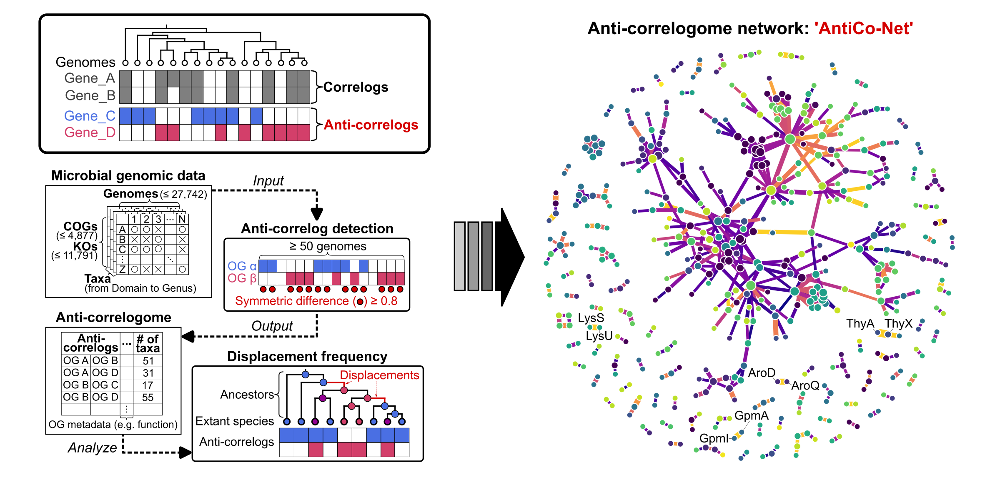
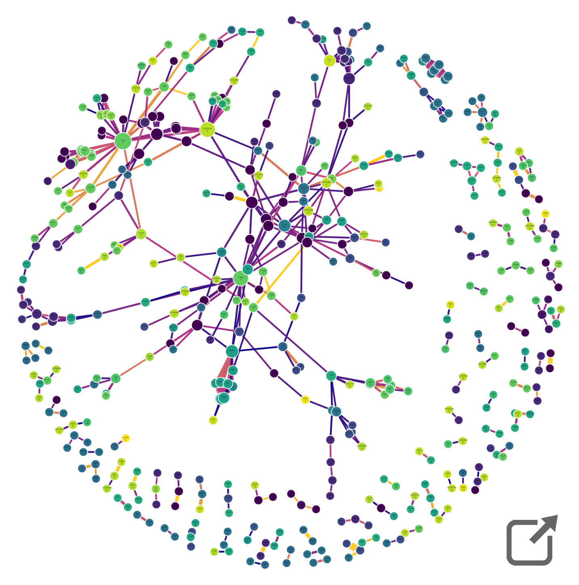
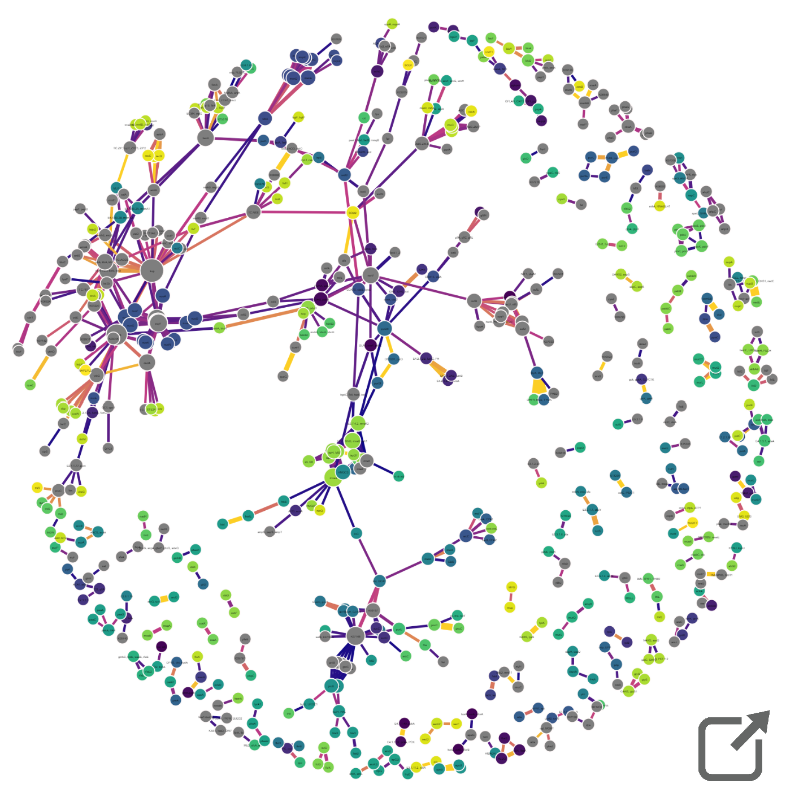
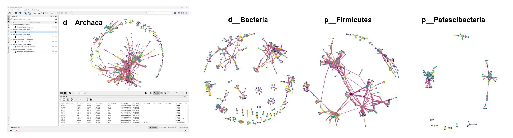
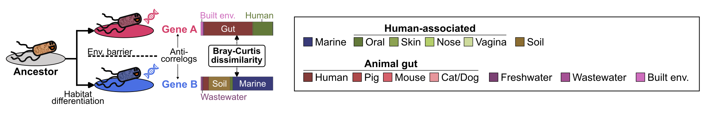
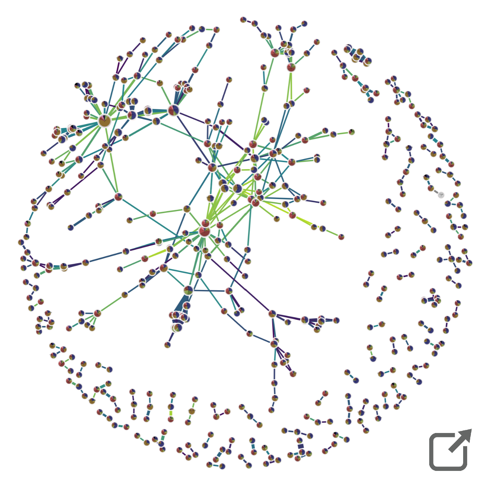
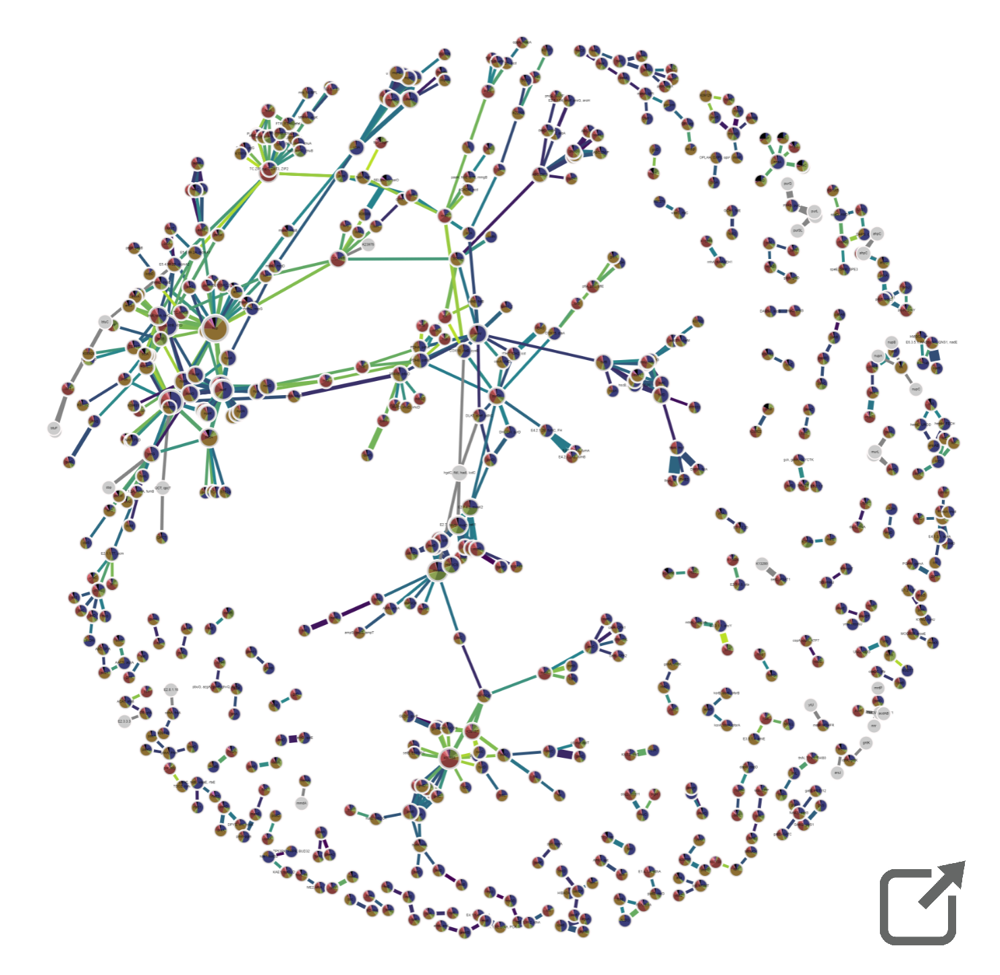
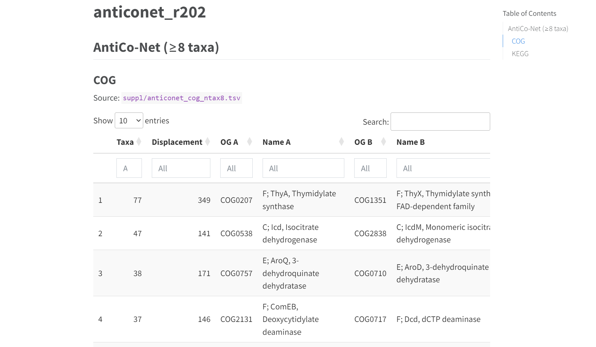
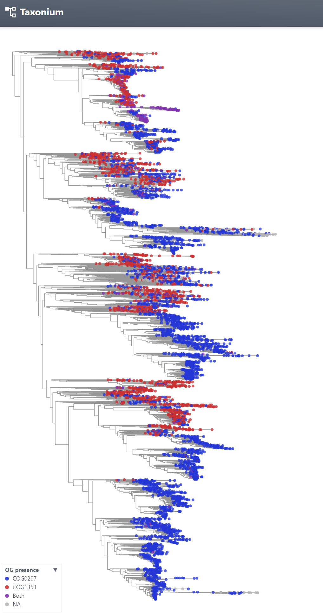

# anticonet_r202

This repository contains the data and code for the 'AntiCo-Net' ([Omae et al.]()) constructed from ~27,000 prokaryotic genomes in [GTDB](https://gtdb.ecogenomic.org/) Release 06-RS202.



## :spider_web: AntiCo-Net

AntiCo-Net is available in [NDEx](https://home.ndexbio.org/index/) platform. Please click the following links to access the networks.

| [COG AntiCo-Net]() (≥8 taxa) | [KEGG AntiCo-Net]() (≥8 taxa) |
|:---:|:----:|
| <a href=""></a> | <a href=""></a> |

> [!NOTE]
> All taxa from the domain to genus levels that contained ≥ 50 genomes (296 taxa) were enumerated.
> Each taxon networks can be downloaded from [figshare]().
> You can visualize them with any network softwares (e.g. [Cytoscape](https://cytoscape.org/)) by importing the `.cx` files.
> 

## :earth_asia: Environmental distribution of anti-correlogs

Environmental distribution (calculated using [GMGC](https://gmgc.embl.de/)) of anti-correlogs were mapped on the AntiCo-Net (≥8 taxa).
For each anti-correlog pair, the Bray–Curtis dissimilarity of the environmental distributions was calculated.
Please click the following links to access the networks.



| [COG AntiCo-Net (GMGC)]() | [KEGG AntiCo-Net (GMGC)]() |
|:---:|:----:|
| <a href=""></a> | <a href=""></a> |

## :telescope: Search anti-correlogs

You can search anti-correlogs (COG/KO) in AntiCo-Net. 

1. Clone or download this repository
2. Unzip `anticonet_data.zip`
3. Open `anticonet_data/AntiCo-Net.html` in your browser.



> [!NOTE]
> To access whole AntiCo-Net (≥1 taxa), download raw data from [figshare]().

## :seedling: Phylogenetic distribution of anti-correlogs

You can visualize the phylogenetic distribution of anti-correlogs (COG/KO) in the prokaryotic genomes by running the R script [`ogs_distribution.R`](scripts/r/ogs_distribution.R). It can be run on any platform.

### :chart_with_upwards_trend: For R users

1. Prepare [R (4.2 or later)](https://www.r-project.org/) environment and install required packages: `tidyverse`, `ape`.
2. Clone or download this repository.
3. Download files (`genomes_analyzed_*.tsv`, `pastml_csv_*.tar.gz`) from [figshare]() and place them in the `ogs_distribution/` directory.
4. Run the R script `scripts/r/ogs_distribution.R` at the repository root directory by using R console or terminal. Arguments: `bacteria` or `archaea`, two COGs or KOs. For example, the following commands will generate the distribution of anti-correlogs (COG0207 & COG1351) in Bacterial species tree.

```r
# By using the R console
params <- list2env(list(dom = "bacteria", og_a = "COG0207", og_b = "COG1351"))
sys.source("scripts/r/ogs_distribution.R", envir = params)
```
```bash
# By using the terminal
Rscript --vanilla --slave scripts/r/ogs_distribution.R bacteria COG0207 COG1351
```

5. The metadata tsv file `ogs_distribution/species_{ar,bac}_*.tsv.gz` will be generated. Visualize it with the tree file `ogs_distribution/species_{ar,bac}.tree.gz` using any phylogenetic tree software.

> [!TIP]
> [Taxonium](https://taxonium.org/) is recommended because all you need to do is upload the tree file and the metadata tsv file.



### :whale: For Docker users

If you are [Docker](https://www.docker.com/) user, you can build a docker image with this Dockerfile [`Dockerfiles/Dockerfile.ogs_dist`](Dockerfiles/Dockerfile.ogs_dist) and run the R script in the container.

```bash
# Build the docker image
DOCKER_USER=XXX  # your docker user name
docker image build -t $DOCKER_USER/ogs_dist -f Dockerfiles/Dockerfile.ogs_dist .

# Run the R script in the container
docker container run --mount type=bind,source=${PWD},target=/temp $DOCKER_USER/ogs_dist bash -c "cd /temp && \
    Rscript --vanilla --slave scripts/r/ogs_distribution.R bacteria COG0207 COG1351"
```

## :information_source: Other resources

- Analysis code
    - [LOG.md](LOG.md)
- Figures and tables
    - [ms/figs_tables.md](ms/figs_tables.md)
- Large data files
    - [figshare]() (≈1.8 GB)

```sh
35M     anticorrelogome_network_cog.tsv.gz
52M     anticorrelogome_network_kegg_mini.tsv.gz
53M     cytoscape.tar.gz
1.4M    genomes_analyzed_ar.tsv
40M     genomes_analyzed_bac.tsv
18M     og_displacement_archaea_cog.tsv.gz
26M     og_displacement_archaea_kegg.tsv.gz
109M    og_displacement_bacteria_cog.tsv.gz
171M    og_displacement_bacteria_kegg.tsv.gz
5.5M    pastml_csv_cog2020_ar.tar.gz
401M    pastml_csv_cog2020_bac.tar.gz
6.8M    pastml_csv_ko_ar.tar.gz
933M    pastml_csv_ko_bac.tar.gz
52K     taxa_summarized_50.tsv
```

## :book: Citation

Please cite the following article when you use the data and code in this repository.

## License

The original source code in this repository is licensed under the MIT License. See the [LICENSE](LICENSE) file for details.

This license does not apply to third-party datasets.

- GTDB-derived metadata: Subject to the Creative Commons Attribution-ShareAlike 4.0 International (CC BY-SA 4.0) license.
- KEGG-derived information: Subject to the applicable KEGG licensing terms.
- Original research datasets: Licensed separately as specified in their respective data repositories.

Please refer to the documentation accompanying each dataset for details.
