# Loading

## Run RStudio Server

- Run following command and access to http://localhost:8787

```{sh}
docker container run -p 8787:8787 -v ${PWD}:/home/rstudio -e PASSWORD=$Pass $User/cpnet
```

## Load libraries

```{r load libraries}
source('scripts/r/functions_ms_fisg_tables.R')
```

## Anti-correlogome network (AntiCo-Net)

### COG

```{r cog anticorrelated networks new}
# Raw data
dt_net_edge_cog <- read_network_data2("cog")
# Network object (COG)
g_cog_0_contra <- create_original_network_object2("cog", 0, "Anticorrelating", dt_net_edge_cog)
g_cog_8_contra <- create_original_network_object2("cog", 8, "Anticorrelating", dt_net_edge_cog)
# Displacement frequency
df_og_replacement_cog_prok <- read.table("data/tsv/og_displacement_prok_cog.tsv.gz", header = TRUE, sep = "\t", quote = "", na.strings=c("", "NULL")) %>% as_tibble()
# Transporter tsv
df_cog_8_contra_transporter <- read.csv("data/tsv/anticorrelogome_network_cog_ntax8_nodes_transporters.csv", header = TRUE, sep = ",", quote = "\"", na.strings=c("", "NULL"), row.names = NULL) %>% as_tibble()
# Normalized habitat distribution (GMGC)
df_gmgc10_cog_norm <- read.csv("data/tsv/gmgc10_cog_norm.tsv.gz", header = TRUE, sep = "\t", quote = "", na.strings=c("", "NULL"), row.names = NULL) %>% as_tibble()
# Displacement network
g_cog_8_contra_displace <- create_displacement_network_object("cog", 8, "Anticorrelating", dt_net_edge_cog, df_og_replacement_cog_prok, replace_thre)
```

### KEGG

```{r kegg anticorrelated networks new}
# Raw data
dt_net_edge_kegg <- read_network_data2("kegg")
# Network object (KEGG)
g_kegg_0_contra <- create_original_network_object2("kegg", 0, "Anticorrelating", dt_net_edge_kegg)
g_kegg_8_contra <- create_original_network_object2("kegg", 8, "Anticorrelating", dt_net_edge_kegg)
# Displacement frequency
df_og_replacement_kegg_prok <- read.table("data/tsv/og_displacement_prok_kegg.tsv.gz", header = TRUE, sep = "\t", quote = "", na.strings=c("", "NULL")) %>% as_tibble()
# Normalized habitat distribution (GMGC)
df_gmgc10_kegg_norm <- read.csv("data/tsv/gmgc10_kegg_norm.tsv.gz", header = TRUE, sep = "\t", quote = "", na.strings=c("", "NULL"), row.names = NULL) %>% as_tibble()
# Displacement network
g_kegg_8_contra_displace <- create_displacement_network_object("kegg", 8, "Anticorrelating", dt_net_edge_kegg, df_og_replacement_kegg_prok, replace_thre)
```

## Habitat preference

```{r load habitat pref}
# Habitat
df_habitat_pref <- fread("data/tsv/gtdb_ssu_prokatlas_habitat_pref.tsv", header = TRUE, sep = "\t", quote = "", stringsAsFactors = FALSE, na.strings=c("", "NULL")) %>%
  as_tibble() %>%
  pivot_longer(cols = c(-accession), names_to = "habitat", values_to = "habitat_pref") %>%
  filter(habitat_pref > 0)
```

# Tables

### Whole network structures

```{r whole network structures cog}
dt_net_edge_cog <- read_network_data2("cog")
g_cog_0_contra <- create_original_network_object("cog", 0, "Anticorrelating", dt_net_edge_cog)
g_cog_1_contra <- subgraph.edges(g_cog_0_contra, igraph::E(g_cog_0_contra)[igraph::E(g_cog_0_contra)$n_tax == 1])
g_cog_8_contra <- create_original_network_object("cog", 8, "Anticorrelating", dt_net_edge_cog)
tibble(
    Network = c("Anti. whole network", "Anti. subgraph (1 taxnon)", "Anti. subgraph (>= 8 taxa)"),
    `Number of edges (COG)` = c(length(igraph::E(g_cog_0_contra)),length(igraph::E(g_cog_1_contra)),length(igraph::E(g_cog_8_contra))),
    `Number of nodes (COG)` = c(length(V(g_cog_0_contra)),length(V(g_cog_1_contra)),length(V(g_cog_8_contra))),
    `Density (COG)` = c(round(edge_density(g_cog_0_contra),3),round(edge_density(g_cog_1_contra),3),round(edge_density(g_cog_8_contra),3))
    #`Assotativity of degree (COG)` = c(assortativity_degree(g_cog_0_contra),assortativity_degree(g_cog_8_contra))
  ) %>%
  knitr::kable()
```

|Network                    | Number of edges (COG)| Number of nodes (COG)| Density (COG)|
|:--------------------------|---------------------:|---------------------:|-------------:|
|Anti. whole network        |                961712|                  4705|         0.087|
|Anti. subgraph (1 taxnon)  |                652542|                  4678|         0.060|
|Anti. subgraph (>= 8 taxa) |                   543|                   471|         0.005|

```{r whole network structures kegg}
dt_net_edge_kegg <- read_network_data2("kegg")
g_kegg_0_contra <- create_original_network_object("kegg", 0, "Anticorrelating", dt_net_edge_kegg)
g_kegg_1_contra <- subgraph.edges(g_kegg_0_contra, igraph::E(g_kegg_0_contra)[igraph::E(g_kegg_0_contra)$n_tax == 1])
g_kegg_8_contra <- create_original_network_object("kegg", 8, "Anticorrelating", dt_net_edge_kegg)
tibble(
    Network = c("Anti. whole network", "Anti. subgraph (1 taxnon)", "Anti. subgraph (>= 8 taxa)"),
    `Number of edges (KO)` = c(length(igraph::E(g_kegg_0_contra)),length(igraph::E(g_kegg_1_contra)),length(igraph::E(g_kegg_8_contra))),
    `Number of nodes (KO)` = c(length(V(g_kegg_0_contra)),length(V(g_kegg_1_contra)),length(V(g_kegg_8_contra))),
    `Density (KO)` = c(round(edge_density(g_kegg_0_contra),3),round(edge_density(g_kegg_1_contra),3),round(edge_density(g_kegg_8_contra),3))
    #`Assotativity of degree (KO)` = c(assortativity_degree(g_kegg_0_contra),assortativity_degree(g_kegg_8_contra),assortativity_degree(g_kegg_0_cooccu))
  ) %>%
  knitr::kable()
```

|Network                    | Number of edges (KO)| Number of nodes (KO)| Density (KO)|
|:--------------------------|--------------------:|--------------------:|------------:|
|Anti. whole network        |              1686842|                 9420|        0.038|
|Anti. subgraph (1 taxnon)  |              1199534|                 9309|        0.028|
|Anti. subgraph (>= 8 taxa) |                  725|                  601|        0.004|

### Top 10 anti-correlogs (n_tax >= 8)

```{r contrapositive top 10 cog}
dt_net_edge_og <- read_network_data2("cog")
df_og_replacement_ar <- load_og_replacement("cog", "archaea")
df_og_replacement_bac <- load_og_replacement("cog", "bacteria")
df_og_replacement_prok <- og_replacement_prokaryotes(df_og_replacement_ar, df_og_replacement_bac) %>%
	mutate(
		edge_id = paste(og_id_A, og_id_B, sep = "_")
	)
df_net_edge_og_replace <- combine_with_net_edge_stats(df_og_replacement_prok)
df_net_edge_cog_top10 <- df_net_edge_og_replace %>%
  filter(edge_type == "Anticorrelating", n_tax >= edge_thre_contra) %>%
  mutate(
    name_A = paste0(cog_fun_cat_A, "; ", cog_gene_A, ", ", cog_name_A),
    name_B = paste0(cog_fun_cat_B, "; ", cog_gene_B, ", ", cog_name_B)
  ) %>%
  select(n_tax,n_replace_prok,og_id_A,name_A,og_id_B,name_B) %>%
  head(10) 
colnames(df_net_edge_cog_top10) <- c("Taxa", "Displacement", "OG A", "Name A", "OG B", "Name B")
df_net_edge_cog_top10 %>% knitr::kable()
rm(dt_net_edge_og, df_og_replacement_ar, df_og_replacement_bac, df_og_replacement_prok, df_net_edge_og_replace, df_net_edge_cog_top10)
```

| Taxa| Displacement|OG A    |Name A                                                                 |OG B    |Name B                                                                             |
|----:|------------:|:-------|:----------------------------------------------------------------------|:-------|:----------------------------------------------------------------------------------|
|   77|          349|COG0207 |F; ThyA, Thymidylate synthase                                          |COG1351 |F; ThyX, Thymidylate synthase ThyX, FAD-dependent family                           |
|   47|          141|COG0538 |C; Icd, Isocitrate dehydrogenase                                       |COG2838 |C; IcdM, Monomeric isocitrate dehydrogenase                                        |
|   38|          171|COG0757 |E; AroQ, 3-dehydroquinate dehydratase                                  |COG0710 |E; AroD, 3-dehydroquinate dehydratase                                              |
|   37|          146|COG2131 |F; ComEB, Deoxycytidylate deaminase                                    |COG0717 |F; Dcd, dCTP deaminase                                                             |
|   33|          206|COG0696 |G; GpmI, Phosphoglycerate mutase (BPG-independent), AlkP superfamily   |COG0588 |G; GpmA, Phosphoglycerate mutase (BPG-dependent)                                   |
|   33|          136|COG1190 |J; LysU, Lysyl-tRNA synthetase (class II)                              |COG1384 |J; LysS, Lysyl-tRNA synthetase, class I                                            |
|   30|           84|COG0499 |H; SAM1, S-adenosylhomocysteine hydrolase                              |COG1854 |T; LuxS, S-ribosylhomocysteine lyase LuxS, autoinducer biosynthesis                |
|   29|          102|COG1866 |C; PckA, Phosphoenolpyruvate carboxykinase, ATP-dependent              |COG1274 |C; PepCK, Phosphoenolpyruvate carboxykinase, GTP-dependent                         |
|   29|          104|COG1872 |S; YggU, Uncharacterized conserved protein YggU, UPF0235/DUF167 family |COG1739 |R; YIH1, Putative translation regulator, IMPACT (imprinted ancient) protein family |
|   28|           82|COG0221 |C; Ppa, Inorganic pyrophosphatase                                      |COG1227 |C; PPX1, Inorganic pyrophosphatase/exopolyphosphatase                              |

```{r contrapositive top 10 kegg}
dt_net_edge_og <- read_network_data2("kegg")
df_og_replacement_ar <- load_og_replacement("kegg", "archaea")
df_og_replacement_bac <- load_og_replacement("kegg", "bacteria")
df_og_replacement_prok <- og_replacement_prokaryotes(df_og_replacement_ar, df_og_replacement_bac) %>%
	mutate(
		edge_id = paste(og_id_A, og_id_B, sep = "_")
	)
df_net_edge_og_replace <- combine_with_net_edge_stats(df_og_replacement_prok)
df_net_edge_kegg_top10 <- df_net_edge_og_replace %>%
  filter(edge_type == "Anticorrelating", n_tax >= edge_thre_contra) %>%
  mutate(
    name_A = paste0(ko_symbol_A, "; ", ko_name_A),
    name_B = paste0(ko_symbol_B, "; ", ko_name_B)
  ) %>%
  select(n_tax,n_replace_prok,og_id_A,name_A,og_id_B,name_B) %>%
  head(10) 
colnames(df_net_edge_kegg_top10) <- c("Taxa", "Displacement", "OG A", "Name A", "OG B", "Name B")
df_net_edge_kegg_top10 %>% knitr::kable()
rm(dt_net_edge_og, df_og_replacement_ar, df_og_replacement_bac, df_og_replacement_prok, df_net_edge_og_replace, df_net_edge_kegg_top10)
```

| Taxa| Displacement|OG A   |Name A                                                                                           |OG B   |Name B                                                                            |
|----:|------------:|:------|:------------------------------------------------------------------------------------------------|:------|:---------------------------------------------------------------------------------|
|   62|          334|K00560 |thyA, TYMS; thymidylate synthase [EC:2.1.1.45]                                                   |K03465 |thyX, thy1; thymidylate synthase (FAD) [EC:2.1.1.148]                             |
|   54|          244|K01916 |nadE; NAD+ synthase [EC:6.3.1.5]                                                                 |K01950 |E6.3.5.1, NADSYN1, QNS1, nadE; NAD+ synthase (glutamine-hydrolysing) [EC:6.3.5.1] |
|   41|          178|K03743 |pncC; nicotinamide-nucleotide amidase [EC:3.5.1.42]                                              |K03742 |pncC; nicotinamide-nucleotide amidase [EC:3.5.1.42]                               |
|   39|          147|K01493 |comEB; dCMP deaminase [EC:3.5.4.12]                                                              |K01494 |dcd; dCTP deaminase [EC:3.5.4.13]                                                 |
|   36|          143|K03786 |aroQ, qutE; 3-dehydroquinate dehydratase II [EC:4.2.1.10]                                        |K03785 |aroD; 3-dehydroquinate dehydratase I [EC:4.2.1.10]                                |
|   35|          239|K00287 |DHFR, folA; dihydrofolate reductase [EC:1.5.1.3]                                                 |K03465 |thyX, thy1; thymidylate synthase (FAD) [EC:2.1.1.148]                             |
|   31|          123|K04566 |lysK; lysyl-tRNA synthetase, class I [EC:6.1.1.6]                                                |K04567 |KARS, lysS; lysyl-tRNA synthetase, class II [EC:6.1.1.6]                          |
|   31|          105|K23265 |purQ; phosphoribosylformylglycinamidine synthase subunit PurQ / glutaminase [EC:6.3.5.3 3.5.1.2] |K01952 |PFAS, purL; phosphoribosylformylglycinamidine synthase [EC:6.3.5.3]               |
|   30|           86|K01251 |E3.3.1.1, ahcY; adenosylhomocysteinase [EC:3.3.1.1]                                              |K07173 |luxS; S-ribosylhomocysteine lyase [EC:4.4.1.21]                                   |
|   29|          143|K06888 |K06888; uncharacterized protein                                                                  |K08997 |SELENOO, selO; serine/tyrosine/threonine adenylyltransferase [EC:2.7.7.-]         |

### Top 10 anti-correlogs (n_tax < 8)

```{r contrapositive top 10 cog n_tax 8}
# join n_replace and n_tax
df_net_edge_og_replace <- combine_with_net_edge_stats2(dt_net_edge_cog, df_og_replacement_cog_prok)
# filter n_tax < 8
df_net_edge_cog_top10 <- df_net_edge_og_replace %>% filter(n_tax < 8) %>% arrange(desc(n_replace_prok)) %>% 
  mutate(
    name_A = paste0(cog_fun_cat_A, "; ", cog_gene_A, ", ", cog_name_A),
    name_B = paste0(cog_fun_cat_B, "; ", cog_gene_B, ", ", cog_name_B)
  ) %>%
  select(n_tax,n_replace_prok,og_id_A,name_A,og_id_B,name_B) %>%
  head(10) 
colnames(df_net_edge_cog_top10) <- c("Taxa", "Displacement", "OG A", "Name A", "OG B", "Name B")
df_net_edge_cog_top10 %>% knitr::kable()
```
| Taxa| Displacement|OG A    |Name A                                                                                                                         |OG B    |Name B                                                                               |
|----:|------------:|:-------|:------------------------------------------------------------------------------------------------------------------------------|:-------|:------------------------------------------------------------------------------------|
|    1|          291|COG0050 |J; TufA, Translation elongation factor EF-Tu, a GTPase                                                                         |COG3587 |V; PM0699, Restriction endonuclease, type III RM system                              |
|    2|          199|COG5278 |T; CHASE3, Extracytoplasmic sensor domain CHASE3 (specificity unknown)                                                         |COG1002 |V; YeeA, Type II restriction/modification system, endonuclease and methylase domains |
|    1|          196|COG3070 |K; TfoX, Transcriptional regulator of competence genes, TfoX/Sxy family                                                        |COG4626 |X; YmfN, Phage terminase-like protein, large subunit, contains N-terminal HTH domain |
|    1|          186|COG1002 |V; YeeA, Type II restriction/modification system, endonuclease and methylase domains                                           |COG3384 |Q; LigB, Aromatic ring-opening dioxygenase, catalytic subunit, LigB family           |
|    2|          182|COG3046 |R; NA, Uncharacterized conserved protein related to deoxyribodipyrimidine photolyase                                           |COG1204 |L; BRR2, Replicative superfamily II helicase                                         |
|    2|          180|COG1858 |O; MauG, Cytochrome c peroxidase                                                                                               |COG3598 |L; RepA, RecA-family ATPase                                                          |
|    2|          177|COG2132 |DPM; SufI, Multicopper oxidase with three cupredoxin domains (includes cell division protein FtsP and spore coat protein CotA) |COG1715 |V; Mrr, Restriction endonuclease Mrr                                                 |
|    1|          177|COG0415 |L; PhrB, Deoxyribodipyrimidine photolyase                                                                                      |COG4626 |X; YmfN, Phage terminase-like protein, large subunit, contains N-terminal HTH domain |
|    1|          175|COG5662 |K; RsiW, Transmembrane transcriptional regulator RsiW (anti-sigma-W factor)                                                    |COG1204 |L; BRR2, Replicative superfamily II helicase                                         |
|    1|          173|COG1835 |M; OafA, Peptidoglycan/LPS O-acetylase OafA/YrhL, contains acyltransferase and SGNH-hydrolase domains                          |COG3440 |V; NA, Predicted restriction endonuclease                                            |

```{r contrapositive top 10 kegg n_tax 8}
# join n_replace and n_tax
df_net_edge_og_replace <- combine_with_net_edge_stats2(dt_net_edge_kegg, df_og_replacement_kegg_prok)
# filter n_tax < 8
df_net_edge_kegg_top10 <- df_net_edge_og_replace %>% filter(n_tax < 8) %>% arrange(desc(n_replace_prok)) %>% 
  mutate(
    name_A = paste0(ko_symbol_A, "; ", ko_name_A),
    name_B = paste0(ko_symbol_B, "; ", ko_name_B)
  ) %>%
  select(n_tax,n_replace_prok,og_id_A,name_A,og_id_B,name_B) %>%
  head(10) 
colnames(df_net_edge_kegg_top10) <- c("Taxa", "Displacement", "OG A", "Name A", "OG B", "Name B")
df_net_edge_kegg_top10 %>% knitr::kable()
```
| Taxa| Displacement|OG A   |Name A                                                                                        |OG B   |Name B                                                                      |
|----:|------------:|:------|:---------------------------------------------------------------------------------------------|:------|:---------------------------------------------------------------------------|
|    1|          238|K11921 |cynR; LysR family transcriptional regulator, cyn operon transcriptional activator             |K01156 |res; type III restriction enzyme [EC:3.1.21.5]                              |
|    1|          209|K14162 |dnaE2; error-prone DNA polymerase [EC:2.7.7.7]                                                |K01156 |res; type III restriction enzyme [EC:3.1.21.5]                              |
|    1|          208|K17737 |dhcR; LysR family transcriptional regulator, carnitine catabolism transcriptional activator   |K01156 |res; type III restriction enzyme [EC:3.1.21.5]                              |
|    1|          207|K03298 |TC.DME; drug/metabolite transporter, DME family                                               |K01156 |res; type III restriction enzyme [EC:3.1.21.5]                              |
|    1|          198|K06193 |phnA; protein PhnA                                                                            |K01156 |res; type III restriction enzyme [EC:3.1.21.5]                              |
|    1|          196|K07402 |xdhC; xanthine dehydrogenase accessory factor                                                 |K01156 |res; type III restriction enzyme [EC:3.1.21.5]                              |
|    1|          196|K09017 |rutR; TetR/AcrR family transcriptional regulator                                              |K01156 |res; type III restriction enzyme [EC:3.1.21.5]                              |
|    1|          196|K05339 |lrgB; holin-like protein LrgB                                                                 |K01156 |res; type III restriction enzyme [EC:3.1.21.5]                              |
|    1|          195|K18907 |norG; GntR family transcriptional regulator, regulator for abcA and norABC                    |K01156 |res; type III restriction enzyme [EC:3.1.21.5]                              |
|    3|          192|K15915 |pglC; undecaprenyl phosphate N,N'-diacetylbacillosamine 1-phosphate transferase [EC:2.7.8.36] |K24310 |wbpV, wreQ; UDP-N-acetyl-alpha-D-quinovosamine dehydrogenase [EC:1.1.1.426] |

## Habitat analysis (GMGC): Bray-Curtis dissimilarity

- [ms/gmgc_bray_network_table_cog.tsv](gmgc_bray_network_table_cog.tsv)

## Genomic feature analysis: KL divergence

- COG
  - [ms/gfeat_cog_kl.tsv](gfeat_cog_kl.tsv)
- KEGG
  - [ms/gfeat_kegg_kl.tsv](gfeat_kegg_kl.tsv)

# Figures

## AntiCoNet appearance

### anticorrelating_network_cog

```{r anticorrelating network cog}
p_network_contra_cog <- contrapositive_network_show(g_cog_8_contra_displace, "cog_fun_cat") +
  theme(legend.position = "right") + labs(subtitle = "COG", title = "a", color = "Displace\nment")
label_cogs <- c(
  names(V(subgraph.edges(g_cog_8_contra_displace, igraph::E(g_cog_8_contra_displace)[igraph::E(g_cog_8_contra_displace)$n_tax >= 29]))),
  "COG0245", "COG1577", "COG2209", "COG1007", "COG3158", "COG2035", "COG0370", "COG3407", "COG0109"
)
p_network_contra_cog_labeled <- add_geom_text_repel(p_network_contra_cog, g_cog_8_contra_displace, "cog_fun_cat", label_cogs)
ggsave(paste0("ms/fig_1a.png"), p_network_contra_cog, height = 6, width = 6, dpi = 600)
ggsave(paste0("ms/fig_1a_labeled.png"), p_network_contra_cog_labeled, height = 6, width = 6, dpi = 600)
```
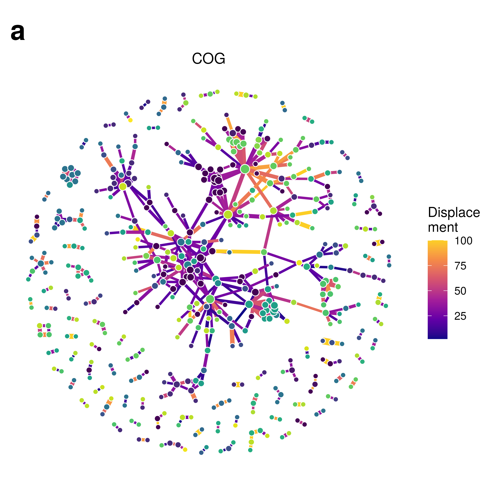

### anticorrelating_network_kegg

```{r anticorrelating network kegg}
p_network_contra_kegg <- contrapositive_network_show(g_kegg_8_contra_displace, "ko_path_num_specific") +
  theme(legend.position = "right") + labs(subtitle = "KEGG", title = "b", color = "Displace\nment")
label_kos <- c(
  names(V(subgraph.edges(g_kegg_8_contra_displace, igraph::E(g_kegg_8_contra_displace)[igraph::E(g_kegg_8_contra_displace)$n_tax >= 29]))),
  "K01770", "K00869", "K00350", "K00343", "K03549", "K08974", "K04759", "K01597", "K02257"
)
p_network_contra_kegg_labeled <- add_geom_text_repel(p_network_contra_kegg, g_kegg_8_contra_displace, "ko_path_num_specific", label_kos)
ggsave(paste0("ms/fig_1b.png"), p_network_contra_kegg, height = 6, width = 6, dpi = 600)
ggsave(paste0("ms/fig_1b_labeled.png"), p_network_contra_kegg_labeled, height = 6, width = 6, dpi = 600)
```
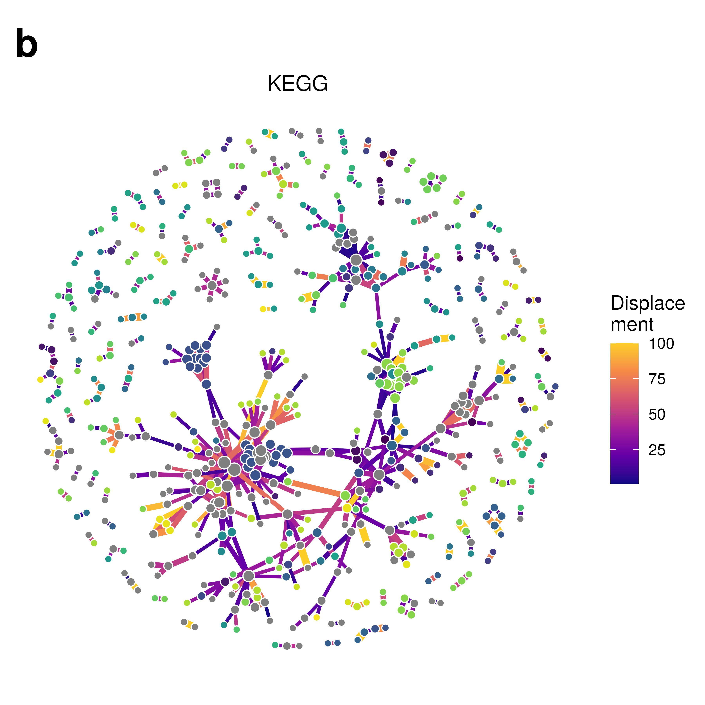

### anticorrelogs_vs_ntaxa_plot_log_linear

```{r Number of edges}
# Number of edges
p_n_edge <- network_n_edges_anti(dt_net_edge_cog, dt_net_edge_kegg) + labs(title = "c") #+ theme(legend.position = "top")
ggsave(paste0("ms/fig_1c.png"), p_n_edge, height = 2.5, width = 5, dpi = 600)
```
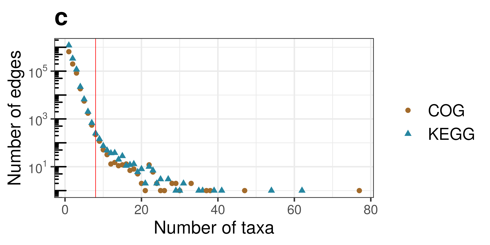

### anticorrelogs_vs_ntaxa_plot_log_log

```{r Number of edges log_log}
# Number of edges
p_n_edge <- network_n_edges_anti_log(dt_net_edge_cog, dt_net_edge_kegg)
ggsave(paste0("ms/anticorrelogs_vs_ntaxa_plot_log_log.png"), p_n_edge, height = 2.5, width = 3.8, dpi = 600)
```
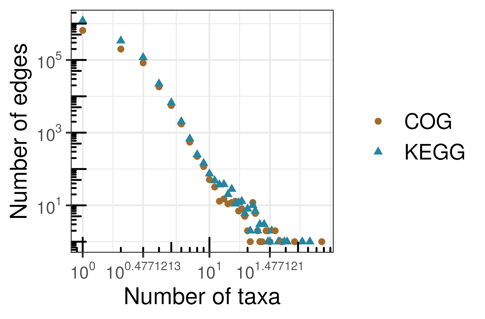

## Displacement frequency

### displacement_frequency_cog_hex

```{r Number of displacement cog hex}
# join n_replace and n_tax
df_net_edge_cog_replace <- combine_with_net_edge_stats2(dt_net_edge_cog, df_og_replacement_cog_prok)
#plot
p_n_replace_cog <- df_net_edge_cog_replace %>% select(n_tax,n_replace_prok) %>% 
  ggplot(aes(x = n_tax, y = n_replace_prok)) +
  geom_hex(bins = 40) + scale_fill_gradientn(trans = "log10", colors = viridis(10)) +
  geom_vline(xintercept = 8, linewidth = 0.1, color = "black") #+
  #geom_hline(yintercept = 90, linewidth = 0.1, color = "black")
ggsave(paste0("ms/displacement_frequency_cog_hex.png"), p_n_replace_cog, height = 2.2, width = 3.5, dpi = 600)
# Make cross tab (40)
df_bin <- df_net_edge_cog_replace %>% select(n_tax,n_replace_prok) %>% 
  mutate(
    n_tax_bin = cut(n_tax, c(1,8,150), right = FALSE),
    n_replace_prok_bin = cut(n_replace_prok, c(0,40,350), right = FALSE)
  ) %>% select(n_tax_bin, n_replace_prok_bin)
xtabs(~n_tax_bin + n_replace_prok_bin, df_bin)
# Make cross tab (90)
df_bin <- df_net_edge_cog_replace %>% select(n_tax,n_replace_prok) %>% 
  mutate(
    n_tax_bin = cut(n_tax, c(1,8,150), right = FALSE),
    n_replace_prok_bin = cut(n_replace_prok, c(0,90,350), right = FALSE)
  ) %>% select(n_tax_bin, n_replace_prok_bin)
xtabs(~n_tax_bin + n_replace_prok_bin, df_bin)
```
```
         n_replace_prok_bin
n_tax_bin [0,40) [40,350)
  [1,8)   896128    65041
  [8,150)    311      232

         n_replace_prok_bin
n_tax_bin [0,90) [90,350)
  [1,8)   960272      897
  [8,150)    516       27
```

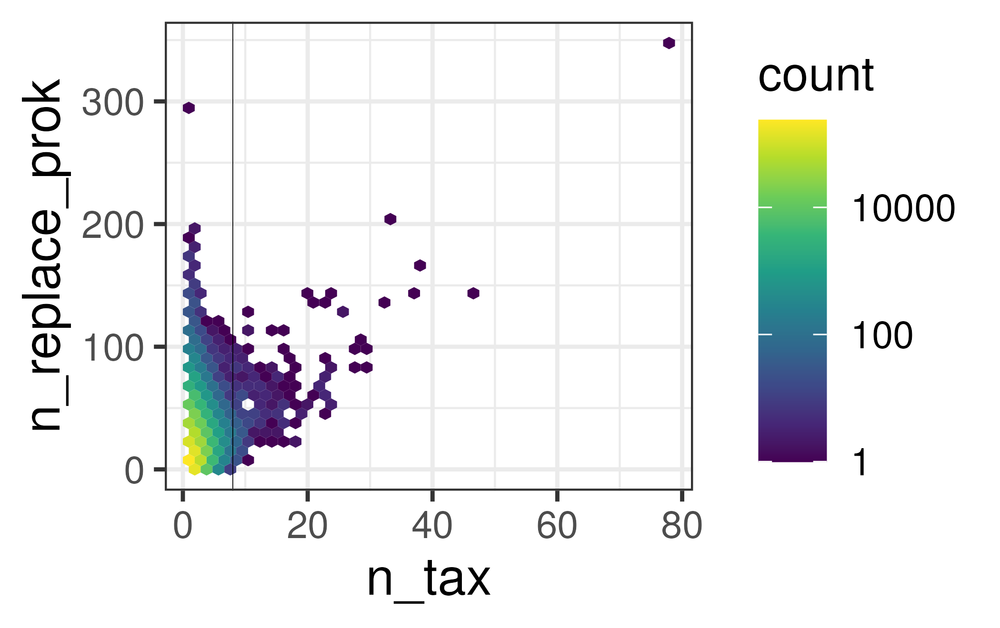

### displacement_frequency_kegg_hex

```{r Number of displacement kegg hex}
# join n_replace and n_tax
df_net_edge_kegg_replace <- combine_with_net_edge_stats2(dt_net_edge_kegg, df_og_replacement_kegg_prok)
# plot
p_n_replace_kegg <- df_net_edge_kegg_replace %>% select(n_tax,n_replace_prok) %>% 
  ggplot(aes(x = n_tax, y = n_replace_prok)) +
  geom_hex(bins = 40) + scale_fill_gradientn(trans = "log10", colors = viridis(10)) +
  geom_vline(xintercept = 8, linewidth = 0.1, color = "black") +
  geom_hline(yintercept = 90, linewidth = 0.1, color = "black")
ggsave(paste0("ms/displacement_frequency_kegg_hex.png"), p_n_replace_kegg, height = 2.5, width = 3.5, dpi = 600)
# Make cross tab (40)
df_bin <- df_net_edge_kegg_replace %>% select(n_tax,n_replace_prok) %>% 
  mutate(
    n_tax_bin = cut(n_tax, c(1,8,150), right = FALSE),
    n_replace_prok_bin = cut(n_replace_prok, c(0,40,350), right = FALSE)
  ) %>% select(n_tax_bin, n_replace_prok_bin)
xtabs(~n_tax_bin + n_replace_prok_bin, df_bin)
# Make cross tab (90)
df_bin <- df_net_edge_kegg_replace %>% select(n_tax,n_replace_prok) %>% 
  mutate(
    n_tax_bin = cut(n_tax, c(1,8,150), right = FALSE),
    n_replace_prok_bin = cut(n_replace_prok, c(0,90,350), right = FALSE)
  ) %>% select(n_tax_bin, n_replace_prok_bin)
xtabs(~n_tax_bin + n_replace_prok_bin, df_bin)
```
```
         n_replace_prok_bin
n_tax_bin  [0,40) [40,350)
  [1,8)   1601418    84699
  [8,150)     418      307

         n_replace_prok_bin
n_tax_bin  [0,90) [90,350)
  [1,8)   1685209      908
  [8,150)     679       46
```

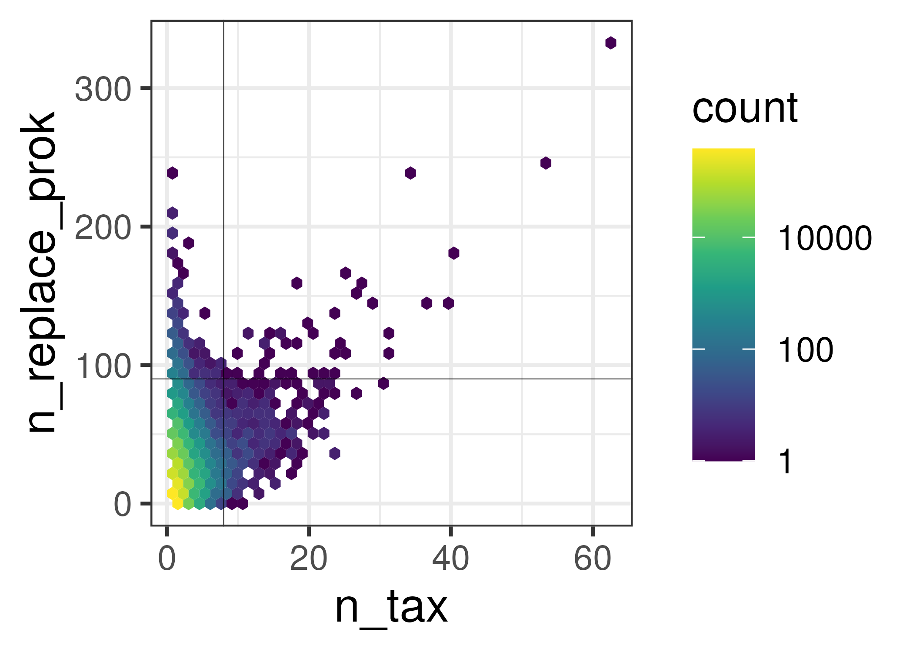

### displacement_skew_cog_facet

```{r displacement_skew_cog_facet}
# join n_replace and n_tax
df_net_edge_cog_replace <- combine_with_net_edge_stats2(dt_net_edge_cog, df_og_replacement_cog_prok)
#plot
p_n_replace_cog <- df_net_edge_cog_replace %>% select(n_tax,n_A_B_prok,n_B_A_prok) %>% 
  mutate(n_tax_bin = cut(n_tax, c(0,8,80))) %>% 
  ggplot(aes(x = n_A_B_prok, y = n_B_A_prok)) +
  geom_hex(bins = 40) + scale_fill_gradientn(trans = "log10", colors = viridis(10)) +
  facet_grid(. ~ n_tax_bin)
ggsave(paste0("ms/displacement_skew_cog_facet.png"), p_n_replace_cog, height = 2.2, width = 4.8, dpi = 600)
```
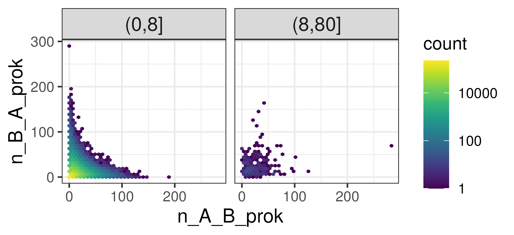

## Ancestral reconstruction of anti-correlogs

### COG

```{r ancestral reconstruction COG0207 COG1351 prok}
p_tree_cog_bac <- visualize_og_displacement_rect("cog", "bacteria", "COG0207", "COG1351", "ThyA", "ThyX", "Phylum")
p_tree_cog_ar <- visualize_og_displacement_rect("cog", "archaea", "COG0207", "COG1351", "ThyA", "ThyX", "Phylum")
p_tree_cog_prok <- (p_tree_cog_bac + theme(legend.position = "none") | p_tree_cog_ar) + plot_layout(widths = c(7,3))
ggsave(paste0("ms/tree_COG0207_COG1351_prok.png"), p_tree_cog_prok, height = 1.25, width = 12, dpi = 600)
```
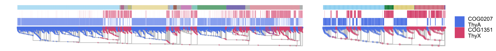
```{r ancestral reconstruction COG0538 COG2838 prok}
p_tree_cog_bac <- visualize_og_displacement_rect("cog", "bacteria", "COG0538", "COG2838", "Icd", "IcdM", "Phylum")
p_tree_cog_ar <- visualize_og_displacement_rect("cog", "archaea", "COG0538", "COG2838", "Icd", "IcdM", "Phylum")
p_tree_cog_prok <- (p_tree_cog_bac + theme(legend.position = "none") | p_tree_cog_ar) + plot_layout(widths = c(7,3))
ggsave(paste0("ms/tree_COG0538_COG2838_prok.png"), p_tree_cog_prok, height = 1.25, width = 12, dpi = 600)
```
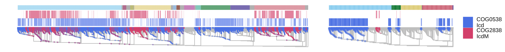
```{r ancestral reconstruction COG0757 COG0710 prok}
p_tree_cog_bac <- visualize_og_displacement_rect("cog", "bacteria", "COG0757", "COG0710", "AroQ", "AroD", "Phylum")
p_tree_cog_ar <- visualize_og_displacement_rect("cog", "archaea", "COG0757", "COG0710", "AroQ", "AroD", "Phylum")
p_tree_cog_prok <- (p_tree_cog_bac + theme(legend.position = "none") | p_tree_cog_ar) + plot_layout(widths = c(7,3))
ggsave(paste0("ms/tree_COG0757_COG0710_prok.png"), p_tree_cog_prok, height = 1.25, width = 12, dpi = 600)
```
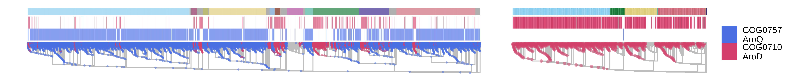
```{r ancestral reconstruction COG2131 COG0717 prok}
p_tree_cog_bac <- visualize_og_displacement_rect("cog", "bacteria", "COG2131", "COG0717", "ComEB", "Dcd", "Phylum")
p_tree_cog_ar <- visualize_og_displacement_rect("cog", "archaea", "COG2131", "COG0717", "ComEB", "Dcd", "Phylum")
p_tree_cog_prok <- (p_tree_cog_bac + theme(legend.position = "none") | p_tree_cog_ar) + plot_layout(widths = c(7,3))
ggsave(paste0("ms/tree_COG2131_COG0717_prok.png"), p_tree_cog_prok, height = 1.25, width = 12, dpi = 600)
```
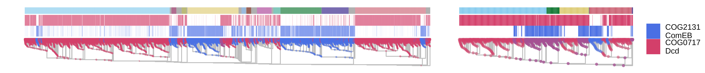
```{r ancestral reconstruction COG0696 COG0588 prok}
p_tree_cog_bac <- visualize_og_displacement_rect("cog", "bacteria", "COG0696", "COG0588", "GpmI", "GpmA", "Phylum")
p_tree_cog_ar <- visualize_og_displacement_rect("cog", "archaea", "COG0696", "COG0588", "GpmI", "GpmA", "Phylum")
p_tree_cog_prok <- (p_tree_cog_bac + theme(legend.position = "none") | p_tree_cog_ar) + plot_layout(widths = c(7,3))
ggsave(paste0("ms/tree_COG0696_COG0588_prok.png"), p_tree_cog_prok, height = 1.25, width = 12, dpi = 600)
```
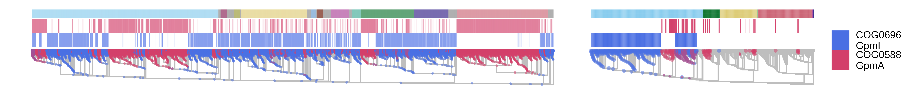
```{r ancestral reconstruction COG1190 COG1384 prok}
p_tree_cog_bac <- visualize_og_displacement_rect("cog", "bacteria", "COG1190", "COG1384", "LysU", "LysS", "Phylum")
p_tree_cog_ar <- visualize_og_displacement_rect("cog", "archaea", "COG1190", "COG1384", "LysU", "LysS", "Phylum")
p_tree_cog_prok <- (p_tree_cog_bac + theme(legend.position = "none") | p_tree_cog_ar) + plot_layout(widths = c(7,3))
ggsave(paste0("ms/tree_COG1190_COG1384_prok.png"), p_tree_cog_prok, height = 1.25, width = 12, dpi = 600)
```
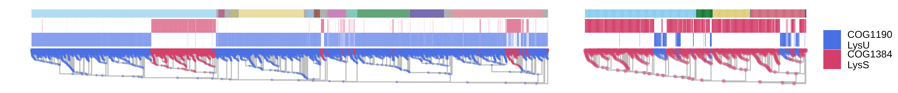
```{r ancestral reconstruction COG0499 COG1854 prok}
p_tree_cog_bac <- visualize_og_displacement_rect("cog", "bacteria", "COG0499", "COG1854", "SAM1", "LuxS", "Phylum")
#p_tree_cog_ar <- visualize_og_displacement_rect("cog", "archaea", "COG0499", "COG1854", "SAM1", "LuxS", "Phylum")
p_tree_cog_prok <- (p_tree_cog_bac | plot_spacer()) + plot_layout(widths = c(7,3))
ggsave(paste0("ms/tree_COG0499_COG1854_prok.png"), p_tree_cog_prok, height = 1.25, width = 12, dpi = 600)
```
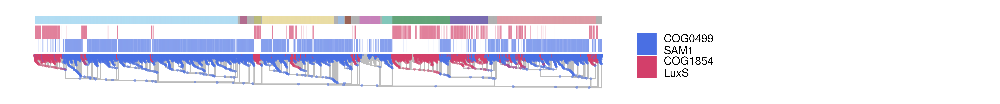
```{r ancestral reconstruction COG1866 COG1274 prok}
p_tree_cog_bac <- visualize_og_displacement_rect("cog", "bacteria", "COG1866", "COG1274", "PckA", "PepCK", "Phylum")
p_tree_cog_ar <- visualize_og_displacement_rect("cog", "archaea", "COG1866", "COG1274", "PckA", "PepCK", "Phylum")
p_tree_cog_prok <- (p_tree_cog_bac + theme(legend.position = "none") | p_tree_cog_ar) + plot_layout(widths = c(7,3))
ggsave(paste0("ms/tree_COG1866_COG1274_prok.png"), p_tree_cog_prok, height = 1.25, width = 12, dpi = 600)
```
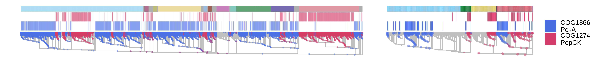
```{r ancestral reconstruction COG1872 COG1739 prok}
p_tree_cog_bac <- visualize_og_displacement_rect("cog", "bacteria", "COG1872", "COG1739", "YggU", "YIH1", "Phylum")
p_tree_cog_ar <- visualize_og_displacement_rect("cog", "archaea", "COG1872", "COG1739", "YggU", "YIH1", "Phylum")
p_tree_cog_prok <- (p_tree_cog_bac + theme(legend.position = "none") | p_tree_cog_ar) + plot_layout(widths = c(7,3))
ggsave(paste0("ms/tree_COG1872_COG1739_prok.png"), p_tree_cog_prok, height = 1.25, width = 12, dpi = 600)
```
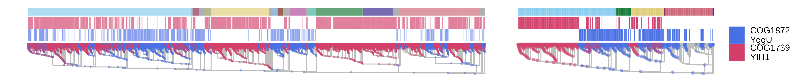
```{r ancestral reconstruction COG0221 COG1227 prok}
p_tree_cog_bac <- visualize_og_displacement_rect("cog", "bacteria", "COG0221", "COG1227", "Ppa", "PPX1", "Phylum")
p_tree_cog_ar <- visualize_og_displacement_rect("cog", "archaea", "COG0221", "COG1227", "Ppa", "PPX1", "Phylum")
p_tree_cog_prok <- (p_tree_cog_bac + theme(legend.position = "none") | p_tree_cog_ar) + plot_layout(widths = c(7,3))
ggsave(paste0("ms/tree_COG0221_COG1227_prok.png"), p_tree_cog_prok, height = 1.25, width = 12, dpi = 600)
```
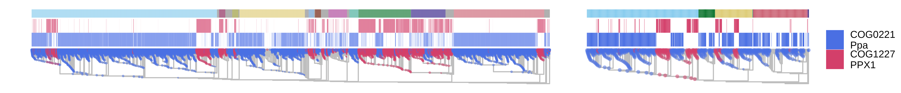
```{r ancestral reconstruction COG0420 COG4487 prok}
p_tree_cog_bac <- visualize_og_displacement_rect("cog", "bacteria", "COG0420", "COG4487", "SbcD", "DUF2130", "Phylum")
p_tree_cog_ar <- visualize_og_displacement_rect("cog", "archaea", "COG0420", "COG4487", "SbcD", "DUF2130", "Phylum")
p_tree_cog_prok <- (p_tree_cog_bac + theme(legend.position = "none") | p_tree_cog_ar) + plot_layout(widths = c(7,3))
ggsave(paste0("ms/tree_COG0420_COG4487_prok.png"), p_tree_cog_prok, height = 1.25, width = 12, dpi = 600)
```
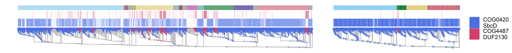
```{r ancestral reconstruction COG0050 COG3587 prok}
p_tree_cog_bac <- visualize_og_displacement_rect("cog", "bacteria", "COG0050", "COG3587", "TufA", "PM0699", "Phylum")
p_tree_cog_ar <- visualize_og_displacement_rect("cog", "archaea", "COG0050", "COG3587", "TufA", "PM0699", "Phylum")
p_tree_cog_prok <- (p_tree_cog_bac + theme(legend.position = "none") | p_tree_cog_ar) + plot_layout(widths = c(7,3))
ggsave(paste0("ms/tree_COG0050_COG3587_prok.png"), p_tree_cog_prok, height = 1.25, width = 12, dpi = 600)
```
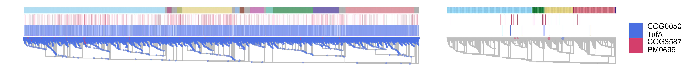

### KEGG

```{r ancestral reconstruction K03743 K03742 prok}
p_tree_kegg_bac <- visualize_og_displacement_rect("kegg", "bacteria", "K03743", "K03742", "pncC", "pncC", "Phylum")
p_tree_kegg_ar <- visualize_og_displacement_rect("kegg", "archaea", "K03743", "K03742", "pncC", "pncC", "Phylum")
p_tree_kegg_prok <- (p_tree_kegg_bac + theme(legend.position = "none") | p_tree_kegg_ar) + plot_layout(widths = c(7,3))
ggsave(paste0("ms/tree_K03743_K03742_prok.png"), p_tree_kegg_prok, height = 1.25, width = 12, dpi = 600)
```
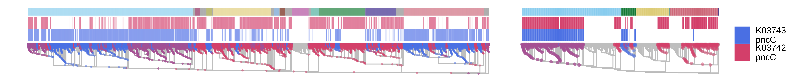
```{r ancestral reconstruction K02379 K00123 prok}
p_tree_kegg_bac <- visualize_og_displacement_rect("kegg", "bacteria", "K02379", "K00123", "fdhD", "fdoG", "Phylum")
p_tree_kegg_ar <- visualize_og_displacement_rect("kegg", "archaea", "K02379", "K00123", "fdhD", "fdoG", "Phylum")
p_tree_kegg_prok <- (p_tree_kegg_bac + theme(legend.position = "none") | p_tree_kegg_ar) + plot_layout(widths = c(7,3))
ggsave(paste0("ms/tree_K02379_K00123_prok.png"), p_tree_kegg_prok, height = 1.25, width = 12, dpi = 600)
```
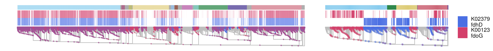

```{r ancestral reconstruction K02188 K03394 prok}
p_tree_kegg_bac <- visualize_og_displacement_rect("kegg", "bacteria", "K02188", "K03394", "cbiD", "cobI-cbiL", "Phylum")
p_tree_kegg_ar <- visualize_og_displacement_rect("kegg", "archaea", "K02188", "K03394", "cbiD", "cobI-cbiL", "Phylum")
p_tree_kegg_prok <- (p_tree_kegg_bac + theme(legend.position = "none") | p_tree_kegg_ar) + plot_layout(widths = c(7,3))
ggsave(paste0("ms/tree_K02188_K03394_prok.png"), p_tree_kegg_prok, height = 1.25, width = 12, dpi = 600)
```
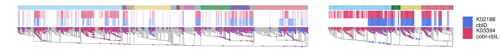

## Functions of anti-correlogs

### share_cog_fun_cat_n_tax

```{r edges share_cog_fun_cat_n_tax}
p_edge_share_cog <- vis_edge_fun_sharing_anti(dt_net_edge_cog, c("share_cog_fun_cat","share_cog_fun_path"))
ggsave(paste0("ms/share_cog_fun_cat_n_tax.png"), p_edge_share_cog, height = 3, width = 5.8, dpi = 600)
```
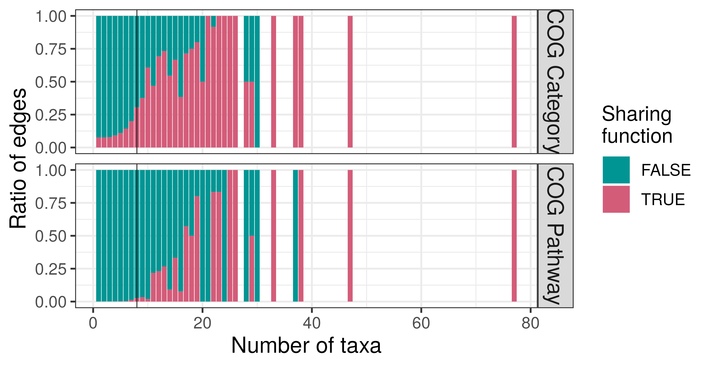

### share_cog_fun_cat_displacement

```{r edges share_cog_fun_cat_displacement}
# join n_replace and n_tax
df_net_edge_cog_replace <- combine_with_net_edge_stats2(dt_net_edge_cog, df_og_replacement_cog_prok)
# plot
p_edge_share_cog <- vis_edge_fun_sharing_anti_displacement(df_net_edge_cog_replace, c("share_cog_fun_cat","share_cog_fun_path"))
ggsave(paste0("ms/share_cog_fun_cat_displacement.png"), p_edge_share_cog, height = 2.5, width = 5, dpi = 600)
```
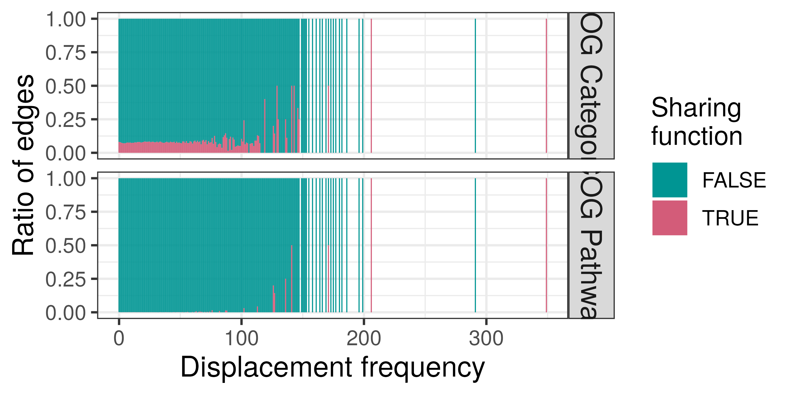

### share_kegg_fun_cat_n_tax
```{r share_kegg_fun_cat_n_tax}
p_edge_share_kegg <- vis_edge_fun_sharing_anti(dt_net_edge_kegg, c("share_ko_path_num_specific","share_ko_rn","share_ko_ec1","share_ko_ec2","share_ko_ec3","share_ko_ec"))
ggsave(paste0("ms/share_kegg_fun_cat_n_tax.png"), p_edge_share_kegg, height = 6, width = 6, dpi = 150)
```
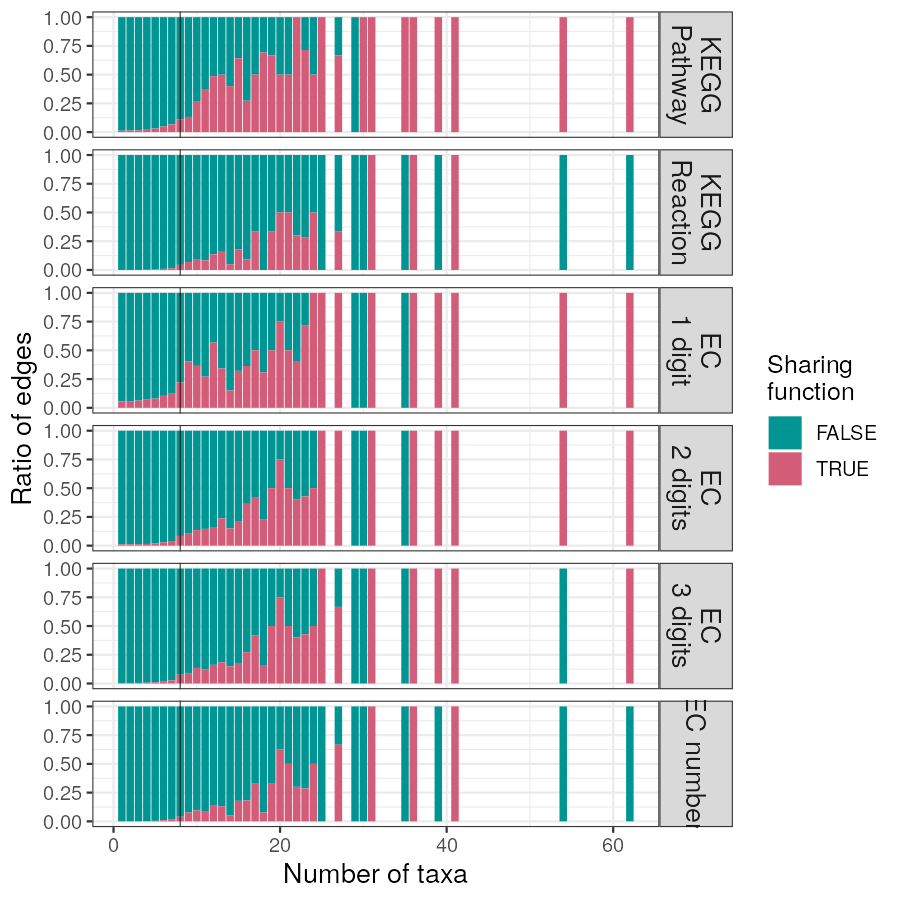

### share_cog_fun_cat_node_ratio

```{r share_cog_fun_cat_node_ratio}
# join n_replace and n_tax
df_net_edge_cog_replace <- combine_with_net_edge_stats2(dt_net_edge_cog, df_og_replacement_cog_prok)
# make graph object
g_cog_0_contra_replace <- df_net_edge_cog_replace %>% select(og_id_A,og_id_B,n_tax,n_replace_prok) %>% 
  graph_from_data_frame(directed = FALSE, vertices = read_cog2020_def_fixed_funcat_text())
# extract n_tax >= 0 (original) nodes
df_cog_node_ori <- g_cog_0_contra_replace %>% as_data_frame(what = "vertices") %>% as_tibble()
# extract n_tax >= 8 nodes
eids_ntax8 <- igraph::E(g_cog_0_contra_replace)[igraph::E(g_cog_0_contra_replace)$n_tax >= 8]
df_cog_node_ntax8 <- subgraph.edges(g_cog_0_contra_replace, eids_ntax8, delete.vertices = TRUE) %>% 
  as_data_frame(what = "vertices") %>% as_tibble()
# n_replace_prok >= 100 nodes
eids_nrep100 <- igraph::E(g_cog_0_contra_replace)[igraph::E(g_cog_0_contra_replace)$n_replace_prok >= 100]
df_cog_node_nrep100 <- subgraph.edges(g_cog_0_contra_replace, eids_nrep100, delete.vertices = TRUE) %>% 
  as_data_frame(what = "vertices") %>% as_tibble()
# make non-redundant cog_fun_cat tsv
df_cog_node_ori_funcat <- df_cog_node_ori %>% 
  mutate(cog_fun_cat_text_single = strsplit(cog_fun_cat_text, ";")) %>% unnest(c(cog_fun_cat_text_single))
df_cog_node_ntax8_funcat <- df_cog_node_ntax8 %>% 
  mutate(cog_fun_cat_text_single = strsplit(cog_fun_cat_text, ";")) %>% unnest(c(cog_fun_cat_text_single))
df_cog_node_nrep100_funcat <- df_cog_node_nrep100 %>% 
  mutate(cog_fun_cat_text_single = strsplit(cog_fun_cat_text, ";")) %>% unnest(c(cog_fun_cat_text_single))
# make cog_fun_cat cross-tab
df_cog_node_funcat_cross <- rbind(
  df_cog_node_ori_funcat %>% group_by(cog_fun_cat_text_single) %>% summarize(n_nodes = dplyr::n()) %>% 
    mutate(edge_group = "Original"),
  df_cog_node_ntax8_funcat %>% group_by(cog_fun_cat_text_single) %>% summarize(n_nodes = dplyr::n()) %>%
    mutate(edge_group = "n_tax >= 8"),
  df_cog_node_nrep100_funcat %>% group_by(cog_fun_cat_text_single) %>% summarize(n_nodes = dplyr::n()) %>% 
    mutate(edge_group = "n_replace_prok >= 100")
)
df_cog_node_funcat_cross$edge_group <- 
  factor(df_cog_node_funcat_cross$edge_group,
         levels = rev(c("Original","n_replace_prok >= 100","n_tax >= 8")))
# node color
node_colors <- c(
  "C, Energy production and conversion",
  "P, Inorganic ion transport and metabolism",
  "H, Coenzyme transport and metabolism",
  "I, Lipid transport and metabolism",
  "E, Amino acid transport and metabolism",
  "J, Translation, ribosomal structure and biogenesis",
  "G, Carbohydrate transport and metabolism",
  "M, Cell wall/membrane/envelope biogenesis",
  "L, Replication, recombination and repair",
  "V, Defense mechanisms",
  "S, Function unknown",
  "R, General function prediction only"
)
df_cog_node_funcat_cross$cog_fun_cat_text_single <- 
  factor(df_cog_node_funcat_cross$cog_fun_cat_text_single, levels = node_colors)
# plot
p_share_cog_fun_cat_node_ratio <- df_cog_node_funcat_cross %>%
  ggplot(aes(x = n_nodes, y = edge_group, fill = cog_fun_cat_text_single)) +
  geom_bar(stat = "identity", position = "fill", color = "black") +
  scale_fill_manual(values = cbp12, na.value = "white")
ggsave(paste0("ms/share_cog_fun_cat_node_ratio.png"), p_share_cog_fun_cat_node_ratio, height = 2.7, width = 7.5, dpi = 600)
```
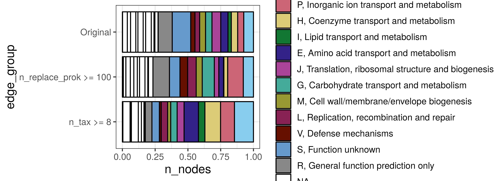

### share_cog_fun_cat_node_ratio_2

```{r share_cog_fun_cat_node_ratio_2}
# join n_replace and n_tax
df_net_edge_cog_replace <- combine_with_net_edge_stats2(dt_net_edge_cog, df_og_replacement_cog_prok)
# make graph object
g_cog_0_contra_replace <- df_net_edge_cog_replace %>% select(og_id_A,og_id_B,n_tax,n_replace_prok) %>% 
  graph_from_data_frame(directed = FALSE, vertices = read_cog2020_def_fixed_funcat_text())
# extract n_tax >= 0 (original) nodes
df_cog_node_ori <- g_cog_0_contra_replace %>% as_data_frame(what = "vertices") %>% as_tibble()
# extract n_tax >= 8 nodes
eids_ntax8 <- igraph::E(g_cog_0_contra_replace)[igraph::E(g_cog_0_contra_replace)$n_tax >= 8]
df_cog_node_ntax8 <- subgraph.edges(g_cog_0_contra_replace, eids_ntax8, delete.vertices = TRUE) %>% 
  as_data_frame(what = "vertices") %>% as_tibble()
# n_tax < 8; n_replace_prok >= 90 nodes
eids_nrep90 <- igraph::E(g_cog_0_contra_replace)[igraph::E(g_cog_0_contra_replace)$n_tax < 8 & igraph::E(g_cog_0_contra_replace)$n_replace_prok >= 90]
df_cog_node_nrep90 <- subgraph.edges(g_cog_0_contra_replace, eids_nrep90, delete.vertices = TRUE) %>% 
  as_data_frame(what = "vertices") %>% as_tibble()
# make non-redundant cog_fun_cat tsv
df_cog_node_ori_funcat <- df_cog_node_ori %>% 
  mutate(cog_fun_cat_text_single = strsplit(cog_fun_cat_text, ";")) %>% unnest(c(cog_fun_cat_text_single))
df_cog_node_ntax8_funcat <- df_cog_node_ntax8 %>% 
  mutate(cog_fun_cat_text_single = strsplit(cog_fun_cat_text, ";")) %>% unnest(c(cog_fun_cat_text_single))
df_cog_node_nrep90_funcat <- df_cog_node_nrep90 %>% 
  mutate(cog_fun_cat_text_single = strsplit(cog_fun_cat_text, ";")) %>% unnest(c(cog_fun_cat_text_single))
# make cog_fun_cat cross-tab
df_cog_node_funcat_cross <- rbind(
  df_cog_node_ori_funcat %>% group_by(cog_fun_cat_text_single) %>% summarize(n_nodes = dplyr::n()) %>% 
    mutate(edge_group = "Original"),
  df_cog_node_ntax8_funcat %>% group_by(cog_fun_cat_text_single) %>% summarize(n_nodes = dplyr::n()) %>%
    mutate(edge_group = "n_tax >= 8"),
  df_cog_node_nrep90_funcat %>% group_by(cog_fun_cat_text_single) %>% summarize(n_nodes = dplyr::n()) %>% 
    mutate(edge_group = "n_tax < 8\nn_replace_prok >= 90")
)
df_cog_node_funcat_cross$edge_group <- 
  factor(df_cog_node_funcat_cross$edge_group,
         levels = rev(c("Original","n_tax < 8\nn_replace_prok >= 90","n_tax >= 8")))
# node color
#df_cog_node_funcat_cross %>% group_by(cog_fun_cat_text_single) %>% summarize(n_nodes_sum = sum(n_nodes)) %>% 
#  arrange(desc(n_nodes_sum)) %>% as.data.frame()
node_colors <- c(
  "C, Energy production and conversion",
  "P, Inorganic ion transport and metabolism",
  "H, Coenzyme transport and metabolism",
  "I, Lipid transport and metabolism",
  "E, Amino acid transport and metabolism",
  "J, Translation, ribosomal structure and biogenesis",
  "G, Carbohydrate transport and metabolism",
  "M, Cell wall/membrane/envelope biogenesis",
  "L, Replication, recombination and repair",
  "V, Defense mechanisms",
  "S, Function unknown",
  "R, General function prediction only"
)
df_cog_node_funcat_cross$cog_fun_cat_text_single <- 
  factor(df_cog_node_funcat_cross$cog_fun_cat_text_single, levels = node_colors)
# plot
p_share_cog_fun_cat_node_ratio_2 <- df_cog_node_funcat_cross %>%
  ggplot(aes(x = n_nodes, y = edge_group, fill = cog_fun_cat_text_single)) +
  geom_bar(stat = "identity", position = "fill", color = "black") +
  scale_fill_manual(values = cbp12, na.value = "white")
ggsave(paste0("ms/share_cog_fun_cat_node_ratio_2.png"), p_share_cog_fun_cat_node_ratio_2, height = 2.7, width = 7.5, dpi = 600)
#p_cog_fun_cat <- vis_stats_category_div_cog_fun_cat(g_cog_0_contra, g_cog_8_contra)
#ggsave(paste0("ms/fig_2b.png"), p_cog_fun_cat + labs(title = "b"), height = 3.75, width = 6.7, dpi = 600)
```
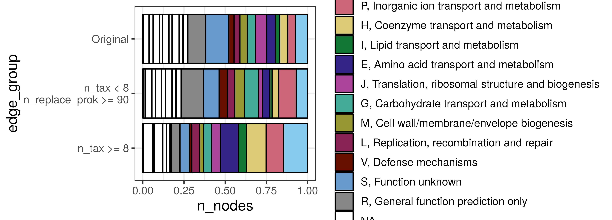

### share_cog_fun_cat_node_ratio_3

```{r share_cog_fun_cat_node_ratio_3}
# join n_replace and n_tax
df_net_edge_cog_replace <- combine_with_net_edge_stats2(dt_net_edge_cog, df_og_replacement_cog_prok)
# make graph object
g_cog_0_contra_replace <- df_net_edge_cog_replace %>% select(og_id_A,og_id_B,n_tax,n_replace_prok) %>% 
  graph_from_data_frame(directed = FALSE, vertices = read_cog2020_def_fixed_funcat_text())
# extract n_tax >= 0 (original) nodes
df_cog_node_ori <- g_cog_0_contra_replace %>% as_data_frame(what = "vertices") %>% as_tibble()
# extract n_tax >= 8 nodes
eids_ntax8 <- igraph::E(g_cog_0_contra_replace)[igraph::E(g_cog_0_contra_replace)$n_tax >= 8]
df_cog_node_ntax8 <- subgraph.edges(g_cog_0_contra_replace, eids_ntax8, delete.vertices = TRUE) %>% 
  as_data_frame(what = "vertices") %>% as_tibble()
# make non-redundant cog_fun_cat tsv
df_cog_node_ori_funcat <- df_cog_node_ori %>% 
  mutate(cog_fun_cat_text_single = strsplit(cog_fun_cat_text, ";")) %>% unnest(c(cog_fun_cat_text_single))
df_cog_node_ntax8_funcat <- df_cog_node_ntax8 %>% 
  mutate(cog_fun_cat_text_single = strsplit(cog_fun_cat_text, ";")) %>% unnest(c(cog_fun_cat_text_single))
# make cog_fun_cat cross-tab
df_cog_node_funcat_cross <- rbind(
  df_cog_node_ori_funcat %>% group_by(cog_fun_cat_text_single) %>% summarize(n_nodes = dplyr::n()) %>% 
    mutate(edge_group = "Original"),
  df_cog_node_ntax8_funcat %>% group_by(cog_fun_cat_text_single) %>% summarize(n_nodes = dplyr::n()) %>%
    mutate(edge_group = "n_tax >= 8")
)
df_cog_node_funcat_cross$edge_group <- 
  factor(df_cog_node_funcat_cross$edge_group,
         levels = c("Original","n_tax >= 8"))
node_colors <- c(
  "C, Energy production and conversion",
  "P, Inorganic ion transport and metabolism",
  "H, Coenzyme transport and metabolism",
  "I, Lipid transport and metabolism",
  "E, Amino acid transport and metabolism",
  "F, Nucleotide transport and metabolism",
  "J, Translation, ribosomal structure and biogenesis",
  "O, Posttranslational modification, protein turnover, chaperones",
  "G, Carbohydrate transport and metabolism",
  "L, Replication, recombination and repair",
  "S, Function unknown",
  "R, General function prediction only"
)
df_cog_node_funcat_cross$cog_fun_cat_text_single <- 
  factor(df_cog_node_funcat_cross$cog_fun_cat_text_single, levels = node_colors)
# plot
p_share_cog_fun_cat_node_ratio_3 <- df_cog_node_funcat_cross %>%
  ggplot(aes(y = n_nodes, x = edge_group, fill = cog_fun_cat_text_single)) +
  geom_bar(stat = "identity", position = "fill", color = "black") +
  scale_fill_manual(values = cbp12, na.value = "white")
ggsave(paste0("ms/share_cog_fun_cat_node_ratio_3.png"), p_share_cog_fun_cat_node_ratio_3, height = 3, width = 6.3, dpi = 600)
```
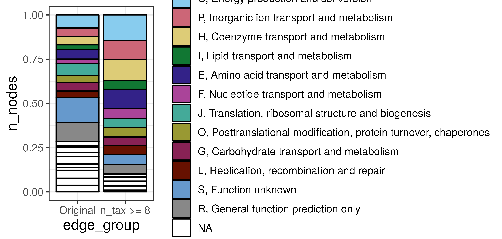

### share_cog_fun_cat_node_ratio_network

```{r share_cog_fun_cat_node_ratio_network}
ogs <- V(g_cog_8_contra)[V(g_cog_8_contra)$cog_fun_cat %in% c("C","P","H","I","E")]$name
p_cog_fun_cat_network <- pick_nodes_in_whole_network_cog_fun_cat(g_cog_8_contra, ogs)
#ggsave(paste0("ms/fig_2c.png"), p_cog_fun_cat_network + labs(title = "c"), height = 4, width = 4.2, dpi = 600)
ggsave(paste0("ms/share_cog_fun_cat_node_ratio_network.png"), p_cog_fun_cat_network, height = 4, width = 4.2, dpi = 600)
```
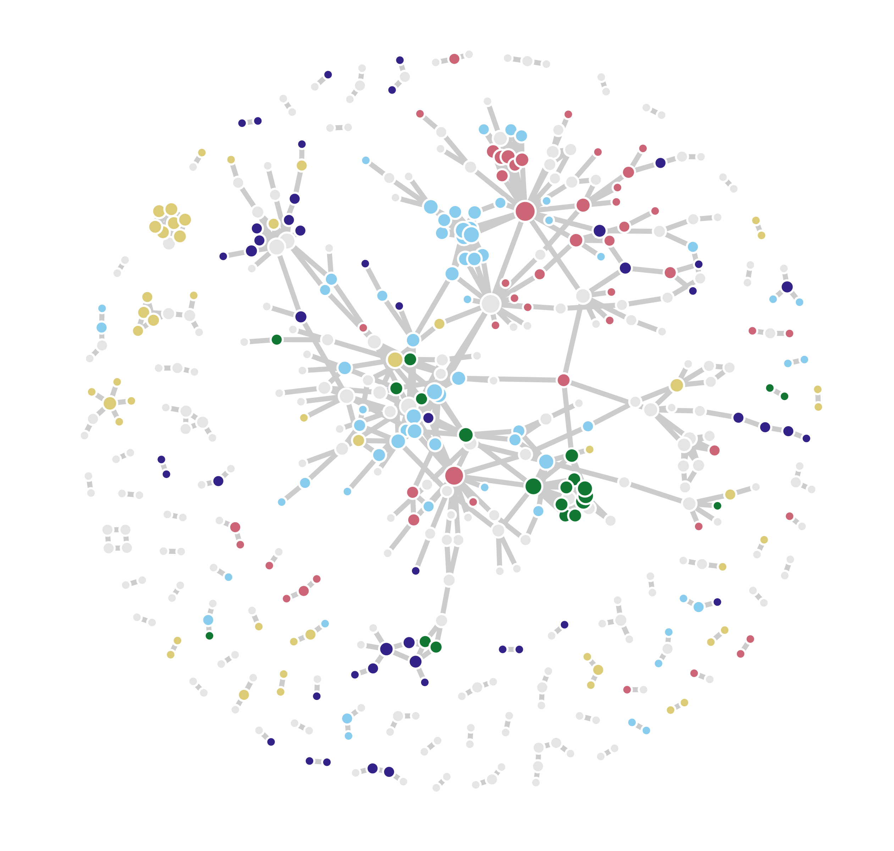

### share_cog_fun_cat_node_ratio_network_transporters

```{r share_cog_fun_cat_node_ratio_network_transporters}
# Make hash (vector) of transporter types
transporter_types <- df_cog_8_contra_transporter$transporter
names(transporter_types) <- df_cog_8_contra_transporter$og_id
# Add transporter types to network
V(g_cog_8_contra)$transporter_type <- transporter_types[V(g_cog_8_contra)$name]
# Draw network
df_g_network <- network_cog_graph2df(g_cog_8_contra, "transporter_type")
transporter_color <- c(
  "Black", # H_transporter
  "Black", # Na_transporter
  "Black", # H_Na_antiporter
  "Black", # transporter
  "Black", # K_transporter
  "grey80", # putative_transporter
  "grey80", # non_transporter
  "grey80", # membrane_bound
  "grey80" # potential_transporter
)
names(transporter_color) <- c("H_transporter","Na_transporter","H_Na_antiporter","transporter","K_transporter","putative_transporter","non_transporter","membrane_bound","potential_transporter")
p_transporter_analysis <- ggplot() +    
  geom_segment(
        aes(x = x, y = y, xend = xend, yend = yend),
        color = "grey80",
        data = df_g_network %>% filter(v_e == "edge")
    ) +
    new_scale("size") +
    geom_point(
        aes(x = x, y = y, fill = v_color),
        shape = 21,
        color = "white",
        data = df_g_network %>% filter(v_e == "vertex")
    ) +
    scale_fill_manual(values = transporter_color, na.value = "grey80") +
    coord_fixed(ratio = 1) +
  theme_blank() +
  theme(
    text = element_text(family = "Arial", size = 12),
            plot.title = element_text(face = "bold", hjust = 0, size = 24),
    plot.subtitle = element_text(hjust = 0.5, size = 13),
    plot.background = element_rect(fill = "white",color = NA),
    plot.tag = element_text(face = "bold", size = 18)
  )
ggsave(paste0("ms/share_cog_fun_cat_node_ratio_network_transporters.png"), p_transporter_analysis, height = 4, width = 6.6, dpi = 600)
```
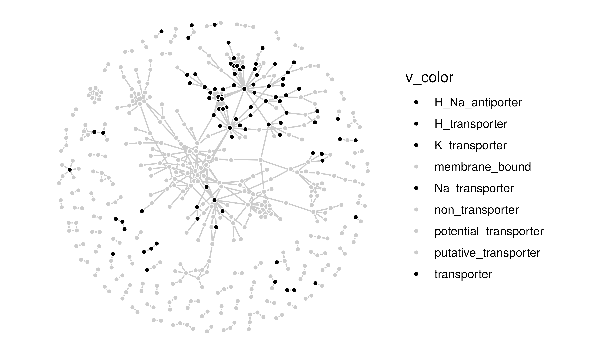

### isoprenoid_bipartite_network

```{r isoprenoid bipartite network}
As <- "COG1257;COG1577;COG3425;COG3407"
Bs <- "COG1154;COG0743;COG1211;COG1947;COG0245;COG0821;COG0761"
p_contra_terpen_network <- contrapositive_network_og_bipartite(g_cog_8_contra_displace, "cog", As, Bs, hcl.colors(2,"Blue-Red 2")[2], hcl.colors(2,"Blue-Red 2")[1], FALSE)
p_contra_terpen_network_label <- contrapositive_network_og_bipartite(g_cog_8_contra_displace, "cog", As, Bs, hcl.colors(2,"Blue-Red 2")[2], hcl.colors(2,"Blue-Red 2")[1], TRUE)
ggsave(paste0("ms/fig_2d.png"), p_contra_terpen_network + labs(title = "d"), height = 2, width = 3, dpi = 600)
ggsave(paste0("ms/fig_2d_labelled.png"), p_contra_terpen_network_label + labs(title = "d"), height = 2, width = 3, dpi = 600)
```
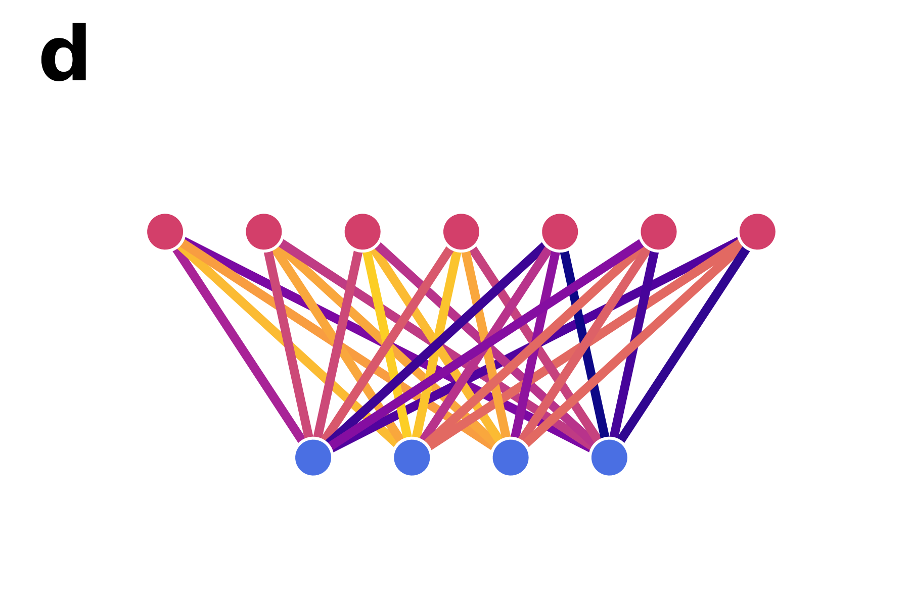

### isoprenoid_bipartite_heatmap

```{r isoprenoid bipartite heatmap}
As <- "COG1257;COG1577;COG3425;COG3407"
Bs <- "COG1154;COG0743;COG1211;COG1947;COG0245;COG0821;COG0761"
p_contra_terpen_tree_bac <- visualize_ogs_tree_binary("cog", "bacteria", As, Bs, "Phylum", 1.7, 0.08, 0.1, 0.2)
#ggsave(paste0("ms/fig_2e.png"), p_contra_terpen_tree_bac + theme(legend.position = "none") + labs(title = "e"), height = 2, width = 9, dpi = 600)
#ggsave(paste0("ms/fig_2e_legend.png"), p_contra_terpen_tree_bac + labs(title = "e"), height = 6, width = 6, dpi = 150)
ggsave(paste0("ms/isoprenoid_bipartite_heatmap.png"), p_contra_terpen_tree_bac + theme(legend.position = "none"), height = 3, width = 7, dpi = 600)
```
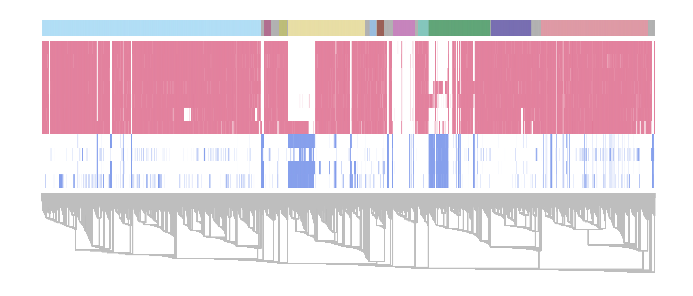

### nqr_nuo_bipartite_network

```{r nqr nuo bipartite network}
As <- "COG1726;COG1805;COG2869;COG1347;COG2209;COG2871;COG2035"
Bs <- "COG0838;COG0377;COG0852;COG0649;COG1034;COG1005;COG0839;COG0713;COG1008;COG1007;COG3158"
p_contra_nqr_nuo_network <- contrapositive_network_og_bipartite(g_cog_8_contra_displace, "cog", As, Bs, hcl.colors(2,"Blue-Red 2")[2], hcl.colors(2,"Blue-Red 2")[1], FALSE)
p_contra_nqr_nuo_network_label <- contrapositive_network_og_bipartite(g_cog_8_contra_displace, "cog", As, Bs, hcl.colors(2,"Blue-Red 2")[2], hcl.colors(2,"Blue-Red 2")[1], TRUE)
ggsave(paste0("ms/fig_2f.png"), p_contra_nqr_nuo_network + labs(title = "f"), height = 2, width = 3, dpi = 600)
ggsave(paste0("ms/fig_2f_labelled.png"), p_contra_nqr_nuo_network_label + labs(title = "f"), height = 2, width = 3, dpi = 600)
```
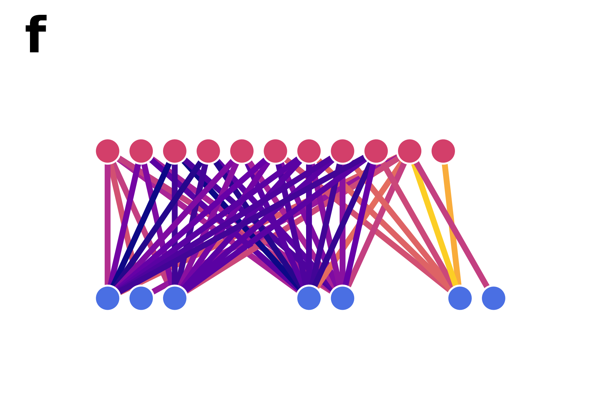

### nqr_nuo_bipartite_heatmap

```{r nqr nuo bipartite heatmap}
As <- "COG1726;COG1805;COG2869;COG1347;COG2209;COG2871" # ;COG2035
Bs <- "COG0838;COG0377;COG0852;COG0649;COG1034;COG1005;COG0839;COG0713;COG1008;COG1007" # ;COG3158
p_contra_nqr_nuo_tree_bac <- visualize_ogs_tree_binary("cog", "bacteria", As, Bs, "Phylum", 1.7, 0.08, 0.1, 0.2)
#ggsave(paste0("ms/fig_2g.png"), p_contra_nqr_nuo_tree_bac + theme(legend.position = "none") + labs(title = "g"), height = 2, width = 9, dpi = 600)
#ggsave(paste0("ms/fig_2g_legend.png"), p_contra_nqr_nuo_tree_bac + labs(title = "g"), height = 6, width = 6, dpi = 150)
ggsave(paste0("ms/nqr_nuo_bipartite_heatmap.png"), p_contra_nqr_nuo_tree_bac + theme(legend.position = "none"), height = 3.8, width = 7, dpi = 600)
```
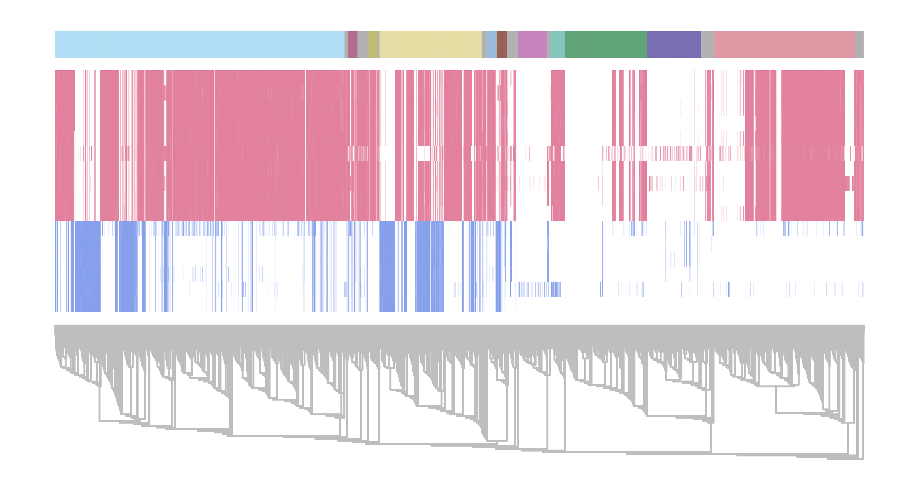

### cog_pathways

```{r cog_pathways}
df_cog_0_contra_nodes <- g_cog_0_contra %>% as_data_frame(what = "vertices") %>% as_tibble()
df_cog_pathway_nr <- df_cog_0_contra_nodes %>% filter(!is.na(cog_fun_path)) %>% 
  select(name,cog_fun_cat,cog_fun_path,cog_fun_cat_text) %>% 
  mutate(cog_fun_cat_text_single = strsplit(cog_fun_cat_text, ";")) %>% 
  unnest(c(cog_fun_cat_text_single))
# Number of all COGs
df_cog_fun_cat_whole <- df_cog_0_contra_nodes %>% select(name,cog_fun_cat,cog_fun_path,cog_fun_cat_text) %>% 
  mutate(cog_fun_cat_text_single = strsplit(cog_fun_cat_text, ";")) %>% 
  unnest(c(cog_fun_cat_text_single)) %>% group_by(cog_fun_cat_text_single) %>%
  summarize(all_cogs = dplyr::n())
# Number of COGs in Pathways
df_cog_fun_cat <- df_cog_pathway_nr %>% group_by(cog_fun_cat_text_single) %>%
  summarize(n_cogs = dplyr::n())
# Number of Pathways
df_cog_fun_path <- df_cog_pathway_nr %>% group_by(cog_fun_cat_text_single,cog_fun_path) %>% 
  summarize(n_cogs = dplyr::n()) %>% ungroup() %>% 
  group_by(cog_fun_cat_text_single) %>% summarize(n_path = dplyr::n())
df_cog_pathway_cross <- 
  left_join(df_cog_fun_cat_whole, df_cog_fun_path, by = "cog_fun_cat_text_single") %>% 
  left_join(df_cog_fun_cat, by = "cog_fun_cat_text_single")
df_cog_pathway_cross$n_path[is.na(df_cog_pathway_cross$n_path)] <- 0
df_cog_pathway_cross$n_cogs[is.na(df_cog_pathway_cross$n_cogs)] <- 0
# Set palette
node_colors <- c(
  "C, Energy production and conversion",
  "P, Inorganic ion transport and metabolism",
  "H, Coenzyme transport and metabolism",
  "I, Lipid transport and metabolism",
  "E, Amino acid transport and metabolism",
  "J, Translation, ribosomal structure and biogenesis",
  "G, Carbohydrate transport and metabolism",
  "M, Cell wall/membrane/envelope biogenesis",
  "L, Replication, recombination and repair",
  "V, Defense mechanisms",
  "S, Function unknown",
  "R, General function prediction only",
  "F, Nucleotide transport and metabolism",
  "Others"
)
df_cog_pathway_cross$cog_fun_cat_text_single <- 
  factor(df_cog_pathway_cross$cog_fun_cat_text_single, levels = node_colors)
df_cog_pathway_cross2 <- df_cog_pathway_cross %>% group_by(cog_fun_cat_text_single) %>%
  summarize(sum_all = sum(all_cogs), sum_cogs = sum(n_cogs), sum_path = sum(n_path))
df_cog_pathway_cross2$cog_fun_cat_text_single[is.na(df_cog_pathway_cross2$cog_fun_cat_text_single)] <- "Others"
# Plot
df_cog_pathway_cross3 <- df_cog_pathway_cross2 %>% 
  pivot_longer(cols = c(sum_all,sum_cogs,sum_path), names_to = "fun_class", values_to = "count")
p_cog_sum_all <- df_cog_pathway_cross3 %>% filter(fun_class == "sum_all") %>% 
  ggplot(aes(x = count, y = cog_fun_cat_text_single, fill = cog_fun_cat_text_single)) +
  geom_bar(stat = "identity", color = "black", linewidth = 0.25) +
  scale_fill_manual(values = c(cbp12,"black","white"), drop = FALSE)
p_cog_sum_path <- df_cog_pathway_cross3 %>% filter(fun_class == "sum_path") %>% 
  ggplot(aes(x = count, y = cog_fun_cat_text_single, fill = cog_fun_cat_text_single)) +
  geom_bar(stat = "identity", color = "black", linewidth = 0.25) +
  scale_fill_manual(values = c(cbp12,"black","white"), drop = FALSE)
p_cog_sum_cogs <- df_cog_pathway_cross3 %>% filter(fun_class == "sum_cogs") %>% 
  ggplot(aes(x = count, y = cog_fun_cat_text_single, fill = cog_fun_cat_text_single)) +
  geom_bar(stat = "identity", color = "black", linewidth = 0.25) +
  scale_fill_manual(values = c(cbp12,"black","white"), drop = FALSE)
p_cog_pathways <-
  (p_cog_sum_all + theme(legend.position = "none")) |
  (p_cog_sum_path + theme(legend.position = "none", axis.text.y = element_blank(), axis.title.y = element_blank())) |
  (p_cog_sum_cogs + theme(axis.text.y = element_blank(), axis.title.y = element_blank()))
ggsave(paste0("ms/cog_pathways.png"), p_cog_pathways, height = 3, width = 9, dpi = 300)

# plotly
#ggplotly(
#  df_cog_pathway_nr %>% group_by(cog_fun_cat_text_single,cog_fun_path) %>%
#    summarize(n_cogs = dplyr::n()) %>% ungroup() %>% 
#    ggplot(aes(x = n_cogs, y = cog_fun_cat_text_single, fill = cog_fun_path)) +
#    geom_bar(stat = "identity", color = "black")
#)
```
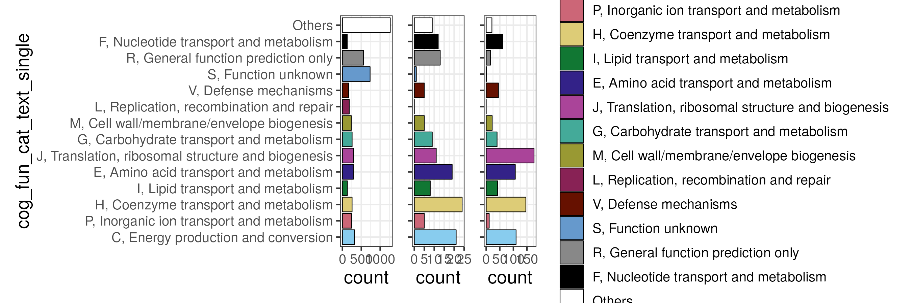

### cog_pathways_test

```{r}
df_cog_0_contra_nodes <- g_cog_0_contra %>% as_data_frame(what = "vertices") %>% as_tibble()
df_cog_pathway_nr <- df_cog_0_contra_nodes %>% filter(!is.na(cog_fun_path)) %>% 
  select(name,cog_fun_cat,cog_fun_path,cog_fun_cat_text) %>% 
  mutate(cog_fun_cat_text_single = strsplit(cog_fun_cat_text, ";")) %>% 
  unnest(c(cog_fun_cat_text_single))
# Number of all COGs
df_cog_fun_cat_whole <- df_cog_0_contra_nodes %>% select(name,cog_fun_cat,cog_fun_path,cog_fun_cat_text) %>% 
  mutate(cog_fun_cat_text_single = strsplit(cog_fun_cat_text, ";")) %>% 
  unnest(c(cog_fun_cat_text_single)) %>% group_by(cog_fun_cat_text_single) %>%
  summarize(all_cogs = dplyr::n())
# Number of COGs in Pathways
df_cog_fun_cat <- df_cog_pathway_nr %>% group_by(cog_fun_cat_text_single) %>%
  summarize(n_cogs = dplyr::n())
# Number of Pathways
df_cog_fun_path <- df_cog_pathway_nr %>% group_by(cog_fun_cat_text_single,cog_fun_path) %>% 
  summarize(n_cogs = dplyr::n()) %>% ungroup() %>% 
  group_by(cog_fun_cat_text_single) %>% summarize(n_path = dplyr::n())
df_cog_pathway_cross <- 
  left_join(df_cog_fun_cat_whole, df_cog_fun_path, by = "cog_fun_cat_text_single") %>% 
  left_join(df_cog_fun_cat, by = "cog_fun_cat_text_single")
df_cog_pathway_cross$n_path[is.na(df_cog_pathway_cross$n_path)] <- 0
df_cog_pathway_cross$n_cogs[is.na(df_cog_pathway_cross$n_cogs)] <- 0
# Histogram of n_path
df_cog_pathway_whole <- df_cog_pathway_cross %>% select(cog_fun_cat_text_single,n_path) %>% 
  mutate(cat_group = "whole")
CPHIE <- c(
  "C, Energy production and conversion",
  "P, Inorganic ion transport and metabolism",
  "H, Coenzyme transport and metabolism",
  "I, Lipid transport and metabolism",
  "E, Amino acid transport and metabolism"
)
df_cog_pathway_CPHIE <- df_cog_pathway_cross %>% select(cog_fun_cat_text_single,n_path) %>% 
  filter(cog_fun_cat_text_single %in% CPHIE) %>% mutate(cat_group = "CPHIE")
p_cog_pathways_test <- rbind(df_cog_pathway_whole, df_cog_pathway_CPHIE) %>% 
  ggplot(aes(x = n_path, fill = cat_group)) +
  geom_histogram(position = "identity", alpha = 0.5, bins = 24) +
  scale_fill_manual(values = hcl.colors(2,"Blue-Red 2"))
ggsave(paste0("ms/cog_pathways_test.png"), p_cog_pathways_test, height = 2.5, width = 4, dpi = 300)
# Wilcoxon test
install.packages("exactRankTests", dependencies=TRUE, repos='http://cran.rstudio.com/')
library(exactRankTests)
wilcox.exact(df_cog_pathway_whole$n_path,df_cog_pathway_CPHIE$n_path)
```
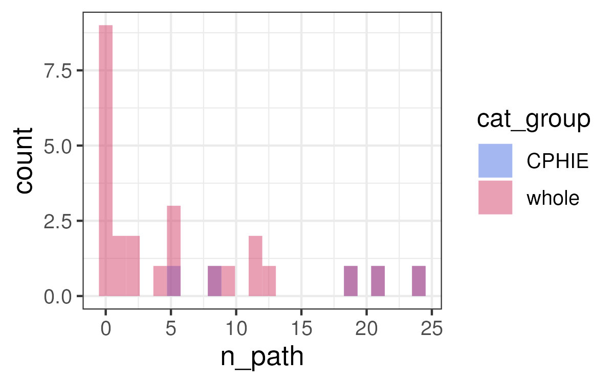

```
	Exact Wilcoxon rank sum test

data:  df_cog_pathway_whole$n_path and df_cog_pathway_CPHIE$n_path
W = 21.5, p-value = 0.01924
alternative hypothesis: true mu is not equal to 0
```

### known_vs_unknown

```{r known_vs_unknown}
# Classify R/S categories
df_net_edge_cog_RS <- dt_net_edge_cog %>%
  select(og_id_A,og_id_B,cog_fun_cat_A,cog_fun_cat_B) %>% 
  mutate(
    RS_A = map(
      cog_fun_cat_A, 
      ~ ifelse(length(grep("R", .x)) > 0 | length(grep("S", .x)) > 0, TRUE, FALSE)),
    RS_B = map(
      cog_fun_cat_B, 
      ~ ifelse(length(grep("R", .x)) > 0 | length(grep("S", .x)) > 0, TRUE, FALSE))
  ) %>%
  unnest(c(RS_A,RS_B)) %>% 
  mutate(RS_sum = RS_A + RS_B)
# Number of (0) known vs known, (1) known vs unknown, (3) unknown vs unknown
table(df_net_edge_cog_RS$RS_sum)
# Number of R/S nodes
unique(
  c(
    df_net_edge_cog_RS$og_id_A[df_net_edge_cog_RS$RS_A],
    df_net_edge_cog_RS$og_id_B[df_net_edge_cog_RS$RS_B]
  )
) %>% length()
# Number of R/S nodes (known vs unknown only)
df_net_edge_cog_RS_ku <- df_net_edge_cog_RS %>% filter(RS_sum == 1)
unique(
  c(
    df_net_edge_cog_RS_ku$og_id_A[df_net_edge_cog_RS_ku$RS_A],
    df_net_edge_cog_RS_ku$og_id_B[df_net_edge_cog_RS_ku$RS_B]
  )
) %>% length()
```
```
# Number of (0) known vs known, (1) known vs unknown, (3) unknown vs unknown
     0      1      2 
560194 348838  52680

# Number of R/S nodes
[1] 1292

# Number of R/S nodes (known vs unknown only)
[1] 1291
```

### known_vs_unknown_ntax8

```{r known_vs_unknown_ntax8}
# Classify R/S categories
df_net_edge_cog_RS <- dt_net_edge_cog %>% filter(n_tax >= 8) %>% 
  select(og_id_A,og_id_B,cog_fun_cat_A,cog_fun_cat_B) %>% 
  mutate(
    RS_A = map(
      cog_fun_cat_A, 
      ~ ifelse(length(grep("R", .x)) > 0 | length(grep("S", .x)) > 0, TRUE, FALSE)),
    RS_B = map(
      cog_fun_cat_B, 
      ~ ifelse(length(grep("R", .x)) > 0 | length(grep("S", .x)) > 0, TRUE, FALSE))
  ) %>%
  unnest(c(RS_A,RS_B)) %>% 
  mutate(RS_sum = RS_A + RS_B)
# Number of (0) known vs known, (1) known vs unknown, (3) unknown vs unknown
table(df_net_edge_cog_RS$RS_sum)
# Number of R/S nodes
unique(
  c(
    df_net_edge_cog_RS$og_id_A[df_net_edge_cog_RS$RS_A],
    df_net_edge_cog_RS$og_id_B[df_net_edge_cog_RS$RS_B]
  )
) %>% length()
# Number of R/S nodes (known vs unknown only)
df_net_edge_cog_RS_ku <- df_net_edge_cog_RS %>% filter(RS_sum == 1)
unique(
  c(
    df_net_edge_cog_RS_ku$og_id_A[df_net_edge_cog_RS_ku$RS_A],
    df_net_edge_cog_RS_ku$og_id_B[df_net_edge_cog_RS_ku$RS_B]
  )
) %>% length()
```
```
# Number of (0) known vs known, (1) known vs unknown, (3) unknown vs unknown
  0   1   2 
442  92   9 

# Number of R/S nodes
[1] 55

# Number of R/S nodes (known vs unknown only)
[1] 47
```

## Habitat analysis (GMGC)

### transporter_analysis

```{r transporter_analysis}
# Make hash (vector) of transporter types
transporter_types <- df_cog_8_contra_transporter$transporter
names(transporter_types) <- df_cog_8_contra_transporter$og_id
# Add transporter types to network
V(g_cog_8_contra)$transporter_type <- transporter_types[V(g_cog_8_contra)$name]
# Draw network
df_g_network <- network_cog_graph2df(g_cog_8_contra, "transporter_type")
transporter_color <- c(
  hcl.colors(2,"Blue-Red 2")[2], # H_transporter
  hcl.colors(2,"Blue-Red 2")[1], # Na_transporter
  hcl.colors(2,"Green-Orange")[2], # H_Na_antiporter
  hcl.colors(2,"Green-Orange")[1], # transporter
  hcl.colors(2,"Green-Orange")[1], # K_transporter
  "black", # putative_transporter
  "grey80", # non_transporter
  "grey80", # membrane_bound
  "grey80" # potential_transporter
)
names(transporter_color) <- c("H_transporter","Na_transporter","H_Na_antiporter","transporter","K_transporter","putative_transporter","non_transporter","membrane_bound","potential_transporter")
p_transporter_analysis <- ggplot() +	
  geom_segment(
		aes(x = x, y = y, xend = xend, yend = yend),
		color = "grey80",
		data = df_g_network %>% filter(v_e == "edge")
	) +
	new_scale("size") +
	geom_point(
		aes(x = x, y = y, fill = v_color),
		shape = 21,
		color = "white",
		data = df_g_network %>% filter(v_e == "vertex")
	) +
	scale_fill_manual(values = transporter_color, na.value = "grey80") +
	coord_fixed(ratio = 1) +
  theme_blank() +
  theme(
  	text = element_text(family = "Arial", size = 12),
      		plot.title = element_text(face = "bold", hjust = 0, size = 24),
  	plot.subtitle = element_text(hjust = 0.5, size = 13),
  	plot.background = element_rect(fill = "white",color = NA),
  	plot.tag = element_text(face = "bold", size = 18)
  )
ggsave(paste0("ms/transporter_analysis.png"), p_transporter_analysis, height = 6, width = 6, dpi = 450)
```
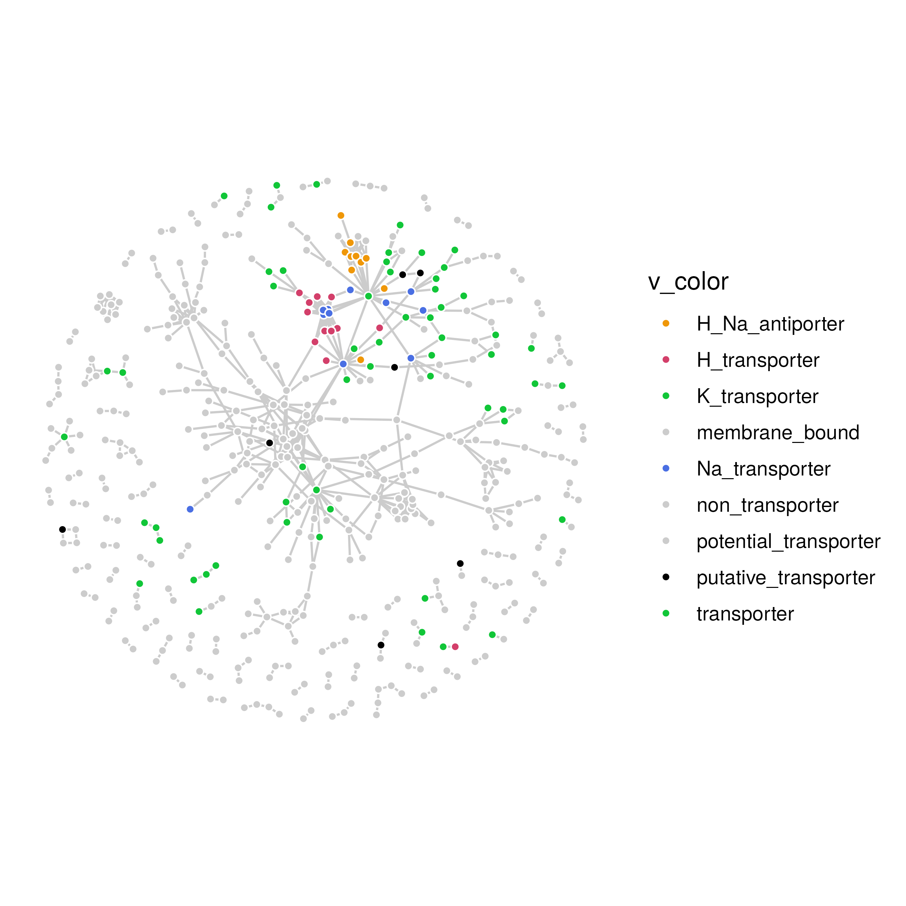

### transporter_analysis_bray

```{r transporter_analysis_bray}
# Calculate Bray-curtis
g_cog_8_contra_bray <- gmgc10_network_bray(g_cog_8_contra, df_gmgc10_cog_norm)
igraph::E(g_cog_8_contra_bray)$bray_binned <- cut(igraph::E(g_cog_8_contra_bray)$bray, c(0,0.25,0.5,0.75,1))
# Make hash (vector) of transporter types
transporter_types <- df_cog_8_contra_transporter$transporter
names(transporter_types) <- df_cog_8_contra_transporter$og_id
# Add transporter types to network
V(g_cog_8_contra_bray)$transporter_type <- transporter_types[V(g_cog_8_contra_bray)$name]
# Draw network
df_g_network <- network_cog_graph2df(g_cog_8_contra_bray, "transporter_type")
transporter_color <- c(
  hcl.colors(2,"Blue-Red 2")[2], # H_transporter
  hcl.colors(2,"Blue-Red 2")[1], # Na_transporter
  hcl.colors(2,"Green-Orange")[2], # H_Na_antiporter
  hcl.colors(2,"Green-Orange")[1], # transporter
  hcl.colors(2,"Green-Orange")[1], # K_transporter
  "black", # putative_transporter
  "grey80", # non_transporter
  "grey80", # membrane_bound
  "grey80" # potential_transporter
)
names(transporter_color) <- c("H_transporter","Na_transporter","H_Na_antiporter","transporter","K_transporter","putative_transporter","non_transporter","membrane_bound","potential_transporter")
p_transporter_analysis_bray <- ggplot() +	
  geom_segment(
		aes(x = x, y = y, xend = xend, yend = yend, color = bray_binned),
		data = df_g_network %>% filter(v_e == "edge")
	) +
  scale_color_manual(values = rev(hcl.colors(4,"Light Grays")), na.value = rev(hcl.colors(4,"Light Grays"))[1]) +
	new_scale("size") +
	geom_point(
		aes(x = x, y = y, fill = v_color),
		shape = 21,
		color = "white",
		data = df_g_network %>% filter(v_e == "vertex")
	) +
	scale_fill_manual(values = transporter_color, na.value = "grey80") +
	coord_fixed(ratio = 1) +
  theme_blank() +
  theme(
  	text = element_text(family = "Arial", size = 12),
      		plot.title = element_text(face = "bold", hjust = 0, size = 24),
  	plot.subtitle = element_text(hjust = 0.5, size = 13),
  	plot.background = element_rect(fill = "white",color = NA),
  	plot.tag = element_text(face = "bold", size = 18)
  )
ggsave(paste0("ms/transporter_analysis_bray.png"), p_transporter_analysis_bray, height = 6, width = 6, dpi = 350)
```
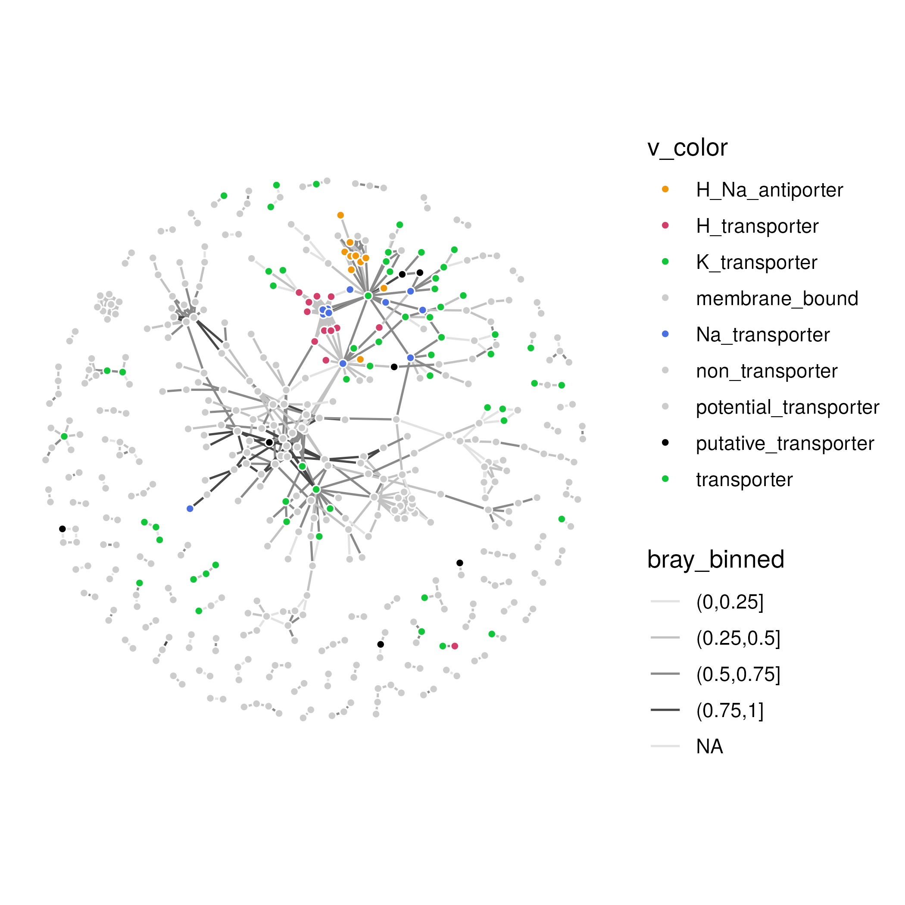

### transporter_analysis_bipartite

```{r transporter_analysis_bipartite}
# Make hash (vector) of transporter types
transporter_types <- df_cog_8_contra_transporter$transporter
names(transporter_types) <- df_cog_8_contra_transporter$og_id
# Add transporter types to network
V(g_cog_8_contra)$transporter_type <- transporter_types[V(g_cog_8_contra)$name]
# Extract transporters
g_cog_8_contra_transporters <- subgraph(
  g_cog_8_contra,
  V(g_cog_8_contra)$name[V(g_cog_8_contra)$transporter_type %in% c("H_transporter","Na_transporter","H_Na_antiporter","transporter","K_transporter", "putative_transporter")]
)
# Extract the largest connected component and adjacent nodes
l_adjacent_nodes <- adjacent_vertices(
  g_cog_8_contra,
  components(g_cog_8_contra_transporters)$membership[components(g_cog_8_contra_transporters)$membership == 1] %>% 
    names()
)
adjacent_nodes <- tibble(OGs = names(l_adjacent_nodes)) %>% 
  mutate(nodes = map(OGs, ~ l_adjacent_nodes[[.x]]$name)) %>% unnest(nodes) %>% select(nodes) %>% pull() %>% unique()
g_cog_8_contra_transporters_large <- subgraph(g_cog_8_contra, adjacent_nodes)
# Map bipartite attribute
V(g_cog_8_contra_transporters_large)$type <- bipartite_mapping(g_cog_8_contra_transporters_large)$type
# Draw network
df_g_network <- network_cog_graph2df_bipartite(g_cog_8_contra_transporters_large, "transporter_type")
#df_g_network <- network_cog_graph2df(g_cog_8_contra_transporters_large, "transporter_type")
transporter_color <- c(
  hcl.colors(2,"Blue-Red 2")[2], # H_transporter
  hcl.colors(2,"Blue-Red 2")[1], # Na_transporter
  hcl.colors(2,"Green-Orange")[2], # H_Na_Antiporter
  hcl.colors(2,"Green-Orange")[1], # transporter
  hcl.colors(2,"Green-Orange")[1], # K_transporter
  "black", # putative_transporter
  "grey50", # non_transporter
  "grey50", # membrane_bound
  "grey50" # potential_transporter
)
names(transporter_color) <- c("H_transporter","Na_transporter","H_Na_antiporter","transporter","K_transporter","putative_transporter","non_transporter","membrane_bound","potential_transporter")
p_transporter_analysis_bipartite <- ggplot() +	
  geom_segment(
		aes(x = x, y = y, xend = xend, yend = yend),
		color = "grey70",
		data = df_g_network %>% filter(v_e == "edge")
	) +
	new_scale("size") +
	geom_point(
		aes(x = x, y = y, fill = v_color),
		shape = 21,
		color = "white",
		data = df_g_network %>% filter(v_e == "vertex")
	) +
	scale_fill_manual(values = transporter_color, na.value = "grey50") +
  theme_blank() +
  theme(
  	text = element_text(family = "Arial", size = 12),
      		plot.title = element_text(face = "bold", hjust = 0, size = 24),
  	plot.subtitle = element_text(hjust = 0.5, size = 13),
  	plot.background = element_rect(fill = "white",color = NA),
  	plot.tag = element_text(face = "bold", size = 18)
  )
ggsave(paste0("ms/transporter_analysis_bipartite.png"), p_transporter_analysis_bipartite, height = 2, width = 6, dpi = 450)
# Export tsv
write.table(g_cog_8_contra_transporters_large %>% as_data_frame("edges"), "data/tsv/anticonet_cog_transporter_analysis_bipartite.tsv", append=FALSE, quote=FALSE, sep = "\t", row.names=FALSE)
write.table(g_cog_8_contra_transporters_large %>% as_data_frame("vertices") %>% select(-name_custom), "data/tsv/anticonet_cog_transporter_analysis_bipartite_nodes.tsv", append=FALSE, quote=FALSE, sep = "\t", row.names=FALSE)
```
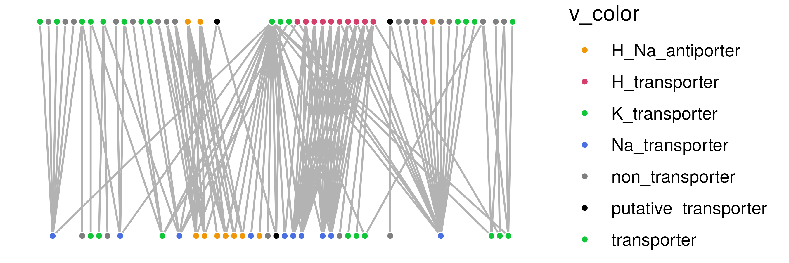

### transporter_analysis_bipartite_bray

```{r transporter_analysis_bipartite_bray}
# Calculate Bray-curtis
g_cog_8_contra_bray <- gmgc10_network_bray(g_cog_8_contra, df_gmgc10_cog_norm)
igraph::E(g_cog_8_contra_bray)$bray_binned <- cut(igraph::E(g_cog_8_contra_bray)$bray, c(0,0.25,0.5,0.75,1))
# Make hash (vector) of transporter types
transporter_types <- df_cog_8_contra_transporter$transporter
names(transporter_types) <- df_cog_8_contra_transporter$og_id
# Add transporter types to network
V(g_cog_8_contra_bray)$transporter_type <- transporter_types[V(g_cog_8_contra_bray)$name]
# Extract transporters
g_cog_8_contra_bray_transporters <- subgraph(
  g_cog_8_contra_bray,
  V(g_cog_8_contra_bray)$name[V(g_cog_8_contra_bray)$transporter_type %in% c("H_transporter","Na_transporter","H_Na_antiporter","transporter","K_transporter", "putative_transporter")]
)
# Extract the largest connected component and adjacent nodes
l_adjacent_nodes <- adjacent_vertices(
  g_cog_8_contra_bray,
  components(g_cog_8_contra_bray_transporters)$membership[components(g_cog_8_contra_bray_transporters)$membership == 1] %>% 
    names()
)
adjacent_nodes <- tibble(OGs = names(l_adjacent_nodes)) %>% 
  mutate(nodes = map(OGs, ~ l_adjacent_nodes[[.x]]$name)) %>% unnest(nodes) %>% select(nodes) %>% pull() %>% unique()
g_cog_8_contra_bray_transporters_large <- subgraph(g_cog_8_contra_bray, adjacent_nodes)
# Map bipartite attribute
V(g_cog_8_contra_bray_transporters_large)$type <- bipartite_mapping(g_cog_8_contra_bray_transporters_large)$type
# Draw network
df_g_network <- network_cog_graph2df_bipartite(g_cog_8_contra_bray_transporters_large, "transporter_type")
#df_g_network <- network_cog_graph2df(g_cog_8_contra_bray_transporters_large, "transporter_type")
transporter_color <- c(
  hcl.colors(2,"Blue-Red 2")[2], # H_transporter
  hcl.colors(2,"Blue-Red 2")[1], # Na_transporter
  hcl.colors(2,"Green-Orange")[2], # H_Na_Antiporter
  hcl.colors(2,"Green-Orange")[1], # transporter
  hcl.colors(2,"Green-Orange")[1], # K_transporter
  "black", # putative_transporter
  "grey80", # non_transporter
  "grey80", # membrane_bound
  "grey80" # potential_transporter
)
names(transporter_color) <- c("H_transporter","Na_transporter","H_Na_antiporter","transporter","K_transporter","putative_transporter","non_transporter","membrane_bound","potential_transporter")
p_transporter_analysis_bipartite_bray <- ggplot() +	
  geom_segment(
		aes(x = x, y = y, xend = xend, yend = yend, color = bray_binned),
		data = df_g_network %>% filter(v_e == "edge")
	) +
  scale_color_manual(values = rev(hcl.colors(4,"Light Grays")), na.value = rev(hcl.colors(4,"Light Grays"))[1]) +
	new_scale("size") +
	geom_point(
		aes(x = x, y = y, fill = v_color),
		shape = 21,
		color = "white",
		data = df_g_network %>% filter(v_e == "vertex")
	) +
	scale_fill_manual(values = transporter_color, na.value = "grey80") +
  theme_blank() +
  theme(
  	text = element_text(family = "Arial", size = 12),
      		plot.title = element_text(face = "bold", hjust = 0, size = 24),
  	plot.subtitle = element_text(hjust = 0.5, size = 13),
  	plot.background = element_rect(fill = "white",color = NA),
  	plot.tag = element_text(face = "bold", size = 18)
  )
ggsave(paste0("ms/transporter_analysis_bipartite_bray.png"), p_transporter_analysis_bipartite_bray, height = 2, width = 6, dpi = 450)
# Export tsv
write.table(g_cog_8_contra_bray_transporters_large %>% as_data_frame("edges"), "data/tsv/anticonet_cog_transporter_analysis_bipartite_bray.tsv", append=FALSE, quote=FALSE, sep = "\t", row.names=FALSE)
write.table(g_cog_8_contra_bray_transporters_large %>% as_data_frame("vertices") %>% select(-name_custom), "data/tsv/anticonet_cog_transporter_analysis_bipartite_bray_nodes.tsv", append=FALSE, quote=FALSE, sep = "\t", row.names=FALSE)
```
```{sh}
cp data/tsv/anticonet_cog_transporter_analysis_bipartite_bray.tsv ms/
cp data/tsv/anticonet_cog_transporter_analysis_bipartite_bray_nodes.tsv ms/
```
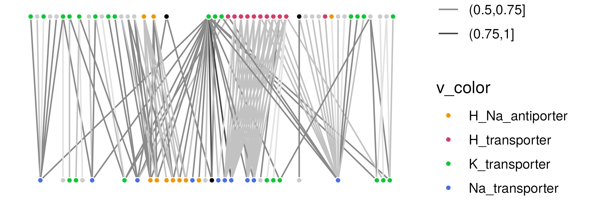

#### transporter_analysis_bipartite_bray (Cytoscape)

- By using Cytoscape, graphs were manually generated from [anticonet_cog_transporter_analysis_bipartite_bray.tsv](anticonet_cog_transporter_analysis_bipartite_bray.tsv) and [anticonet_cog_transporter_analysis_bipartite_bray_nodes.tsv](anticonet_cog_transporter_analysis_bipartite_bray_nodes.tsv)
  - `Layout` -> `Attribute Grid Layout` -> Modify `Number of columns in the grid`
  - Export figures: 1,240 px width
- The Cytoscape object can be downloaded from [NDEx platform](https://www.ndexbio.org/#/)

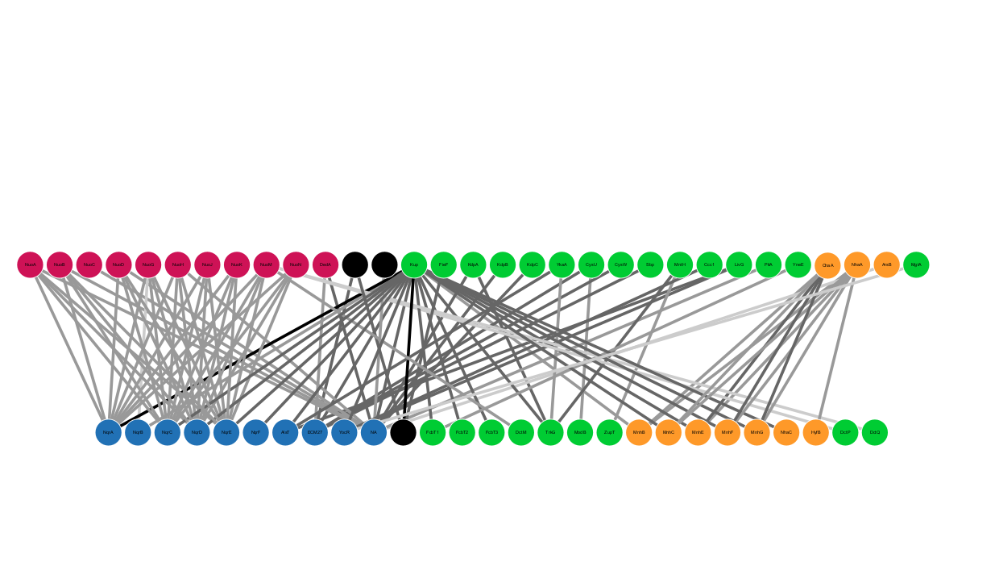

### gmgc_habitat_barplot

```{r gmgc_habitat_barplot}
# OGs to plot (Sorted)
gmgc_habitat_barplot_ogs <- c(
  "COG0838", # NuoA
  "COG0377", # NuoB
  "COG0852", # NuoC
  "COG0649", # NuoD
  "COG1034", # NuoG
  "COG1005", # NuoH
  "COG0839", # NuoJ
  "COG0713", # NuoK
  "COG1008", # NuoM
  "COG1007", # NuoN
  "COG0586", # DedA
  "COG3162", # YjcH
  "COG2426", # NA
  "COG3158", # Kup
  "COG0053", # FieF
  "COG2060", # KdpA
  "COG2216", # KdpB
  "COG2156", # KdpC
  "COG1392", # YkaA
  "COG0555", # CysU
  "COG4208", # CysW
  "COG1613", # Sbp
  "COG1914", # MntH
  "COG1814", # Ccc1
  "COG0411", # LivG
  "COG0306", # PitA
  "COG3781", # YneE
  "COG0387", # ChaA
  "COG3004", # NhaA
  "COG1055", # ArsB
  "COG0474", # MgtA
  "COG1726", # NqrA
  "COG1805", # NqrB
  "COG2869", # NqrC
  "COG1347", # NqrD
  "COG2209", # NqrE
  "COG2871", # NqrF
  "COG1115", # AlsT
  "COG0530", # ECM27
  "COG0733", # YocR
  "COG2035", # DUF368
  "COG4327", # NA
  "COG4663", # FcbT1
  "COG4665", # FcbT2
  "COG4664", # FcbT3
  "COG3090", # DctM
  "COG0168", # TrkG
  "COG4149", # ModB
  "COG0428", # ZupT
  "COG2111", # MnhB
  "COG1006", # MnhC
  "COG1863", # MnhE
  "COG2212", # MnhF
  "COG1320", # MnhG
  "COG1757", # NhaC
  "COG0651", # HyfB
  "COG1638", # DctP
  "COG1593" # DctQ
)
# Draw barplot
p_gmgc_habitat_barplot <- gmgc_bar_horizon3(df_gmgc10_cog_norm, gmgc_habitat_barplot_ogs)
ggsave("ms/gmgc_habitat_barplot.png", p_gmgc_habitat_barplot, height = 3, width = 16.7, dpi = 150)
ggsave("ms/gmgc_habitat_barplot_legend.png", p_gmgc_habitat_barplot, height = 5, width = 12, dpi = 150)
```
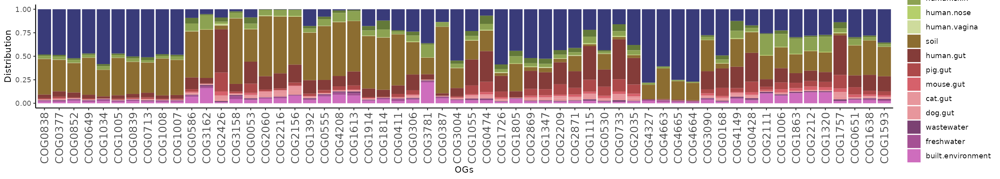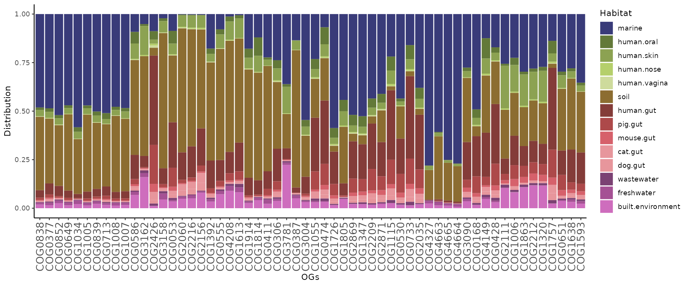

### gmgc_bray_cog_n_tax

```{r gmgc_bray_cog_n_tax}
df_gmgc_cog <- read_gmgc10_env_gene_abundance("cog") %>% gmgc10_env_gene_relative_abundance()
g_cog_0_contra_bray <- gmgc10_network_bray(g_cog_0_contra, df_gmgc_cog)
p_cog_0_contra_bray_n_tax <- vis_edge_bray_n_tax(g_cog_0_contra_bray) + 
  theme(legend.position = "top", axis.title.x = element_blank())
ggsave("ms/gmgc_bray_cog_n_tax.png", p_cog_0_contra_bray_n_tax, height = 2.8, width = 7, dpi = 150)
```
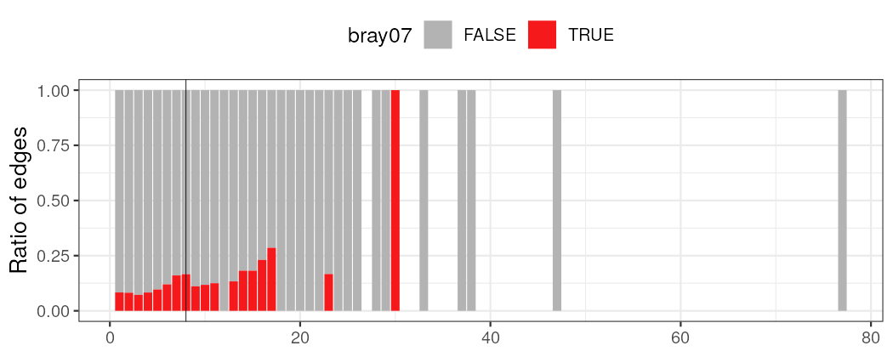

### gmgc_bray_permutation

- Rewire 10,000 times; Randomization 1,000 times.

```{r gmgc_bray_permutation}
# Calculate bray for original anti-correlogome network (>=8 taxa)
df_gmgc_cog <- read_gmgc10_env_gene_abundance("cog") %>% gmgc10_env_gene_relative_abundance()
g_cog_8_contra_bray <- gmgc10_network_bray(g_cog_8_contra, df_gmgc_cog)
cog_8_contra_bray_median <- median(igraph::E(g_cog_8_contra_bray)$bray, na.rm = TRUE)
# Random permutation
df_cog_8_contra_rand <- tibble(id = seq(1,1000)) %>% 
  mutate(
    bray_graphs = map(id, ~ {
      set.seed(.x)
      rewire(g_cog_8_contra, keeping_degseq(loops = FALSE, niter = 10000)) %>% 
        gmgc10_network_bray(df_gmgc_cog)
      }),
    bray_vals = map(bray_graphs, ~ igraph::E(.x)$bray),
    bray_median = map(bray_vals, ~ median(.x, na.rm = TRUE))
  ) %>% unnest(c(bray_median))
# Plot Bray-Curtis dissimilarity
df_cog_8_contra_bray_plot <- bind_rows(
  tibble(bray = df_cog_8_contra_rand %>% select(bray_vals) %>% unnest(c(bray_vals)) %>% pull(), 
         Category = "≥8 taxa\nshuffle"),
  tibble(bray = igraph::E(g_cog_8_contra_bray)$bray, Category = "≥8 taxa"),
  tibble(bray = igraph::E(g_cog_8_contra_bray)$bray[!igraph::E(g_cog_8_contra_bray)$share_cog_fun_cat], 
         Category = "≥8 taxa\ndiff. fun.")
)
df_cog_8_contra_bray_plot$Category <- 
  factor(df_cog_8_contra_bray_plot$Category, levels = c("≥8 taxa\nshuffle","≥8 taxa","≥8 taxa\ndiff. fun."))
p_cog_8_contra_bray_plot <- df_cog_8_contra_bray_plot %>% 
  ggplot(aes(x = Category, y = bray)) + labs(y = "Bray-Curtis dissimilarity") +
  #ggplot(aes(x = Category, y = bray)) + ylim(c(0,1.2)) + labs(y = "Bray-Curtis dissimilarity") +
  #geom_point(position = position_jitter(), size = 0.1, color = "grey80") +
  geom_violin(fill = "grey40") + geom_boxplot(outlier.color = NA, fill = "white", width = 0.1)
ggsave("ms/gmgc_bray_permutation.png", p_cog_8_contra_bray_plot, height = 2.7, width = 3, dpi = 300)

### Followings were performed for check ###

# Make random networks by Degree-preserving randomization
set.seed(1)
g_cog_8_contra_bray_rand <- g_cog_8_contra %>% 
  rewire(keeping_degseq(loops = FALSE, niter = 10000))
# Draw networks for check
g_cog_8_contra_bray %>% ggnetwork() %>% 
  ggplot(aes(x = x, y = y, xend = xend, yend = yend)) + geom_edges() + geom_nodes(aes(color = name)) +
  scale_color_viridis_d() + theme(legend.position = "none")
g_cog_8_contra_bray_rand %>% ggnetwork() %>% 
  ggplot(aes(x = x, y = y, xend = xend, yend = yend)) + geom_edges() + geom_nodes(aes(color = name)) +
  scale_color_viridis_d() + theme(legend.position = "none")
# Degree distribution for check
degree_distribution(g_cog_8_contra_bray)
# [1] 0.000000000 0.526539278 0.210191083 0.093418259 0.061571125 0.038216561 0.016985138 0.012738854 #0.006369427 0.006369427 0.016985138
#[12] 0.002123142 0.002123142 0.000000000 0.000000000 0.000000000 0.000000000 0.000000000 0.004246285 #0.000000000 0.000000000 0.000000000
#[23] 0.002123142
degree_distribution(g_cog_8_contra_bray_rand)
# [1] 0.000000000 0.526539278 0.210191083 0.093418259 0.061571125 0.038216561 0.016985138 0.012738854 #0.006369427 0.006369427 0.016985138
#[12] 0.002123142 0.002123142 0.000000000 0.000000000 0.000000000 0.000000000 0.000000000 0.004246285 #0.000000000 0.000000000 0.000000000
#[23] 0.002123142
```
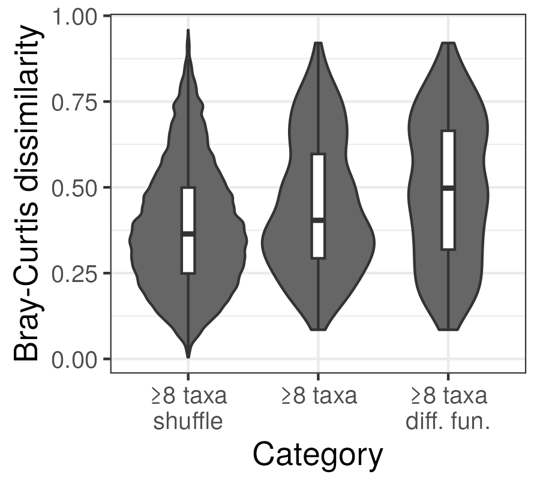

### gmgc_bray_permutation_pval

- Calculate p-value using median of 1,000 times randumization

```{r gmgc_bray_permutation_pval}
# Draw expected distribution
set.seed(1234)
p_cog_8_contra_rand <- (
  df_cog_8_contra_rand %>% ggplot(aes(x = bray_median)) + geom_density() + 
    geom_vline(xintercept = cog_8_contra_bray_median, color = "red") +
    theme(axis.text.x = element_blank(), axis.title.x = element_blank())
) / (
  df_cog_8_contra_rand %>% ggplot(aes(x = bray_median, y = "1")) + 
    geom_point(position = position_jitter(), size = 0.1, color = "grey80") + 
    labs(x = "Median Bray-Curtis dissimilarity") +
    geom_vline(xintercept = cog_8_contra_bray_median, color = "red")
) + plot_layout(heights = c(4,1))
ggsave("ms/gmgc_bray_permutation_pval.png", p_cog_8_contra_rand, height = 3, width = 4, dpi = 300)
# p-value
df_cog_8_contra_rand %>% 
  mutate(over_original = map(bray_median, ~ if (.x >= cog_8_contra_bray_median) {TRUE} else {FALSE})) %>% 
  unnest(c(over_original)) %>% group_by(over_original) %>% summarize(count = dplyr::n())
```
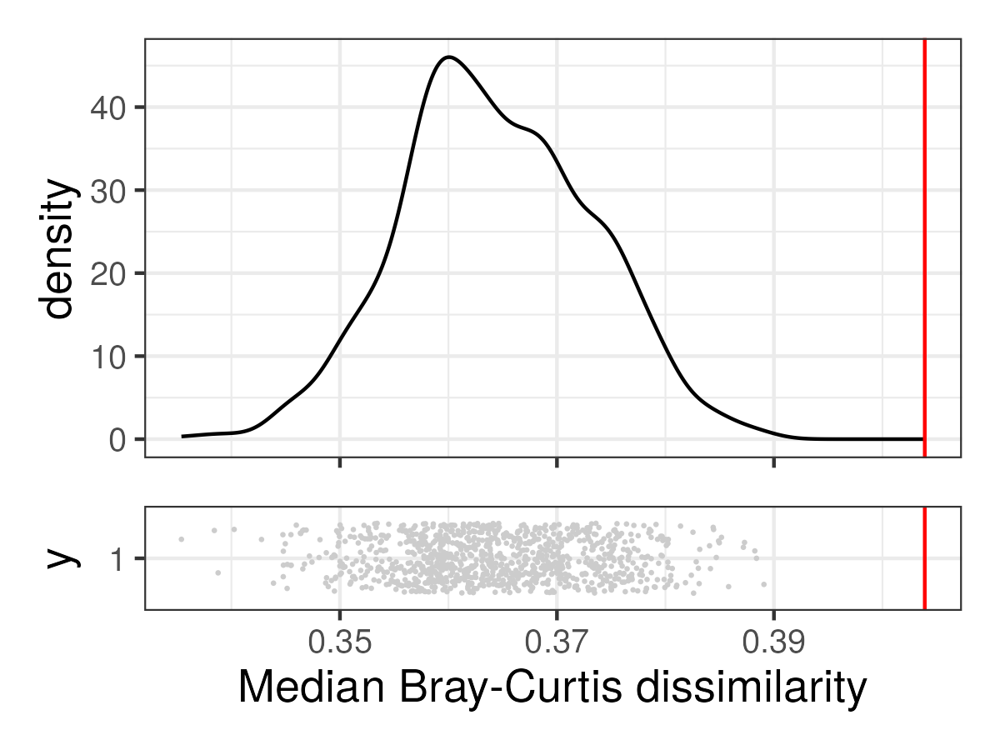

```
# A tibble: 1 × 2
  over_original count
  <lgl>         <int>
1 FALSE          1000
```

### gmgc_bray_network

```{r gmgc_bray_network}
# Add bray to network
df_gmgc_cog <- read_gmgc10_env_gene_abundance("cog") %>% gmgc10_env_gene_relative_abundance()
g_cog_8_contra_bray <- gmgc10_network_bray(g_cog_8_contra, df_gmgc_cog)
igraph::E(g_cog_8_contra_bray)$bray_binned <- cut(igraph::E(g_cog_8_contra_bray)$bray, c(0,0.5,0.7,1))
# Extract communities with bray >= 0.7
edges_bray_logic <- igraph::E(g_cog_8_contra_bray)$bray >= 0.7
edges_bray_logic[is.na(edges_bray_logic)] <- FALSE
edges_bray <- igraph::E(g_cog_8_contra_bray)[edges_bray_logic] %>% as_ids()
edges_bray_comp <- subgraph.edges(g_cog_8_contra_bray, edges_bray) %>% components()
df_clusters <- tibble(OGs = names(edges_bray_comp$membership), cluster_id = edges_bray_comp$membership)
cluster_colors <- df_clusters$cluster_id
names(cluster_colors) <- df_clusters$OGs
V(g_cog_8_contra_bray)$cluster_colors <- cluster_colors[V(g_cog_8_contra_bray)$name]
# Plot graph
df_g_network <- network_cog_graph2df(g_cog_8_contra_bray, "cluster_colors")
cluster_colors_pal <- c(
  cols25(15)[2], # 1
  cols25(15)[4], # 2
  cols25(15)[3], # 3
  cols25(15)[1], # 4
  cols25(15)[5:15] # 5-15
)
names(cluster_colors_pal) <- seq(1:15)
p_cog_8_contra_bray <- ggplot() +	
  geom_segment(
		aes(x = x, y = y, xend = xend, yend = yend, color = bray_binned),
		data = df_g_network %>% filter(v_e == "edge")
	) +
  scale_color_manual(values = rev(hcl.colors(3,"Light Grays")), na.value = rev(hcl.colors(3,"Light Grays"))[1]) +
	new_scale("color") +
	geom_point(
		aes(x = x, y = y, fill = as.factor(v_color)),
		shape = 21,
		color = "white",
		data = df_g_network %>% filter(v_e == "vertex")
	) +
	scale_fill_manual(values = cluster_colors_pal, na.value = "grey80") +
	coord_fixed(ratio = 1) +
  theme_blank() +
  theme(
  	text = element_text(family = "Arial", size = 12),
      		plot.title = element_text(face = "bold", hjust = 0, size = 24),
  	plot.subtitle = element_text(hjust = 0.5, size = 13),
  	plot.background = element_rect(fill = "white",color = NA),
  	plot.tag = element_text(face = "bold", size = 18)
  )
ggsave("ms/gmgc_bray_network.png", p_cog_8_contra_bray, height = 6, width = 6, dpi = 300)
```
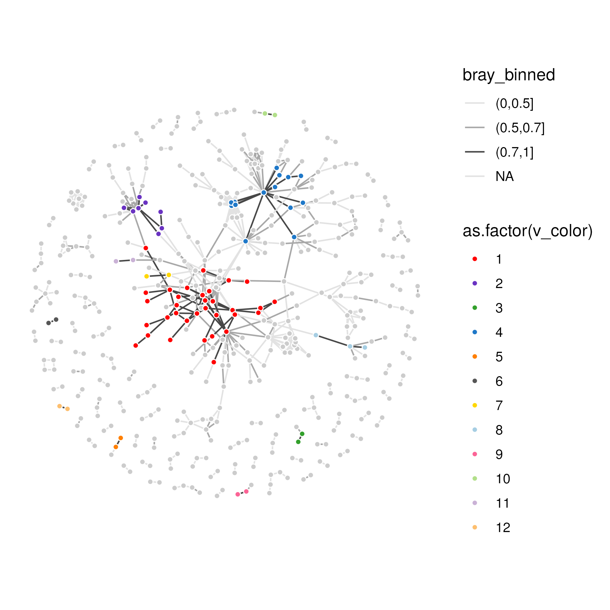

```{r community analysis bray fig3 connected components}
edges_bray
edges_bray_comp
```
```
 [1] "COG0499|COG1854" "COG0168|COG3158" "COG2035|COG3158" "COG2869|COG3158" "COG1347|COG3158"
 [6] "COG1726|COG3158" "COG2209|COG3158" "COG1115|COG3158" "COG1757|COG3158" "COG3158|COG4327"
[11] "COG0403|COG2848" "COG0404|COG3830" "COG1003|COG2848" "COG0665|COG1924" "COG3158|COG4665"
[16] "COG0109|COG2768" "COG0404|COG2848" "COG1328|COG2010" "COG0370|COG3253" "COG3158|COG4664"
[21] "COG0733|COG3158" "COG0109|COG1328" "COG3162|COG4327" "COG0826|COG1832" "COG0045|COG1453"
[26] "COG1433|COG2154" "COG1180|COG1398" "COG0045|COG2848" "COG0109|COG0426" "COG0109|COG2033"
[31] "COG0316|COG1433" "COG0370|COG0843" "COG0426|COG0843" "COG0370|COG1290" "COG0426|COG1622"
[36] "COG1064|COG2033" "COG0022|COG4868" "COG0022|COG1924" "COG1071|COG4868" "COG1071|COG1924"
[41] "COG1570|COG1839" "COG2010|COG4659" "COG1313|COG3253" "COG0665|COG2768" "COG0370|COG1703"
[46] "COG1780|COG2185" "COG1739|COG3576" "COG1180|COG2124" "COG2928|COG3590" "COG0074|COG2848"
[51] "COG0109|COG0370" "COG0109|COG1151" "COG0109|COG1924" "COG0506|COG1433" "COG0843|COG1592"
[56] "COG0843|COG1433" "COG0843|COG1924" "COG0370|COG1024" "COG1145|COG1547" "COG1250|COG2033"
[61] "COG1290|COG1918" "COG1592|COG1612" "COG0426|COG1612" "COG1433|COG1612" "COG1592|COG1622"
[66] "COG0370|COG1622" "COG1433|COG1622" "COG1622|COG1924" "COG1328|COG1845" "COG0426|COG1845"
[71] "COG1328|COG2146" "COG0508|COG1592" "COG0108|COG3601"

$membership
COG0022 COG0045 COG0074 COG0108 COG0109 COG0168 COG0316 COG0370 COG0403 COG0404 COG0426 COG0499 
      1       2       2       3       1       4       1       1       2       2       1       5 
COG0506 COG0508 COG0665 COG0733 COG0826 COG0843 COG1003 COG1024 COG1064 COG1071 COG1115 COG1145 
      1       1       1       4       6       1       2       1       1       1       4       7 
COG1151 COG1180 COG1250 COG1290 COG1313 COG1328 COG1347 COG1398 COG1433 COG1453 COG1547 COG1570 
      1       8       1       1       1       1       4       8       1       2       7       9 
COG1592 COG1612 COG1622 COG1703 COG1726 COG1739 COG1757 COG1780 COG1832 COG1839 COG1845 COG1854 
      1       1       1       1       4      10       4      11       6       9       1       5 
COG1918 COG1924 COG2010 COG2033 COG2035 COG2124 COG2146 COG2154 COG2185 COG2209 COG2768 COG2848 
      1       1       1       1       4       8       1       1      11       4       1       2 
COG2869 COG2928 COG3158 COG3162 COG3253 COG3576 COG3590 COG3601 COG3830 COG4327 COG4659 COG4664 
      4      12       4       4       1      10      12       3       2       4       1       4 
COG4665 COG4868 
      4       1 

$csize
 [1] 33  8  2 14  2  2  2  3  2  2  2  2

$no
[1] 12
```

#### Table

```{r gmgc_bray_network_table_cog}
# cog name
cog_name <- sub("\n.*", "", igraph::V(g_cog_8_contra_bray)$name_custom)
names(cog_name) <- igraph::V(g_cog_8_contra_bray)$name
# make table
df_gmgc_bray_network_table_cog <- g_cog_8_contra_bray %>% as_data_frame(what = "edges") %>%
  as_tibble() %>% filter(bray >= 0.7) %>% select(bray,n_tax,from,to) %>% 
  mutate(
    cc = map(from, ~ edges_bray_comp$membership[.x]),
    bray_round = round(bray, 2),
    from_name = map(from, ~ paste(c(.x, cog_name[.x]), collapse = ", ")),
    to_name = map(to, ~ paste(c(.x, cog_name[.x]), collapse = ", "))
  ) %>% unnest(c(cc,bray_round,from_name,to_name)) %>% 
  arrange(cc) %>% select(cc, bray_round, everything(), -from, -to, -bray)
write.table(
  df_gmgc_bray_network_table_cog,
  "data/tsv/gmgc_bray_network_table_cog.tsv",
  append=FALSE, quote=FALSE, sep = "\t", row.names=FALSE)
```

```{sh}
cp data/tsv/gmgc_bray_network_table_cog.tsv ms/
```

- [ms/gmgc_bray_network_table_cog.tsv](gmgc_bray_network_table_cog.tsv)

### gmgc_bray_network_cc4_bipartite

- By using Cytoscape, graphs were manually generated from data/tsv/gmgc_bray_network_cc4_bipartite.tsv and data/tsv/gmgc_bray_network_cc4_bipartite_node.tsv
  - `Layout` -> `Attribute Grid Layout` -> Modify `Number of columns in the grid`
  - Export figures: 1,240 px width
- The Cytoscape object can be downloaded from NDEx platform

```{r gmgc_bray_network_cc4_bipartite}
# Add bray to network
df_gmgc_cog <- read_gmgc10_env_gene_abundance("cog") %>% gmgc10_env_gene_relative_abundance()
g_cog_8_contra_bray <- gmgc10_network_bray(g_cog_8_contra, df_gmgc_cog)
igraph::E(g_cog_8_contra_bray)$bray_binned <- cut(igraph::E(g_cog_8_contra_bray)$bray, c(0,0.5,0.7,1))
# Extract communities with bray >= 0.7
edges_bray_logic <- igraph::E(g_cog_8_contra_bray)$bray >= 0.7
edges_bray_logic[is.na(edges_bray_logic)] <- FALSE
edges_bray <- igraph::E(g_cog_8_contra_bray)[edges_bray_logic] %>% as_ids()
edges_bray_comp <- subgraph.edges(g_cog_8_contra_bray, edges_bray) %>% components()
df_clusters <- tibble(OGs = names(edges_bray_comp$membership), cluster_id = edges_bray_comp$membership)
cluster_colors <- df_clusters$cluster_id
names(cluster_colors) <- df_clusters$OGs
V(g_cog_8_contra_bray)$cluster_colors <- cluster_colors[V(g_cog_8_contra_bray)$name]
# Extract the connected component 4 and adjacent nodes
l_adjacent_nodes <- adjacent_vertices(
  g_cog_8_contra_bray,
  edges_bray_comp$membership[edges_bray_comp$membership == 4] %>% names()
)
adjacent_nodes <- tibble(OGs = names(l_adjacent_nodes)) %>% 
  mutate(nodes = map(OGs, ~ l_adjacent_nodes[[.x]]$name)) %>% unnest(nodes) %>% select(nodes) %>% pull() %>% unique()
g_cog_8_contra_bray_cc4 <- subgraph(g_cog_8_contra_bray, adjacent_nodes)
# Map bipartite attribute
V(g_cog_8_contra_bray_cc4)$type <- bipartite_mapping(g_cog_8_contra_bray_cc4)$type
# Export edge/nodes tsv
write.table(g_cog_8_contra_bray_cc4 %>% as_data_frame("edges"), "data/tsv/gmgc_bray_network_cc4_bipartite.tsv", append=FALSE, quote=FALSE, sep = "\t", row.names=FALSE)
write.table(g_cog_8_contra_bray_cc4 %>% as_data_frame("vertices") %>% select(-name_custom), "data/tsv/gmgc_bray_network_cc4_bipartite_node.tsv", append=FALSE, quote=FALSE, sep = "\t", row.names=FALSE)
```
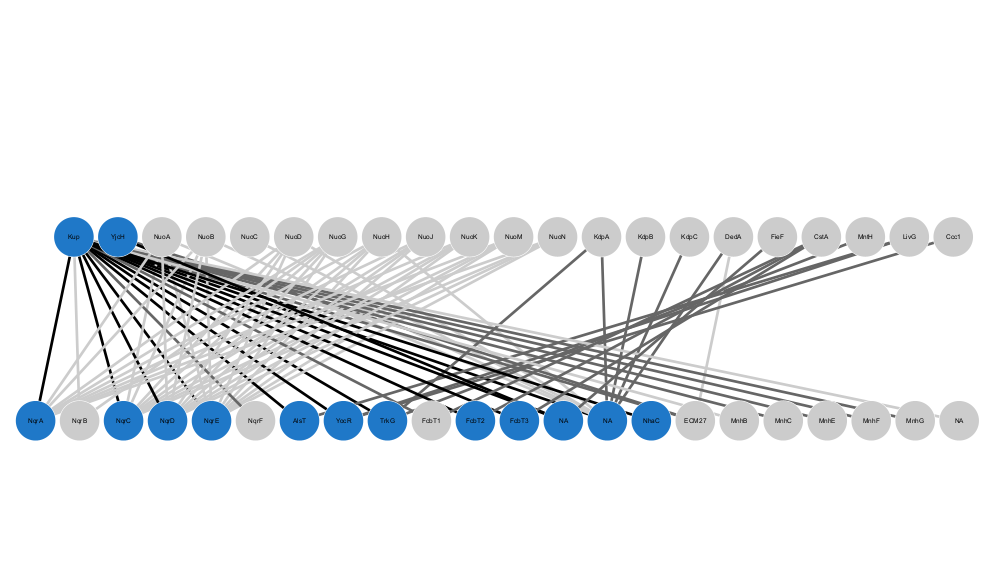

### gmgc_bray_network_cc4_bipartite_bar

```{r gmgc_bray_network_cc4_bipartite_bar}
# OGs to plot (Sorted)
gmgc_bray_network_cc4_bipartite_bar_ogs <- c(
  "COG3158", # Kup
  "COG3162", # YjcH
  "COG0838", # NuoA
  "COG0377", # NuoB
  "COG0852", # NuoC
  "COG0649", # NuoD
  "COG1034", # NuoG
  "COG1005", # NuoH
  "COG0839", # NuoJ
  "COG0713", # NuoK
  "COG1008", # NuoM
  "COG1007", # NuoN
  "COG2060", # KdpA
  "COG2216", # KdpB
  "COG2156", # KdpC
  "COG0586", # DedA
  "COG0053", # FieF
  "COG1966", # CstA
  "COG1914", # MntH
  "COG0411", # LivG
  "COG1814", # Ccc1
  "COG1392", # YkaA
  "COG1055", # ArsB
  "COG0306", # PitA
  "COG0474", # MgtA
  "COG2426", # NA
  "COG1726", # NqrA
  "COG1805", # NqrB
  "COG2869", # NqrC
  "COG1347", # NqrD
  "COG2209", # NqrE
  "COG2871", # NqrF
  "COG1115", # AlsT
  "COG0733", # YocR
  "COG0168", # TrkG
  "COG4663", # FcbT1
  "COG4665", # FcbT2
  "COG4664", # FcbT3
  "COG4327", # NA
  "COG2035", # DUF368
  "COG1757", # NhaC
  "COG0530", # ECM27
  "COG2111", # MnhB
  "COG1006", # MnhC
  "COG1863", # MnhE
  "COG2212", # MnhF
  "COG1320", # MnhG
  "COG1430" # NA
)
# Draw barplot
p_gmgc_bray_network_cc4_bipartite_bar <- gmgc_bar_horizon3(df_gmgc10_cog_norm, gmgc_bray_network_cc4_bipartite_bar_ogs)
ggsave("ms/gmgc_bray_network_cc4_bipartite_bar.png", p_gmgc_bray_network_cc4_bipartite_bar, height = 3, width = 15.4, dpi = 150)
ggsave("ms/gmgc_bray_network_cc4_bipartite_bar_legend.png", p_gmgc_bray_network_cc4_bipartite_bar, height = 5, width = 12, dpi = 150)
```
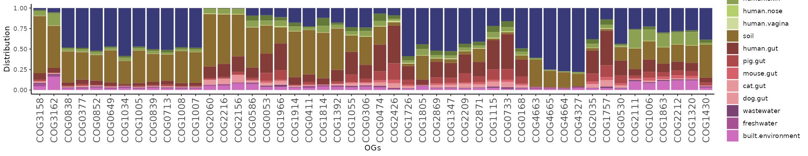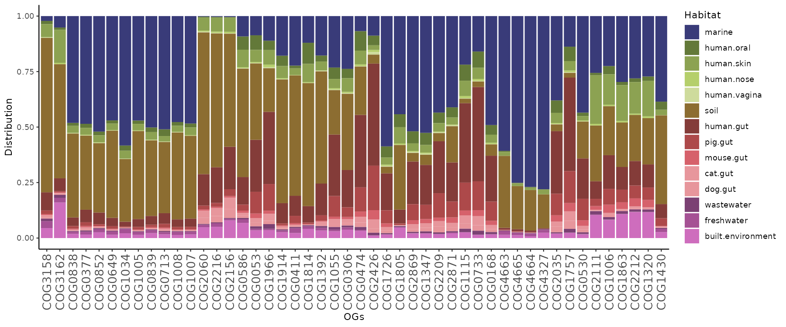

### gmgc_bray_network_cc1_bipartite

- By using Cytoscape, graphs were manually generated from data/tsv/gmgc_bray_network_cc1_bipartite.tsv and data/tsv/gmgc_bray_network_cc1_bipartite_node.tsv
  - `Layout` -> `Attribute Grid Layout` -> Modify `Number of columns in the grid`
  - Export figures: 1,240 px width
- The Cytoscape object can be downloaded from NDEx platform

```{r gmgc_bray_network_cc1_bipartite}
# Add bray to network
df_gmgc_cog <- read_gmgc10_env_gene_abundance("cog") %>% gmgc10_env_gene_relative_abundance()
g_cog_8_contra_bray <- gmgc10_network_bray(g_cog_8_contra, df_gmgc_cog)
igraph::E(g_cog_8_contra_bray)$bray_binned <- cut(igraph::E(g_cog_8_contra_bray)$bray, c(0,0.5,0.7,1))
# Extract communities with bray >= 0.7
edges_bray_logic <- igraph::E(g_cog_8_contra_bray)$bray >= 0.7
edges_bray_logic[is.na(edges_bray_logic)] <- FALSE
edges_bray <- igraph::E(g_cog_8_contra_bray)[edges_bray_logic] %>% as_ids()
edges_bray_comp <- subgraph.edges(g_cog_8_contra_bray, edges_bray) %>% components()
df_clusters <- tibble(OGs = names(edges_bray_comp$membership), cluster_id = edges_bray_comp$membership)
cluster_colors <- df_clusters$cluster_id
names(cluster_colors) <- df_clusters$OGs
V(g_cog_8_contra_bray)$cluster_colors <- cluster_colors[V(g_cog_8_contra_bray)$name]
# Extract the connected component 1 nodes
g_cog_8_contra_bray_cc1 <- subgraph(g_cog_8_contra_bray, edges_bray_comp$membership[edges_bray_comp$membership == 1] %>% names())
# Map bipartite attribute
V(g_cog_8_contra_bray_cc1)$type <- bipartite_mapping(g_cog_8_contra_bray_cc1)$type
# Export edge/nodes tsv
write.table(g_cog_8_contra_bray_cc1 %>% as_data_frame("edges"), "data/tsv/gmgc_bray_network_cc1_bipartite.tsv", append=FALSE, quote=FALSE, sep = "\t", row.names=FALSE)
write.table(g_cog_8_contra_bray_cc1 %>% as_data_frame("vertices") %>% select(-name_custom), "data/tsv/gmgc_bray_network_cc1_bipartite_node.tsv", append=FALSE, quote=FALSE, sep = "\t", row.names=FALSE)
```


### gmgc_bray_network_cc1_bipartite_bar

```{r gmgc_bray_network_cc1_bipartite_bar}
# OGs to plot (Sorted)
gmgc_bray_network_cc1_bipartite_bar_ogs <- c(
  "COG1622", # CyoA
  "COG0843", # CyoB
  "COG1845", # CyoC
  "COG0109", # CyoE
  "COG2154", # PhhB
  "COG2010", # CccA
  "COG2146", # NirD
  "COG1612", # CtaA
  "COG0665", # DadA
  "COG0316", # IscA
  "COG0506", # PutA
  "COG1290", # QcrB/PetB
  "COG1250", # FadB
  "COG1064", # AdhP
  "COG1071", # AcoA
  "COG0022", # AcoB
  "COG0508", # AceF
  "COG3253", # HemQ
  "COG1703", # ArgK
  "COG1024", # CaiD
  "COG1433", # NifX
  "COG1592", # YotD
  "COG1924", # YjiL
  "COG0370", # FeoB
  "COG1151", # Hcp
  "COG2033", # SORL
  "COG1328", # NrdD
  "COG2768", # COG2768
  "COG4659", # RnfG
  "COG0426", # NorV
  "COG1918", # FeoA
  "COG4868", # COG4868
  "COG1313" # PflX
)
# Draw barplot
p_gmgc_bray_network_cc1_bipartite_bar <- gmgc_bar_horizon3(df_gmgc10_cog_norm, gmgc_bray_network_cc1_bipartite_bar_ogs)
ggsave("ms/gmgc_bray_network_cc1_bipartite_bar.png", p_gmgc_bray_network_cc1_bipartite_bar, height = 3, width = 11.75, dpi = 150)
ggsave("ms/gmgc_bray_network_cc1_bipartite_bar_legend.png", p_gmgc_bray_network_cc1_bipartite_bar, height = 5, width = 12, dpi = 150)
```


### gmgc_bray_network_cc5_bipartite_bar

```{r gmgc_bray_network_cc5_bipartite_bar}
# OGs to plot (Sorted)
gmgc_bray_network_cc5_bipartite_bar_ogs <- c(
  "COG1854", # LuxS
  "COG0499" # SAM1
)
# Draw barplot
p_gmgc_bray_network_cc5_bipartite_bar <- gmgc_bar_horizon3(df_gmgc10_cog_norm, gmgc_bray_network_cc5_bipartite_bar_ogs)
ggsave("ms/gmgc_bray_network_cc5_bipartite_bar.png", p_gmgc_bray_network_cc5_bipartite_bar, height = 3, width = 3.5, dpi = 150)
ggsave("ms/gmgc_bray_network_cc5_bipartite_bar_legend.png", p_gmgc_bray_network_cc5_bipartite_bar, height = 5, width = 3, dpi = 150)
```


### gmgc_bray_network_pca

```{r gmgc_bray_network_pca}
dt_net_edge_cog <- read_network_data2("cog")
g_cog_8_contra <- create_original_network_object("cog", 8, "Anticorrelating", dt_net_edge_cog)
rm(dt_net_edge_cog)
df_gmgc_cog <- read_gmgc10_env_gene_abundance("cog") %>% gmgc10_env_gene_relative_abundance()
g_cog_8_contra_bray <- gmgc10_network_bray(g_cog_8_contra, df_gmgc_cog)
# Extract communities with bray >= 0.7
edges_bray_logic <- igraph::E(g_cog_8_contra_bray)$bray >= 0.7
edges_bray_logic[is.na(edges_bray_logic)] <- FALSE
edges_bray <- igraph::E(g_cog_8_contra_bray)[edges_bray_logic] %>% as_ids()
edges_bray_comp <- subgraph.edges(g_cog_8_contra_bray, edges_bray) %>% components()
df_clusters <- tibble(OGs = names(edges_bray_comp$membership), cluster_id = edges_bray_comp$membership)
cluster_colors <- df_clusters$cluster_id
names(cluster_colors) <- df_clusters$OGs
V(g_cog_8_contra_bray)$cluster_colors <- cluster_colors[V(g_cog_8_contra_bray)$name]
# Extract nodes of selected communities
OGs_select <- df_clusters$OGs
gmgc_cog_bray_pca <- gmgc_pca2(df_gmgc_cog, OGs_select)
df_gmgc_cog_bray_pca <- gmgc_cog_bray_pca$x[,c("PC1","PC2")] %>% as.data.frame() %>% rownames_to_column() %>%
  dplyr::rename(OGs = "rowname") %>% left_join(df_clusters, by = "OGs") %>% filter(!is.na(cluster_id))
df_gmgc_cog_bray_pca$cluster_id <- factor(df_gmgc_cog_bray_pca$cluster_id, levels = 1:max(df_gmgc_cog_bray_pca$cluster_id))
df_gmgc_cog_bray_rotation <- gmgc_cog_bray_pca$rotation %>% as.data.frame() %>% rownames_to_column()
# Extract pairwise info
PC1 <- df_gmgc_cog_bray_pca$PC1
names(PC1) <- df_gmgc_cog_bray_pca$OGs
PC2 <- df_gmgc_cog_bray_pca$PC2
names(PC2) <- df_gmgc_cog_bray_pca$OGs
df_pairwise <- subgraph.edges(g_cog_8_contra_bray, edges_bray) %>% as_data_frame() %>% as_tibble() %>% select(from,to) %>%
  mutate(x = PC1[from], y = PC2[from], xend = PC1[to], yend = PC2[to]) %>%
  left_join(df_gmgc_cog_bray_pca %>% dplyr::rename(from = "OGs"))
# Classify OGs into habitat groups
df_gmgc_cog_bray_pca <- rbind(
  df_gmgc_cog_bray_pca %>%
    mutate(
      habitat_group = map2(
        cluster_id, PC1,
        ~ if (!(.x == 4 | .x == 10 | .x == 13) & .y < 0) {
          "Non-gut"
        } else if (!(.x == 4 | .x == 10 | .x == 13) & .y > 0) {
          "Gut"
        }
      )
    ) %>%
    unnest(c("habitat_group")),
  df_gmgc_cog_bray_pca %>%
    mutate(
      habitat_group = map2(
        cluster_id, PC2,
        ~ if ((.x == 4 | .x == 10 | .x == 13) & .y > 0) {
          "Non-soil"
        } else if ((.x == 4 | .x == 10 | .x == 13) & .y < 0) {
          "Soil"
        }
      )
    ) %>%
    unnest(c("habitat_group"))
)
df_gmgc_cog_bray_pca$habitat_group <- factor(df_gmgc_cog_bray_pca$habitat_group, levels = c("Gut","Non-gut","Soil","Non-soil"))
p_gmgc_pca_up <- ggplot(
    df_gmgc_cog_bray_pca %>% filter(cluster_id %in% c(1:3,5:9,11,12))
  ) +
  geom_segment(
    data = df_pairwise %>% filter(cluster_id %in% c(1:3,5:9,11,12)),
    aes(x = x, y = y, xend = xend, yend = yend, color = cluster_id),
    alpha = 0.5,
    size = 0.3
  ) +
	scale_color_manual(values = cols25(15), na.value = "black", drop = FALSE) +
  geom_segment(
    data = df_gmgc_cog_bray_rotation, #%>% filter(rowname %in% c("gut","human-associated","marine","soil")),
    aes(x = 0, y = 0, xend = PC1, yend = PC2),
    color = "grey30",
    arrow = arrow(length = unit(0.2,"cm"))
  ) +
	geom_point(aes(x = PC1, y = PC2, fill = cluster_id, shape = habitat_group), size = 3, color = "black") +
	scale_fill_manual(values = cols25(15), na.value = "black", drop = FALSE) +
  scale_shape_manual(values = c(23,21,24,22), drop = FALSE) +
  guides(fill = "none", color = "none") +
  labs(x = "PC1", y = "PC2")
p_gmgc_pca_low <- ggplot(
    df_gmgc_cog_bray_pca %>% filter(cluster_id %in% c(4,10,13))
  ) +
  geom_segment(
    data = df_pairwise %>% filter(cluster_id %in% c(4,10,13)),
    aes(x = x, y = y, xend = xend, yend = yend, color = cluster_id),
    alpha = 0.5,
    size = 0.3
  ) +
	scale_color_manual(values = cols25(15), na.value = "black", drop = FALSE) +
  geom_segment(
    data = df_gmgc_cog_bray_rotation, #%>% filter(rowname %in% c("gut","human-associated","marine","soil")),
    aes(x = 0, y = 0, xend = PC1, yend = PC2),
    color = "grey30",
    arrow = arrow(length = unit(0.2,"cm"))
  ) +
	geom_point(aes(x = PC1, y = PC2, fill = cluster_id, shape = habitat_group), size = 3, color = "black") +
	scale_fill_manual(values = cols25(15), na.value = "black", drop = FALSE) +
  scale_shape_manual(values = c(23,21,24,22), drop = FALSE) +
  guides(fill = "none", color = "none") +
  labs(x = "PC1", y = "PC2")
p_gmgc_pca <- (p_gmgc_pca_up + theme(legend.position = "none")) | (p_gmgc_pca_low + theme(axis.title.y = element_blank()))
# Draw
ggsave("ms/fig_3d.png", p_gmgc_pca, height = 3.2, width = 7.5, dpi = 600)
```


```{r pca result}
# Contribution of each PC
summary(gmgc_cog_bray_pca)
# Contribution of each envs
df_gmgc_cog_bray_rotation %>% select(rowname:PC4)
# Contribution of each envs to PC1-PC2
df_gmgc_cog_bray_rotation %>% mutate(PC1PC2_len = sqrt(PC1^2 + PC2^2)) %>%
  select(rowname:PC2, PC1PC2_len) %>% arrange(desc(PC1PC2_len))
```
```
Importance of components:
                          PC1    PC2     PC3     PC4     PC5     PC6     PC7     PC8      PC9     PC10
Standard deviation     0.2333 0.2304 0.08323 0.05387 0.03074 0.02459 0.01524 0.01009 0.007629 0.006086
Proportion of Variance 0.4559 0.4448 0.05804 0.02432 0.00792 0.00507 0.00195 0.00085 0.000490 0.000310
Cumulative Proportion  0.4559 0.9007 0.95874 0.98306 0.99098 0.99604 0.99799 0.99884 0.999330 0.999640
                           PC11     PC12     PC13    PC14
Standard deviation     0.004734 0.004065 0.001961 1.4e-16
Proportion of Variance 0.000190 0.000140 0.000030 0.0e+00
Cumulative Proportion  0.999830 0.999970 1.000000 1.0e+00

             rowname          PC1          PC2          PC3          PC4
1  built.environment  0.064326130 -0.009370226  0.550664202 -0.530575546
2            cat.gut  0.042766035  0.016285843 -0.052070898 -0.016587843
3            dog.gut  0.036937604  0.013413098 -0.027922074 -0.008168530
4         freshwater -0.007119958 -0.004926337  0.022170737 -0.016962400
5          human.gut  0.501518223  0.159737979 -0.446788455 -0.135749789
6         human.nose  0.011626222  0.004572318  0.019680405  0.008433071
7         human.oral  0.151162126  0.053963115  0.286816545  0.831124454
8         human.skin  0.065747927  0.003520532  0.450923998 -0.058326504
9       human.vagina  0.005333005  0.002323478  0.004678231  0.006120612
10            marine -0.750408473  0.520322973 -0.153366925 -0.002150028
11         mouse.gut  0.046649128  0.014384671 -0.065782246 -0.027120991
12           pig.gut  0.163090779  0.058466443 -0.375036001 -0.057044686
13              soil -0.348686988 -0.834632167 -0.195779294  0.027323602
14        wastewater  0.017058239  0.001938279 -0.018188225 -0.020315424

             rowname          PC1          PC2  PC1PC2_len
1             marine -0.750408473  0.520322973 0.913153258
2               soil -0.348686988 -0.834632167 0.904540475
3          human.gut  0.501518223  0.159737979 0.526342806
4            pig.gut  0.163090779  0.058466443 0.173253939
5         human.oral  0.151162126  0.053963115 0.160505471
6         human.skin  0.065747927  0.003520532 0.065842115
7  built.environment  0.064326130 -0.009370226 0.065005016
8          mouse.gut  0.046649128  0.014384671 0.048816595
9            cat.gut  0.042766035  0.016285843 0.045762020
10           dog.gut  0.036937604  0.013413098 0.039297555
11        wastewater  0.017058239  0.001938279 0.017168006
12        human.nose  0.011626222  0.004572318 0.012493004
13        freshwater -0.007119958 -0.004926337 0.008658095
14      human.vagina  0.005333005  0.002323478 0.005817172
```

### gmgc_bray_network_pca_cc1_cc4_cc5

```{r gmgc_bray_network_pca_cc1_cc4_cc5}
dt_net_edge_cog <- read_network_data2("cog")
g_cog_8_contra <- create_original_network_object("cog", 8, "Anticorrelating", dt_net_edge_cog)
rm(dt_net_edge_cog)
df_gmgc_cog <- read_gmgc10_env_gene_abundance("cog") %>% gmgc10_env_gene_relative_abundance()
g_cog_8_contra_bray <- gmgc10_network_bray(g_cog_8_contra, df_gmgc_cog)
# Extract communities with bray >= 0.7
edges_bray_logic <- igraph::E(g_cog_8_contra_bray)$bray >= 0.7
edges_bray_logic[is.na(edges_bray_logic)] <- FALSE
edges_bray <- igraph::E(g_cog_8_contra_bray)[edges_bray_logic] %>% as_ids()
edges_bray_comp <- subgraph.edges(g_cog_8_contra_bray, edges_bray) %>% components()
df_clusters <- tibble(OGs = names(edges_bray_comp$membership), cluster_id = edges_bray_comp$membership)
cluster_colors <- df_clusters$cluster_id
names(cluster_colors) <- df_clusters$OGs
V(g_cog_8_contra_bray)$cluster_colors <- cluster_colors[V(g_cog_8_contra_bray)$name]
# Extract nodes of selected communities
OGs_select <- df_clusters$OGs
gmgc_cog_bray_pca <- gmgc_pca2(df_gmgc_cog, OGs_select)
df_gmgc_cog_bray_pca <- gmgc_cog_bray_pca$x[,c("PC1","PC2")] %>% as.data.frame() %>% rownames_to_column() %>%
  dplyr::rename(OGs = "rowname") %>% left_join(df_clusters, by = "OGs") %>% filter(!is.na(cluster_id))
df_gmgc_cog_bray_pca$cluster_id <- factor(df_gmgc_cog_bray_pca$cluster_id, levels = 1:max(df_gmgc_cog_bray_pca$cluster_id))
df_gmgc_cog_bray_rotation <- gmgc_cog_bray_pca$rotation %>% as.data.frame() %>% rownames_to_column()
# Extract pairwise info
PC1 <- df_gmgc_cog_bray_pca$PC1
names(PC1) <- df_gmgc_cog_bray_pca$OGs
PC2 <- df_gmgc_cog_bray_pca$PC2
names(PC2) <- df_gmgc_cog_bray_pca$OGs
df_pairwise <- subgraph.edges(g_cog_8_contra_bray, edges_bray) %>% as_data_frame() %>% as_tibble() %>% select(from,to) %>%
  mutate(x = PC1[from], y = PC2[from], xend = PC1[to], yend = PC2[to]) %>%
  left_join(df_gmgc_cog_bray_pca %>% dplyr::rename(from = "OGs"))
# Modify color pallete
cluster_colors_pal <- c(
  cols25(15)[2], # 1
  cols25(15)[4], # 2
  cols25(15)[3], # 3
  cols25(15)[1], # 4
  cols25(15)[5:15] # 5-15
)
# Plot cc1
p_gmgc_pca_cc1 <- ggplot(
    df_gmgc_cog_bray_pca %>% filter(cluster_id %in% c(1))
  ) +
  geom_segment(
    data = df_pairwise %>% filter(cluster_id %in% c(1)),
    aes(x = x, y = y, xend = xend, yend = yend, color = cluster_id),
    alpha = 0.5,
    size = 0.3
  ) +
  geom_segment(
    data = df_gmgc_cog_bray_rotation %>% filter(rowname %in% c("human.gut","marine","soil")),
    aes(x = 0, y = 0, xend = PC1, yend = PC2),
    color = "grey30",
    arrow = arrow(length = unit(0.2,"cm"))
  ) +
	geom_point(aes(x = PC1, y = PC2, fill = cluster_id), shape = 21, size = 3, color = "black") +
	scale_color_manual(values = cluster_colors_pal, na.value = "black", drop = FALSE) +
  scale_fill_manual(values = cluster_colors_pal, na.value = "black", drop = FALSE) +
  guides(fill = "none", color = "none") +
  labs(x = "PC1", y = "PC2")
# Plot cc4
p_gmgc_pca_cc4 <- ggplot(
    df_gmgc_cog_bray_pca %>% filter(cluster_id %in% c(4))
  ) +
  geom_segment(
    data = df_pairwise %>% filter(cluster_id %in% c(4)),
    aes(x = x, y = y, xend = xend, yend = yend, color = cluster_id),
    alpha = 0.5,
    size = 0.3
  ) +
  geom_segment(
    data = df_gmgc_cog_bray_rotation %>% filter(rowname %in% c("human.gut","marine","soil")),
    aes(x = 0, y = 0, xend = PC1, yend = PC2),
    color = "grey30",
    arrow = arrow(length = unit(0.2,"cm"))
  ) +
	geom_point(aes(x = PC1, y = PC2, fill = cluster_id), shape = 21, size = 3, color = "black") +
	scale_color_manual(values = cluster_colors_pal, na.value = "black", drop = FALSE) +
  scale_fill_manual(values = cluster_colors_pal, na.value = "black", drop = FALSE) +
  guides(fill = "none", color = "none") +
  labs(x = "PC1", y = "PC2")
# Plot cc5
p_gmgc_pca_cc5 <- ggplot(
    df_gmgc_cog_bray_pca %>% filter(cluster_id %in% c(5))
  ) +
  geom_segment(
    data = df_pairwise %>% filter(cluster_id %in% c(5)),
    aes(x = x, y = y, xend = xend, yend = yend, color = cluster_id),
    alpha = 0.5,
    size = 0.3
  ) +
  geom_segment(
    data = df_gmgc_cog_bray_rotation %>% filter(rowname %in% c("human.gut","marine","soil")),
    aes(x = 0, y = 0, xend = PC1, yend = PC2),
    color = "grey30",
    arrow = arrow(length = unit(0.2,"cm"))
  ) +
	geom_point(aes(x = PC1, y = PC2, fill = cluster_id), shape = 21, size = 3, color = "black") +
	scale_color_manual(values = cluster_colors_pal, na.value = "black", drop = FALSE) +
  scale_fill_manual(values = cluster_colors_pal, na.value = "black", drop = FALSE) +
  guides(fill = "none", color = "none") +
  labs(x = "PC1", y = "PC2")
# Plot others
p_gmgc_pca_others <- ggplot(
    df_gmgc_cog_bray_pca %>% filter(cluster_id %in% c(2,3,6:12))
  ) +
  geom_segment(
    data = df_pairwise %>% filter(cluster_id %in% c(2,3,6:12)),
    aes(x = x, y = y, xend = xend, yend = yend, color = cluster_id),
    alpha = 0.5,
    size = 0.3
  ) +
  geom_segment(
    data = df_gmgc_cog_bray_rotation %>% filter(rowname %in% c("human.gut","marine","soil")),
    aes(x = 0, y = 0, xend = PC1, yend = PC2),
    color = "grey30",
    arrow = arrow(length = unit(0.2,"cm"))
  ) +
	geom_point(aes(x = PC1, y = PC2, fill = cluster_id), shape = 21, size = 3, color = "black") +
	scale_color_manual(values = cluster_colors_pal, na.value = "black", drop = FALSE) +
  scale_fill_manual(values = cluster_colors_pal, na.value = "black", drop = FALSE) +
  guides(fill = "none", color = "none") +
  labs(x = "PC1", y = "PC2")
p_gmgc_pca <- 
  (p_gmgc_pca_cc1 + theme(legend.position = "none")) |
  (p_gmgc_pca_cc4 + theme(axis.title.y = element_blank())) |
  (p_gmgc_pca_cc5 + theme(axis.title.y = element_blank())) |
  (p_gmgc_pca_others + theme(axis.title.y = element_blank()))
# Draw
ggsave("ms/gmgc_bray_network_pca_cc1_cc4_cc5.png", p_gmgc_pca, height = 2.7, width = 9.7, dpi = 600)
```


## Habitat analysis (Prokatlas)

### prokatlas_cog_presence_cc_1_5

- based on presense/absense

```{r prokatlas_cog_presence_cc_1_5}
# Load fisher's test result (habitat pref. >= 0)
df_contingency_habitat_hp0 <- fread("data/tsv/contingency_tsv_cog2020_habitat_hp0.tsv", header = TRUE, sep = "\t", quote = "", na.strings=c("", "NULL")) %>% as_tibble()
# Load network and bray (GMGC)
dt_net_edge_cog <- read_network_data2("cog")
g_cog_8_contra <- create_original_network_object("cog", 8, "Anticorrelating", dt_net_edge_cog)
rm(dt_net_edge_cog)
df_gmgc_cog <- read_gmgc10_env_gene_abundance("cog") %>% gmgc10_env_gene_relative_abundance()
g_cog_8_contra_bray <- gmgc10_network_bray(g_cog_8_contra, df_gmgc_cog)
# Extract communities with bray >= 0.7
edges_bray_logic <- igraph::E(g_cog_8_contra_bray)$bray >= 0.7
edges_bray_logic[is.na(edges_bray_logic)] <- FALSE
edges_bray <- igraph::E(g_cog_8_contra_bray)[edges_bray_logic] %>% as_ids()
edges_bray_comp <- subgraph.edges(g_cog_8_contra_bray, edges_bray) %>% components()
df_clusters <- tibble(OGs = names(edges_bray_comp$membership), cluster_id = edges_bray_comp$membership)
cluster_colors <- df_clusters$cluster_id
names(cluster_colors) <- df_clusters$OGs
V(g_cog_8_contra_bray)$cluster_colors <- cluster_colors[V(g_cog_8_contra_bray)$name]
# Extract nodes of selected communities
OGs_select <- df_clusters$OGs
gmgc_cog_bray_pca <- gmgc_pca2(df_gmgc_cog, OGs_select)
df_gmgc_cog_bray_pca <- gmgc_cog_bray_pca$x[,c("PC1","PC2")] %>% as.data.frame() %>% rownames_to_column() %>%
  dplyr::rename(OGs = "rowname") %>% left_join(df_clusters, by = "OGs") %>% filter(!is.na(cluster_id))
df_gmgc_cog_bray_pca$cluster_id <- factor(df_gmgc_cog_bray_pca$cluster_id, levels = 1:max(df_gmgc_cog_bray_pca$cluster_id))
df_gmgc_cog_bray_rotation <- gmgc_cog_bray_pca$rotation %>% as.data.frame() %>% rownames_to_column()
# Sort nodes in comunities 1, 4, and 5
df_upper_1 <- df_gmgc_cog_bray_pca %>% filter(cluster_id == 1, PC1 > 0) %>% select(OGs, cluster_id) %>% mutate(habitat_group = "Gut")
df_lower_1 <- df_gmgc_cog_bray_pca %>% filter(cluster_id == 1, PC1 < 0) %>% select(OGs, cluster_id) %>% mutate(habitat_group = "Non-gut")
df_upper_4 <- df_gmgc_cog_bray_pca %>% filter(cluster_id == 4, PC2 < 0) %>% select(OGs, cluster_id) %>% mutate(habitat_group = "Soil")
df_lower_4 <- df_gmgc_cog_bray_pca %>% filter(cluster_id == 4, PC2 > 0) %>% select(OGs, cluster_id) %>% mutate(habitat_group = "Non-soil")
df_upper_5 <- df_gmgc_cog_bray_pca %>% filter(cluster_id == 5, PC1 > 0) %>% select(OGs, cluster_id) %>% mutate(habitat_group = "Gut")
df_lower_5 <- df_gmgc_cog_bray_pca %>% filter(cluster_id == 5, PC1 < 0) %>% select(OGs, cluster_id) %>% mutate(habitat_group = "Non-gut")
df_ogs_sort <- rbind(
  df_upper_5,
  df_lower_5,
  df_upper_1,
  df_lower_1,
  df_upper_4,
  df_lower_4
) %>% as_tibble()
#df_ogs_sort$OGs <- factor(df_ogs_sort$OGs, levels = df_ogs_sort$OGs)
df_ogs_sort$habitat_group <- factor(df_ogs_sort$habitat_group, levels = c("Gut","Non-gut","Soil","Non-soil"))
# Change OG name
df_og_name <- tibble(OGs = V(g_cog_8_contra_bray)$name, new_name = sub("\n",",",V(g_cog_8_contra_bray)$name_custom))
df_ogs_sort <- left_join(df_ogs_sort, df_og_name, by = "OGs")
df_ogs_sort$new_name <- factor(df_ogs_sort$new_name, levels = df_ogs_sort$new_name)
# Combine network and ProkAtlas q-value
df_ogs_hp0 <-
  left_join(df_ogs_sort, df_contingency_habitat_hp0 %>% dplyr::rename(OGs = "og_id"), by = "OGs") %>%
  mutate(log_qval = -log10(q_value), nega_posi = cooccurring_ratio_hp - contrapositive_ratio_hp)
df_ogs_hp0$log_qval[is.infinite(df_ogs_hp0$log_qval)] <-
  max(df_ogs_hp0$log_qval[!is.infinite(df_ogs_hp0$log_qval)]) + 1
df_ogs_hp0 <- df_ogs_hp0 %>%
  mutate(corr_score = map2(log_qval, nega_posi, ~ if (.y >= 0) {.x} else {-.x})) %>% 
  unnest(c(corr_score))
# Hierarchical clustering
# Hierarchical clustering in each connected component
heatmap_df <- function(df_ogs_hp0) {
  df_ogs_hp_log_small <- df_ogs_hp0 %>% select(new_name, habitat, corr_score) %>%
    pivot_wider(names_from = new_name, values_from = corr_score)
  mx_ogs_hp_log_small <- df_ogs_hp_log_small %>% select(-habitat) %>% as.matrix()
  row.names(mx_ogs_hp_log_small) <- df_ogs_hp_log_small$habitat
  hclust_ogs_hp_log <- dist(mx_ogs_hp_log_small, method = "euclidean") %>% hclust()
  hclust_ogs_hp_log_order <- hclust_ogs_hp_log$labels[hclust_ogs_hp_log$order]
  df_ogs_hp0$habitat <- factor(df_ogs_hp0$habitat, levels = hclust_ogs_hp_log_order)
  return(df_ogs_hp0)
}
df_ogs_hp_log_1 <- heatmap_df(df_ogs_hp0 %>% filter(cluster_id == 1))
#df_ogs_hp_log_4 <- heatmap_df(df_ogs_hp0 %>% filter(cluster_id == 4))
df_ogs_hp_log_5 <- heatmap_df(df_ogs_hp0 %>% filter(cluster_id == 5))
# Heat map
p_prokatlas_heat_5 <- df_ogs_hp_log_5 %>% filter(cluster_id == 5) %>% ggplot() +
  geom_tile(aes(x = new_name, y = habitat, fill = corr_score)) +
  scale_fill_gradient2(low = hcl.colors(2,"PiYG")[2], mid = "white", high = hcl.colors(2,"PiYG")[1], na.value = "white") +
  theme(axis.title.y = element_blank(), axis.text.x = element_text(angle = 90, hjust = 1, vjust = 0.5),
  axis.title.x = element_blank())
p_prokatlas_heat_1 <- df_ogs_hp_log_1 %>% filter(cluster_id == 1) %>% ggplot() +
  geom_tile(aes(x = new_name, y = habitat, fill = corr_score)) +
  scale_fill_gradient2(low = hcl.colors(2,"PiYG")[2], mid = "white", high = hcl.colors(2,"PiYG")[1], na.value = "white") +
  theme(axis.text.x = element_text(angle = 90, hjust = 1, vjust = 0.5), axis.title.x = element_blank())
#p_prokatlas_heat_4 <- df_ogs_hp_log_4 %>% filter(cluster_id == 4) %>% ggplot() +
#  geom_tile(aes(x = new_name, y = habitat, fill = corr_score)) +
#  scale_fill_gradient2(low = hcl.colors(2,"PiYG")[2], mid = "white", high = hcl.colors(2,"PiYG")[1], na.value = "white") +
#  theme(axis.title.y = element_blank(), axis.text.x = element_text(angle = 90, hjust = 1, vjust = 0.5),
#  axis.title.x = element_blank())
# Binary plot
p_prokatlas_binary_5 <- gmgc_binary_horizon(df_ogs_sort %>% filter(cluster_id == 5)) + theme(legend.position = "none")
p_prokatlas_binary_1 <- gmgc_binary_horizon(df_ogs_sort %>% filter(cluster_id == 1)) + theme(legend.position = "none")
#p_prokatlas_binary_4 <- gmgc_binary_horizon(df_ogs_sort %>% filter(cluster_id == 4)) + theme(legend.position = "none")
p_prokatlas_heat <- (
    (p_prokatlas_binary_1 / p_prokatlas_heat_1) + plot_layout(heights = c(0.2,10)) | 
    (p_prokatlas_binary_5 / p_prokatlas_heat_5) + plot_layout(heights = c(0.2,10))
  ) +
  plot_layout(widths = c(nrow(rbind(df_upper_1,df_lower_1)), nrow(rbind(df_upper_5,df_lower_5))))
ggsave("ms/prokatlas_cog_presence_cc_1_5.png", p_prokatlas_heat, height = 13, width = 13, dpi = 300)
```


### prokatlas_cog_presence_cc_4

```{r prokatlas_cog_presence_cc_4}
# Load fisher's test result (habitat pref. >= 0)
df_contingency_habitat_hp0 <- fread("data/tsv/contingency_tsv_cog2020_habitat_hp0.tsv", header = TRUE, sep = "\t", quote = "", na.strings=c("", "NULL")) %>% as_tibble()
# Load network and bray (GMGC)
dt_net_edge_cog <- read_network_data2("cog")
g_cog_8_contra <- create_original_network_object("cog", 8, "Anticorrelating", dt_net_edge_cog)
rm(dt_net_edge_cog)
df_gmgc_cog <- read_gmgc10_env_gene_abundance("cog") %>% gmgc10_env_gene_relative_abundance()
g_cog_8_contra_bray <- gmgc10_network_bray(g_cog_8_contra, df_gmgc_cog)
# Extract communities with bray >= 0.7
edges_bray_logic <- igraph::E(g_cog_8_contra_bray)$bray >= 0.7
edges_bray_logic[is.na(edges_bray_logic)] <- FALSE
edges_bray <- igraph::E(g_cog_8_contra_bray)[edges_bray_logic] %>% as_ids()
edges_bray_comp <- subgraph.edges(g_cog_8_contra_bray, edges_bray) %>% components()
df_clusters <- tibble(OGs = names(edges_bray_comp$membership), cluster_id = edges_bray_comp$membership)
cluster_colors <- df_clusters$cluster_id
names(cluster_colors) <- df_clusters$OGs
V(g_cog_8_contra_bray)$cluster_colors <- cluster_colors[V(g_cog_8_contra_bray)$name]
# Sort nodes in comunities 4 and ajacents
non_saline_nodes <- c(
    "COG3158", # Kup
    "COG3162", # YjcH
    "COG2060", # KdpA
    "COG2216", # KdpB
    "COG2156", # KdpC
    "COG0586", # DedA
    "COG0838", # NuoA
    "COG0377", # NuoB
    "COG0852", # NuoC
    "COG0649", # NuoD
    "COG1034", # NuoG
    "COG1005", # NuoH
    "COG0839", # NuoJ
    "COG0713", # NuoK
    "COG1008", # NuoM
    "COG1007" # NuoN
)
saline_nodes <- c(
    "COG1726", # NqrA
    "COG1805", # NqrB
    "COG2869", # NqrC
    "COG1347", # NqrD
    "COG2209", # NqrE
    "COG2871", # NqrF
    "COG0168", # TrkG
    "COG0530", # ECM27
    "COG4327", # Unknonw
    "COG1115", # AlsT
    "COG0733", # YocR
    "COG2035", # Unknown
    "COG4663", # FcbT1
    "COG4665", # FcbT2
    "COG4664" # FcbT3
)
antiporter_nodes <- c(
    "COG1055", # ArsB
    "COG0387", # ChaA
    "COG3004", # NhaA
    "COG1757", # NhaC
    "COG2111", # MnhB
    "COG1006", # MnhC
    "COG1863", # MnhE
    "COG2212", # MnhF
    "COG1320" # MnhG
)
df_ogs_sort <- rbind(
  tibble(OGs = non_saline_nodes, habitat_group = "Soil"),
  tibble(OGs = saline_nodes, habitat_group = "Non-soil"),
  tibble(OGs = antiporter_nodes, habitat_group = "Antiporters")
) %>% left_join(df_clusters, by = "OGs")
df_ogs_sort$OGs <- factor(df_ogs_sort$OGs, levels = df_ogs_sort$OGs)
df_ogs_sort$cluster_id <- factor(df_ogs_sort$cluster_id, levels = 1:edges_bray_comp$no)
df_ogs_sort$habitat_group <- factor(df_ogs_sort$habitat_group, levels = c("Gut","Non-gut","Soil","Non-soil","Antiporters"))
# Change OG name
df_og_name <- tibble(OGs = V(g_cog_8_contra_bray)$name, new_name = sub("\n",",",V(g_cog_8_contra_bray)$name_custom))
df_ogs_sort <- left_join(df_ogs_sort, df_og_name, by = "OGs")
df_ogs_sort$new_name <- factor(df_ogs_sort$new_name, levels = df_ogs_sort$new_name)
# Binary plot
p_gmgc_binary_4 <- gmgc_binary_horizon2(df_ogs_sort %>% filter(habitat_group %in% c("Soil","Non-soil"))) +
  theme(legend.position = "none")
p_gmgc_binary_4_anti <- gmgc_binary_horizon2(df_ogs_sort %>% filter(habitat_group %in% c("Antiporters"))) +
  theme(legend.position = "none")
# Combine network and ProkAtlas q-value
df_ogs_hp0 <-
  left_join(df_ogs_sort, df_contingency_habitat_hp0 %>% dplyr::rename(OGs = "og_id"), by = "OGs") %>%
  mutate(log_qval = -log10(q_value), nega_posi = cooccurring_ratio_hp - contrapositive_ratio_hp)
df_ogs_hp0$log_qval[is.infinite(df_ogs_hp0$log_qval)] <-
  max(df_ogs_hp0$log_qval[!is.infinite(df_ogs_hp0$log_qval)]) + 1
df_ogs_hp0 <- df_ogs_hp0 %>%
  mutate(corr_score = map2(log_qval, nega_posi, ~ if (.y >= 0) {.x} else {-.x})) %>% 
  unnest(c(corr_score))
# Hierarchical clustering in each connected component
heatmap_df <- function(df_ogs_hp0) {
  df_ogs_hp_log_small <- df_ogs_hp0 %>% select(new_name, habitat, corr_score) %>%
    pivot_wider(names_from = new_name, values_from = corr_score)
  mx_ogs_hp_log_small <- df_ogs_hp_log_small %>% select(-habitat) %>% as.matrix()
  row.names(mx_ogs_hp_log_small) <- df_ogs_hp_log_small$habitat
  hclust_ogs_hp_log <- dist(mx_ogs_hp_log_small, method = "euclidean") %>% hclust()
  hclust_ogs_hp_log_order <- hclust_ogs_hp_log$labels[hclust_ogs_hp_log$order]
  df_ogs_hp0$habitat <- factor(df_ogs_hp0$habitat, levels = hclust_ogs_hp_log_order)
  return(df_ogs_hp0)
}
df_ogs_hp_log_4 <- heatmap_df(df_ogs_hp0 %>% filter(OGs %in% c(non_saline_nodes, saline_nodes)))
df_ogs_hp_log_4_anti <- heatmap_df(df_ogs_hp0 %>% filter(OGs %in% antiporter_nodes))
# Heat map
p_prokatlas_heat_4 <- df_ogs_hp_log_4 %>% ggplot() +
  geom_tile(aes(x = new_name, y = habitat, fill = corr_score)) +
  scale_fill_gradient2(low = hcl.colors(2,"PiYG")[2], mid = "white", high = hcl.colors(2,"PiYG")[1], na.value = "white") +
  theme(axis.text.x = element_text(angle = 90, hjust = 1, vjust = 0.5),
  axis.title.x = element_blank())
p_prokatlas_heat_4_anti <- df_ogs_hp_log_4_anti %>% ggplot() +
  geom_tile(aes(x = new_name, y = habitat, fill = corr_score)) +
  scale_fill_gradient2(low = hcl.colors(2,"PiYG")[2], mid = "white", high = hcl.colors(2,"PiYG")[1], na.value = "white") +
  theme(axis.title.y = element_blank(), axis.text.x = element_text(angle = 90, hjust = 1, vjust = 0.5), axis.title.x = element_blank())
# Draw
p_prokatlas_heat <- (
    (p_gmgc_binary_4 / p_prokatlas_heat_4) + plot_layout(heights = c(0.2,10)) | 
    (p_gmgc_binary_4_anti / p_prokatlas_heat_4_anti) + plot_layout(heights = c(0.2,10))
  ) +
  plot_layout(widths = c(length(c(non_saline_nodes,saline_nodes)), length(c(antiporter_nodes))))
ggsave("ms/prokatlas_cog_presence_cc_4.png", p_prokatlas_heat, height = 13, width = 13, dpi = 300)
```


## Genomic feature analysis

### genomic_feat_plot

```{r genomic_feat_plot}
# Load KL divergence result
g_cog_8_contra_gc_percentage <- network_genomic_feature(g_cog_8_contra, "cog", "gc_percentage", 100)
g_cog_8_contra_genome_size <- network_genomic_feature(g_cog_8_contra, "cog", "genome_size", 100)
# Combine tsv
df_cog_8_contra_gfeat <- rbind(
  tibble(GFeat = "genome_size", kl = igraph::E(g_cog_8_contra_genome_size)$kl),
  tibble(GFeat = "gc_percentage", kl = igraph::E(g_cog_8_contra_gc_percentage)$kl)
)
df_cog_8_contra_gfeat$GFeat <-
  factor(df_cog_8_contra_gfeat$GFeat, levels = c("genome_size", "gc_percentage"))
# Plot
set.seed(1234)
p_cog_8_contra_gfeat <- df_cog_8_contra_gfeat %>% 
  ggplot(aes(x = GFeat , y = kl)) +
  geom_point(position = position_jitter(), color = "grey80", size = 0.1) +
  geom_violin(fill = "grey40") + 
  geom_boxplot(outlier.color = NA, fill = "white", width = 0.1) +
  labs(y = "KL divergence")
ggsave("ms/genomic_feat_plot.png", p_cog_8_contra_gfeat, height = 3, width = 2, dpi = 600)

# KL >= 1 graphs
## GC
eids_ntax8_kl1_gc <- igraph::E(g_cog_8_contra_gc_percentage)[igraph::E(g_cog_8_contra_gc_percentage)$n_tax >= 8 & igraph::E(g_cog_8_contra_gc_percentage)$kl >= 1]
subgraph.edges(g_cog_8_contra_gc_percentage, eids_ntax8_kl1_gc, delete.vertices = TRUE)
## Genome size
eids_ntax8_kl1_gs <- igraph::E(g_cog_8_contra_genome_size)[igraph::E(g_cog_8_contra_genome_size)$n_tax >= 8 & igraph::E(g_cog_8_contra_genome_size)$kl >= 1]
subgraph.edges(g_cog_8_contra_genome_size, eids_ntax8_kl1_gs, delete.vertices = TRUE)
```
```
## GC
IGRAPH 9042941 UN-- 49(V) 59(E) -- 
## Genome size
IGRAPH 62c25dd UN-- 24(V) 17(E) -- 
```


### genomic_feat_cog_fun_cat

- KL divergence >= 1

```{r genomic_feat_cog_fun_cat}
# Load KL divergence result (GC percent)
df_gfeat_gc <- fread("data/tsv/genomic_feature_cog.tsv.gz", header = TRUE, sep = "\t", quote = "", na.strings=c("", "NULL")) %>% as_tibble() %>% select(OG,.data[["gc_percentage"]])
## Combine KL with AntiCo-Net
g_cog_8_contra_kl_gc <- network_genomic_feature_kl(g_cog_8_contra, df_gfeat_gc, "cog", "gc_percentage", 100)

# Load KL divergence result (Genome size)
df_gfeat_gs <- fread("data/tsv/genomic_feature_cog.tsv.gz", header = TRUE, sep = "\t", quote = "", na.strings=c("", "NULL")) %>% as_tibble() %>% select(OG,.data[["genome_size"]])
## Combine KL with AntiCo-Net
g_cog_8_contra_kl_gs <- network_genomic_feature_kl(g_cog_8_contra, df_gfeat_gs, "cog", "genome_size", 100)

# extract n_tax >= 8 nodes
eids_ntax8 <- igraph::E(g_cog_8_contra)[igraph::E(g_cog_8_contra_kl_gc)$n_tax >= 8]
df_cog_node_ntax8 <- subgraph.edges(g_cog_8_contra, eids_ntax8, delete.vertices = TRUE) %>% 
  as_data_frame(what = "vertices") %>% as_tibble()
# extract n_tax >= 8 & KL >= 1 nodes (GC percent)
eids_ntax8_kl1_gc <- igraph::E(g_cog_8_contra_kl_gc)[igraph::E(g_cog_8_contra_kl_gc)$n_tax >= 8 & igraph::E(g_cog_8_contra_kl_gc)$kl >= 1]
df_cog_node_ntax8_kl1_gc <- subgraph.edges(g_cog_8_contra_kl_gc, eids_ntax8_kl1_gc, delete.vertices = TRUE) %>% 
  as_data_frame(what = "vertices") %>% as_tibble()
# extract n_tax >= 8 & KL >= 1 nodes (Genome size)
eids_ntax8_kl1_gs <- igraph::E(g_cog_8_contra_kl_gs)[igraph::E(g_cog_8_contra_kl_gs)$n_tax >= 8 & igraph::E(g_cog_8_contra_kl_gs)$kl >= 1]
df_cog_node_ntax8_kl1_gs <- subgraph.edges(g_cog_8_contra_kl_gs, eids_ntax8_kl1_gs, delete.vertices = TRUE) %>% 
  as_data_frame(what = "vertices") %>% as_tibble()

# make non-redundant cog_fun_cat tsv
df_cog_node_ntax8_funcat <- df_cog_node_ntax8 %>% 
  mutate(cog_fun_cat_text_single = strsplit(cog_fun_cat_text, ";")) %>% unnest(c(cog_fun_cat_text_single))
df_cog_node_ntax8_kl1_gc_funcat <- df_cog_node_ntax8_kl1_gc %>% 
  mutate(cog_fun_cat_text_single = strsplit(cog_fun_cat_text, ";")) %>% unnest(c(cog_fun_cat_text_single))
df_cog_node_ntax8_kl1_gs_funcat <- df_cog_node_ntax8_kl1_gs %>% 
  mutate(cog_fun_cat_text_single = strsplit(cog_fun_cat_text, ";")) %>% unnest(c(cog_fun_cat_text_single))

# make cog_fun_cat cross-tab
df_cog_node_funcat_cross <- rbind(
  df_cog_node_ntax8_funcat %>% group_by(cog_fun_cat_text_single) %>% summarize(n_nodes = dplyr::n()) %>%
    mutate(edge_group = "n_tax >= 8"),
  df_cog_node_ntax8_kl1_gc_funcat %>% group_by(cog_fun_cat_text_single) %>% summarize(n_nodes = dplyr::n()) %>%
    mutate(edge_group = "gc_percentage"),
  df_cog_node_ntax8_kl1_gs_funcat %>% group_by(cog_fun_cat_text_single) %>% summarize(n_nodes = dplyr::n()) %>%
    mutate(edge_group = "genome_size")
)
df_cog_node_funcat_cross$edge_group <- 
  factor(df_cog_node_funcat_cross$edge_group,
         levels = c("n_tax >= 8","genome_size","gc_percentage"))
node_colors <- c(
  "C, Energy production and conversion",
  "P, Inorganic ion transport and metabolism",
  "H, Coenzyme transport and metabolism",
  "I, Lipid transport and metabolism",
  "E, Amino acid transport and metabolism",
  "F, Nucleotide transport and metabolism",
  "J, Translation, ribosomal structure and biogenesis",
  "O, Posttranslational modification, protein turnover, chaperones",
  "G, Carbohydrate transport and metabolism",
  "L, Replication, recombination and repair",
  "S, Function unknown",
  "R, General function prediction only"
)
df_cog_node_funcat_cross$cog_fun_cat_text_single <- 
  factor(df_cog_node_funcat_cross$cog_fun_cat_text_single, levels = node_colors)
# plot
p_genomic_feat_cog_fun_cat <- df_cog_node_funcat_cross %>%
  ggplot(aes(y = n_nodes, x = edge_group, fill = cog_fun_cat_text_single)) +
  geom_bar(stat = "identity", position = "fill", color = "black") +
  scale_fill_manual(values = cbp12, na.value = "white")
ggsave(paste0("ms/genomic_feat_cog_fun_cat.png"), p_genomic_feat_cog_fun_cat, height = 3, width = 7, dpi = 600)
```


### genomic_feat_cog_fun_cat_gc

- KL divergence >= 1.5

```{r genomic_feat_cog_fun_cat_gc}
# Load KL divergence result (GC percent)
df_gfeat_gc <- fread("data/tsv/genomic_feature_cog.tsv.gz", header = TRUE, sep = "\t", quote = "", na.strings=c("", "NULL")) %>% as_tibble() %>% select(OG,.data[["gc_percentage"]])
# Combine KL with AntiCo-Net
g_cog_8_contra_kl_gc <- network_genomic_feature_kl(g_cog_8_contra, df_gfeat_gc, "cog", "gc_percentage", 100)
# extract n_tax >= 8 nodes (GC percent)
eids_ntax8_gc <- igraph::E(g_cog_8_contra_kl_gc)[igraph::E(g_cog_8_contra_kl_gc)$n_tax >= 8]
df_cog_node_ntax8_gc <- subgraph.edges(g_cog_8_contra_kl_gc, eids_ntax8_gc, delete.vertices = TRUE) %>% 
  as_data_frame(what = "vertices") %>% as_tibble()
# extract n_tax >= 8 & KL >= 1.5 nodes (GC percent)
eids_ntax8_kl1_gc <- igraph::E(g_cog_8_contra_kl_gc)[igraph::E(g_cog_8_contra_kl_gc)$n_tax >= 8 & igraph::E(g_cog_8_contra_kl_gc)$kl >= 1.5]
df_cog_node_ntax8_kl1_gc <- subgraph.edges(g_cog_8_contra_kl_gc, eids_ntax8_kl1_gc, delete.vertices = TRUE) %>% 
  as_data_frame(what = "vertices") %>% as_tibble()
# make non-redundant cog_fun_cat tsv
df_cog_node_ntax8_gc_funcat <- df_cog_node_ntax8_gc %>% 
  mutate(cog_fun_cat_text_single = strsplit(cog_fun_cat_text, ";")) %>% unnest(c(cog_fun_cat_text_single))
df_cog_node_ntax8_kl1_gc_funcat <- df_cog_node_ntax8_kl1_gc %>% 
  mutate(cog_fun_cat_text_single = strsplit(cog_fun_cat_text, ";")) %>% unnest(c(cog_fun_cat_text_single))
# make cog_fun_cat cross-tab
df_cog_node_funcat_cross <- rbind(
  df_cog_node_ntax8_gc_funcat %>% group_by(cog_fun_cat_text_single) %>% summarize(n_nodes = dplyr::n()) %>%
    mutate(edge_group = "n_tax >= 8"),
  df_cog_node_ntax8_kl1_gc_funcat %>% group_by(cog_fun_cat_text_single) %>% summarize(n_nodes = dplyr::n()) %>%
    mutate(edge_group = "gc_percantage")
)
df_cog_node_funcat_cross$edge_group <- 
  factor(df_cog_node_funcat_cross$edge_group,
         levels = c("n_tax >= 8","gc_percantage"))
node_colors <- c(
  "C, Energy production and conversion",
  "P, Inorganic ion transport and metabolism",
  "H, Coenzyme transport and metabolism",
  "I, Lipid transport and metabolism",
  "E, Amino acid transport and metabolism",
  "F, Nucleotide transport and metabolism",
  "J, Translation, ribosomal structure and biogenesis",
  "O, Posttranslational modification, protein turnover, chaperones",
  "G, Carbohydrate transport and metabolism",
  "L, Replication, recombination and repair",
  "S, Function unknown",
  "R, General function prediction only"
)
df_cog_node_funcat_cross$cog_fun_cat_text_single <- 
  factor(df_cog_node_funcat_cross$cog_fun_cat_text_single, levels = node_colors)
# plot
p_genomic_feat_cog_fun_cat_gc <- df_cog_node_funcat_cross %>%
  ggplot(aes(y = n_nodes, x = edge_group, fill = cog_fun_cat_text_single)) +
  geom_bar(stat = "identity", position = "fill", color = "black") +
  scale_fill_manual(values = cbp12, na.value = "white", drop = FALSE)
ggsave(paste0("ms/genomic_feat_cog_fun_cat_gc.png"), p_genomic_feat_cog_fun_cat_gc, height = 3, width = 6.3, dpi = 600)
```


### genomic_feat_cog_fun_cat_gs

- KL divergence >= 1

```{r genomic_feat_cog_fun_cat_gs}
# Load KL divergence result (Genome size)
df_gfeat_gs <- fread("data/tsv/genomic_feature_cog.tsv.gz", header = TRUE, sep = "\t", quote = "", na.strings=c("", "NULL")) %>% as_tibble() %>% select(OG,.data[["genome_size"]])
# Combine KL with AntiCo-Net
g_cog_8_contra_kl_gs <- network_genomic_feature_kl(g_cog_8_contra, df_gfeat_gs, "cog", "genome_size", 100)
# extract n_tax >= 8 nodes (Genome size)
eids_ntax8_gs <- igraph::E(g_cog_8_contra_kl_gs)[igraph::E(g_cog_8_contra_kl_gs)$n_tax >= 8]
df_cog_node_ntax8_gs <- subgraph.edges(g_cog_8_contra_kl_gs, eids_ntax8_gs, delete.vertices = TRUE) %>% 
  as_data_frame(what = "vertices") %>% as_tibble()
# extract n_tax >= 8 & KL >= 1 nodes (Genome size)
eids_ntax8_kl1_gs <- igraph::E(g_cog_8_contra_kl_gs)[igraph::E(g_cog_8_contra_kl_gs)$n_tax >= 8 & igraph::E(g_cog_8_contra_kl_gs)$kl >= 1]
df_cog_node_ntax8_kl1_gs <- subgraph.edges(g_cog_8_contra_kl_gs, eids_ntax8_kl1_gs, delete.vertices = TRUE) %>% 
  as_data_frame(what = "vertices") %>% as_tibble()
# make non-redundant cog_fun_cat tsv
df_cog_node_ntax8_gs_funcat <- df_cog_node_ntax8_gs %>% 
  mutate(cog_fun_cat_text_single = strsplit(cog_fun_cat_text, ";")) %>% unnest(c(cog_fun_cat_text_single))
df_cog_node_ntax8_kl1_gs_funcat <- df_cog_node_ntax8_kl1_gs %>% 
  mutate(cog_fun_cat_text_single = strsplit(cog_fun_cat_text, ";")) %>% unnest(c(cog_fun_cat_text_single))
# make cog_fun_cat cross-tab
df_cog_node_funcat_cross <- rbind(
  df_cog_node_ntax8_gs_funcat %>% group_by(cog_fun_cat_text_single) %>% summarize(n_nodes = dplyr::n()) %>%
    mutate(edge_group = "n_tax >= 8"),
  df_cog_node_ntax8_kl1_gs_funcat %>% group_by(cog_fun_cat_text_single) %>% summarize(n_nodes = dplyr::n()) %>%
    mutate(edge_group = "n_tax >= 8;kl >= 1")
)
df_cog_node_funcat_cross$edge_group <- 
  factor(df_cog_node_funcat_cross$edge_group,
         levels = c("n_tax >= 8","n_tax >= 8;kl >= 1"))
node_colors <- c(
  "C, Energy production and conversion",
  "P, Inorganic ion transport and metabolism",
  "H, Coenzyme transport and metabolism",
  "I, Lipid transport and metabolism",
  "E, Amino acid transport and metabolism",
  "F, Nucleotide transport and metabolism",
  "J, Translation, ribosomal structure and biogenesis",
  "O, Posttranslational modification, protein turnover, chaperones",
  "G, Carbohydrate transport and metabolism",
  "L, Replication, recombination and repair",
  "S, Function unknown",
  "R, General function prediction only"
)
df_cog_node_funcat_cross$cog_fun_cat_text_single <- 
  factor(df_cog_node_funcat_cross$cog_fun_cat_text_single, levels = node_colors)
# plot
p_genomic_feat_cog_fun_cat_gs <- df_cog_node_funcat_cross %>%
  ggplot(aes(y = n_nodes, x = edge_group, fill = cog_fun_cat_text_single)) +
  geom_bar(stat = "identity", position = "fill", color = "black") +
  scale_fill_manual(values = cbp12, na.value = "white")
ggsave(paste0("ms/genomic_feat_cog_fun_cat_gs.png"), p_genomic_feat_cog_fun_cat_gs, height = 3, width = 6.3, dpi = 600)
```


### genomic_feat_gc_kl_bray_fun2

- Bray < 0.7 or not

```{r genomic_feat_gc_kl_bray_fun2}
# Add bray to network
df_gmgc_cog <- read_gmgc10_env_gene_abundance("cog") %>% gmgc10_env_gene_relative_abundance()
g_cog_8_contra_bray <- gmgc10_network_bray(g_cog_8_contra, df_gmgc_cog)

# Load KL divergence result (GC percent)
df_gfeat_gc <- fread("data/tsv/genomic_feature_cog.tsv.gz", header = TRUE, sep = "\t", quote = "", na.strings=c("", "NULL")) %>% as_tibble() %>% select(OG,.data[["gc_percentage"]])
## Combine KL with AntiCo-Net
g_cog_8_contra_kl_gc <- network_genomic_feature_kl(g_cog_8_contra_bray, df_gfeat_gc, "cog", "gc_percentage", 100)

# Plot
df_whole <- g_cog_8_contra_kl_gc %>% as_data_frame(what = "edges") %>% as_tibble() %>% mutate(plot_type = "whole")
## Omit bray = NA and categorize by bray < 0.7
df_bray_difffun <- df_whole %>% filter(!is.na(bray)) %>% mutate(plot_type = bray < 0.7)
df_bray_difffun$plot_type <- factor(df_bray_difffun$plot_type, levels = c(TRUE,FALSE))
## plot
p_genomic_feat_gc_kl_bray_fun2 <- df_bray_difffun %>%
  ggplot(aes(x = plot_type, y = kl)) +
  geom_point(position = position_jitter(width = 0.2), color = "grey60", size = 0.1) +
  #geom_violin(fill = "grey40") + 
  geom_boxplot(outlier.color = NA, fill = "white", width = 0.1) +
  ylim(0,2.8)
ggsave(paste0("ms/genomic_feat_gc_kl_bray_fun2.png"), p_genomic_feat_gc_kl_bray_fun2, height = 2.5, width = 1.5, dpi = 600)
```


### genomic_feat_gs_kl_bray_fun2

- Bray < 0.7 or not

```{r genomic_feat_gs_kl_bray_fun2}
# Add bray to network
df_gmgc_cog <- read_gmgc10_env_gene_abundance("cog") %>% gmgc10_env_gene_relative_abundance()
g_cog_8_contra_bray <- gmgc10_network_bray(g_cog_8_contra, df_gmgc_cog)

# Load KL divergence result (GC percent)
df_gfeat_gs <- fread("data/tsv/genomic_feature_cog.tsv.gz", header = TRUE, sep = "\t", quote = "", na.strings=c("", "NULL")) %>% as_tibble() %>% select(OG,.data[["genome_size"]])
## Combine KL with AntiCo-Net
g_cog_8_contra_kl_gs <- network_genomic_feature_kl(g_cog_8_contra_bray, df_gfeat_gs, "cog", "genome_size", 100)

# Plot
df_whole <- g_cog_8_contra_kl_gs %>% as_data_frame(what = "edges") %>% as_tibble() %>% mutate(plot_type = "whole")
## Omit bray = NA and categorize by bray < 0.7
df_bray_difffun <- df_whole %>% filter(!is.na(bray)) %>% mutate(plot_type = bray < 0.7)
df_bray_difffun$plot_type <- factor(df_bray_difffun$plot_type, levels = c(TRUE,FALSE))
## plot
p_genomic_feat_gs_kl_bray_fun2 <- df_bray_difffun %>%
  ggplot(aes(x = plot_type, y = kl)) +
  geom_point(position = position_jitter(width = 0.2), color = "grey60", size = 0.1) +
  #geom_violin(fill = "grey40") + 
  geom_boxplot(outlier.color = NA, fill = "white", width = 0.1) +
  ylim(0,2.8)
ggsave(paste0("ms/genomic_feat_gs_kl_bray_fun2.png"), p_genomic_feat_gs_kl_bray_fun2, height = 2.5, width = 1.5, dpi = 600)
```


### genomic_feat_tree_thy_cog

```{r genomic_feat_tree_thy_cog}
p_thy_tree_cog_bac <- 
  visualize_og_displacement_rect_gfeat2("cog", "bacteria", "COG0207","COG1351", "ThyA", "ThyX", "Phylum") +
  theme(legend.position = "left")
ggsave("ms/genomic_feat_tree_thy_cog.png", p_thy_tree_cog_bac, height = 1.3, width = 7, dpi = 600)
```


#### genomic_feat_dens_thy_cog

```{r genomic_feat_dens_thy_cog}
p_gfeat_genome_size_dens_thy_cog <- dens_genomic_feature(g_cog_8_contra, "cog", "genome_size", c("COG0207","COG1351"), 10^6) +
  labs(x = "Genome size (Mbp)", y = "Density", color = "OG", fill = "OG") + theme(legend.position = "bottom")
p_gfeat_gc_percentage_dens_thy_cog <- dens_genomic_feature(g_cog_8_contra, "cog", "gc_percentage", c("COG0207","COG1351"), 1) +
  labs(x = "GC percentage", y = "Density", color = "OG", fill = "OG") + theme(legend.position = "none")
ggsave("ms/genomic_feat_dens_thy_cog.png", p_gfeat_genome_size_dens_thy_cog | p_gfeat_gc_percentage_dens_thy_cog, height = 2.5, width = 5, dpi = 600)
```


### genomic_feat_tree_rnh_cog

```{r genomic_feat_tree_rnh_cog}
p_rnh_tree_cog_bac <- visualize_og_displacement_rect_gfeat2("cog", "bacteria", "COG3341","COG0328", "Rnh1", "RnhA", "Phylum") +
  theme(legend.position = "left")
ggsave("ms/genomic_feat_tree_rnh_cog.png", p_rnh_tree_cog_bac, height = 1.3, width = 7, dpi = 600)
```


#### genomic_feat_dens_rnh_cog

```{r genomic_feat_dens_rnh_cog}
p_gfeat_genome_size_dens_rnh_cog <- dens_genomic_feature(g_cog_8_contra, "cog", "genome_size", c("COG3341","COG0328"), 10^6) +
  labs(x = "Genome size (Mbp)", y = "Density", color = "OG", fill = "OG") + theme(legend.position = "bottom")
p_gfeat_gc_percentage_dens_rnh_cog <- dens_genomic_feature(g_cog_8_contra, "cog", "gc_percentage", c("COG3341","COG0328"), 1) +
  labs(x = "GC percentage", y = "Density", color = "OG", fill = "OG") + theme(legend.position = "none")
ggsave("ms/genomic_feat_dens_rnh_cog.png", p_gfeat_genome_size_dens_rnh_cog | p_gfeat_gc_percentage_dens_rnh_cog, height = 2.5, width = 5, dpi = 600)
```


### genomic_feat_tree_quet_cog

```{r genomic_feat_tree_quet_cog}
p_thy_tree_cog_bac <- visualize_og_displacement_rect_gfeat2("cog", "bacteria", "COG4708","COG0311", "QueT", "PdxT", "Phylum") +
  theme(legend.position = "left")
ggsave("ms/genomic_feat_tree_quet_cog.png", p_thy_tree_cog_bac, height = 1.3, width = 7, dpi = 600)
```


#### genomic_feat_dens_quet_cog

```{r genomic_feat_dens_quet_cog}
p_gfeat_genome_size_dens_thy_cog <- dens_genomic_feature(g_cog_8_contra, "cog", "genome_size", c("COG4708","COG0311"), 10^6) +
  labs(x = "Genome size (Mbp)", y = "Density", color = "OG", fill = "OG") + theme(legend.position = "bottom")
p_gfeat_gc_percentage_dens_thy_cog <- dens_genomic_feature(g_cog_8_contra, "cog", "gc_percentage", c("COG4708","COG0311"), 1) +
  labs(x = "GC percentage", y = "Density", color = "OG", fill = "OG") + theme(legend.position = "none")
ggsave("ms/genomic_feat_dens_quet_cog.png", p_gfeat_genome_size_dens_thy_cog | p_gfeat_gc_percentage_dens_thy_cog, height = 2.5, width = 5, dpi = 600)
```


### genomic_feat_tree_pdxs_quet_cog

```{r genomic_feat_tree_pdxs_quet_cog}
p_thy_tree_cog_bac <- visualize_og_displacement_rect_gfeat2("cog", "bacteria", "COG4708","COG0214", "QueT", "PdxS", "Phylum") +
  theme(legend.position = "left")
ggsave("ms/genomic_feat_tree_pdxs_quet_cog.png", p_thy_tree_cog_bac, height = 1.3, width = 7, dpi = 600)
```


#### genomic_feat_dens_quet_cog

```{r genomic_feat_dens_pdxs_quet_cog}
p_gfeat_genome_size_dens_thy_cog <- dens_genomic_feature(g_cog_8_contra, "cog", "genome_size", c("COG4708","COG0214"), 10^6) +
  labs(x = "Genome size (Mbp)", y = "Density", color = "OG", fill = "OG") + theme(legend.position = "bottom")
p_gfeat_gc_percentage_dens_thy_cog <- dens_genomic_feature(g_cog_8_contra, "cog", "gc_percentage", c("COG4708","COG0214"), 1) +
  labs(x = "GC percentage", y = "Density", color = "OG", fill = "OG") + theme(legend.position = "none")
ggsave("ms/genomic_feat_dens_pdxs_quet_cog.png", p_gfeat_genome_size_dens_thy_cog | p_gfeat_gc_percentage_dens_thy_cog, height = 2.5, width = 5, dpi = 600)
```


### genomic_featrue_kl_table

```{r genomic_featrue_kl_table}
# COG
g_cog_8_contra_genome_size <- network_genomic_feature(g_cog_8_contra, "cog", "genome_size", 100)
g_cog_8_contra_gc_percentage <- network_genomic_feature(g_cog_8_contra, "cog", "gc_percentage", 100)
df_kl_plot_cog <- tibble(
    n_tax = igraph::E(g_cog_8_contra)$n_tax,
    edge_id = igraph::E(g_cog_8_contra) %>% as_ids(),
    `Genome size` = igraph::E(g_cog_8_contra_genome_size)$kl,
    `GC percentage` = igraph::E(g_cog_8_contra_gc_percentage)$kl
  ) %>%
  pivot_longer(cols = c(-edge_id, -n_tax), names_to = "Genomic features", values_to = "KL divergence")
df_kl_table_cog <- df_kl_plot_cog %>% group_by(`Genomic features`) %>% nest() %>% mutate(top6 = map(data, ~ arrange(., desc(`KL divergence`)))) %>% unnest(c(top6))
df_kl_kable_cog <- cbind(df_kl_table_cog %>% select(-data, -edge_id), edgeid2function(g_cog_8_contra, df_kl_table_cog$edge_id, "cog")) %>% mutate(OG = "COG") %>%
  select(OG,`Genomic features`,`KL divergence`,everything())
write.table(df_kl_kable_cog, "ms/gfeat_cog_kl.tsv", append=FALSE, quote=FALSE, sep = "\t", row.names=FALSE)
## small table
df_genomic_featrue_kl_table_cog <- 
  df_kl_kable_cog %>% ungroup() %>% filter(`KL divergence` >= 1) %>%
  mutate(
    kl_round = round(`KL divergence`, digits = 2),
    A_name = map(`Name A`, ~ sub(";.*", "", sub("^.+?; ", "", .x))),
    og_name_A = paste(`OG A`, A_name, sep = ", "),
    B_name = map(`Name B`, ~ sub(";.*", "", sub("^.+?; ", "", .x))),
    og_name_B = paste(`OG B`, B_name, sep = ", ")
  ) %>% 
  unnest(c(kl_round,og_name_A,og_name_B)) %>% 
  select(`Genomic features`,kl_round,n_tax,og_name_A,og_name_B)
write.table(df_genomic_featrue_kl_table_cog, "data/tsv/genomic_featrue_kl_table_cog.tsv", append=FALSE, quote=FALSE, sep = "\t", row.names=FALSE)
# KEGG
g_kegg_8_contra_genome_size <- network_genomic_feature(g_kegg_8_contra, "kegg", "genome_size", 100)
g_kegg_8_contra_gc_percentage <- network_genomic_feature(g_kegg_8_contra, "kegg", "gc_percentage", 100)
df_kl_plot_kegg <- tibble(
    n_tax = igraph::E(g_kegg_8_contra)$n_tax,
    edge_id = igraph::E(g_kegg_8_contra) %>% as_ids(),
    `Genome size` = igraph::E(g_kegg_8_contra_genome_size)$kl,
    `GC percentage` = igraph::E(g_kegg_8_contra_gc_percentage)$kl
  ) %>%
  pivot_longer(cols = c(-edge_id, -n_tax), names_to = "Genomic features", values_to = "KL divergence")
df_kl_table_kegg <- df_kl_plot_kegg %>% group_by(`Genomic features`) %>% nest() %>% mutate(top6 = map(data, ~ arrange(., desc(`KL divergence`)))) %>% unnest(c(top6))
df_kl_kable_kegg <- cbind(df_kl_table_kegg %>% select(-data, -edge_id), edgeid2function(g_kegg_8_contra, df_kl_table_kegg$edge_id, "kegg")) %>% mutate(OG = "KEGG") %>%
  select(OG,`Genomic features`,`KL divergence`,everything())
write.table(df_kl_kable_kegg, "ms/gfeat_kegg_kl.tsv", append=FALSE, quote=FALSE, sep = "\t", row.names=FALSE)
```

- Result tsv (for supplement)
  - COG
    - data/tsv/genomic_featrue_kl_table_cog.tsv
    - [ms/gfeat_cog_kl.tsv](gfeat_cog_kl.tsv)
  - KEGG
    - [ms/gfeat_kegg_kl.tsv](gfeat_kegg_kl.tsv)
